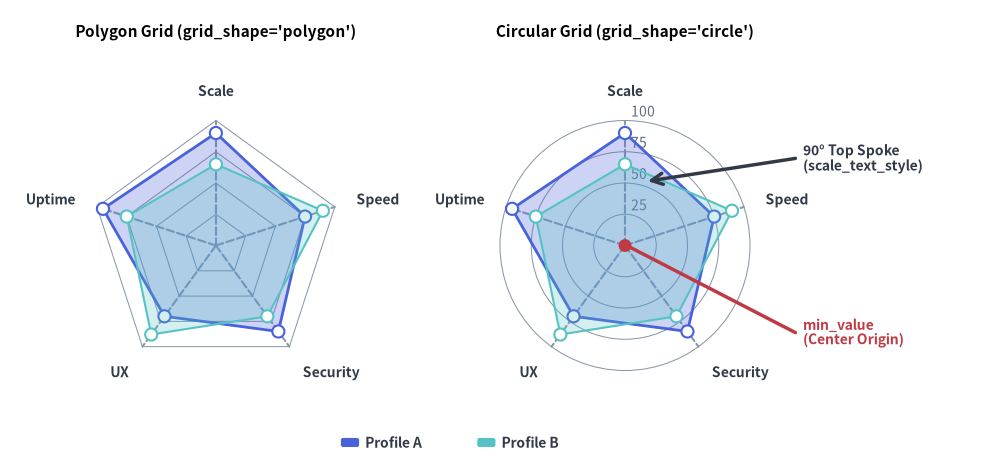
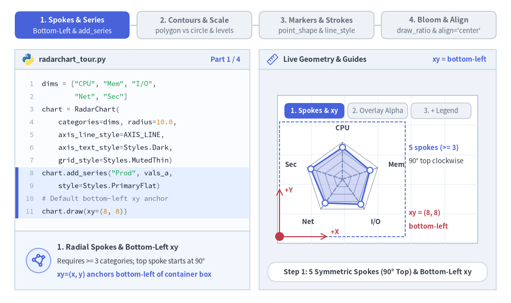
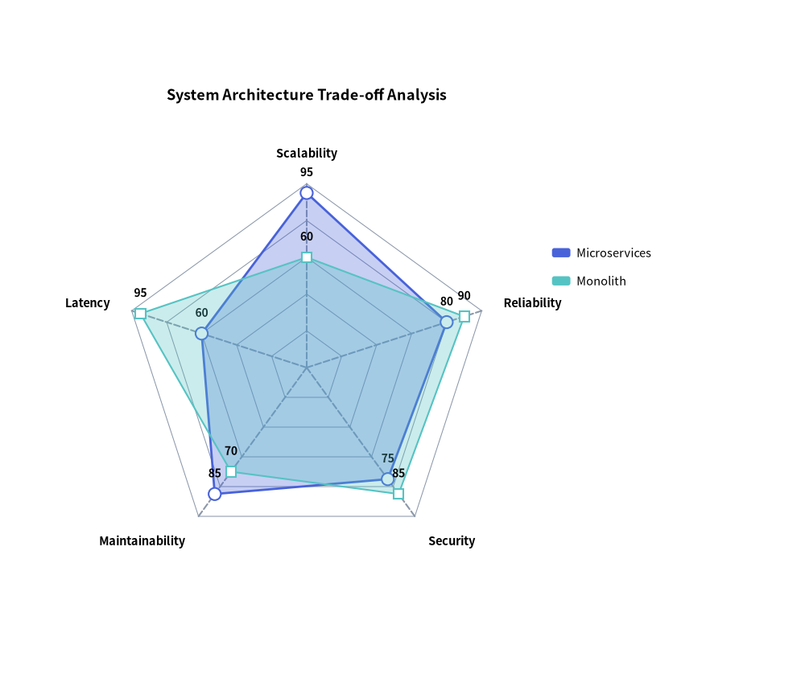
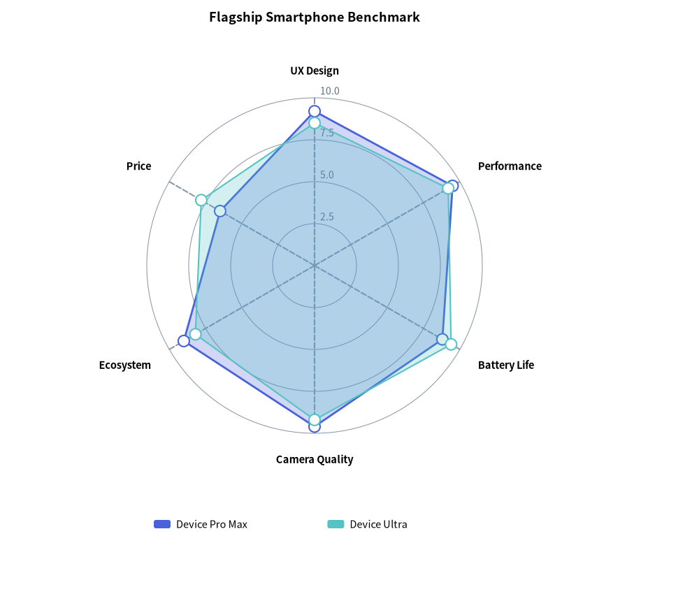

# Radar Chart（レーダーチャート）：多変量評価とスパイダープロット

`RadarChart`（`drawlib.charts.radar`、別名スパイダーチャート／スターチャート）は、共通の中心原点から放射状に伸びる 3 軸以上の対称な次元にわたって多変量プロファイルを評価します。スキルマトリクス、競合ベンチマーク比較、システムアーキテクチャのトレードオフ分析などに幅広く活用されます。


<figure class="drawlib-image" style="text-align: center;">
  
  <figcaption class="drawlib-caption">RadarChart の放射グリッド形状：多角形コンター (polygon) と円形コンター (circle)</figcaption>
</figure>

<details class="drawlib-code-details">
<summary>Source Code</summary>

```python
from drawlib.canvas import save, setup
from drawlib.charts.radar import RadarChart
from drawlib.lines import line
from drawlib.shapes import circle
from drawlib.styles import Styles
from drawlib.text import text

setup(width=132, height=62)

dims = ["Scale", "Speed", "Security", "UX", "Uptime"]
vals_a = [90, 75, 85, 70, 95]
vals_b = [65, 90, 70, 88, 75]

# Left: Polygon Grid
poly_radar = RadarChart(
    categories=dims,
    axis_line_style=Styles.MutedDashed,
    axis_text_style=Styles.DarkBold.patch(text_size=10.0),
    grid_style=Styles.MutedThin,
    radius=16.5,
    min_value=0.0,
    max_value=100.0,
    levels=4,
    grid_shape="polygon",
    title="Polygon Grid (grid_shape='polygon')",
    title_style=Styles.BlackBold.patch(text_size=11.0),
)
poly_radar.add_series("Profile A", vals_a, style=Styles.PrimaryFlat, fill_alpha=0.28)
poly_radar.add_series("Profile B", vals_b, style=Styles.SecondaryNeutral, fill_alpha=0.25, line_style="dashed")
poly_radar.draw(xy=(4.0, 5.0))

# Right: Circular Grid with Scale Labels
circ_radar = RadarChart(
    categories=dims,
    axis_line_style=Styles.MutedDashed,
    axis_text_style=Styles.DarkBold.patch(text_size=10.0),
    grid_style=Styles.MutedThin,
    scale_text_style=Styles.Muted.patch(text_size=10.0),
    scale_format="{:.0f}",
    radius=16.5,
    min_value=0.0,
    max_value=100.0,
    levels=4,
    grid_shape="circle",
    title="Circular Grid (grid_shape='circle')",
    title_style=Styles.BlackBold.patch(text_size=11.0),
)
circ_radar.add_series("Profile A", vals_a, style=Styles.PrimaryFlat, fill_alpha=0.28)
circ_radar.add_series("Profile B", vals_b, style=Styles.SecondaryNeutral, fill_alpha=0.25, line_style="dashed")
circ_radar.draw(xy=(58.0, 5.0))

# Callout annotations on Right RadarChart using exact center coordinates
rw, rh = circ_radar.get_size()
rcx = 58.0 + rw / 2.0
rcy = 5.0 + (rh - 6.0) / 2.0

circle((rcx, rcy), radius=0.85, style=Styles.DangerFlat)
line((rcx + 0.8, rcy - 0.3), (105.0, 18.0), style=Styles.DangerBold)
text((106.0, 18.0), "min_value\n(Center Origin)", style=Styles.DangerBold.patch(text_size=10.0, halign="left"))

line((rcx + 3.0, rcy + 8.5), (105.0, 41.0), arrow_head="<-", style=Styles.DarkBold)
text((106.0, 41.0), "90° Top Spoke\n(scale_text_style)", style=Styles.DarkBold.patch(text_size=10.0, halign="left"))

circ_radar.draw_legend(xy=(45.0, 3.5), text_style=Styles.DarkBold.patch(text_size=10.0), orientation="horizontal")
save()
```

</details>


---

## 1. 基本概念と基本的な使い方

`RadarChart` は 3 本以上の対称な放射軸（`categories`、`axis_line_style`）にわたって閉じた多変量ポリゴンを描画し、デフォルトでコンテナボックスの**左下 `(x, y)`** を基準にアンカーします（`align="center"` でレーダーの中心ハブに直接ピン留めも可）。直線的なスパイダーウェブ（`grid_shape="polygon"`）と同心円リング（`grid_shape="circle"`）の切り替え、スケール目盛り（`configure_axis`）・頂点マーカー（`point_shape`）・線種パターン（`line_style`）の調整、および中心から外側へ広がる放射アニメーション（`draw_ratio`）をサポートしています。


<figure class="drawlib-image" style="text-align: center;">
  
  <figcaption class="drawlib-caption">基本的な使い方とパラメータツアー：放射軸と系列、コンター形状とスケール、マーカーと線種、放射展開と中央配置（APNG アニメーション）</figcaption>
</figure>


<div class="drawlib-source-link">
  <a href="https://github.com/yuichi110/drawlib/blob/main/docs/docs_src/ja/05_charts/radar.md" target="_blank" rel="noopener noreferrer">GitHub でアニメーションのソースコードを見る &rarr;</a>
</div>

- **放射スポーク・重ね合わせ系列・アンカー（`categories`, `add_series`, `fill_alpha`）**: `3` 軸以上の対称な放射軸（`90°` の上端スポークから時計回りに配置）を定義し、左下 `xy` にアンカーされた半透明の系列ポリゴン（`fill_alpha=0.25`）を重ね合わせ、`chart.draw_legend(...)` と組み合わせます。
- **多角形／円形の等高線グリッドとスケール（`grid_shape`, `configure_axis`, `scale_text_style`）**: `levels` 個の同心リングに対して `"polygon"` のクモの巣グリッドまたは `"circle"` の極座標リングを選択でき、`configure_axis(...)` で放射スケールの範囲（`min_value`、`max_value`、`scale_format`）を調整できます。
- **頂点マーカー・線種パターン・数値ラベル（`point_shape`, `line_style`, `value_text_style`）**: `line_style`（`"solid"`、`"dashed"`、`"dotted"`、`"dashdot"`）、`point_shape`（`"circle"`、`"square"`、`"none"`）、および任意の頂点数値ラベル（`value_text_style`）によって、ベースラインと注目プロファイルを明確に区別できます。
- **放射状展開・表示切替・ハブ中心ピン留め（`draw_ratio`, `show`, `align="center"`）**: `draw_ratio`（`"bottom_to_top"` または `"left_to_right"`）で中心ハブから外側へ系列を展開したり、`series.show = False` で個別プロファイルを非表示化したり、`align="center"` を渡して `xy=(cx, cy)` をレーダーの中心ハブにピン留めしたりできます。

---

## 2. 多角形グリッドによるアーキテクチャ比較

多角形グリッド線（`grid_shape="polygon"`）は放射スポークと直線で結ばれるため、非機能要件全体にわたるアーキテクチャ上のトレードオフを比較しやすくなります。


```python
from drawlib.canvas import save, setup
from drawlib.charts.radar import RadarChart
from drawlib.styles import Styles

setup(width=105, height=88)

chart = RadarChart(
    categories=["Scalability", "Reliability", "Security", "Maintainability", "Latency"],
    axis_line_style=Styles.MutedDashed,
    axis_text_style=Styles.BlackBold.patch(text_size=10.5),
    grid_style=Styles.MutedThin,
    value_text_style=Styles.BlackBold.patch(text_size=10.0),
    radius=24.0,
    min_value=0.0,
    max_value=100.0,
    levels=5,
    grid_shape="polygon",
    title="System Architecture Trade-off Analysis",
    title_style=Styles.BlackBold.patch(text_size=13.0),
    value_format="{:.0f}",
)
chart.add_series("Microservices", [95, 80, 75, 85, 60], style=Styles.PrimaryFlat, fill_alpha=0.3)
chart.add_series(
    "Monolith",
    [60, 90, 85, 70, 95],
    style=Styles.SecondaryNeutral,
    fill_alpha=0.3,
    line_style="dashed",
    point_shape="square",
)

chart.draw(xy=(8.0, 8.0))
chart.draw_legend(xy=(72.0, 55.0), text_style=Styles.Black.patch(text_size=10.5))
save()
```

<figure class="drawlib-image" style="text-align: center;">
  
  <figcaption class="drawlib-caption">システムアーキテクチャの非機能要件分析</figcaption>
</figure>


---

## 3. 円形グリッドによる製品ベンチマーク

`grid_shape="circle"` に `scale_text_style` と `configure_axis(...)` を組み合わせると、数値スケールラベル付きの滑らかな同心円リングを描画できます。


```python
from drawlib.canvas import save, setup
from drawlib.charts.radar import RadarChart
from drawlib.styles import Styles

setup(width=100, height=85)

chart = RadarChart(
    categories=["UX Design", "Performance", "Battery Life", "Camera Quality", "Ecosystem", "Price"],
    axis_line_style=Styles.MutedDashed,
    axis_text_style=Styles.BlackBold.patch(text_size=10.5),
    grid_style=Styles.MutedThin,
    scale_text_style=Styles.Muted.patch(text_size=10.0),
    radius=24.0,
    levels=4,
    grid_shape="circle",
    title="Flagship Smartphone Benchmark",
    title_style=Styles.BlackBold.patch(text_size=13.0),
)
chart.configure_axis(min_value=0.0, max_value=10.0, levels=4, scale_format="{:.1f}")
chart.add_series("Device Pro Max", [9.2, 9.5, 8.8, 9.6, 9.0, 6.5], style=Styles.PrimaryFlat)
chart.add_series("Device Ultra", [8.5, 9.2, 9.4, 9.2, 8.2, 7.8], style=Styles.SecondaryNeutral, line_style="dashed")

chart.draw(xy=(13.0, 15.0))
chart.draw_legend(xy=(22.0, 10.0), text_style=Styles.Black.patch(text_size=10.5), orientation="horizontal")
save()
```

<figure class="drawlib-image" style="text-align: center;">
  
  <figcaption class="drawlib-caption">円形グリッドを用いたデバイス機能マトリクス</figcaption>
</figure>


---

## 4. API リファレンス

### コンストラクタ（`RadarChart`）

すべてのコンストラクタ引数は**キーワード専用引数**（`*`）です。

```python
from drawlib.charts.radar import DrawDirection, FormatterType, GridShape, RadarChart, Series

chart = RadarChart(
    *,
    categories: list[str],
    axis_line_style: Style,
    radius: float = 25.0,
    min_value: float = 0.0,
    max_value: float | None = None,
    levels: int = 5,
    grid_shape: GridShape = "polygon",
    axis_text_style: Style | None = None,
    grid_style: Style | None = None,
    scale_text_style: Style | None = None,
    scale_format: FormatterType = None,
    value_text_style: Style | None = None,
    value_format: FormatterType = None,
    background_style: Style | None = None,
    title: str = "",
    title_style: Style | None = None,
    width: float | None = None,
    height: float | None = None,
)
```

| パラメータ | 型 | デフォルト | 説明 |
| :--- | :--- | :--- | :--- |
| **`categories`** | `list[str]` | **必須** | 外周に沿った放射評価軸の名称リスト（**最低 3 要素が必須**。3 未満の場合は `ValueError` が送出されます）。 |
| **`axis_line_style`** | `Style` | **必須** | 放射スポーク線に用いる必須アンカースタイル。 |
| `radius` | `float` | `25.0` | キャンバス単位でのレーダー網の外周半径。 |
| `min_value` | `float` | `0.0` | 中心原点におけるベースラインデータ値。 |
| `max_value` | `float \| None` | `None` | 外周境界のスケール値。`None` の場合は系列データから自動算出されます。 |
| `levels` | `int` | `5` | 同心グリッドリングの段数（最小 `1`）。 |
| `grid_shape` | `"polygon"` \| `"circle"` | `"polygon"` | 同心グリッド輪郭の幾何形状（`GridShape`）。 |
| `axis_text_style` | `Style \| None` | `None` | 外周のカテゴリラベルのスタイル。`None` の場合は省略されます。 |
| `grid_style` | `Style \| None` | `None` | 同心グリッドリングのスタイル。`None` の場合は省略されます。 |
| `scale_text_style` | `Style \| None` | `None` | 上端スポークに沿って描画される数値スケールラベルのスタイル。`None` の場合は省略されます。 |
| `scale_format` | `FormatterType` | `None` | 同心リングのスケールラベル用のフォーマット文字列または `Callable[[float], str]`。 |
| `value_text_style` | `Style \| None` | `None` | 系列の各頂点横に描画される数値ラベルのスタイル。`None` の場合は省略されます。 |
| `value_format` | `FormatterType` | `None` | 系列の頂点数値用のフォーマット文字列または `Callable[[float], str]`。 |
| `background_style` | `Style \| None` | `None` | チャート外枠の背景カードのスタイル。`None` の場合は省略されます。 |
| `title` | `str` | `""` | コンテナ上部に描画されるチャートタイトル文字列。 |
| `title_style` | `Style \| None` | `None` | `title` のタイポグラフィスタイル。タイトルを描画するには必須です。 |
| `width` / `height` | `float \| None` | `None` | 明示的なコンテナ寸法。`None` の場合は `radius` と `title` から自動算出されます。 |

### メソッドとプロパティ

- **`configure_axis(*, min_value: float | None = None, max_value: float | None = None, levels: int | None = None, scale_format: FormatterType = None) -> RadarChart`**:
  放射スケールの範囲、同心リング数、およびスケールラベルのフォーマットをインプレースで更新します（メソッドチェーン用に `self` を返します）。
- **`add_series(name: str, values: list[float], style: Style, fill_alpha: float = 0.25, line_width: float = 2.0, line_style: LineStyle = "solid", point_shape: PointShape = "circle", point_size: float = 0.8, legend_text_style: Style | None = None, *, show: bool = True, draw_ratio: float = 1.0, draw_direction: DrawDirection = "bottom_to_top") -> Series`**:
  閉じたレーダー多角形系列を登録し、変更可能な `Series` インスタンスを返します。
  - `fill_alpha`: ポリゴン塗りつぶしの不透明度（`0.0`〜`1.0`、デフォルトは `0.25`）。
  - `line_width` / `line_style`: 外周ストロークの線幅（`2.0`）と線種パターン（`"solid"`、`"dashed"`、`"dotted"`、`"dashdot"`）。
  - `point_shape` / `point_size`: 頂点マーカーの形状（`"circle"`、`"square"`、`"none"`）と半径（`0.8`）。
  - `draw_ratio` & `draw_direction`: 部分空間レンダリング制御（`"bottom_to_top"` はすべての頂点を中心から放射状に外側へ展開し、`"left_to_right"` は外周に沿ってスポーク順にスイープします）。
- **`get_size() -> tuple[float, float]`**:
  算出されたチャートコンテナの `(width, height)` バウンディングボックスを返します。
- **`draw(xy: tuple[float, float] = (0.0, 0.0), *, radius: float | None = None, width: float | None = None, height: float | None = None, align: Literal["bottom_left", "center"] = "bottom_left", scale: float = 1.0) -> None`**:
  `xy` を基準（デフォルトは `"bottom_left"`、または `"center"`）としてチャートを描画します。一時的な `radius`/`width`/`height` の上書きや均一な `scale` にも対応しています。
- **`draw_legend(xy: tuple[float, float], text_style: Style, orientation: Literal["vertical", "horizontal"] = "vertical", swatch_width: float = 2.4, swatch_height: float = 1.2, item_gap: float = 4.0, *, scale: float = 1.0) -> None`**:
  分離配置された系列凡例を `xy` に描画します。
- **プロパティ**:
  - **`chart.categories -> list[str]`**: 放射評価軸の名称リストのコピーを返します。
  - **`chart.series -> list[Series]`**: 登録済み `Series` オブジェクトのコピーを返します。
