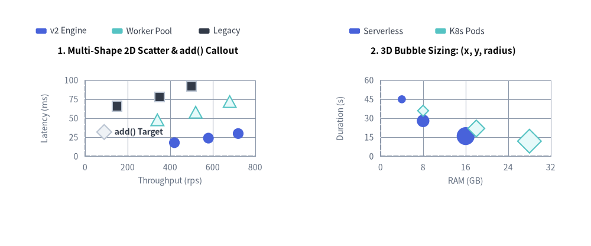
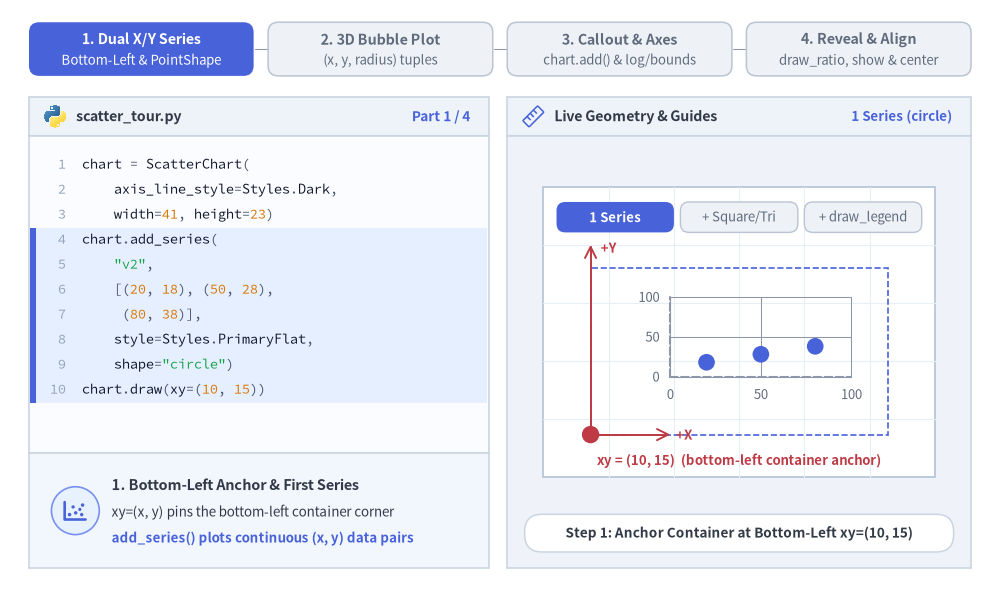
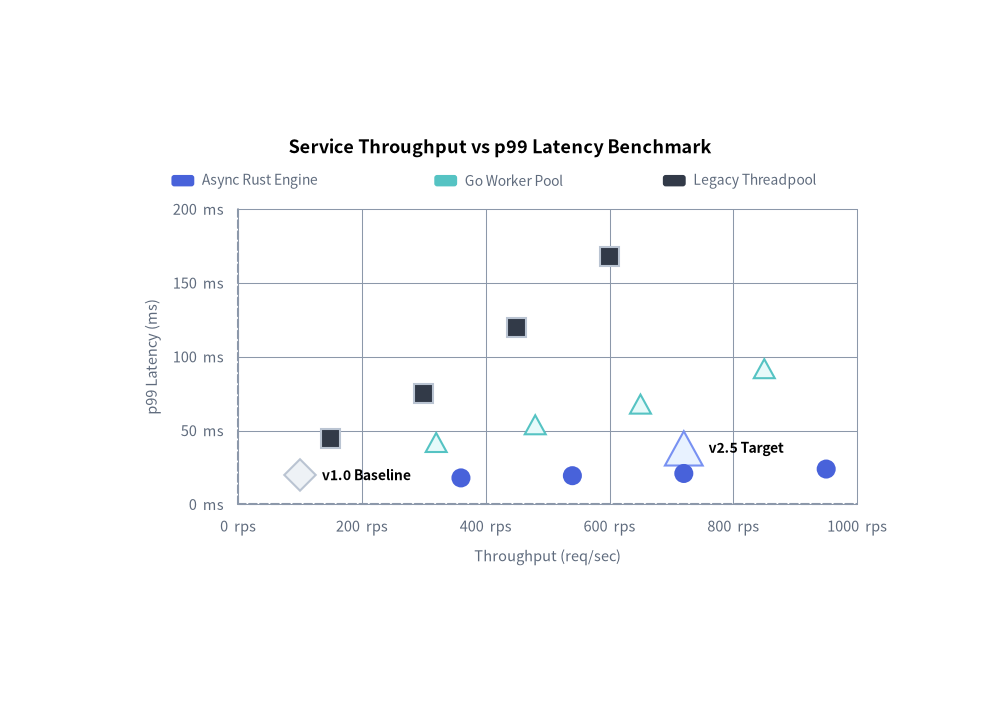
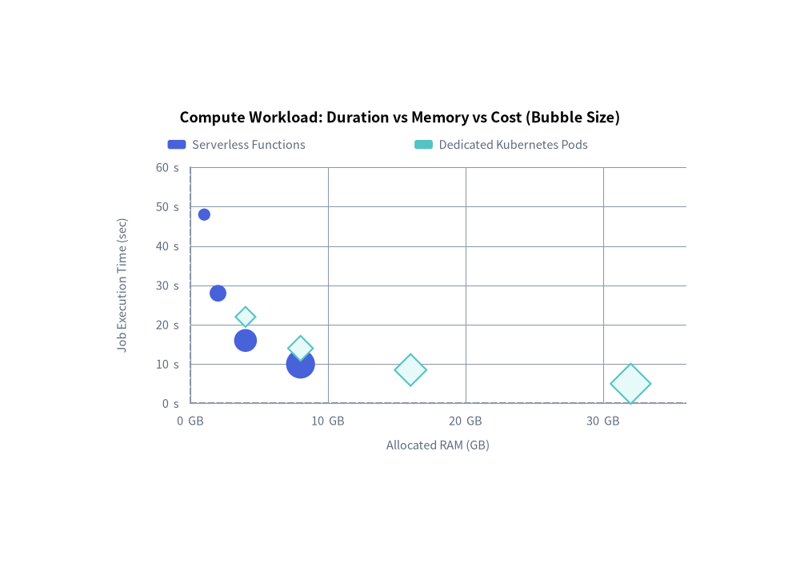

# Scatter Chart（散布図）：2 軸プロットと多次元バブルチャート

`ScatterChart`（`drawlib.charts.scatter`）は、2 つの独立した直交座標軸（`X` 軸と `Y` 軸）上に連続数値データをプロットします。統計的な相関関係やクラスタ分布の把握、レイテンシ対スループットのトレードオフ分析、およびマーカー半径で第 3 の数値変数を表現する 3D バブル分析に最適です。


<figure class="drawlib-image" style="text-align: center;">
  
  <figcaption class="drawlib-caption">ScatterChart のトポロジ：複数マーカー形状の 2D 散布図と 3D バブルサイズ表現</figcaption>
</figure>

<details class="drawlib-code-details">
<summary>Source Code</summary>

```python
from drawlib.canvas import save, setup
from drawlib.charts.scatter import ScatterChart
from drawlib.styles import Styles

setup(width=132, height=55)

# Left: 2D Scatter with Multiple PointShapes & add() Callout
scatter_2d = ScatterChart(
    axis_line_style=Styles.MutedDashed,
    axis_text_style=Styles.Muted.patch(text_size=10.0),
    value_text_style=Styles.DarkBold.patch(text_size=10.0),
    grid_style=Styles.MutedThin,
    width=58.0,
    height=38.0,
    title="1. Multi-Shape 2D Scatter & add() Callout",
    title_style=Styles.BlackBold.patch(text_size=11.0),
)
scatter_2d.configure_x_axis(label="Throughput (rps)", min_value=0, max_value=800, tick_step=200)
scatter_2d.configure_y_axis(label="Latency (ms)", min_value=0, max_value=100, tick_step=25)

scatter_2d.add(xy=(90, 32), style=Styles.Neutral, radius=1.5, shape="rhombus", label="add() Target")
scatter_2d.add_series("v2 Engine", [(420, 18), (580, 24), (720, 30)], style=Styles.PrimaryFlat, shape="circle", radius=1.2)
scatter_2d.add_series("Worker Pool", [(340, 48), (520, 58), (680, 72)], style=Styles.SecondaryNeutral, shape="triangle", radius=1.3)
scatter_2d.add_series("Legacy", [(150, 66), (350, 78), (500, 92)], style=Styles.Dark, shape="square", radius=1.1)
scatter_2d.draw(xy=(4.0, 8.0))
scatter_2d.draw_legend(xy=(8.0, 48.0), text_style=Styles.Dark.patch(text_size=10.0), orientation="horizontal", item_gap=3.0)

# Right: 3D Proportional Bubble Plot (x, y, radius)
bubble_3d = ScatterChart(
    axis_line_style=Styles.MutedDashed,
    axis_text_style=Styles.Muted.patch(text_size=10.0),
    grid_style=Styles.MutedThin,
    width=58.0,
    height=38.0,
    title="2. 3D Bubble Sizing: (x, y, radius)",
    title_style=Styles.BlackBold.patch(text_size=11.0),
)
bubble_3d.configure_x_axis(label="RAM (GB)", min_value=0, max_value=32, tick_step=8)
bubble_3d.configure_y_axis(label="Duration (s)", min_value=0, max_value=60, tick_step=15)

bubble_3d.add_series(
    "Serverless",
    [(4, 45, 0.9), (8, 28, 1.4), (16, 16, 2.0)],
    style=Styles.PrimaryFlat,
    shape="circle",
)
bubble_3d.add_series(
    "K8s Pods",
    [(8, 36, 1.1), (18, 22, 1.7), (28, 12, 2.4)],
    style=Styles.SecondaryNeutral,
    shape="rhombus",
)
bubble_3d.draw(xy=(70.0, 8.0))
bubble_3d.draw_legend(xy=(78.0, 48.0), text_style=Styles.Dark.patch(text_size=10.0), orientation="horizontal", item_gap=4.0)

save()
```

</details>


---

## 1. 基本概念と基本的な使い方

`ScatterChart` は独立した X 軸・Y 軸上に連続数値データをプロットし、デフォルトでコンテナの**左下 `(x, y)`** を基準にアンカーします（`align="center"` で中央揃えも可）。`.add_series(...)` による複数形状のデータ系列登録、3 要素タプル `(x, y, radius)` を用いた第 3 指標のマーカー半径エンコーディング、`.add(...)` による個別外れ値・基準点のピンポイント注釈、線形軸／対数軸の調整、および `draw_ratio` や `show` による段階的表示アニメーションに対応しています。


<figure class="drawlib-image" style="text-align: center;">
  
  <figcaption class="drawlib-caption">基本的な使い方とパラメータツアー：2 軸系列、3D バブルサイズ、ポイント注釈と対数軸、段階的スイープ表示（APNG アニメーション）</figcaption>
</figure>


<div class="drawlib-source-link">
  <a href="https://github.com/yuichi110/drawlib/blob/main/docs/docs_src/ja/05_charts/scatter.md" target="_blank" rel="noopener noreferrer">GitHub でアニメーションのソースコードを見る &rarr;</a>
</div>

- **2 軸連続値系列とマーカー形状（`xy`, `PointShape`, `draw_legend`）**: デフォルトで**左下** `xy` にアンカーされた連続 `(x, y)` 系列をプロットし、`"circle"`、`"square"`、`"triangle"`、`"rhombus"` で実験系統を区別し、`draw_legend(...)` で分離配置された凡例を描画します。
- **3 次元比例バブルサイズ（`(x, y, radius)`）**: `add_series(...)` に 3 要素タプル `(x, y, r)` と落ち着いた半透明スタイル（`Styles.PrimaryNeutral`、`Styles.SecondaryNeutral`）を渡すことで、画面を煩雑にせずマーカー半径で第 3 の変数を表現できます。
- **個別コールアウトと軸スケール（`add()`, `scale="log"`）**: `chart.add(...)` で特定の目標点や外れ値にインラインラベルを付与でき、`configure_x_axis` / `configure_y_axis` で線形範囲の固定、`unit` 接尾辞、または桁ごとの `"log"` 対数スケールを設定できます。
- **段階的表示と中央配置（`draw_ratio`, `show`, `align`）**: `draw_ratio` でスイープアニメーションを描画したり、X/Y 軸のスケール範囲を固定したまま `series.show = False` を切り替えたり、`draw(xy, align="center")` で `(cx, cy)` を中心にチャートコンテナを配置したりできます。

---

## 2. ベースライン注釈とマーカー形状を組み合わせたベンチマーク散布図

複数系列の計測結果（`"circle"`、`"square"`、`"triangle"`）と個別に注釈を付けた基準点（`"rhombus"`）を組み合わせることで、システム性能の比較から具体的な判断を即座に導き出せます。


```python
from drawlib.canvas import save, setup
from drawlib.charts.scatter import ScatterChart
from drawlib.styles import Styles

setup(width=105, height=75)

chart = ScatterChart(
    axis_line_style=Styles.MutedDashed,
    axis_text_style=Styles.Muted.patch(text_size=10.5),
    value_text_style=Styles.BlackBold.patch(text_size=10.0),
    grid_style=Styles.MutedThin,
    width=85.0,
    height=52.0,
    title="Service Throughput vs p99 Latency Benchmark",
    title_style=Styles.BlackBold.patch(text_size=13.0),
)
chart.configure_x_axis(label="Throughput (req/sec)", unit=" rps", min_value=0, max_value=1000)
chart.configure_y_axis(label="p99 Latency (ms)", unit=" ms", min_value=0, max_value=200)

# 1. Annotated Reference Points with Rhombus & Triangle Shapes
chart.add(xy=(100.0, 20.0), style=Styles.Neutral, radius=1.5, shape="rhombus", label="v1.0 Baseline")
chart.add(xy=(720.0, 38.0), style=Styles.PrimaryNeutral, radius=1.8, shape="triangle", label="v2.5 Target")

# 2. Multi-Series Experimental Runs
chart.add_series(
    name="Async Rust Engine",
    data=[(360, 18.0), (540, 19.5), (720, 21.0), (950, 24.0)],
    style=Styles.PrimaryFlat,
    shape="circle",
)
chart.add_series(
    name="Go Worker Pool",
    data=[(320, 42.0), (480, 54.0), (650, 68.0), (850, 92.0)],
    style=Styles.SecondaryNeutral,
    shape="triangle",
)
chart.add_series(
    name="Legacy Threadpool",
    data=[(150, 45.0), (300, 75.0), (450, 120.0), (600, 168.0)],
    style=Styles.Dark,
    shape="square",
)

chart.draw(xy=(10.0, 10.0))
chart.draw_legend(xy=(18.0, 56.0), text_style=Styles.Muted.patch(text_size=10.0), orientation="horizontal")
save()
```

<figure class="drawlib-image" style="text-align: center;">
  
  <figcaption class="drawlib-caption">マーカー形状別に比較したスループット対 p99 レイテンシのベンチマーク</figcaption>
</figure>


---

## 3. クラウドコストの多次元バブルチャート

`add_series(data=...)` に 3 要素タプル `(x, y, radius)` を渡すことで、各点の半径に第 3 の数値次元をエンコードできます。


```python
from drawlib.canvas import save, setup
from drawlib.charts.scatter import ScatterChart
from drawlib.styles import Styles

setup(width=105, height=75)

chart = ScatterChart(
    axis_line_style=Styles.MutedDashed,
    axis_text_style=Styles.Muted.patch(text_size=10.5),
    grid_style=Styles.MutedThin,
    width=85.0,
    height=52.0,
    title="Compute Workload: Duration vs Memory vs Cost (Bubble Size)",
    title_style=Styles.BlackBold.patch(text_size=13.0),
)
chart.configure_x_axis(label="Allocated RAM (GB)", unit=" GB", min_value=0, max_value=36)
chart.configure_y_axis(label="Job Execution Time (sec)", unit=" s", min_value=0, max_value=60)

# 3-Tuples encode: (RAM_GB, Execution_Time_Sec, Relative_Monthly_Cost_Radius)
chart.add_series(
    name="Serverless Functions",
    data=[(1.0, 48.0, 0.8), (2.0, 28.0, 1.1), (4.0, 16.0, 1.5), (8.0, 10.0, 1.9)],
    style=Styles.PrimaryFlat,
    shape="circle",
)
chart.add_series(
    name="Dedicated Kubernetes Pods",
    data=[(4.0, 22.0, 1.2), (8.0, 14.0, 1.5), (16.0, 8.5, 1.9), (32.0, 5.0, 2.4)],
    style=Styles.SecondaryNeutral,
    shape="rhombus",
)

chart.draw(xy=(10.0, 10.0))
chart.draw_legend(xy=(22.0, 56.0), text_style=Styles.Muted.patch(text_size=10.5), orientation="horizontal")
save()
```

<figure class="drawlib-image" style="text-align: center;">
  
  <figcaption class="drawlib-caption">コンピュートワークロードの多次元バブルプロット</figcaption>
</figure>


---

## 4. API リファレンス

### コンストラクタ（`ScatterChart`）

すべてのコンストラクタ引数は**キーワード専用引数**（`*`）です。

```python
from drawlib.charts.scatter import Axis, DrawDirection, Point, PointShape, ScaleType, ScatterChart, Series

chart = ScatterChart(
    *,
    axis_line_style: Style,
    width: float = 88.0,
    height: float = 55.0,
    default_radius: float = 1.0,
    default_shape: PointShape = "circle",
    axis_text_style: Style | None = None,
    grid_style: Style | None = None,
    value_text_style: Style | None = None,
    background_style: Style | None = None,
    title: str = "",
    title_style: Style | None = None,
)
```

| パラメータ | 型 | デフォルト | 説明 |
| :--- | :--- | :--- | :--- |
| **`axis_line_style`** | `Style` | **必須** | X 軸および Y 軸の座標ベースラインストロークに用いる必須アンカースタイル。 |
| `width` / `height` | `float` | `88.0` / `55.0` | キャンバス単位でのチャート全体のバウンディングボックス寸法。 |
| `default_radius` | `float` | `1.0` | `add()` または `add_series()` で `radius` を省略した際のデフォルトマーカー半径。 |
| `default_shape` | `"circle"` \| `"square"` \| `"rhombus"` \| `"triangle"` \| `"none"` | `"circle"` | `shape` を省略した際のデフォルトマーカー形状（`PointShape`）。 |
| `axis_text_style` | `Style \| None` | `None` | X 軸・Y 軸の目盛りラベルおよび軸タイトルのスタイル。`None` の場合は省略されます。 |
| `grid_style` | `Style \| None` | `None` | 水平・垂直方向の直交グリッド線のスタイル。`None` の場合は省略されます。 |
| `value_text_style` | `Style \| None` | `None` | 点ごとの `label_style` が未指定の場合に点テキスト注釈（`Point.label`）へ適用されるデフォルトスタイル。 |
| `background_style` | `Style \| None` | `None` | チャート外枠の背景カードのスタイル。`None` の場合は省略されます。 |
| `title` | `str` | `""` | コンテナ上部に描画されるチャートタイトル文字列。 |
| `title_style` | `Style \| None` | `None` | `title` のタイポグラフィスタイル。タイトルを描画するには必須です。 |

### メソッドとプロパティ

- **`add(xy: tuple[float, float], style: Style, radius: float | None = None, shape: PointShape | None = None, label: str = "", label_style: Style | None = None, *, show: bool = True) -> Point`**:
  単独の `(x, y)` データ点を登録し、変更可能な `Point` インスタンスを返します。
  - `radius` / `shape`: 点単位でのマーカーサイズおよび形状の上書き（`"circle"`、`"square"`、`"rhombus"`、`"triangle"`、`"none"`）。
  - `label` / `label_style`: 点の横に描画される任意のコールアウトテキスト（`label_style` を使用し、未指定時は `chart.value_text_style` にフォールバックします）。
- **`add_series(name: str, data: list[tuple[float, float]] | list[tuple[float, float, float]], style: Style, radius: float | None = None, shape: PointShape | None = None, legend_text_style: Style | None = None, *, show: bool = True, draw_ratio: float = 1.0, draw_direction: DrawDirection = "left_to_right") -> Series`**:
  名前付きの `(x, y)` または `(x, y, radius)` データ点グループを登録し、変更可能な `Series` インスタンスを返します。
  - `draw_ratio` & `draw_direction`: 部分空間レンダリング制御（`"left_to_right"` は X 軸の範囲に沿って左から右へ段階的に点を表示し、`"bottom_to_top"` は半径を `draw_ratio` 倍にスケールしながら下端軸から本来の位置へせり上げます）。
- **`configure_x_axis(...) -> Axis`** / **`configure_y_axis(...) -> Axis`**:
  連続数値の X 軸または Y 軸の範囲、線形／対数スケール、目盛り間隔、フォーマッタ、単位、および軸ラベルを設定します。詳細は **[軸・スケール・凡例](./axes_and_legends.md)** を参照してください。
- **`get_size() -> tuple[float, float]`**:
  チャートコンテナの `(width, height)` を返します。
- **`draw(xy: tuple[float, float] = (0.0, 0.0), *, width: float | None = None, height: float | None = None, align: Literal["bottom_left", "center"] = "bottom_left", scale: float = 1.0) -> None`**:
  左下 `xy` を基準（`align="center"` の場合は `xy` を中心）としてチャートを描画します。一時的な寸法上書きや比例 `scale` にも対応しています。
- **`draw_legend(xy: tuple[float, float], text_style: Style, orientation: Literal["vertical", "horizontal"] = "vertical", swatch_width: float = 2.4, swatch_height: float = 1.2, item_gap: float = 4.0, *, scale: float = 1.0) -> None`**:
  分離配置された系列凡例を `xy` に描画します。
- **プロパティ**:
  - **`chart.points -> list[Point]`**: `add()` で登録された単独 `Point` オブジェクトのコピーを返します。
  - **`chart.series -> list[Series]`**: `add_series()` で登録された `Series` オブジェクトのコピーを返します。
  - **`chart.x_axis -> Axis`** / **`chart.y_axis -> Axis`**: 水平軸・垂直軸の `Axis` インスタンスへの直接アクセスを提供します。

