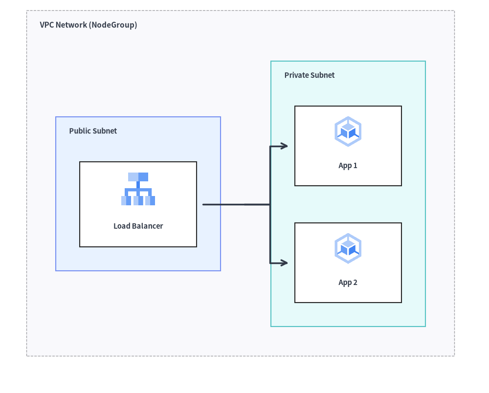
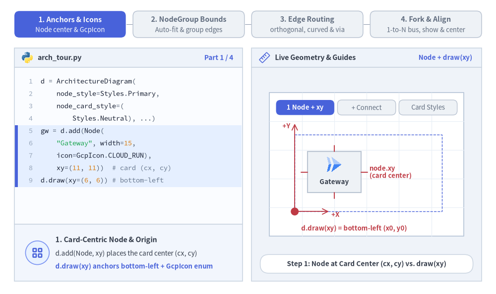
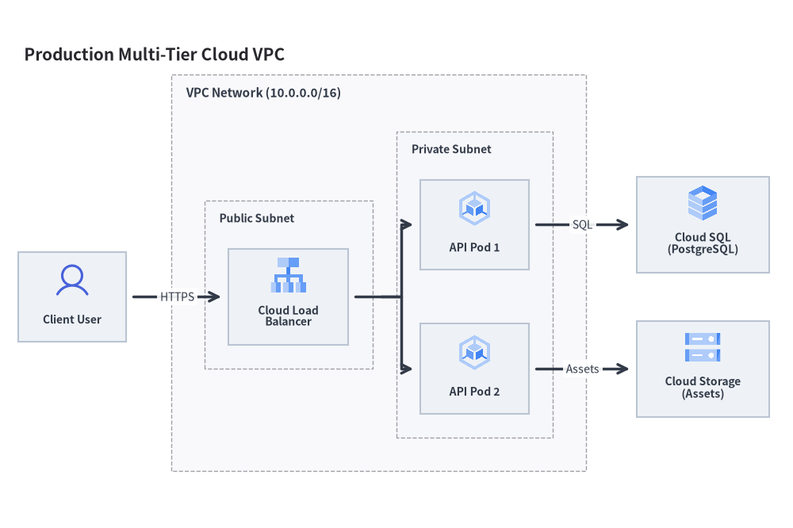
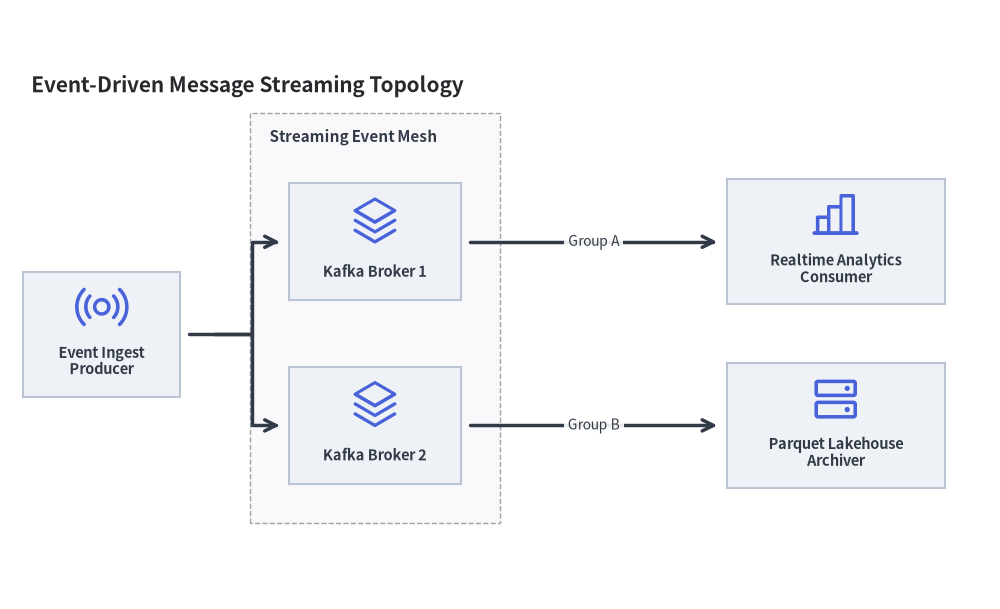

# アーキテクチャ図: クラウドトポロジ・マイクロサービス・VPC 境界

`ArchitectureDiagram` は、分散システム、クラウドネットワーク、マイクロサービストポロジ、およびインフラストラクチャ境界を可視化します。アイコン中心のノードと、自動サイズ調整される階層型境界ボックス（`NodeGroup`）および多方向分岐ルーティングを組み合わせて表現します。


<figure class="drawlib-image" style="text-align: center;">
  
  <figcaption class="drawlib-caption">ネストされた NodeGroup (VPC とサブネット) および境界をまたぐ接続</figcaption>
</figure>

<details class="drawlib-code-details">
<summary>Source Code</summary>

```python
from drawlib.canvas import save, setup
from drawlib.diagrams.architecture import ArchitectureDiagram, GcpIcon, Node, NodeGroup
from drawlib.styles import Styles

setup(width=92, height=74)

d = ArchitectureDiagram(
    node_style=Styles.Primary,
    node_text_style=Styles.DarkBold.patch(text_size=10.5),
    edge_style=Styles.DarkBold,
    edge_text_style=Styles.Dark.patch(text_size=10.5),
    node_card_style=Styles.Neutral,
)

vpc = d.add(
    NodeGroup(
        title="VPC Network (NodeGroup)",
        padding=5.5,
        text_style=Styles.DarkBold.patch(text_size=11.0, halign="left", valign="top"),
    ),
    xy=(3.0, 3.0),
)

pub_subnet = vpc.add(
    NodeGroup(
        title="Public Subnet",
        padding=4.5,
        style=Styles.PrimaryNeutral,
        text_style=Styles.DarkBold.patch(text_size=10.5, halign="left", valign="top"),
    ),
    xy=(5.5, 5.5),
)
lb = pub_subnet.add(
    Node("Load Balancer", width=22, height=16, icon=GcpIcon.CLOUD_LOAD_BALANCING, icon_size=7.0, card_style=Styles.White),
    xy=(14.5, 24.0),
)

priv_subnet = vpc.add(
    NodeGroup(
        title="Private Subnet",
        padding=4.5,
        style=Styles.SecondaryNeutral,
        text_style=Styles.DarkBold.patch(text_size=10.5, halign="left", valign="top"),
    ),
    xy=(46.0, 5.5),
)
app1 = priv_subnet.add(
    Node("App 1", width=20, height=15, icon=GcpIcon.GOOGLE_KUBERNETES_ENGINE, icon_size=6.5, card_style=Styles.White),
    xy=(13.5, 35.0),
)
app2 = priv_subnet.add(
    Node("App 2", width=20, height=15, icon=GcpIcon.GOOGLE_KUBERNETES_ENGINE, icon_size=6.5, card_style=Styles.White),
    xy=(13.5, 13.0),
)

lb.fork([app1, app2], at_x=43.0, padding=1.2)

d.draw(xy=(3.0, 3.0))
save()
```

</details>


---

## 1. 基本概念と基本的な使い方

`ArchitectureDiagram` は、各 `Node` を**カード中心 `(cx, cy)`** で配置する一方、`NodeGroup` コンテナおよび `d.draw(xy)` は**左下 `(x0, y0)`** 原点（または `align="center"` 指定時はダイアグラム中央）を基準に配置します。子要素の外接境界を自動算出する `NodeGroup` のネスト、グループ外周への直接エッジ接続、`"orthogonal"`・`"direct"`・`"curved"` ルーティングや `.via()` 中継点ルートの切り替え、さらに `.fork()` による 1 対 N 分岐を利用できます。


<figure class="drawlib-image" style="text-align: center;">
  
  <figcaption class="drawlib-caption">基本的な使い方とパラメータツアー: ノードとグループのアンカー、ネストされた VPC の自動境界、エッジルーティングと中継点、1 対 N 分岐と配置揃え (APNG アニメーション)</figcaption>
</figure>


<div class="drawlib-source-link">
  <a href="https://github.com/yuichi110/drawlib/blob/main/docs/docs_src/ja/06_diagrams/architecture.md" target="_blank" rel="noopener noreferrer">GitHub でアニメーションのソースコードを見る &rarr;</a>
</div>

- **カード中心基準の `Node` と左下基準の `NodeGroup` / `draw(xy)`**: `d.add(Node, xy)` は 34 種類の組み込み `*Icon` 列挙型（`GcpIcon`、`AwsIcon`、`AzureIcon`、`PhosphorIcon` など）を備えたカードの中心 `(cx, cy)` を配置する一方、`NodeGroup` と `d.draw(xy)` は左下原点 `(x0, y0)` を基準に配置します。
- **階層的な `NodeGroup` の自動境界算出と外周エッジ接続**: ネストされた `NodeGroup` コンテナは指定された `padding` で子ノードやサブグループを自動的に囲むよう拡張され、グループ外周への直接接続（`client.connect(vpc)`）もサポートします。
- **柔軟な `Edge` ルーティングと `.via()` 中継点**: エッジ単位で `routing` を直角折れ線の `"orthogonal"`、直線の `"direct"`、曲線の `"curved"`（`arrow="->" | "<-" | "<->" | "-"`）から切り替えたり、`.via((wx, wy), ...)` をチェーンして障害物をきれいに迂回したりできます。
- **1 対 N の `.fork()`、`.show` による自動非表示、中央揃えスケーリング**: `node.fork(targets, at_x=..., at_y=...)` で共有幹から分岐させたり、`node.show = False` でレイアウトをずらさずに接続エッジごと自動非表示にしたり、`d.draw(xy, align="center", scale=...)` で中央配置と拡大縮小を行ったりできます。

---

## 2. コンストラクタと主要クラス

```python
from drawlib.diagrams.architecture import ArchitectureDiagram, GcpIcon, Node, NodeGroup, PhosphorIcon
from drawlib.styles import Styles

d = ArchitectureDiagram(
    node_style=Styles.Primary,
    node_text_style=Styles.DarkBold,
    edge_style=Styles.DarkBold,
    edge_text_style=Styles.Dark,
    node_card_style=Styles.Neutral,
    title="Production Multi-Tier Cloud VPC",
)
```

### パラメータリファレンス

#### `ArchitectureDiagram` クラス
| パラメータ | 型 | デフォルト | 説明 |
|---|---|---|---|
| `node_style` | `Style` | *(必須)* | ノードのアイコンおよび画像のデフォルトスタイル。 |
| `node_text_style` | `Style` | *(必須)* | ノードのテキストラベルのデフォルトスタイル。 |
| `edge_style` | `Style` | *(必須)* | 接続線および矢印のデフォルトスタイル。 |
| `edge_text_style` | `Style` | *(必須)* | 接続線のテキストラベルのデフォルトスタイル。 |
| `node_card_style` | `Style \| None` | `None` | ノードカード背景のデフォルトスタイル（`None` の場合は透明）。 |
| `title` | `str` | `""` | ダイアグラム上部に表示する任意のバナータイトル。 |
| `title_style` | `Style \| None` | `None` | ダイアグラムタイトルの任意のスタイル。 |
| `width` | `float \| None` | `None` | 明示的なダイアグラムキャンバス幅（`None` の場合は自動フィット）。 |
| `height` | `float \| None` | `None` | 明示的なダイアグラムキャンバス高さ（`None` の場合は自動フィット）。 |
| `style` | `Style \| None` | `None` | ダイアグラム全体の背景および枠線スタイル。 |

#### `Node` クラスと `CustomIcon`
| パラメータ | 型 | デフォルト | 説明 |
|---|---|---|---|
| `text` | `str` | `""` | ノードのラベルテキスト（`\n` による改行に対応）。 |
| `width` | `float` | `20.0` | カード境界ボックスの幅（キャンバス単位）。 |
| `height` | `float` | `16.0` | カード境界ボックスの高さ（キャンバス単位）。 |
| `icon` | `IconType` | `None` | 34 種類の `*Icon` Enum（`PhosphorIcon`、`GcpIcon`、`AwsIcon`、`AzureIcon`、`AiIcon`〜`OriginalWorkspaceIcon`）、アイコン関数（`gcp.cloud_run`、`ai.claude`）、`CustomIcon`、`Dimage`、`PIL.Image`、または画像パス。 |
| `icon_size` | `float` | `8.0` | アイコン／画像の外形幅・高さ。 |
| `style` | `Style \| None` | `None` | アイコンまたは画像のスタイルオーバーライド（任意）。 |
| `text_style` | `Style \| None` | `None` | ラベルテキストのスタイルオーバーライド（`xy_shift`、`angle` に対応）。 |
| `card_style` | `Style \| None` | `None` | ノードカード背景・枠線のスタイルオーバーライド（`None` かつ `node_card_style` も `None` の場合は透明）。 |
| `show` | `bool` | `True` | 表示フラグ（`False` の場合、接続されているエッジも自動非表示）。 |

- **34 種類の組み込みアイコン Enum (`drawlib.diagrams.architecture`)**: 全 34 アイコンモジュールが、`drawlib.diagrams.architecture`（および `drawlib.diagrams.sequence`）内で 1 対 1 の `StrEnum` として公開されています。
  - **ベクター＆クラウドプロバイダ**: `PhosphorIcon` (1,512)、`GcpIcon` (250)、`AwsIcon` (329)、`AzureIcon` (250)
  - **15 種類の公式ブランド Enum**: `AiIcon` (60)、`BusinessIcon` (48)、`ClientIcon` (60)、`CloudIcon` (45)、`CnativeIcon` (73)、`CodeIcon` (97)、`DataIcon` (70)、`DevopsIcon` (58)、`FacilityIcon` (49)、`ItserviceIcon` (44)、`NetworkIcon` (70)、`SecurityIcon` (74)、`ServerIcon` (82)、`SocialIcon` (50)、`WorkspaceIcon` (40)
  - **15 種類のオリジナル 2D フラットパステル Enum**: `OriginalAiIcon` (80)、`OriginalBusinessIcon` (76)、`OriginalClientIcon` (92)、`OriginalCloudIcon` (147)、`OriginalCnativeIcon` (73)、`OriginalCodeIcon` (121)、`OriginalDataIcon` (86)、`OriginalDevopsIcon` (78)、`OriginalFacilityIcon` (86)、`OriginalItserviceIcon` (64)、`OriginalNetworkIcon` (70)、`OriginalSecurityIcon` (103)、`OriginalServerIcon` (80)、`OriginalSocialIcon` (66)、`OriginalWorkspaceIcon` (57)
  - 全カタログの一覧は**[アイコン概要](../03_icons/overview.md)**を参照してください。
- **`CustomIcon(image: str | Path | Dimage | Image | CustomIcon)`**: カスタムラスター画像パス、`Dimage`、または `PIL.Image` をラップして複数ノード間で再利用できるようにします（`.dimage` および `.copy()` を公開）。
- **ノード幾何情報の取得**: `node.xy`、`node.center`、`node.left`、`node.right`、`node.top`、`node.bottom`、`node.get_bounds() -> tuple[float, float, float, float]`、`node.get_size() -> tuple[float, float]`、および `node.get_absolute_xy() -> tuple[float, float]`。

#### `NodeGroup` クラス
| パラメータ | 型 | デフォルト | 説明 |
|---|---|---|---|
| `title` | `str` | `""` | グループのバナータイトル（例: `"VPC Network (10.0.0.0/16)"`）。 |
| `width` | `float \| None` | `None` | 固定幅（任意）。`None` の場合、内包要素＋`padding` から自動計算。 |
| `height` | `float \| None` | `None` | 固定高さ（任意）。`None` の場合、内包要素＋`padding` から自動計算。 |
| `padding` | `float` | `5.0` | 外接境界を自動計算する際の子ノード周囲の内側余白。 |
| `style` | `Style \| None` | `None` | グループの背景塗りつぶしおよび境界枠線のスタイル。 |
| `text_style` | `Style \| None` | `None` | グループヘッダータイトルテキストのスタイル。 |
| `show` | `bool` | `True` | 表示フラグ（`False` の場合、外側の自動サイズ計算を維持したままグループ枠・子ノード・接続エッジを非表示）。 |

- **境界プロパティとメソッド**:
  - `group.xy`: グループのローカル左下 `(x, y)` 原点。
  - `group.left`、`group.right`、`group.top`、`group.bottom`、`group.center`: 外周アンカーおよび中心の `(x, y)` 座標。
  - `group.get_bounds() -> tuple[float, float, float, float]`: ローカルの `(min_x, min_y, max_x, max_y)` を返します。
  - `group.get_size() -> tuple[float, float]`: グループ枠の `(width, height)` を返します。
  - `group.connect(target, label="", arrow="->", routing="orthogonal", style=None, padding=0.0, show=True) -> Edge`: グループの外周境界を別の `Node`、`NodeGroup`、または `Junction` へ直接接続します。

---

### `Edge` と `Junction` の API リファレンス

#### `Edge` コンストラクタとメソッド
```python
Edge(
    start: Connectable,
    end: Connectable,
    label: str = "",
    arrow: Literal["->", "<-", "<->", "-"] = "->",
    routing: Literal["orthogonal", "direct", "curved"] = "orthogonal",
    style: Style | None = None,
    text_style: Style | None = None,
    padding: float | tuple[float, float] = 0.0,
    show: bool = True,
)
```
- **中継点ルーティングメソッド**:
  - **`edge.points(waypoints: list[tuple[float, float]]) -> Edge`**: ダイアグラム相対の明示的な中間座標 `(x, y)` のリストを設定し、メソッドチェーン用に `self` を返します。
  - **`edge.via(*waypoints: tuple[float, float]) -> Edge`**: `.points(list(waypoints))` の可変長引数ショートハンドです（例: `d.connect(a, b).via((40, 20), (40, 50))`）。
  - **`edge.add_point(xy: tuple[float, float]) -> Junction`**: `edge` 上の中継点として `xy` を追加し、下流への分岐配線を接続できる登録済み `Junction` を返します。
- **ラベルおよび外観変更メソッド**:
  - **`edge.set_label(text: str, pos: float = 0.5) -> Edge`**: エッジラベルとパス上の相対位置（`0.0` = 始点、`0.5` = 中点、`1.0` = 終点）を設定します。
  - **`edge.set_arrow(arrow) -> Edge`**、**`edge.set_style(style) -> Edge`**、**`edge.set_text_style(text_style) -> Edge`**、**`edge.set_padding(padding) -> Edge`**。

#### 要素登録・`Junction`・`fork()`・サイズ取得メソッド
- **`d.add(item, xy=(x, y), *, show: bool | None = None) -> Node | NodeGroup | Junction`**（および `group.add(...)`）: `Node` を中心 `(x, y)` に、または `NodeGroup` を左下 `(x, y)` に配置します。
- **`d.junction(xy: tuple[float, float], *, show: bool = True) -> Junction`**: サイズゼロの接続可能な `Junction(xy, *, show=True)` を `xy` に作成・登録します（`j.connect(...)`、`.xy`、`.center`、`.top`、`.bottom`、`.left`、`.right` を公開）。
- **`d.connect(start, end, label="", arrow="->", routing="orthogonal", style=None, text_style=None, padding=0.0, show=True) -> Edge`**（および `node.connect(...)`、`group.connect(...)`、`junction.connect(...)`、`d.add_edge(edge, *, show=None) -> Edge`）。
- **`node.fork(targets: list[Connectable], at_x: float | None = None, at_y: float | None = None, style: Style | None = None, padding: float | tuple[float, float] = 0.0, show: bool = True) -> list[Edge]`**: 自動生成される `(at_x, at_y)` の中間 `Junction` を経由して、`node` から複数のターゲットへ一括分岐します。
- **`d.get_size() -> tuple[float, float]`**: ダイアグラム全体の `(width, height)` を返します。
- **`d.draw(xy=(0.0, 0.0), *, scale: float = 1.0) -> None`**: 左下 `xy` を基準として、`scale` 倍に比例スケーリングしてダイアグラムを描画します。

---

## 3. 本番環境向けクラウド VPC アーキテクチャ

次の完全なサンプルでは、パブリックサブネットとプライベートサブネット、ロードバランサ、GKE Pod、Cloud SQL、および外部ユーザーを組み合わせた構成を描画しています。


```python
from drawlib.canvas import save, setup
from drawlib.diagrams.architecture import ArchitectureDiagram, GcpIcon, Node, NodeGroup, PhosphorIcon
from drawlib.styles import Styles

setup(width=132, height=88)

d = ArchitectureDiagram(
    node_style=Styles.Primary,
    node_text_style=Styles.DarkBold.patch(text_size=10.0),
    edge_style=Styles.DarkBold,
    edge_text_style=Styles.Dark.patch(text_size=10.0),
    node_card_style=Styles.Neutral,
    title="Production Multi-Tier Cloud VPC",
)

# 1. Outer VPC Network Boundary
vpc = d.add(
    NodeGroup(
        title="VPC Network (10.0.0.0/16)",
        padding=5.5,
        text_style=Styles.DarkBold.patch(text_size=11.0, halign="left", valign="top"),
    ),
    xy=(28.0, 6.0),
)

# 2. Public Subnet with Load Balancer (local coordinates inside vpc)
public_subnet = vpc.add(
    NodeGroup(
        title="Public Subnet",
        padding=4.0,
        text_style=Styles.DarkBold.patch(text_size=10.0, halign="left", valign="top"),
    ),
    xy=(4.5, 4.5),
)
lb = public_subnet.add(
    Node("Cloud Load\nBalancer", width=20, height=16, icon=GcpIcon.CLOUD_LOAD_BALANCING, icon_size=6.5),
    xy=(12.5, 25.0),
)

# 3. Private Subnet with Application Pods (local coordinates inside vpc)
private_subnet = vpc.add(
    NodeGroup(
        title="Private Subnet",
        padding=4.0,
        text_style=Styles.DarkBold.patch(text_size=10.0, halign="left", valign="top"),
    ),
    xy=(36.5, 4.5),
)
gke1 = private_subnet.add(
    Node("API Pod 1", width=18, height=15, icon=GcpIcon.GOOGLE_KUBERNETES_ENGINE, icon_size=6.5),
    xy=(11.5, 37.0),
)
gke2 = private_subnet.add(
    Node("API Pod 2", width=18, height=15, icon=GcpIcon.GOOGLE_KUBERNETES_ENGINE, icon_size=6.5),
    xy=(11.5, 13.0),
)

# 4. External Actor and Managed Services (global diagram coordinates outside vpc)
user = d.add(Node("Client User", width=18, height=15, icon=PhosphorIcon.USER, icon_size=6.5), xy=(9.0, 35.5))
db = d.add(Node("Cloud SQL\n(PostgreSQL)", width=22, height=16, icon=GcpIcon.CLOUD_SQL, icon_size=6.5), xy=(114.0, 47.5))
storage = d.add(Node("Cloud Storage\n(Assets)", width=22, height=16, icon=GcpIcon.CLOUD_STORAGE, icon_size=6.5), xy=(114.0, 23.5))

# 5. Connections
d.connect(user, lb, label="HTTPS", padding=1.2)
lb.fork([gke1, gke2], at_x=60.5, padding=1.2)
d.connect(gke1, db, label="SQL", padding=1.2)
d.connect(gke2, storage, label="Assets", padding=1.2)

d.draw(xy=(3.0, 3.0))
save()
```

<figure class="drawlib-image" style="text-align: center;">
  
  <figcaption class="drawlib-caption">本番環境向けマルチティアクラウド VPC トポロジ</figcaption>
</figure>


---

## 4. イベント駆動ストリーミングメッシュ

`PhosphorIcon` の汎用アーキテクチャアイコンを活用して、メッセージングキュー、Kafka クラスタ、分析エンジンなども柔軟にモデリングできます。


```python
from drawlib.canvas import save, setup
from drawlib.diagrams.architecture import ArchitectureDiagram, Node, NodeGroup, PhosphorIcon
from drawlib.styles import Styles

setup(width=128, height=78)

d = ArchitectureDiagram(
    node_style=Styles.Primary,
    node_text_style=Styles.DarkBold.patch(text_size=10.5),
    edge_style=Styles.DarkBold,
    edge_text_style=Styles.Dark.patch(text_size=10.0),
    node_card_style=Styles.Neutral,
    title="Event-Driven Message Streaming Topology",
)

cluster = d.add(
    NodeGroup(
        title="Streaming Event Mesh",
        padding=5.0,
        text_style=Styles.DarkBold.patch(text_size=11.0, halign="left", valign="top"),
    ),
    xy=(29.0, 8.0),
)
broker1 = cluster.add(Node("Kafka Broker 1", width=22, height=15, icon=PhosphorIcon.STACK, icon_size=6.5), xy=(16.0, 36.0))
broker2 = cluster.add(Node("Kafka Broker 2", width=22, height=15, icon=PhosphorIcon.STACK, icon_size=6.5), xy=(16.0, 12.5))

pub = d.add(Node("Event Ingest\nProducer", width=20, height=16, icon=PhosphorIcon.BROADCAST, icon_size=7.0), xy=(10.0, 32.2))
analytics = d.add(
    Node("Realtime Analytics\nConsumer", width=28, height=16, icon=PhosphorIcon.CHART_BAR, icon_size=7.0),
    xy=(104.0, 44.0),
)
archiver = d.add(
    Node("Parquet Lakehouse\nArchiver", width=28, height=16, icon=PhosphorIcon.HARD_DRIVES, icon_size=7.0),
    xy=(104.0, 20.5),
)

pub.fork([broker1, broker2], at_x=24.5, padding=1.2)
d.connect(broker1, analytics, label="Group A", padding=1.2)
d.connect(broker2, archiver, label="Group B", padding=1.2)

d.draw(xy=(3.0, 3.0))
save()
```

<figure class="drawlib-image" style="text-align: center;">
  
  <figcaption class="drawlib-caption">イベント駆動メッセージストリーミングトポロジ</figcaption>
</figure>


---

## 5. ベストプラクティスとガイドライン

1. **ノード中心座標の整列**: 複数のノードを横一列または縦一列に並べる際は、X 座標または Y 座標を完全に一致させることで、水平・垂直の接続線がまっすぐに描画されます。
2. **ファンアウトには `fork` を使用**: 1 つのノードから交差する複数の線を個別に引くのではなく、`node.fork([n1, n2, ...], at_x=...)` を使用して整然とした直角バス分岐を作成してください。
3. **境界ボックスの余白確保**: `NodeGroup` には常に適切な `padding`（通常 `5.0`〜`7.0`）を設定し、内部コンポーネントと枠線の間に十分な余白を持たせてください。
