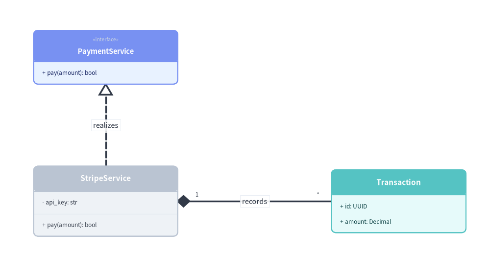
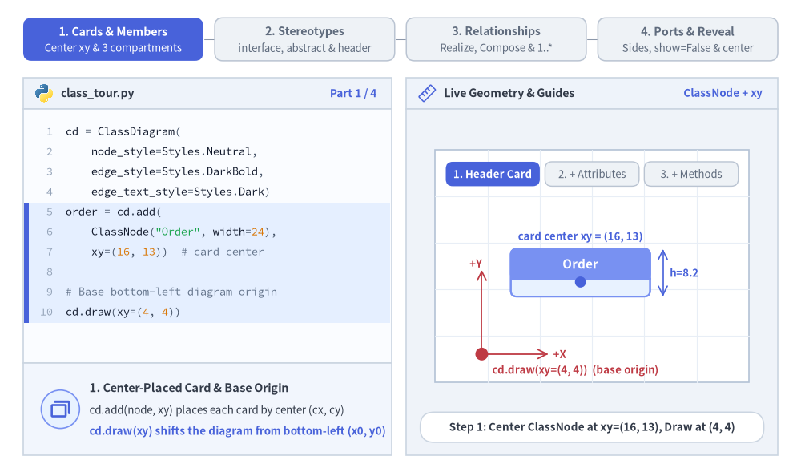
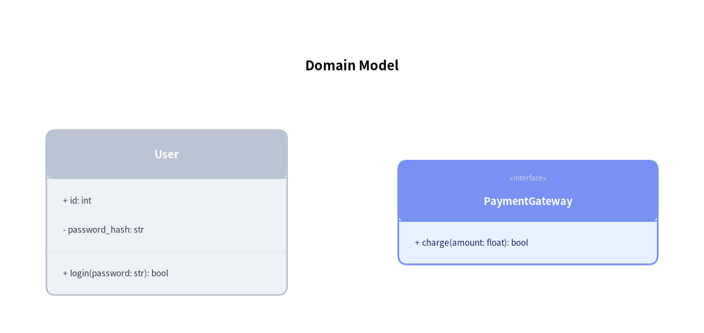
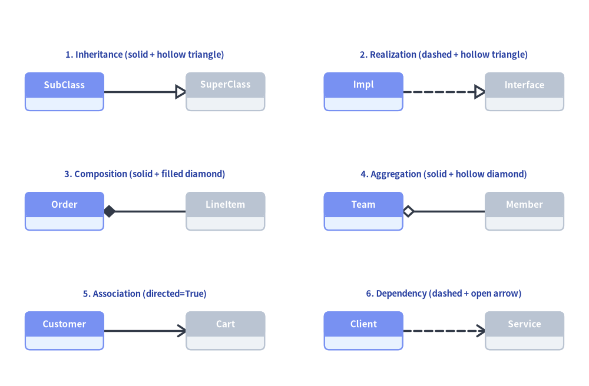
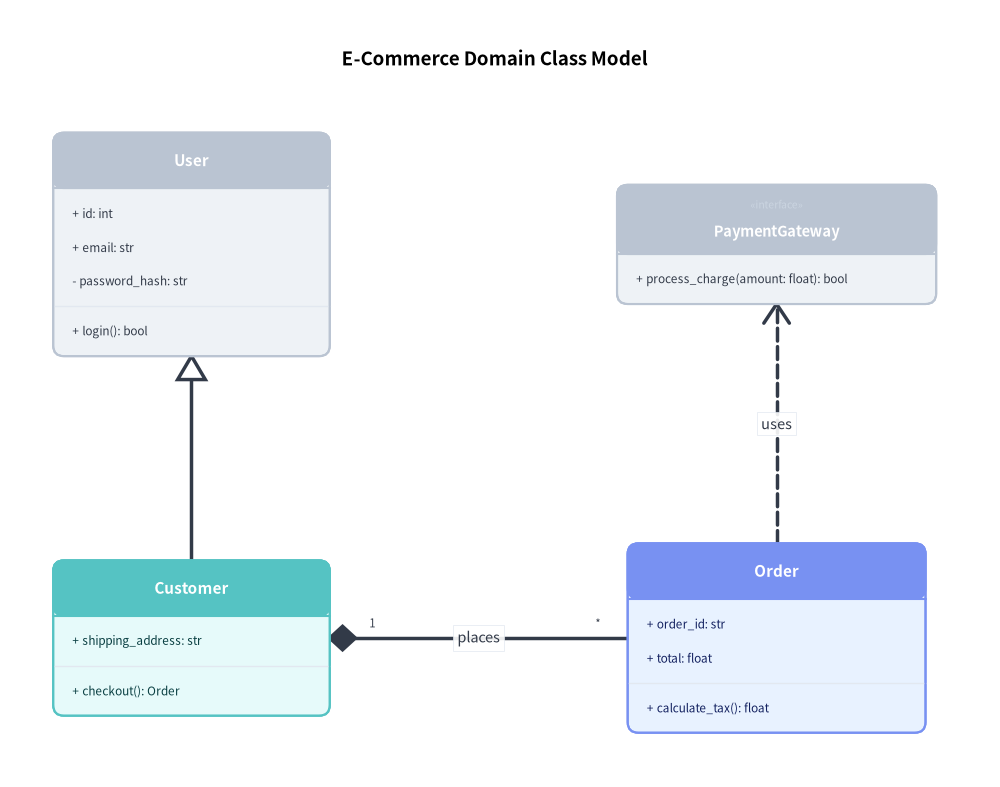
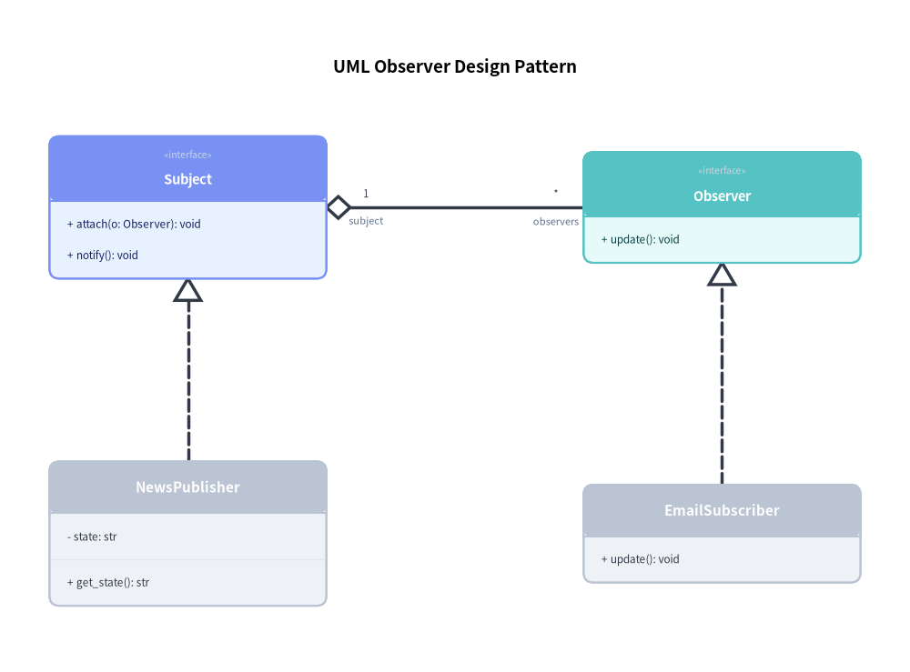

# UML クラス図 (ClassDiagram): UML 2.0 クラス階層とリレーションシップ

`ClassDiagram` は、標準的な UML 2.0 オブジェクト指向構造モデリングを実装します。3 区画のクラスカード（クラス名、属性、メソッド）、ステレオタイプ、抽象クラス、および全 6 種類の標準 UML リレーションシップを備えています。


<figure class="drawlib-image" style="text-align: center;">
  
  <figcaption class="drawlib-caption">実現とコンポジションを備えた 3 区画構造の UML クラスカード</figcaption>
</figure>

<details class="drawlib-code-details">
<summary>Source Code</summary>

```python
from drawlib.canvas import save, setup
from drawlib.diagrams.class_diagram import ClassDiagram, ClassNode
from drawlib.styles import Styles

setup(width=102, height=58)

cd = ClassDiagram(
    node_style=Styles.Neutral,
    edge_style=Styles.DarkBold,
    edge_text_style=Styles.Dark.patch(text_size=10.5),
)

payment_svc = cd.add(
    ClassNode(name="PaymentService", stereotype="interface", width=30.0, style=Styles.PrimaryNeutral),
    xy=(20.0, 44.0),
)
payment_svc.add_method("pay", params="amount", return_type="bool")

stripe_svc = cd.add(
    ClassNode(name="StripeService", width=30.0, style=Styles.Neutral),
    xy=(20.0, 14.0),
)
stripe_svc.add_attribute("api_key", type="str", is_public=False)
stripe_svc.add_method("pay", params="amount", return_type="bool")

tx = cd.add(
    ClassNode(name="Transaction", width=28.0, style=Styles.SecondaryNeutral),
    xy=(81.0, 14.0),
)
tx.add_attribute("id", type="UUID", is_public=True)
tx.add_attribute("amount", type="Decimal", is_public=True)

cd.connect(
    stripe_svc,
    payment_svc,
    relationship_type="realization",
    start_side="top",
    end_side="bottom",
    label="realizes",
)
cd.connect(
    stripe_svc,
    tx,
    relationship_type="composition",
    start_side="right",
    end_side="left",
    start_multiplicity="1",
    end_multiplicity="*",
    label="records",
)

cd.draw(xy=(2.0, 2.0))
save()
```

</details>


---

## 1. 基本概念と基本的な使い方

`ClassDiagram` は、`cd.add(node, xy=(cx, cy))` によって 3 区画構造の `ClassNode` カードを**中心 `(cx, cy)`** 基準で配置し、UML 可視性修飾子（`+`、`-`、`#`、`~`）付きの属性やメソッドが登録されるにつれて `effective_height` を動的に拡張します。ヘッダーへのギュメ付き `stereotype` バッジ・`is_abstract`・カスタム `header_style` 塗りつぶしの付与、多重度を備えた全 6 種類の標準 UML `relationship_type` マーカーによるクラス接続、および接続面・`show=False` 表示制御・`align="center"` 配置の制御をサポートします。


<figure class="drawlib-image" style="text-align: center;">
  
  <figcaption class="drawlib-caption">基本的な使い方とパラメータツアー: 3 区画カードとアンカー、ステレオタイプと修飾子、UML リレーションシップと多重度、ルーティングと段階的表示 (APNG アニメーション)</figcaption>
</figure>


<div class="drawlib-source-link">
  <a href="https://github.com/yuichi110/drawlib/blob/main/docs/docs_src/ja/06_diagrams/class_diagram.md" target="_blank" rel="noopener noreferrer">GitHub でアニメーションのソースコードを見る &rarr;</a>
</div>

- **3 区画の `ClassNode` と動的な高さ (`xy`, `effective_height`)**: `cd.add(node, xy=(cx, cy))` は各クラスカードを中心座標で配置し、`add_attribute(...)` および `add_method(...)` が区画にメンバを追加するにつれて `node.effective_height` を自動的に拡張します。
- **可視性・ステレオタイプ・ヘッダースタイル (`+`/`-`/`#`/`~`, `stereotype`, `is_abstract`, `header_style`)**: UML アクセス修飾子付きでメンバを整形し、ギュメ付きヘッダー（`«interface»`、`«abstract»`）を表示するほか、`header_style` で注目クラスのヘッダーを装飾できます。
- **6 種類の標準 UML リレーションシップ (`relationship_type`, 多重度, ロール)**: `cd.connect(...)` は `"inheritance"`、`"realization"`、`"composition"`、`"aggregation"`、`"association"`（`directed=True` 対応）、および `"dependency"` を、`start_multiplicity`、`end_multiplicity`、`start_role`、`end_role`、`label` とともに描画します。
- **ポートルーティング・段階的表示・中央配置 (`start_side`/`end_side`, `routing`, `show=False`, `align="center"`)**: `"orthogonal"` または `"direct"` 経路で正確な接続面を固定したり、`show=False` で位置を変えずにノードと接続エッジを非表示にしたり、`align="center"` で `xy` を中心にダイアグラムを配置したりできます。

---

## 2. コンストラクタ・`ClassNode`・メンバ定義


```python
from drawlib.canvas import save, setup
from drawlib.diagrams.class_diagram import ClassDiagram, ClassNode
from drawlib.styles import Styles

setup(width=76, height=36)

cd = ClassDiagram(
    node_style=Styles.Neutral,
    edge_style=Styles.DarkBold,
    edge_text_style=Styles.Dark.patch(text_size=10.5),
    title="Domain Model",
    title_style=Styles.BlackBold.patch(text_size=13.5),
)

# Class with attributes and methods
user = cd.add(ClassNode(name="User", width=26.0), xy=(18.0, 13.0))
user.add_attribute("id", type="int", is_public=True)
user.add_attribute("password_hash", type="str", is_public=False)
user.add_method("login", params="password: str", return_type="bool")

# Interface with stereotype
gateway = cd.add(
    ClassNode(name="PaymentGateway", stereotype="interface", width=28.0, style=Styles.PrimaryNeutral),
    xy=(57.0, 13.0),
)
gateway.add_method("charge", params="amount: float", return_type="bool")

cd.draw(xy=(0.0, 0.0))
save()
```

<figure class="drawlib-image" style="text-align: center;">
  
  <figcaption class="drawlib-caption">基本的なクラスノードとインターフェースノード</figcaption>
</figure>


### パラメータリファレンス

#### `ClassDiagram` クラス
| パラメータ | 型 | デフォルト | 説明 |
|---|---|---|---|
| `node_style` | `Style` | *(必須)* | ダイアグラム内のクラスカードの基本 `Style` オブジェクト。 |
| `edge_style` | `Style` | *(必須)* | リレーションシップ線および UML マーカーの基本 `Style` オブジェクト。 |
| `edge_text_style` | `Style` | *(必須)* | リレーションシップのラベル、ロール、多重度の基本 `Style` オブジェクト。 |
| `title` | `str` | `""` | ダイアグラム上部に表示する任意のタイトル。 |
| `title_style` | `Style \| None` | `None` | ダイアグラムタイトル用の任意の `Style` オブジェクト。 |
| `style` | `Style \| None` | `None` | ダイアグラム全体の背景を上書きする任意の `Style`。 |
| `width` | `float \| None` | `None` | キャンバスの任意の固定幅（`None` の場合はコンテンツから自動算出）。 |
| `height` | `float \| None` | `None` | キャンバスの任意の固定高さ（`None` の場合はコンテンツから自動算出）。 |
| `margin` | `float` | `5.0` | サイズ自動算出時に全クラスの外周を囲む外側余白パディング。 |
| `header_style` | `Style \| None` | `None` | ダイアグラム全体のクラスカードヘッダー区画を上書きする任意の `Style`。 |

#### `ClassNode` クラス
| パラメータ | 型 | デフォルト | 説明 |
|---|---|---|---|
| `name` | `str` | *(必須)* | クラス名またはインターフェース名。 |
| `stereotype` | `str` | `""` | `«stereotype»` として描画される任意の UML ステレオタイプ（例: `"interface"`、`"abstract"`、`"enumeration"`）。 |
| `is_abstract` | `bool` | `False` | `True` の場合、クラス名をイタリック体フォントで描画します。 |
| `width` | `float` | `28.0` | キャンバス単位でのクラスカードの幅。 |
| `height` | `float \| None` | `None` | 任意の最小高さの上書き設定（`None` または不足する場合は属性・メソッドが収まるよう自動拡張）。 |
| `size` | `tuple[float, float] \| None` | `None` | `width` と `height` をまとめて上書きする任意の `(width, height)` 短縮タプル。 |
| `header_height` | `float \| None` | `None` | ヘッダー区画の高さ（`stereotype` 指定時は `6.5`、それ以外は `5.2`）。 |
| `row_height` | `float` | `3.2` | 各属性行およびメソッド行の垂直高さ。 |
| `style` | `Style \| None` | `None` | カードの枠線および本体塗りつぶし用の任意の `Style` 上書き設定。 |
| `header_style` | `Style \| None` | `None` | このカードのヘッダー区画の背景およびテキスト用の任意の `Style` 上書き設定。 |
| `show` | `bool` | `True` | 表示フラグ（`False` の場合、接続された `ClassRelationship` エッジも自動的に非表示になります）。 |

### 属性・メソッド定義 API (`AttributeInfo` & `MethodInfo`)

```python
from drawlib.diagrams.class_diagram import AttributeInfo, MethodInfo

# Single attribute & batch attributes
node.add_attribute(
    name: str,
    type: str = "",
    is_public: bool = True,
    visibility: str | None = None,      # "+", "-", "#", or "~" (overrides is_public if set)
    default_value: str = "",            # Rendered as " = <default_value>"
    is_static: bool = False,
) -> ClassNode

node.add_attributes(
    attributes: Sequence[Sequence[Any] | AttributeInfo],
    # Each tuple is (name, [type, is_public, visibility, default_value]) or an AttributeInfo instance
) -> ClassNode

# Single method & batch methods
node.add_method(
    name: str,
    params: str = "",
    return_type: str = "",
    is_public: bool = True,
    visibility: str | None = None,      # "+", "-", "#", or "~" (overrides is_public if set)
    is_static: bool = False,
    is_abstract: bool = False,
) -> ClassNode

node.add_methods(
    methods: Sequence[Sequence[Any] | MethodInfo],
    # Each tuple is (name, [return_type, params, is_public, visibility]) or a MethodInfo instance
) -> ClassNode
```

---

## 3. 6 種類の UML リレーションシップ (`ClassRelationship`)

クラス間のリレーションシップは、ダイアグラムレベルの `cd.connect(source, target, relationship_type=...)`（または `cd.add_relationship(rel: ClassRelationship) -> ClassRelationship`）を使って登録します。

| `relationship_type` | 短縮エイリアス | リレーションシップ | 線種 | マーカー | 意味 |
|---|---|---|---|---|---|
| `"inheritance"` | `"inherit"` | **継承 (Inheritance)** | 実線 | 白抜き三角形（`target` 側） | スーパークラスの汎化 |
| `"realization"` | `"realize"` | **実現 (Realization)** | 破線 | 白抜き三角形（`target` 側） | インターフェースの実装 |
| `"composition"` | `"composite"` | **コンポジション (Composition)** | 実線 | 塗りつぶしひし形（`source` 側） | 強いライフサイクル所有関係 |
| `"aggregation"` | `"aggregate"` | **集約 (Aggregation)** | 実線 | 白抜きひし形（`source` 側） | 共有ライフサイクル / 全体と部分 |
| `"association"` | `"associate"` | **関連 (Association)** | 実線 | なし（`directed=True` の場合は開いた矢印） | 構造的な参照 |
| `"dependency"` | `"depend"` | **依存 (Dependency)** | 破線 | 開いた矢印（`target` 側） | 一時的な利用依存（Uses-a） |


```python
from drawlib.canvas import save, setup
from drawlib.diagrams.class_diagram import ClassDiagram, ClassNode
from drawlib.styles import Colors, Styles
from drawlib.text import text

setup(width=128, height=84)

cd = ClassDiagram(
    node_style=Styles.Neutral,
    edge_style=Styles.DarkBold,
    edge_text_style=Styles.Dark.patch(text_size=10.5),
)

# 2x3 Grid of the 6 UML Relationship Types
specs = [
    # Left column (x_src=14, x_dst=49)
    ("1. Inheritance (solid + hollow triangle)", "inheritance", False, 14.0, 49.0, 64.0, "SubClass", "SuperClass"),
    ("3. Composition (solid + filled diamond)", "composition", False, 14.0, 49.0, 38.0, "Order", "LineItem"),
    ("5. Association (directed=True)", "association", True, 14.0, 49.0, 12.0, "Customer", "Cart"),
    # Right column (x_src=79, x_dst=114)
    ("2. Realization (dashed + hollow triangle)", "realization", False, 79.0, 114.0, 64.0, "Impl", "Interface"),
    ("4. Aggregation (solid + hollow diamond)", "aggregation", False, 79.0, 114.0, 38.0, "Team", "Member"),
    ("6. Dependency (dashed + open arrow)", "dependency", False, 79.0, 114.0, 12.0, "Client", "Service"),
]

lbl_style = Styles.DarkBold.patch(text_size=10.5, text_color=Colors.Primary5)

for _title_str, rel_type, is_dir, x1, x2, y, src_name, dst_name in specs:
    n_src = cd.add(ClassNode(name=src_name, width=17.0, style=Styles.PrimaryNeutral), xy=(x1, y))
    n_dst = cd.add(ClassNode(name=dst_name, width=17.0, style=Styles.Neutral), xy=(x2, y))
    cd.connect(
        n_src,
        n_dst,
        relationship_type=rel_type,
        directed=is_dir,
        start_side="right",
        end_side="left",
    )

cd.draw(xy=(0.0, 0.0))

for title_str, _rel_type, _is_dir, x1, x2, y, _src_name, _dst_name in specs:
    text(((x1 + x2) / 2.0, y + 8.0), title_str, style=lbl_style)

save()
```

<figure class="drawlib-image" style="text-align: center;">
  
  <figcaption class="drawlib-caption">ClassDiagram における全 6 種類の UML リレーションシップとマーカースタイル</figcaption>
</figure>


### `cd.connect(...)` のシグネチャ
```python
cd.connect(
    source: ClassNode,
    target: ClassNode,
    relationship_type: RelationshipType = "association",
    *,
    type: RelationshipType | None = None,              # Keyword alias for relationship_type
    label: str = "",
    start_side: Literal["left", "right", "top", "bottom", "auto"] = "auto",
    end_side: Literal["left", "right", "top", "bottom", "auto"] = "auto",
    start_multiplicity: str = "",                      # e.g. "1", "0..1"
    end_multiplicity: str = "",                        # e.g. "*", "1..*"
    start_role: str = "",
    end_role: str = "",
    directed: bool = False,                            # Draws open navigability arrow at target
    style: Style | None = None,
    text_style: Style | None = None,
    routing: Literal["orthogonal", "direct"] = "orthogonal",
    padding: float | tuple[float, float] = 0.0,
    show: bool = True,
) -> ClassRelationship
```

### 登録・サイズ取得・描画ライフサイクル
- **`cd.add(class_node, xy=(cx, cy), show: bool | None = None) -> ClassNode`**: クラスカードを中心 `(cx, cy)` に登録し、ミュータブルな `ClassNode`（`node.show`、`node.style`、`node.header_style`）を返します。クラスを非表示（`show=False`）にすると、ダイアグラム全体の外接サイズは固定したまま、接続されているすべての `ClassRelationship` エッジも自動的に非表示になります。
- **`cd.get_bounds() -> tuple[float, float, float, float]`**: 登録された全クラスを囲む `(min_x, min_y, max_x, max_y)` を返します。
- **`cd.get_size() -> tuple[float, float]`**: ダイアグラムの `(width, height)`（`margin` を含む）を返します。
- **`cd.draw(xy=(0.0, 0.0), *, scale: float = 1.0) -> None`**: 左下 `xy` を基準として、カード幅、区画高さ、UML マーカー、タイポグラフィを `scale` 倍に比例スケーリングしてクラス図を描画します。

---

## 4. EC ドメインモデル

次のサンプルでは、継承（汎化）、コンポジション、およびインターフェース依存を組み合わせています。


```python
from drawlib.canvas import save, setup
from drawlib.diagrams.class_diagram import ClassDiagram, ClassNode
from drawlib.styles import Styles

setup(width=94, height=74)

cd = ClassDiagram(
    node_style=Styles.Neutral,
    edge_style=Styles.DarkBold,
    edge_text_style=Styles.Dark.patch(text_size=10.5),
    title="E-Commerce Domain Class Model",
    title_style=Styles.BlackBold.patch(text_size=13.5),
)

# 1. Define classes
user = cd.add(ClassNode(name="User", width=26.0), xy=(18.0, 51.0))
user.add_attribute("id", type="int", is_public=True)
user.add_attribute("email", type="str", is_public=True)
user.add_attribute("password_hash", type="str", is_public=False)
user.add_method("login", return_type="bool")

customer = cd.add(ClassNode(name="Customer", width=26.0, style=Styles.SecondaryNeutral), xy=(18.0, 14.0))
customer.add_attribute("shipping_address", type="str")
customer.add_method("checkout", return_type="Order")

order = cd.add(ClassNode(name="Order", width=28.0, style=Styles.PrimaryNeutral), xy=(73.0, 14.0))
order.add_attribute("order_id", type="str")
order.add_attribute("total", type="float")
order.add_method("calculate_tax", return_type="float")

iface = cd.add(ClassNode(name="PaymentGateway", stereotype="interface", width=30.0), xy=(73.0, 51.0))
iface.add_method("process_charge", params="amount: float", return_type="bool")

# 2. Connect relationships using diagram.connect
cd.connect(customer, user, "inheritance", start_side="top", end_side="bottom")
cd.connect(
    customer,
    order,
    "composition",
    start_side="right",
    end_side="left",
    start_multiplicity="1",
    end_multiplicity="*",
    label="places",
)
cd.connect(order, iface, "dependency", start_side="top", end_side="bottom", label="uses")

cd.draw(xy=(0.0, 0.0))
save()
```

<figure class="drawlib-image" style="text-align: center;">
  
  <figcaption class="drawlib-caption">EC ドメインのクラス階層モデル</figcaption>
</figure>


---

## 5. デザインパターンのモデリング: Observer パターン

クラス図は、Observer パターンをはじめとするソフトウェアデザインパターンの図解に最適です。


```python
from drawlib.canvas import save, setup
from drawlib.diagrams.class_diagram import ClassDiagram, ClassNode
from drawlib.styles import Styles

setup(width=92, height=68)

cd = ClassDiagram(
    node_style=Styles.Neutral,
    edge_style=Styles.DarkBold,
    edge_text_style=Styles.Dark.patch(text_size=10.5),
    title="UML Observer Design Pattern",
    title_style=Styles.BlackBold.patch(text_size=13.5),
)

subj_iface = cd.add(
    ClassNode(name="Subject", stereotype="interface", width=28.0, style=Styles.PrimaryNeutral),
    xy=(19.0, 47.0),
)
subj_iface.add_method("attach", params="o: Observer", return_type="void")
subj_iface.add_method("notify", return_type="void")

obs_iface = cd.add(
    ClassNode(name="Observer", stereotype="interface", width=28.0, style=Styles.SecondaryNeutral),
    xy=(73.0, 47.0),
)
obs_iface.add_method("update", return_type="void")

concrete_subj = cd.add(ClassNode(name="NewsPublisher", width=28.0), xy=(19.0, 14.0))
concrete_subj.add_attribute("state", type="str", is_public=False)
concrete_subj.add_method("get_state", return_type="str")

concrete_obs = cd.add(ClassNode(name="EmailSubscriber", width=28.0), xy=(73.0, 14.0))
concrete_obs.add_method("update", return_type="void")

cd.connect(concrete_subj, subj_iface, "realization", start_side="top", end_side="bottom")
cd.connect(concrete_obs, obs_iface, "realization", start_side="top", end_side="bottom")
cd.connect(
    subj_iface,
    obs_iface,
    "aggregation",
    start_side="right",
    end_side="left",
    start_multiplicity="1",
    end_multiplicity="*",
    start_role="subject",
    end_role="observers",
)

cd.draw(xy=(0.0, 0.0))
save()
```

<figure class="drawlib-image" style="text-align: center;">
  
  <figcaption class="drawlib-caption">UML Observer デザインパターン</figcaption>
</figure>


---

## 6. ベストプラクティスとガイドライン

1. **カード幅の統一**: 水平方向に並べるクラス間では、視覚的なバランスを保つために一貫したカード幅（`26.0`〜`30.0` 単位）を設定してください。
2. **接続辺の明示指定**: `start_side` と `end_side` を明示的に指定することで、直交配線がテキスト区画を横切らずカードの周囲をきれいに迂回します。
