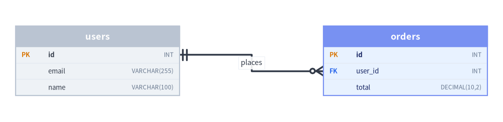
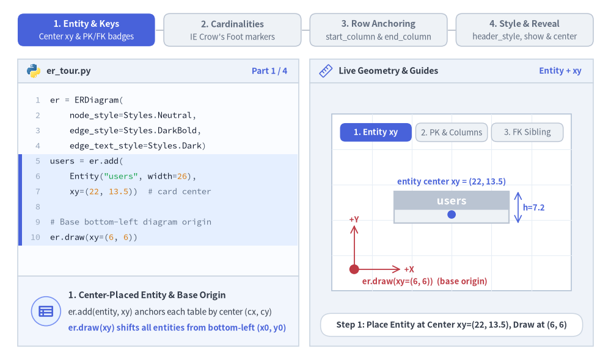
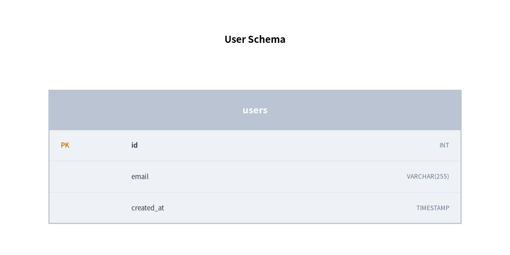
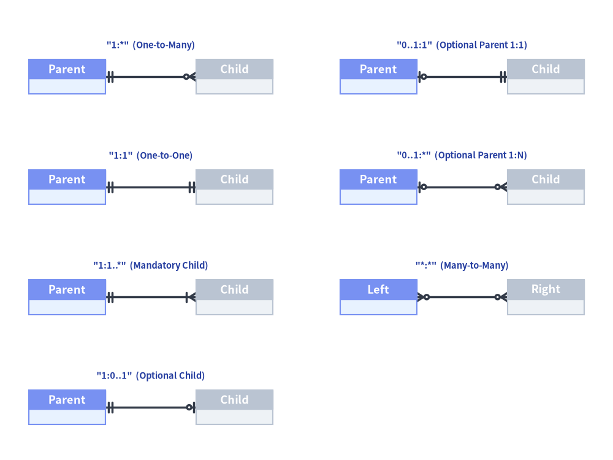
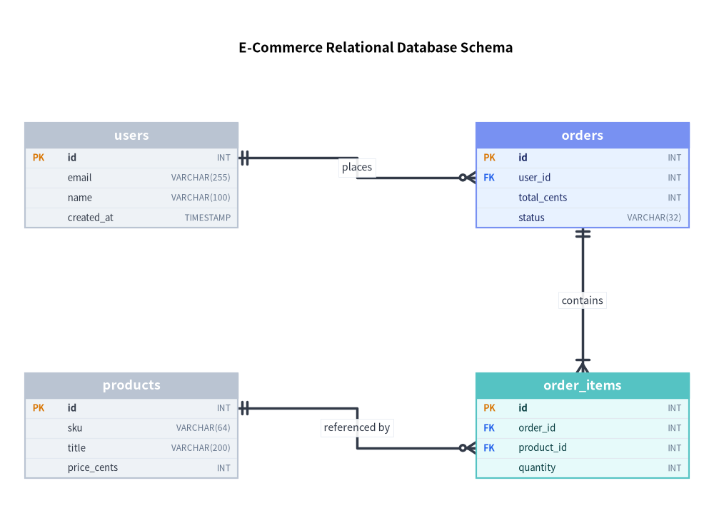

# ER 図 (ERDiagram): リレーショナルスキーマと Crow's Foot 記法

`ERDiagram` は、物理データベーススキーマモデリングの業界標準である **Information Engineering (IE) / Crow's Foot（カラスの足跡）記法**に厳密に準拠してリレーショナルデータベースアーキテクチャを可視化します。


<figure class="drawlib-image" style="text-align: center;">
  
  <figcaption class="drawlib-caption">行単位でアンカー接続された Crow's Foot 記法によるエンティティ・リレーションシップテーブル</figcaption>
</figure>

<details class="drawlib-code-details">
<summary>Source Code</summary>

```python
from drawlib.canvas import save, setup
from drawlib.diagrams.er import ERDiagram, Entity
from drawlib.styles import Styles

setup(width=98, height=24)

er = ERDiagram(
    node_style=Styles.Neutral,
    edge_style=Styles.DarkBold,
    edge_text_style=Styles.Dark.patch(text_size=10.5),
)

users = er.add(Entity(name="users", width=32.0), xy=(19.0, 12.0))
users.add_column("id", type="INT", pk=True)
users.add_column("email", type="VARCHAR(255)", nullable=False)
users.add_column("name", type="VARCHAR(100)")

orders = er.add(Entity(name="orders", width=32.0, style=Styles.PrimaryNeutral), xy=(79.0, 12.0))
orders.add_column("id", type="INT", pk=True)
orders.add_column("user_id", type="INT", fk=True)
orders.add_column("total", type="DECIMAL(10,2)", nullable=False)

users.connect(
    orders,
    cardinality="1:*",
    start_side="right",
    end_side="left",
    start_column="id",
    end_column="user_id",
    label="places",
)

er.draw(xy=(0.0, 0.0))
save()
```

</details>


---

## 1. 基本概念と基本的な使い方

`ERDiagram` は、`er.add(entity, xy=(cx, cy))` によってリレーショナルな `Entity` テーブルを**中心 `(cx, cy)`** 基準で配置し、すべてのカラムが収まるよう `effective_height` を自動拡張しながら、自動 `PK` / `FK` キーバッジ付きの型付きスキーマ行を描画します。リレーションシップは業界標準の Information Engineering (IE) 方式 Crow's Foot の `cardinality` マーカーを描画し、`start_column` と `end_column` で主キー行・外部キー行へ直接スナップ接続できるほか、カスタムの `header_style` バンド、`show=False` による非表示、`align="center"` 配置をサポートします。


<figure class="drawlib-image" style="text-align: center;">
  
  <figcaption class="drawlib-caption">基本的な使い方とパラメータツアー: エンティティテーブルとキーバッジ、Crow's Foot カーディナリティ、行レベルのカラムアンカー、ヘッダースタイルと段階的表示 (APNG アニメーション)</figcaption>
</figure>


<div class="drawlib-source-link">
  <a href="https://github.com/yuichi110/drawlib/blob/main/docs/docs_src/ja/06_diagrams/er.md" target="_blank" rel="noopener noreferrer">GitHub でアニメーションのソースコードを見る &rarr;</a>
</div>

- **中心基準の `Entity` カードとキーバッジ (`xy`, `pk`, `fk`, `nullable`)**: `er.add(entity, xy=(cx, cy))` は各テーブルを中心座標で配置し、`.add_column(...)` がアンバー色の `PK` タグや青色の `FK` タグを付与しながら `effective_height` を自動的に拡張します。
- **IE 方式 Crow's Foot カーディナリティ (`cardinality`)**: `entity.connect(...)` と `er.connect(...)` は、全 7 種類の多重度（`"1:*"`、`"1:1"`、`"1:1..*"`、`"1:0..1"`、`"0..1:1"`、`"0..1:*"`、`"*:*"`）にわたる Information Engineering ベクターマーカーを描画します。
- **行レベルのカラムアンカー接続 (`start_column`, `end_column`)**: テーブル中央の汎用ポートではなく、`"left"` / `"right"` 側面の特定の主キー行・外部キー行へリレーションシップ線を直接スナップ接続できます。
- **ヘッダースタイル・表示制御・中央配置 (`header_style`, `show=False`, `align="center"`)**: `header_style` で注目テーブルを強調したり、`show=False` でレイアウトを保ったままエンティティと接続済みの Crow's Foot 線を非表示にしたり、`align="center"` で `xy` を中心にスキーマ全体を配置したりできます。

---

## 2. コンストラクタとエンティティ定義


```python
from drawlib.canvas import save, setup
from drawlib.diagrams.er import ERDiagram, Entity
from drawlib.styles import Styles

setup(width=52, height=26)

er = ERDiagram(
    node_style=Styles.Neutral,
    edge_style=Styles.DarkBold,
    edge_text_style=Styles.Dark.patch(text_size=10.5),
    title="User Schema",
    title_style=Styles.BlackBold.patch(text_size=13.5),
    width=52.0,
    height=20.0,
)

# Create entity table
users = er.add(Entity(name="users", width=42.0), xy=(26.0, 10.0))
users.add_column("id", type="INT", pk=True)
users.add_column("email", type="VARCHAR(255)", nullable=False)
users.add_column("created_at", type="TIMESTAMP")

er.draw(xy=(0.0, 0.0))
save()
```

<figure class="drawlib-image" style="text-align: center;">
  
  <figcaption class="drawlib-caption">基本的なエンティティテーブル</figcaption>
</figure>


### パラメータリファレンス

#### `ERDiagram` クラス
| パラメータ | 型 | デフォルト | 説明 |
|---|---|---|---|
| `node_style` | `Style` | *(必須)* | ダイアグラム内のエンティティテーブルカードのベース `Style` オブジェクト。 |
| `edge_style` | `Style` | *(必須)* | リレーションシップ線および Crow's Foot マーカーのベース `Style` オブジェクト。 |
| `edge_text_style` | `Style` | *(必須)* | リレーションシップラベルのベース `Style` オブジェクト。 |
| `title` | `str` | `""` | ダイアグラム上部に表示する任意のバナータイトル。 |
| `title_style` | `Style \| None` | `None` | ダイアグラムタイトルの `Style` オブジェクト（任意）。 |
| `width` | `float \| None` | `None` | ダイアグラムの固定幅（`None` の場合は自動フィット）。 |
| `height` | `float \| None` | `None` | ダイアグラムの固定高さ（`None` の場合は自動フィット）。 |
| `style` | `Style \| None` | `None` | ダイアグラム背景カードの `Style` オブジェクト（任意）。 |
| `header_style` | `Style \| None` | `None` | ダイアグラム全体のエンティティヘッダー帯を一括上書きする `Style`（任意）。 |

#### `Entity` クラス
| パラメータ | 型 | デフォルト | 説明 |
|---|---|---|---|
| `name` | `str` | *(必須)* | ヘッダー帯に表示するテーブル名／エンティティ名。 |
| `width` | `float` | `25.0` | テーブル境界ボックスの幅（キャンバス単位）。 |
| `height` | `float \| None` | `None` | 最小高さのオーバーライド（`None` または不足時は全カラムが収まる高さへ自動拡張）。 |
| `size` | `tuple[float, float] \| None` | `None` | `width` と `height` をまとめて指定する `(width, height)` タプル（任意）。 |
| `header_height` | `float` | `4.0` | エンティティタイトルヘッダー区画の高さ。 |
| `row_height` | `float` | `3.2` | 各カラム行の垂直高さ。 |
| `style` | `Style \| None` | `None` | エンティティ本体ボックスおよび枠線の `Style`（任意）。 |
| `header_style` | `Style \| None` | `None` | このエンティティのヘッダー背景およびテキストの `Style`（任意）。 |
| `show` | `bool` | `True` | 表示フラグ（`False` の場合、接続されている `Relationship` 線も自動非表示）。 |

#### カラム定義（`add_column`・`add_columns`・`ColumnInfo`）
| パラメータ | 型 | デフォルト | 説明 |
|---|---|---|---|
| `name` | `str` | *(必須)* | カラム（フィールド）名。 |
| `type` | `str` | `""` | SQL データ型文字列（例: `"INT"`、`"VARCHAR(255)"`）。 |
| `pk` | `bool` | `False` | `True` の場合、`[PK]` 主キーバッジを表示。 |
| `fk` | `bool` | `False` | `True` の場合、`[FK]` 外部キーバッジを表示。 |
| `nullable` | `bool` | `True` | カラムが `NULL` 値を許容するかどうか。 |

```python
from drawlib.diagrams.er import ColumnInfo

# Single column & batch column registration
entity.add_column(name: str, type: str = "", pk: bool = False, fk: bool = False, nullable: bool = True) -> Entity
entity.add_columns(
    columns: Sequence[Sequence[Any] | ColumnInfo],
    # Each item is a ColumnInfo or tuple (name, [type, pk, fk, nullable])
) -> Entity
```

#### `Relationship`（`entity.connect` & `er.connect`）
| パラメータ | 型 | デフォルト | 説明 |
|---|---|---|---|
| `start` / `target` | `Entity` | *(必須)* | 始点および終点の `Entity` テーブル（`entity.connect(target, ...)` または `er.connect(start, end, ...)`）。 |
| `cardinality` | `Cardinality` | `"1:*"` | Crow's Foot 多重度（`"1:*"`、`"1:1"`、`"1:1..*"`、`"1:0..1"`、`"0..1:1"`、`"0..1:*"`、`"*:*"`）。 |
| `start_side` | `Literal["left", "right", "top", "bottom", "auto"]` | `"auto"` | 始点エンティティ外周上の接続辺。 |
| `end_side` | `Literal["left", "right", "top", "bottom", "auto"]` | `"auto"` | 終点エンティティ外周上の接続辺。 |
| `start_column` | `str \| None` | `None` | `start` エンティティ内のカラム名（指定するとその行へ接続線を直接アンカー固定）。 |
| `end_column` | `str \| None` | `None` | `end` エンティティ内のカラム名（指定するとその行へ接続線を直接アンカー固定）。 |
| `label` | `str` | `""` | 接続線に沿って表示する任意のリレーションシップラベル。 |
| `style` | `Style \| None` | `None` | リレーションシップ線および Crow's Foot マーカーの `Style` オーバーライド（任意）。 |
| `text_style` | `Style \| None` | `None` | リレーションシップラベルテキストの `Style` オーバーライド（任意）。 |
| `routing` | `Literal["orthogonal", "direct"]` | `"orthogonal"` | 配線戦略（`"orthogonal"` Z 字直交ベンド、または `"direct"` 直線）。 |
| `padding` | `float \| tuple[float, float]` | `0.0` | エンティティ枠線と接続線端点の間の余白距離。 |
| `show` | `bool` | `True` | リレーションシップ線の表示フラグ。 |

#### 登録・サイズ取得・描画メソッド
- **`er.add(entity, xy=(cx, cy), show: bool | None = None) -> Entity`**: エンティティテーブルを中心 `(cx, cy)` に配置し、ミュータブルな `Entity` を返します。
- **`entity.connect(target, cardinality="1:*", ..., show=True) -> Relationship`** または **`er.connect(start, end, cardinality="1:*", ..., show=True) -> Relationship`**（および `er.add_relationship(rel) -> Relationship`）: 2 つのエンティティを Crow's Foot 記法で接続し、ミュータブルな `Relationship`（`rel.show`、`rel.style`、`rel.text_style`）を返します。
- **`er.get_size() -> tuple[float, float]`**: ダイアグラム全体の `(width, height)` を返します。
- **`er.draw(xy=(0.0, 0.0), *, scale: float = 1.0) -> None`**: 左下 `xy` を基準として、テーブル形状、Crow's Foot マーカー、フォントサイズを `scale` 倍に比例スケーリングして ER 図を描画します。

---

## 3. サポートされるカーディナリティ記法一覧

| カーディナリティ文字列 | 親側マーカー | 子側マーカー | 標準的な意味 |
|---|---|---|---|
| `"1:*"` | 1（二重縦線） | 0 以上（丸＋カラスの足） | 1 対多（デフォルト） |
| `"1:1"` | 1（二重縦線） | 1（二重縦線） | 1 対 1 |
| `"1:1..*"` | 1（二重縦線） | 1 以上（縦線＋カラスの足） | 必須の子を持つ 1 対多 |
| `"1:0..1"` | 1（二重縦線） | 0 または 1（丸＋縦線） | 任意の子を持つ 1 対 1 |
| `"0..1:1"` | 0 または 1（丸＋縦線） | 1（二重縦線） | 任意の親を持つ 1 対 1 |
| `"0..1:*"` | 0 または 1（丸＋縦線） | 0 以上（丸＋カラスの足） | 任意の親を持つ 1 対多 |
| `"*:*"` | 0 以上（丸＋カラスの足） | 0 以上（丸＋カラスの足） | 多対多 |


```python
from drawlib.canvas import save, setup
from drawlib.diagrams.er import ERDiagram, Entity
from drawlib.styles import Colors, Styles
from drawlib.text import text

setup(width=128, height=96)

er = ERDiagram(
    node_style=Styles.Neutral,
    edge_style=Styles.DarkBold,
    edge_text_style=Styles.Dark.patch(text_size=10.5),
)

# 7 supported Crow's Foot cardinality strings arranged in a clean 2-column catalog
specs = [
    # Left column (x_src=14, x_dst=49)
    ('"1:*"  (One-to-Many)', "1:*", 14.0, 49.0, 80.0, "Parent", "Child"),
    ('"1:1"  (One-to-One)', "1:1", 14.0, 49.0, 57.0, "Parent", "Child"),
    ('"1:1..*"  (Mandatory Child)', "1:1..*", 14.0, 49.0, 34.0, "Parent", "Child"),
    ('"1:0..1"  (Optional Child)', "1:0..1", 14.0, 49.0, 11.0, "Parent", "Child"),
    # Right column (x_src=79, x_dst=114)
    ('"0..1:1"  (Optional Parent 1:1)', "0..1:1", 79.0, 114.0, 80.0, "Parent", "Child"),
    ('"0..1:*"  (Optional Parent 1:N)', "0..1:*", 79.0, 114.0, 57.0, "Parent", "Child"),
    ('"*:*"  (Many-to-Many)', "*:*", 79.0, 114.0, 34.0, "Left", "Right"),
]

lbl_style = Styles.DarkBold.patch(text_size=10.5, text_color=Colors.Primary5)

for _title_str, card, x1, x2, y, src_name, dst_name in specs:
    e_src = er.add(Entity(name=src_name, width=16.0, style=Styles.PrimaryNeutral), xy=(x1, y))
    e_dst = er.add(Entity(name=dst_name, width=16.0, style=Styles.Neutral), xy=(x2, y))
    e_src.connect(e_dst, cardinality=card, start_side="right", end_side="left")

er.draw(xy=(0.0, 0.0))

for title_str, _card, x1, x2, y, _src_name, _dst_name in specs:
    text(((x1 + x2) / 2.0, y + 6.5), title_str, style=lbl_style)

save()
```

<figure class="drawlib-image" style="text-align: center;">
  
  <figcaption class="drawlib-caption">ERDiagram でサポートされる全 7 種類の Crow's Foot カーディナリティ記法</figcaption>
</figure>


---

## 4. カラムアンカーを用いた EC リレーショナルスキーマ

次の 4 テーブル構成のスキーマ（`users`、`orders`、`order_items`、`products`）では、すべてのリレーションシップを対応する主キー行と外部キー行へ直接アンカー固定しています。


```python
from drawlib.canvas import save, setup
from drawlib.diagrams.er import ERDiagram, Entity
from drawlib.styles import Styles

setup(width=114, height=82)

er = ERDiagram(
    node_style=Styles.Neutral,
    edge_style=Styles.DarkBold,
    edge_text_style=Styles.Dark.patch(text_size=10.5),
    title="E-Commerce Relational Database Schema",
    title_style=Styles.BlackBold.patch(text_size=13.5),
)

# Top row: users (left) -> orders (right)
users = er.add(Entity(name="users", width=34.0), xy=(21.0, 54.0))
users.add_column("id", type="INT", pk=True)
users.add_column("email", type="VARCHAR(255)", nullable=False)
users.add_column("name", type="VARCHAR(100)")
users.add_column("created_at", type="TIMESTAMP")

orders = er.add(Entity(name="orders", width=34.0, style=Styles.PrimaryNeutral), xy=(93.0, 54.0))
orders.add_column("id", type="INT", pk=True)
orders.add_column("user_id", type="INT", fk=True)
orders.add_column("total_cents", type="INT", nullable=False)
orders.add_column("status", type="VARCHAR(32)")

# Bottom row: products (left) -> order_items (right)
products = er.add(Entity(name="products", width=34.0), xy=(21.0, 14.0))
products.add_column("id", type="INT", pk=True)
products.add_column("sku", type="VARCHAR(64)", nullable=False)
products.add_column("title", type="VARCHAR(200)")
products.add_column("price_cents", type="INT", nullable=False)

order_items = er.add(Entity(name="order_items", width=34.0, style=Styles.SecondaryNeutral), xy=(93.0, 14.0))
order_items.add_column("id", type="INT", pk=True)
order_items.add_column("order_id", type="INT", fk=True)
order_items.add_column("product_id", type="INT", fk=True)
order_items.add_column("quantity", type="INT", nullable=False)

# Row-anchored relationships
users.connect(
    orders,
    cardinality="1:*",
    start_side="right",
    end_side="left",
    start_column="id",
    end_column="user_id",
    label="places",
)
orders.connect(
    order_items,
    cardinality="1:1..*",
    start_side="bottom",
    end_side="top",
    label="contains",
)
products.connect(
    order_items,
    cardinality="1:*",
    start_side="right",
    end_side="left",
    start_column="id",
    end_column="product_id",
    label="referenced by",
)

er.draw(xy=(0.0, 0.0))
save()
```

<figure class="drawlib-image" style="text-align: center;">
  
  <figcaption class="drawlib-caption">EC サイトのリレーショナルデータベーススキーマ</figcaption>
</figure>


---

## 5. ベストプラクティスとガイドライン

1. **カラム単位アンカーの積極活用**: `start_column` と `end_column` を指定すると、外部キー属性と参照先の主キー属性が視覚的に直接結ばれ、直感的で完成度の高いスキーマ図になります。
2. **テーブル幅の設計**: 長いデータ型（例: `VARCHAR(255)`）を含むテーブルでは、`width` を `28.0`〜`34.0` キャンバス単位に設定すると見やすくなります。
3. **明示的なカーディナリティ文字列**: 手動で矢印形状を指定するのではなく、常に明示的なカーディナリティ文字列（`"1:*"`、`"1:1"` など）を使用してください。
