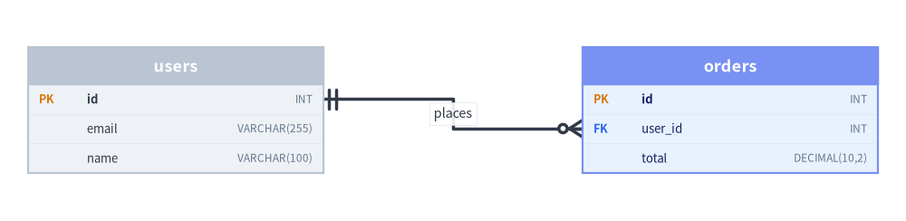
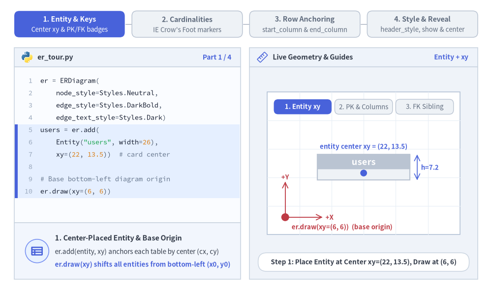
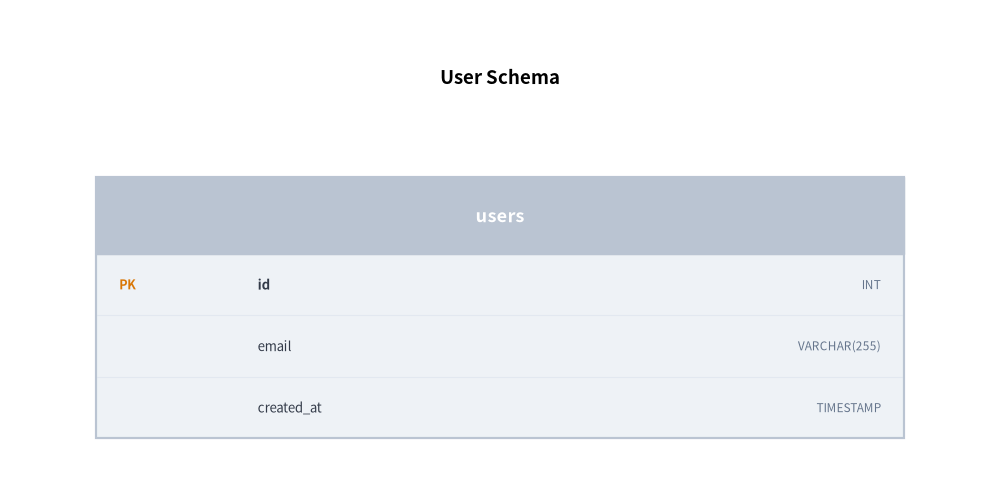
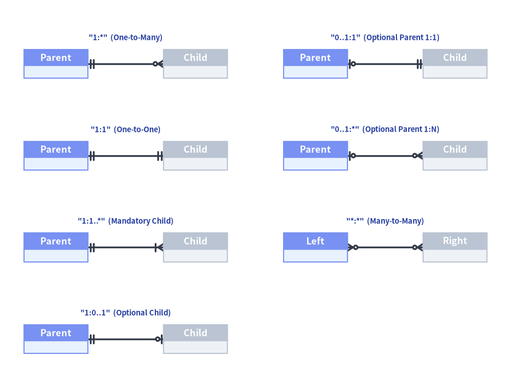
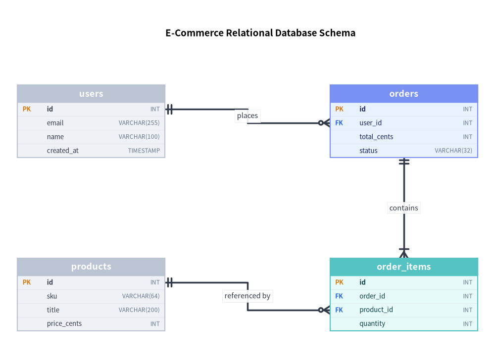

# ER 図 (ERDiagram): リレーショナルスキーマと Crow's Foot 記法

`ERDiagram` は、物理データベーススキーマモデリングの業界標準である **Information Engineering (IE) / Crow's Foot（カラスの足跡）記法**に厳密に準拠してリレーショナルデータベースアーキテクチャを可視化します。


<figure class="drawlib-image" style="text-align: center;">
  
  <figcaption class="drawlib-caption">行単位でアンカー接続された Crow's Foot 記法によるエンティティ・リレーションシップテーブル</figcaption>
</figure>

<details class="drawlib-code-details">
<summary>Source Code</summary>

```python
from drawlib.canvas import save, setup
from drawlib.diagrams.er import ERDiagram, Entity
from drawlib.styles import Styles

setup(width=98, height=24)

er = ERDiagram(
    node_style=Styles.Neutral,
    edge_style=Styles.DarkBold,
    edge_text_style=Styles.Dark.patch(text_size=10.5),
)

users = er.add(Entity(name="users", width=32.0), xy=(19.0, 12.0))
users.add_column("id", type="INT", pk=True)
users.add_column("email", type="VARCHAR(255)", nullable=False)
users.add_column("name", type="VARCHAR(100)")

orders = er.add(Entity(name="orders", width=32.0, style=Styles.PrimaryNeutral), xy=(79.0, 12.0))
orders.add_column("id", type="INT", pk=True)
orders.add_column("user_id", type="INT", fk=True)
orders.add_column("total", type="DECIMAL(10,2)", nullable=False)

users.connect(
    orders,
    cardinality="1:*",
    start_side="right",
    end_side="left",
    start_column="id",
    end_column="user_id",
    label="places",
)

er.draw(xy=(0.0, 0.0))
save()
```

</details>


---

## 1. 基本概念と基本的な使い方

`ERDiagram` は、`er.add(entity, xy=(cx, cy))` によってリレーショナルな `Entity` テーブルを**中心 `(cx, cy)`** 基準で配置し、すべてのカラムが収まるよう `effective_height` を自動拡張しながら、自動 `PK` / `FK` キーバッジ付きの型付きスキーマ行を描画します。リレーションシップは業界標準の Information Engineering (IE) 方式 Crow's Foot の `cardinality` マーカーを描画し、`start_column` と `end_column` で主キー行・外部キー行へ直接スナップ接続できるほか、カスタムの `header_style` バンド、`show=False` による非表示、`align="center"` 配置をサポートします。


<figure class="drawlib-image" style="text-align: center;">
  
  <figcaption class="drawlib-caption">基本的な使い方とパラメータツアー: エンティティテーブルとキーバッジ、Crow's Foot カーディナリティ、行レベルのカラムアンカー、ヘッダースタイルと段階的表示 (APNG アニメーション)</figcaption>
</figure>

<details class="drawlib-code-details">
<summary>Source Code</summary>

```python
from __future__ import annotations

from drawlib.anim import Animation
from drawlib.canvas import save, setup
from drawlib.diagrams.er import Entity, ERDiagram
from drawlib.icons import code as code_icons
from drawlib.icons import phosphor
from drawlib.lines import line
from drawlib.shapes import circle, rectangle
from drawlib.smartarts import SourceCode, SourceCodeStyles
from drawlib.styles import Colors, Styles
from drawlib.text import text

W, H = 138.0, 82.0
setup(width=W, height=H)
anim = Animation(fps=10.0, loop=0)

CODE_TEXT_SIZE = 10.0
PT_TO_CANVAS = W / 720.0
FONT_CANVAS = CODE_TEXT_SIZE * PT_TO_CANVAS
LINE_H = FONT_CANVAS * 1.8
PAD_Y = FONT_CANVAS * 1.2

CODE_STYLES = SourceCodeStyles.get("default", font_lang="en", text_size=CODE_TEXT_SIZE).patch(
    box_style=Styles.Neutral.patch(shape_fill_color=(0, 0, 0, 0), shape_line_width=0),
)

PANE_HEADER = Styles.Neutral.patch(
    shape_fill_color=(238, 243, 250),
    shape_line_color=(203, 213, 225),
    shape_line_width=1.2,
    shape_r=0.0,
)
EDITOR_BODY = Styles.Neutral.patch(
    shape_fill_color=(250, 252, 255),
    shape_line_color=(203, 213, 225),
    shape_line_width=1.2,
    shape_r=0.0,
)
TAKEAWAY_BODY = Styles.Neutral.patch(
    shape_fill_color=(242, 246, 253),
    shape_line_color=(203, 213, 225),
    shape_line_width=1.2,
    shape_r=0.0,
)
STUDIO_BODY = Styles.Neutral.patch(
    shape_fill_color=(239, 243, 249),
    shape_line_color=(203, 213, 225),
    shape_line_width=1.2,
    shape_r=0.0,
)

PART_ITEMS = [
    ("1. Entity & Keys", "Center xy & PK/FK badges"),
    ("2. Cardinalities", "IE Crow's Foot markers"),
    ("3. Row Anchoring", "start_column & end_column"),
    ("4. Style & Reveal", "header_style, show & center"),
]


def draw_step_bar(active_part: int) -> None:
    """Draw top 4-part progress bar (active_part is 1..4)."""
    pill_w = 31.0
    pill_h = 7.4
    gap = 2.0
    start_x = 4.0 + pill_w / 2.0
    cy = 75.2

    for idx, (label, sublabel) in enumerate(PART_ITEMS, start=1):
        cx = start_x + (idx - 1) * (pill_w + gap)
        if idx > 1:
            prev_cx = cx - (pill_w + gap)
            line(
                (prev_cx + pill_w / 2.0 + 0.2, cy),
                (cx - pill_w / 2.0 - 0.2, cy),
                style=Styles.PrimaryBold if idx <= active_part else Styles.MutedThin,
            )

        if idx == active_part:
            st = Styles.PrimaryFlat.patch(shape_r=1.4)
            tst = Styles.WhiteBold.patch(text_size=10.3)
            sub_tst = Styles.White.patch(text_size=9.5)
        elif idx < active_part:
            st = Styles.PrimaryNeutral.patch(shape_r=1.4, shape_line_width=1.1)
            tst = Styles.PrimaryBold.patch(text_size=10.3)
            sub_tst = Styles.Primary.patch(text_size=9.5)
        else:
            st = Styles.Neutral.patch(shape_r=1.4, shape_line_width=1.1)
            tst = Styles.MutedBold.patch(text_size=10.3)
            sub_tst = Styles.Muted.patch(text_size=9.5)

        rectangle((cx, cy), width=pill_w, height=pill_h, style=st)
        text((cx, cy + 1.35), label, style=tst)
        text((cx, cy - 1.55), sublabel, style=sub_tst)


def draw_left_pane(
    active_part: int,
    code_lines: list[str],
    hl_range: tuple[int, int],
    icon_fn: object,
    summary_title: str,
    summary_line1: str,
    summary_line2: str,
) -> None:
    """Draw left Python code editor + bottom concept takeaway card."""
    x0, w = 4.0, 63.5
    cx = x0 + w / 2.0
    top_y = 63.2
    header_h = 5.4
    editor_h = 43.8
    takeaway_h = 15.8

    rectangle((cx, top_y + header_h / 2.0), width=w, height=header_h, style=PANE_HEADER)
    code_icons.python((x0 + 3.6, top_y + header_h / 2.0), width=3.4, style=Styles.Neutral)
    text(
        (x0 + 6.5, top_y + header_h / 2.0),
        "er_tour.py",
        style=Styles.DarkBold.patch(text_size=10.2, halign="left"),
    )
    text(
        (x0 + w - 2.6, top_y + header_h / 2.0),
        f"Part {active_part} / 4",
        style=Styles.PrimaryBold.patch(text_size=9.8, halign="right"),
    )

    rectangle((cx, top_y - editor_h / 2.0), width=w, height=editor_h, style=EDITOR_BODY)

    hl_start, hl_end = hl_range
    hl_top = top_y - PAD_Y - hl_start * LINE_H
    hl_bot = top_y - PAD_Y - (hl_end + 1) * LINE_H
    hl_cy = (hl_top + hl_bot) / 2.0
    hl_h = hl_top - hl_bot
    rectangle(
        (cx, hl_cy),
        width=w - 0.6,
        height=hl_h,
        style=Styles.Neutral.patch(shape_fill_color=(229, 239, 255), shape_line_width=0),
    )
    rectangle(
        (x0 + 0.55, hl_cy),
        width=0.9,
        height=hl_h,
        style=Styles.PrimaryFlat.patch(shape_line_width=0),
    )

    SourceCode.draw(
        xy=(x0, top_y),
        width=w,
        code="\n".join(code_lines),
        styles=CODE_STYLES,
        code_lang="python",
        show_linenum=True,
        align="top_left",
    )

    take_cy = 3.6 + takeaway_h / 2.0
    rectangle((cx, take_cy), width=w, height=takeaway_h, style=TAKEAWAY_BODY)
    circle(
        (x0 + 6.4, take_cy),
        radius=3.3,
        style=Styles.PrimaryNeutral.patch(shape_line_width=1.2),
    )
    icon_fn((x0 + 6.4, take_cy), width=3.8, style=Styles.PrimaryBold)  # type: ignore[operator]
    text(
        (x0 + 11.4, take_cy + 3.6),
        summary_title,
        style=Styles.DarkBold.patch(text_size=10.4, halign="left"),
    )
    text(
        (x0 + 11.4, take_cy - 0.2),
        summary_line1,
        style=Styles.Dark.patch(text_size=9.7, halign="left"),
    )
    text(
        (x0 + 11.4, take_cy - 3.8),
        summary_line2,
        style=Styles.PrimaryBold.patch(text_size=9.6, halign="left"),
    )


def draw_geometry_studio(param_badge: str, footer_caption: str) -> tuple[float, float]:
    """Draw right geometry lab shell, inner coordinate sheet with subtle grid, and footer."""
    x0, w = 70.0, 64.0
    cx = x0 + w / 2.0
    top_y = 63.2
    header_h = 5.4
    body_h = 59.6

    rectangle((cx, top_y + header_h / 2.0), width=w, height=header_h, style=PANE_HEADER)
    phosphor.ruler((x0 + 3.6, top_y + header_h / 2.0), width=3.4, style=Styles.Primary)
    text(
        (x0 + 6.5, top_y + header_h / 2.0),
        "Live Geometry & Guides",
        style=Styles.DarkBold.patch(text_size=10.2, halign="left"),
    )
    text(
        (x0 + w - 2.6, top_y + header_h / 2.0),
        param_badge,
        style=Styles.PrimaryBold.patch(text_size=9.6, halign="right"),
    )

    rectangle((cx, 3.6 + body_h / 2.0), width=w, height=body_h, style=STUDIO_BODY)

    sheet_cx, sheet_cy = cx, 36.2
    sheet_w, sheet_h = 54.0, 40.0
    sx0, sy0 = sheet_cx - sheet_w / 2.0, sheet_cy - sheet_h / 2.0
    rectangle(
        (sheet_cx, sheet_cy),
        width=sheet_w,
        height=sheet_h,
        style=Styles.Neutral.patch(
            shape_fill_color=(255, 255, 255),
            shape_line_color=(180, 194, 214),
            shape_line_width=1.2,
        ),
    )
    g_st = Styles.MutedThin.patch(line_color=(232, 238, 246), line_width=0.8)
    for gx in range(1, 6):
        vx = sx0 + gx * (sheet_w / 6.0)
        line((vx, sy0), (vx, sy0 + sheet_h), style=g_st)
    for gy in range(1, 5):
        vy = sy0 + gy * (sheet_h / 5.0)
        line((sx0, vy), (sx0 + sheet_w, vy), style=g_st)

    rectangle(
        (cx, 8.4),
        width=59.2,
        height=5.2,
        style=Styles.Neutral.patch(
            shape_fill_color=(255, 255, 255),
            shape_line_color=(203, 213, 225),
            shape_line_width=1.1,
            shape_r=2.4,
        ),
        text=footer_caption,
        text_style=Styles.DarkBold.patch(text_size=9.8),
    )
    return sheet_cx, sheet_cy


def draw_sub_pills(scx: float, labels: list[str], active_idx: int) -> None:
    """Draw 3-step tracker pills near the top of the studio sheet."""
    pw, ph, pgap = 16.2, 4.2, 0.9
    p_start = scx - (3 * pw + 2 * pgap) / 2.0 + pw / 2.0
    for idx, lbl in enumerate(labels):
        px = p_start + idx * (pw + pgap)
        if idx == active_idx:
            pst = Styles.PrimaryFlat.patch(shape_r=1.2)
            ptst = Styles.WhiteBold.patch(text_size=9.5)
        elif idx < active_idx:
            pst = Styles.PrimaryNeutral.patch(shape_r=1.2, shape_line_width=1.0)
            ptst = Styles.PrimaryBold.patch(text_size=9.5)
        else:
            pst = Styles.Neutral.patch(shape_r=1.2, shape_line_width=1.0)
            ptst = Styles.Muted.patch(text_size=9.5)
        rectangle((px, 52.0), width=pw, height=ph, style=pst, text=lbl, text_style=ptst)


EDGE_TXT = Styles.Dark.patch(text_size=9.5)

# =========================================================================
# Part 1: Entity & Keys — Center xy, PK/FK badges & auto height
# =========================================================================
PART1_STATES = [
    (
        1,
        3.3,
        [
            "er = ERDiagram(",
            "    node_style=Styles.Neutral,",
            "    edge_style=Styles.DarkBold,",
            "    edge_text_style=Styles.Dark)",
            "users = er.add(",
            '    Entity("users", width=26),',
            "    xy=(22, 13.5))  # card center",
            "",
            "# Base bottom-left diagram origin",
            "er.draw(xy=(6, 6))",
        ],
        (4, 9),
        "Entity + xy",
        "Step 1: Place Entity at Center xy=(22, 13.5), Draw at (6, 6)",
        "1. Center-Placed Entity & Base Origin",
        "er.add(entity, xy) anchors each table by center (cx, cy)",
        "er.draw(xy) shifts all entities from bottom-left (x0, y0)",
    ),
    (
        2,
        3.3,
        [
            "er = ERDiagram(...)",
            "users = er.add(",
            '    Entity("users", width=26),',
            "    xy=(22, 13.5))",
            "users.add_column(",
            '    "id", type="INT", pk=True)',
            "users.add_column(",
            '    "email", type="VARCHAR",',
            "    nullable=False)",
            "er.draw(xy=(6, 6))",
        ],
        (4, 8),
        "PK & Columns",
        "Step 2: add_column() Adds PK Badge & Expands Table Height",
        "2. Primary Key Badge & Column Rows",
        "pk=True highlights the amber PK tag + bold column name",
        "effective_height auto-expands per row (7.2 -> 10.4)",
    ),
    (
        3,
        3.5,
        [
            'users = er.add(Entity("users"),',
            "    xy=(12, 13.5))",
            "users.add_column(",
            '    "id", type="INT", pk=True)',
            'orders = er.add(Entity("orders"),',
            "    xy=(38, 13.5))",
            "orders.add_column(",
            '    "id", type="INT", pk=True)',
            "orders.add_column(",
            '    "user_id", "INT", fk=True)',
            "er.draw(xy=(6, 6))",
        ],
        (4, 9),
        "FK Badge",
        "Step 3: Second Entity Table With Blue FK Key Badge",
        "3. Foreign Key (fk=True) Sibling Table",
        "fk=True renders the blue FK badge next to user_id",
        "Prepares primary & foreign key rows for Crow's Foot links",
    ),
]

for p1_idx, (step_n, dur, code_1, hl_rng, badge_txt, foot_txt, s_t, s_1, s_2) in enumerate(PART1_STATES):
    with anim.frame(duration=dur):
        draw_step_bar(1)
        draw_left_pane(1, code_1, hl_rng, phosphor.table, s_t, s_1, s_2)
        scx, scy = draw_geometry_studio(badge_txt, foot_txt)
        draw_sub_pills(scx, ["1. Entity xy", "2. PK & Columns", "3. FK Sibling"], p1_idx)

        if step_n <= 2:
            bx, by = 80.0, 21.0
            er = ERDiagram(
                node_style=Styles.Neutral,
                edge_style=Styles.DarkBold,
                edge_text_style=EDGE_TXT,
            )
            users = er.add(Entity("users", width=26.0), xy=(22.0, 14.0))
            if step_n == 2:
                users.add_column("id", type="INT", pk=True)
                users.add_column("email", type="VARCHAR", nullable=False)
            er.draw(xy=(bx, by))

            ecx, ecy = bx + 22.0, by + 14.0
            eff_h = users.effective_height
            dim_x = ecx + 15.0
            line(
                (dim_x, ecy - eff_h / 2.0),
                (dim_x, ecy + eff_h / 2.0),
                arrow_head="<->",
                style=Styles.PrimaryBold.patch(line_width=1.2),
            )
            text(
                (dim_x + 1.1, ecy),
                f"h={eff_h:.1f}",
                style=Styles.PrimaryBold.patch(text_size=9.5, halign="left"),
            )
            if step_n == 1:
                circle((ecx, ecy - 1.6), radius=0.95, style=Styles.PrimaryFlat)
                text(
                    (ecx, ecy + 5.8),
                    "entity center xy = (22, 13.5)",
                    style=Styles.PrimaryBold.patch(text_size=9.5),
                )
            y_arrow_h = 10.0
        else:
            bx, by = 77.2, 21.0
            er = ERDiagram(
                node_style=Styles.Neutral,
                edge_style=Styles.DarkBold,
                edge_text_style=EDGE_TXT,
            )
            users = er.add(Entity("users", width=21.0), xy=(11.8, 14.8))
            users.add_column("id", type="INT", pk=True)
            users.add_column("email", type="VARCHAR", nullable=False)

            orders = er.add(Entity("orders", width=21.0, style=Styles.PrimaryNeutral), xy=(37.2, 14.8))
            orders.add_column("id", type="INT", pk=True)
            orders.add_column("user_id", type="INT", fk=True)
            er.draw(xy=(bx, by))
            text(
                (bx + 37.2, 43.2),
                "PK + FK badges",
                style=Styles.PrimaryBold.patch(text_size=9.5),
            )
            y_arrow_h = 6.2

        # Red base origin xy=(x0, y0) + +X / +Y axes
        line(
            (bx, by),
            (bx, by + y_arrow_h),
            arrow_head="->",
            style=Styles.DangerBold.patch(line_width=1.3),
        )
        text(
            (bx, by + y_arrow_h + 1.3),
            "+Y",
            style=Styles.DangerBold.patch(text_size=9.5),
        )
        line(
            (bx, by),
            (bx + 10.5, by),
            arrow_head="->",
            style=Styles.DangerBold.patch(line_width=1.3),
        )
        text(
            (bx + 11.3, by),
            "+X",
            style=Styles.DangerBold.patch(text_size=9.5, halign="left"),
        )
        circle((bx, by), radius=1.1, style=Styles.DangerFlat)
        text(
            (bx + 1.8, 18.2),
            "er.draw(xy=(6, 6))  (base origin)",
            style=Styles.DangerBold.patch(text_size=9.5, halign="left"),
        )

# =========================================================================
# Part 2: Cardinalities — IE Crow's Foot markers
# =========================================================================
PART2_STATES = [
    (
        "one_to_many",
        3.3,
        [
            "# IE Crow's Foot One-to-Many",
            "users.connect(",
            "    orders,",
            '    cardinality="1:*",',
            '    start_side="right",',
            '    end_side="left",',
            '    label="owns")',
            "er.draw(xy=(6, 6))",
        ],
        (1, 6),
        'cardinality="1:*"',
        'cardinality="1:*": Double Bar (1) to Crow\'s Foot (0..N)',
        '1. One-to-Many ("1:*" Default)',
        "Left '1' renders double vertical bar (exactly one)",
        "Right '*' renders circle + 3-prong crow's foot (0..N)",
    ),
    (
        "optional_links",
        3.3,
        [
            "# Optional child (|| to o|)",
            "users.connect(",
            "    profile,",
            '    cardinality="1:0..1",',
            '    label="has")',
            "# Optional parent (o| to o<)",
            "coupon.connect(",
            "    orders,",
            '    cardinality="0..1:*",',
            '    label="applies")',
        ],
        (1, 9),
        '"1:0..1" / "0..1:*"',
        'Optional Zero-or-One ("1:0..1") & Optional Parent ("0..1:*")',
        '2. Optional Zero-or-One ("0..1") Markers',
        '"1:0..1" pairs double bar with circle+bar (optional 1:1)',
        '"0..1:*" marks an optional parent foreign key (0..1 to N)',
    ),
    (
        "mandatory_m2m",
        3.5,
        [
            "# Mandatory child (|| to |<)",
            "orders.connect(",
            "    items,",
            '    cardinality="1:1..*",',
            '    label="owns")',
            "# Many-to-Many (o< to o<)",
            "posts.connect(",
            "    tags,",
            '    cardinality="*:*",',
            '    label="tagged")',
        ],
        (1, 9),
        '"1:1..*" & "*:*"',
        'Mandatory Child ("1:1..*") & Many-to-Many ("*:*")',
        '3. Mandatory One-or-Many & Many-to-Many',
        '"1:1..*" draws bar + crow\'s foot (at least one child)',
        '"*:*" places symmetric crow\'s foot forks on both ends',
    ),
]

for p2_idx, (c_mode, dur, code_2, hl_rng, badge_txt, foot_txt, s_t, s_1, s_2) in enumerate(PART2_STATES):
    with anim.frame(duration=dur):
        draw_step_bar(2)
        draw_left_pane(2, code_2, hl_rng, phosphor.flow_arrow, s_t, s_1, s_2)
        scx, scy = draw_geometry_studio(badge_txt, foot_txt)
        draw_sub_pills(scx, ['"1:*" (1-to-N)', '"1:0..1" & "0..1:*"', '"1:1..*" & "*:*"'], p2_idx)

        er = ERDiagram(
            node_style=Styles.Neutral,
            edge_style=Styles.DarkBold,
            edge_text_style=EDGE_TXT,
        )

        if c_mode == "one_to_many":
            u = er.add(Entity("users", width=19.8), xy=(86.4, 34.0))
            u.add_column("id", type="INT", pk=True)
            u.add_column("email", type="TEXT", nullable=False)

            o = er.add(Entity("orders", width=19.8, style=Styles.PrimaryNeutral), xy=(117.6, 34.0))
            o.add_column("id", type="INT", pk=True)
            o.add_column("user_id", type="INT", fk=True)

            u.connect(o, cardinality="1:*", start_side="right", end_side="left", label="owns")
            er.draw(xy=(0.0, 0.0))

            text((97.8, 41.8), "|| (1)", style=Styles.PrimaryBold.patch(text_size=9.5))
            text((106.2, 41.8), "o< (*)", style=Styles.PrimaryBold.patch(text_size=9.5))
            text(
                (scx, 19.0),
                'cardinality="1:*"  •  1 parent row -> 0..N child rows',
                style=Styles.DarkBold.patch(text_size=9.5),
            )
        elif c_mode == "optional_links":
            xl, xr = 85.0, 119.0
            yt, yb = 40.8, 25.0
            e1 = er.add(Entity("users", width=15.5, header_height=3.6, row_height=3.0, style=Styles.PrimaryNeutral), xy=(xl, yt))
            e1.add_column("id", type="INT")
            e2 = er.add(Entity("profile", width=15.5, header_height=3.6, row_height=3.0), xy=(xr, yt))
            e2.add_column("uid", type="INT")
            e1.connect(e2, cardinality="1:0..1", start_side="right", end_side="left", label="has")

            e3 = er.add(Entity("coupon", width=15.5, header_height=3.6, row_height=3.0, style=Styles.SecondaryNeutral), xy=(xl, yb))
            e3.add_column("id", type="INT")
            e4 = er.add(Entity("orders", width=15.5, header_height=3.6, row_height=3.0), xy=(xr, yb))
            e4.add_column("cid", type="INT")
            e3.connect(e4, cardinality="0..1:*", start_side="right", end_side="left", label="applies")
            er.draw(xy=(0.0, 0.0))

            text((scx, 46.5), '"1:0..1"  (One to Zero-or-One)', style=Styles.PrimaryBold.patch(text_size=9.5))
            text((scx, 18.6), '"0..1:*"  (Zero-or-One to Zero-or-Many)', style=Styles.DarkBold.patch(text_size=9.5))
        else:
            xl, xr = 85.0, 119.0
            yt, yb = 40.8, 25.0
            e1 = er.add(Entity("orders", width=15.5, header_height=3.6, row_height=3.0, style=Styles.PrimaryNeutral), xy=(xl, yt))
            e1.add_column("id", type="INT")
            e2 = er.add(Entity("items", width=15.5, header_height=3.6, row_height=3.0), xy=(xr, yt))
            e2.add_column("oid", type="INT")
            e1.connect(e2, cardinality="1:1..*", start_side="right", end_side="left", label="owns")

            e3 = er.add(Entity("posts", width=15.5, header_height=3.6, row_height=3.0, style=Styles.SecondaryNeutral), xy=(xl, yb))
            e3.add_column("id", type="INT")
            e4 = er.add(Entity("tags", width=15.5, header_height=3.6, row_height=3.0), xy=(xr, yb))
            e4.add_column("id", type="INT")
            e3.connect(e4, cardinality="*:*", start_side="right", end_side="left", label="tagged")
            er.draw(xy=(0.0, 0.0))

            text((scx, 46.5), '"1:1..*"  (Mandatory One-or-Many)', style=Styles.PrimaryBold.patch(text_size=9.5))
            text((scx, 18.6), '"*:*"  (Symmetric Many-to-Many)', style=Styles.DarkBold.patch(text_size=9.5))

# =========================================================================
# Part 3: Row Anchoring — Perimeter midpoint vs start_column & end_column
# =========================================================================
PART3_STATES = [
    (
        "midpoint",
        3.3,
        [
            "# Default: card side midpoint",
            "users.connect(",
            "    orders,",
            '    cardinality="1:*",',
            '    start_side="right",',
            '    end_side="left")',
            "# start_column / end_column",
            "# omitted -> attaches at cy",
            "er.draw(xy=(6, 6))",
        ],
        (1, 5),
        "Side Midpoint",
        "No Column Names: Attaches at Card Vertical Midpoint (cy)",
        "1. Entity-Perimeter Midpoint Anchor",
        "Omitting start_column / end_column attaches at cy",
        "Clean for high-level conceptual ER overviews",
    ),
    (
        "row_anchor",
        3.3,
        [
            "# Pin directly to PK & FK rows!",
            "users.connect(",
            "    orders,",
            '    cardinality="1:*",',
            '    start_side="right",',
            '    end_side="left",',
            '    start_column="id",',
            '    end_column="user_id")',
            "er.draw(xy=(6, 6))",
        ],
        (6, 7),
        "PK -> FK Rows",
        'start_column="id" -> end_column="user_id" Row Snapping',
        "2. Exact Row-Level PK -> FK Anchoring",
        "Snaps wire directly from users.id [PK] to user_id [FK]",
        "Orthogonal Z-bend routes cleanly between exact rows",
    ),
    (
        "multi_fk",
        3.5,
        [
            "users.connect(",
            '    orders, cardinality="1:*",',
            '    start_column="id",',
            '    end_column="user_id")',
            "orders.connect(",
            '    items, cardinality="1:*",',
            '    start_side="left",',
            '    end_side="right",',
            '    start_column="id",',
            '    end_column="ord_id")',
        ],
        (0, 9),
        "Multi-FK Schema",
        "Multi-Table Row Anchoring: users.id & orders.id -> FKs",
        "3. Multi-Table Relational FK Wiring",
        "Each foreign key links unambiguously to its target PK",
        "Zero crossing when row order matches vertical layout",
    ),
]

for p3_idx, (a_mode, dur, code_3, hl_rng, badge_txt, foot_txt, s_t, s_1, s_2) in enumerate(PART3_STATES):
    with anim.frame(duration=dur):
        draw_step_bar(3)
        draw_left_pane(3, code_3, hl_rng, phosphor.link, s_t, s_1, s_2)
        scx, scy = draw_geometry_studio(badge_txt, foot_txt)
        draw_sub_pills(scx, ["Card Midpoint", "PK -> FK Rows", "Multi-FK Schema"], p3_idx)

        er = ERDiagram(
            node_style=Styles.Neutral,
            edge_style=Styles.DarkBold,
            edge_text_style=EDGE_TXT,
        )

        if a_mode in {"midpoint", "row_anchor"}:
            u = er.add(Entity("users", width=20.4), xy=(86.7, 34.2))
            u.add_column("id", type="INT", pk=True)
            u.add_column("email", type="TEXT", nullable=False)
            u.add_column("name", type="TEXT")

            o = er.add(Entity("orders", width=20.4, style=Styles.PrimaryNeutral), xy=(117.3, 34.2))
            o.add_column("id", type="INT", pk=True)
            o.add_column("total", type="DEC", nullable=False)
            o.add_column("user_id", type="INT", fk=True)

            if a_mode == "midpoint":
                u.connect(o, cardinality="1:*", start_side="right", end_side="left")
                er.draw(xy=(0.0, 0.0))
                circle((96.9, 34.2), radius=0.85, style=Styles.DangerFlat)
                circle((107.1, 34.2), radius=0.85, style=Styles.DangerFlat)
                text(
                    (scx, 43.2),
                    "attaches to vertical midpoint (cy)",
                    style=Styles.DarkBold.patch(text_size=9.5),
                )
                text(
                    (scx, 18.8),
                    "card-center ports (not tied to specific PK / FK rows)",
                    style=Styles.MutedBold.patch(text_size=9.5),
                )
            else:
                u.connect(
                    o,
                    cardinality="1:*",
                    start_side="right",
                    end_side="left",
                    start_column="id",
                    end_column="user_id",
                )
                er.draw(xy=(0.0, 0.0))
                # Exact row anchor coordinates: users.id (row 0 -> 35.4), orders.user_id (row 2 -> 29.0)
                circle((96.9, 35.4), radius=0.9, style=Styles.DangerFlat)
                circle((107.1, 29.0), radius=0.9, style=Styles.DangerFlat)
                text(
                    (scx, 43.2),
                    "users.id [PK]  ->  orders.user_id [FK]",
                    style=Styles.PrimaryBold.patch(text_size=9.5),
                )
                text(
                    (scx, 18.8),
                    "red dots mark exact row-level attachment ports!",
                    style=Styles.DangerBold.patch(text_size=9.5),
                )
        else:
            items = er.add(
                Entity("items", width=20.2, header_height=3.6, row_height=2.9, style=Styles.SecondaryNeutral),
                xy=(86.9, 43.1),
            )
            items.add_column("id", type="INT", pk=True)
            items.add_column("ord_id", type="INT", fk=True)

            users = er.add(
                Entity("users", width=20.2, header_height=3.6, row_height=2.9, style=Styles.Neutral),
                xy=(86.9, 24.9),
            )
            users.add_column("id", type="INT", pk=True)
            users.add_column("email", type="TEXT", nullable=False)

            orders = er.add(
                Entity("orders", width=20.2, header_height=3.8, row_height=3.1, style=Styles.PrimaryNeutral),
                xy=(117.1, 34.0),
            )
            orders.add_column("id", type="INT", pk=True)
            orders.add_column("user_id", type="INT", fk=True)
            orders.add_column("total", type="DEC", nullable=False)

            orders.connect(
                items,
                cardinality="1:*",
                start_side="left",
                end_side="right",
                start_column="id",
                end_column="ord_id",
            )
            users.connect(
                orders,
                cardinality="1:*",
                start_side="right",
                end_side="left",
                start_column="id",
                end_column="user_id",
            )
            er.draw(xy=(0.0, 0.0))

            for rx, ry in ((97.0, 39.85), (107.0, 35.2), (97.0, 24.55), (107.0, 32.1)):
                circle((rx, ry), radius=0.75, style=Styles.DangerFlat)
            text(
                (117.1, 18.5),
                "2 non-crossing PK->FK wires",
                style=Styles.PrimaryBold.patch(text_size=9.5),
            )

# =========================================================================
# Part 4: Style & Reveal — header_style, show=False & align="center"
# =========================================================================
PART4_STATES = [
    (
        "header_style",
        3.3,
        [
            "HDR = Styles.PrimaryFlat.patch(",
            "    text_color=Colors.White)",
            "orders = er.add(",
            "    Entity(",
            '        "orders", width=20.2,',
            "        header_style=HDR),",
            "    xy=(40, 13.8))",
            "# Keep sibling tables Neutral!",
            'users = er.add(Entity("users"),',
            "    xy=(10, 4.7))",
        ],
        (0, 6),
        "header_style",
        "header_style: Hero PrimaryFlat Header on Focal Table",
        "1. Focal Entity Header Styling",
        "Highlight core fact/order table via header_style",
        "Keep 50%+ sibling tables grounded in Neutral styles",
    ),
    (
        "hide_entity",
        3.3,
        [
            'items = er.add(Entity("items"),',
            "    xy=(10, 22.9))",
            "orders.connect(",
            '    items, cardinality="1:*",',
            '    start_column="id",',
            '    end_column="ord_id")',
            "",
            "# Hide table + incident FK wire!",
            "items.show = False",
            "er.draw(xy=(6, 6))",
        ],
        (7, 8),
        "show = False",
        "items.show=False: Hides Entity & Incident FK Relationship",
        "2. Schema-Stable Visibility (show = False)",
        "Hides items table and its orders->items Crow's Foot wire",
        "users and orders stay locked in place for step builds",
    ),
    (
        "center_align",
        3.5,
        [
            "er = ERDiagram(",
            "    ..., width=50.4, height=27.6)",
            'users = er.add(Entity("users"),',
            "    xy=(10, 4.7))",
            'items = er.add(Entity("items"),',
            "    xy=(10, 22.9))",
            'orders = er.add(Entity("orders"),',
            "    xy=(40, 13.8))",
            "er.draw(",
            "    xy=(34, 20),",
            '    align="center")',
        ],
        (8, 10),
        'align="center"',
        'align="center": Centers (width, height) Schema Box on xy',
        '3. Centered Placement (align="center")',
        "Centers total (width, height) diagram bounds on xy",
        "Great for multi-panel architecture & database views",
    ),
]

for p4_idx, (p4_mode, dur, code_4, hl_rng, badge_txt, foot_txt, s_t, s_1, s_2) in enumerate(PART4_STATES):
    with anim.frame(duration=dur):
        draw_step_bar(4)
        draw_left_pane(4, code_4, hl_rng, phosphor.crosshair, s_t, s_1, s_2)
        scx, scy = draw_geometry_studio(badge_txt, foot_txt)
        draw_sub_pills(scx, ["header_style", "show = False", 'align="center"'], p4_idx)

        dw, dh = 50.4, 27.6
        er = ERDiagram(
            node_style=Styles.Neutral,
            edge_style=Styles.DarkBold,
            edge_text_style=EDGE_TXT,
            width=dw,
            height=dh,
        )
        hdr_hero = Styles.PrimaryFlat.patch(text_color=Colors.White)

        items = er.add(
            Entity("items", width=20.2, header_height=3.6, row_height=2.9, style=Styles.SecondaryNeutral),
            xy=(10.1, 22.9),
            show=(p4_mode != "hide_entity"),
        )
        items.add_column("id", type="INT", pk=True)
        items.add_column("ord_id", type="INT", fk=True)

        users = er.add(
            Entity("users", width=20.2, header_height=3.6, row_height=2.9, style=Styles.Neutral),
            xy=(10.1, 4.7),
        )
        users.add_column("id", type="INT", pk=True)
        users.add_column("email", type="TEXT", nullable=False)

        orders = er.add(
            Entity(
                "orders",
                width=20.2,
                header_height=3.8,
                row_height=3.1,
                style=Styles.PrimaryNeutral,
                header_style=hdr_hero if p4_mode == "header_style" else None,
            ),
            xy=(40.3, 13.8),
        )
        orders.add_column("id", type="INT", pk=True)
        orders.add_column("user_id", type="INT", fk=True)
        orders.add_column("total", type="DEC", nullable=False)

        orders.connect(
            items,
            cardinality="1:*",
            start_side="left",
            end_side="right",
            start_column="id",
            end_column="ord_id",
        )
        users.connect(
            orders,
            cardinality="1:*",
            start_side="right",
            end_side="left",
            start_column="id",
            end_column="user_id",
        )

        if p4_mode == "header_style":
            er.draw(xy=(76.8, 20.2))
            text(
                (117.1, 42.4),
                "PrimaryFlat header",
                style=Styles.PrimaryBold.patch(text_size=9.5),
            )
            text(
                (117.1, 18.5),
                "focal orders + 2 Neutral siblings",
                style=Styles.DarkBold.patch(text_size=9.5),
            )
        elif p4_mode == "hide_entity":
            bx, by = 76.8, 20.2
            er.draw(xy=(bx, by))
            rectangle(
                (bx + 10.1, by + 22.9),
                width=20.2,
                height=9.4,
                style=Styles.MutedDashed.patch(shape_fill_color=(0, 0, 0, 0), shape_line_width=1.1),
            )
            text(
                (bx + 10.1, by + 22.9),
                "show=False",
                style=Styles.MutedBold.patch(text_size=9.5),
            )
            text(
                (117.1, 18.5),
                "items + FK wire hidden in place",
                style=Styles.PrimaryBold.patch(text_size=9.5),
            )
        else:
            cx_a, cy_a = scx, 34.0
            er.draw(xy=(cx_a, cy_a), align="center")
            rectangle(
                (cx_a, cy_a),
                width=dw,
                height=dh,
                style=Styles.PrimaryDashed.patch(shape_fill_color=(0, 0, 0, 0), shape_line_width=1.2),
            )
            line((cx_a - dw / 2.0 - 1.3, cy_a), (cx_a - dw / 2.0, cy_a), style=Styles.DangerBold.patch(line_width=1.5))
            line((cx_a + dw / 2.0, cy_a), (cx_a + dw / 2.0 + 1.3, cy_a), style=Styles.DangerBold.patch(line_width=1.5))
            line((cx_a, cy_a + dh / 2.0), (cx_a, cy_a + dh / 2.0 + 1.4), style=Styles.DangerBold.patch(line_width=1.5))
            line((cx_a, cy_a - dh / 2.0 - 1.4), (cx_a, cy_a - dh / 2.0), style=Styles.DangerBold.patch(line_width=1.5))
            circle(
                (cx_a, cy_a),
                radius=1.25,
                style=Styles.Neutral.patch(shape_fill_color=(255, 255, 255), shape_line_width=0),
            )
            circle((cx_a, cy_a), radius=0.95, style=Styles.DangerFlat)
            text(
                (117.1, 18.5),
                'xy=(cx, cy) • align="center"',
                style=Styles.DangerBold.patch(text_size=9.5),
            )

save()
```

</details>


- **中心基準の `Entity` カードとキーバッジ (`xy`, `pk`, `fk`, `nullable`)**: `er.add(entity, xy=(cx, cy))` は各テーブルを中心座標で配置し、`.add_column(...)` がアンバー色の `PK` タグや青色の `FK` タグを付与しながら `effective_height` を自動的に拡張します。
- **IE 方式 Crow's Foot カーディナリティ (`cardinality`)**: `entity.connect(...)` と `er.connect(...)` は、全 7 種類の多重度（`"1:*"`、`"1:1"`、`"1:1..*"`、`"1:0..1"`、`"0..1:1"`、`"0..1:*"`、`"*:*"`）にわたる Information Engineering ベクターマーカーを描画します。
- **行レベルのカラムアンカー接続 (`start_column`, `end_column`)**: テーブル中央の汎用ポートではなく、`"left"` / `"right"` 側面の特定の主キー行・外部キー行へリレーションシップ線を直接スナップ接続できます。
- **ヘッダースタイル・表示制御・中央配置 (`header_style`, `show=False`, `align="center"`)**: `header_style` で注目テーブルを強調したり、`show=False` でレイアウトを保ったままエンティティと接続済みの Crow's Foot 線を非表示にしたり、`align="center"` で `xy` を中心にスキーマ全体を配置したりできます。

---

## 2. コンストラクタとエンティティ定義


```python
from drawlib.canvas import save, setup
from drawlib.diagrams.er import ERDiagram, Entity
from drawlib.styles import Styles

setup(width=52, height=26)

er = ERDiagram(
    node_style=Styles.Neutral,
    edge_style=Styles.DarkBold,
    edge_text_style=Styles.Dark.patch(text_size=10.5),
    title="User Schema",
    title_style=Styles.BlackBold.patch(text_size=13.5),
    width=52.0,
    height=20.0,
)

# Create entity table
users = er.add(Entity(name="users", width=42.0), xy=(26.0, 10.0))
users.add_column("id", type="INT", pk=True)
users.add_column("email", type="VARCHAR(255)", nullable=False)
users.add_column("created_at", type="TIMESTAMP")

er.draw(xy=(0.0, 0.0))
save()
```

<figure class="drawlib-image" style="text-align: center;">
  
  <figcaption class="drawlib-caption">基本的なエンティティテーブル</figcaption>
</figure>


### パラメータリファレンス

#### `ERDiagram` クラス
| パラメータ | 型 | デフォルト | 説明 |
|---|---|---|---|
| `node_style` | `Style` | *(必須)* | ダイアグラム内のエンティティテーブルカードのベース `Style` オブジェクト。 |
| `edge_style` | `Style` | *(必須)* | リレーションシップ線および Crow's Foot マーカーのベース `Style` オブジェクト。 |
| `edge_text_style` | `Style` | *(必須)* | リレーションシップラベルのベース `Style` オブジェクト。 |
| `title` | `str` | `""` | ダイアグラム上部に表示する任意のバナータイトル。 |
| `title_style` | `Style \| None` | `None` | ダイアグラムタイトルの `Style` オブジェクト（任意）。 |
| `width` | `float \| None` | `None` | ダイアグラムの固定幅（`None` の場合は自動フィット）。 |
| `height` | `float \| None` | `None` | ダイアグラムの固定高さ（`None` の場合は自動フィット）。 |
| `style` | `Style \| None` | `None` | ダイアグラム背景カードの `Style` オブジェクト（任意）。 |
| `header_style` | `Style \| None` | `None` | ダイアグラム全体のエンティティヘッダー帯を一括上書きする `Style`（任意）。 |

#### `Entity` クラス
| パラメータ | 型 | デフォルト | 説明 |
|---|---|---|---|
| `name` | `str` | *(必須)* | ヘッダー帯に表示するテーブル名／エンティティ名。 |
| `width` | `float` | `25.0` | テーブル境界ボックスの幅（キャンバス単位）。 |
| `height` | `float \| None` | `None` | 最小高さのオーバーライド（`None` または不足時は全カラムが収まる高さへ自動拡張）。 |
| `size` | `tuple[float, float] \| None` | `None` | `width` と `height` をまとめて指定する `(width, height)` タプル（任意）。 |
| `header_height` | `float` | `4.0` | エンティティタイトルヘッダー区画の高さ。 |
| `row_height` | `float` | `3.2` | 各カラム行の垂直高さ。 |
| `style` | `Style \| None` | `None` | エンティティ本体ボックスおよび枠線の `Style`（任意）。 |
| `header_style` | `Style \| None` | `None` | このエンティティのヘッダー背景およびテキストの `Style`（任意）。 |
| `show` | `bool` | `True` | 表示フラグ（`False` の場合、接続されている `Relationship` 線も自動非表示）。 |

#### カラム定義（`add_column`・`add_columns`・`ColumnInfo`）
| パラメータ | 型 | デフォルト | 説明 |
|---|---|---|---|
| `name` | `str` | *(必須)* | カラム（フィールド）名。 |
| `type` | `str` | `""` | SQL データ型文字列（例: `"INT"`、`"VARCHAR(255)"`）。 |
| `pk` | `bool` | `False` | `True` の場合、`[PK]` 主キーバッジを表示。 |
| `fk` | `bool` | `False` | `True` の場合、`[FK]` 外部キーバッジを表示。 |
| `nullable` | `bool` | `True` | カラムが `NULL` 値を許容するかどうか。 |

```python
from drawlib.diagrams.er import ColumnInfo

# Single column & batch column registration
entity.add_column(name: str, type: str = "", pk: bool = False, fk: bool = False, nullable: bool = True) -> Entity
entity.add_columns(
    columns: Sequence[Sequence[Any] | ColumnInfo],
    # Each item is a ColumnInfo or tuple (name, [type, pk, fk, nullable])
) -> Entity
```

#### `Relationship`（`entity.connect` & `er.connect`）
| パラメータ | 型 | デフォルト | 説明 |
|---|---|---|---|
| `start` / `target` | `Entity` | *(必須)* | 始点および終点の `Entity` テーブル（`entity.connect(target, ...)` または `er.connect(start, end, ...)`）。 |
| `cardinality` | `Cardinality` | `"1:*"` | Crow's Foot 多重度（`"1:*"`、`"1:1"`、`"1:1..*"`、`"1:0..1"`、`"0..1:1"`、`"0..1:*"`、`"*:*"`）。 |
| `start_side` | `Literal["left", "right", "top", "bottom", "auto"]` | `"auto"` | 始点エンティティ外周上の接続辺。 |
| `end_side` | `Literal["left", "right", "top", "bottom", "auto"]` | `"auto"` | 終点エンティティ外周上の接続辺。 |
| `start_column` | `str \| None` | `None` | `start` エンティティ内のカラム名（指定するとその行へ接続線を直接アンカー固定）。 |
| `end_column` | `str \| None` | `None` | `end` エンティティ内のカラム名（指定するとその行へ接続線を直接アンカー固定）。 |
| `label` | `str` | `""` | 接続線に沿って表示する任意のリレーションシップラベル。 |
| `style` | `Style \| None` | `None` | リレーションシップ線および Crow's Foot マーカーの `Style` オーバーライド（任意）。 |
| `text_style` | `Style \| None` | `None` | リレーションシップラベルテキストの `Style` オーバーライド（任意）。 |
| `routing` | `Literal["orthogonal", "direct"]` | `"orthogonal"` | 配線戦略（`"orthogonal"` Z 字直交ベンド、または `"direct"` 直線）。 |
| `padding` | `float \| tuple[float, float]` | `0.0` | エンティティ枠線と接続線端点の間の余白距離。 |
| `show` | `bool` | `True` | リレーションシップ線の表示フラグ。 |

#### 登録・サイズ取得・描画メソッド
- **`er.add(entity, xy=(cx, cy), show: bool | None = None) -> Entity`**: エンティティテーブルを中心 `(cx, cy)` に配置し、ミュータブルな `Entity` を返します。
- **`entity.connect(target, cardinality="1:*", ..., show=True) -> Relationship`** または **`er.connect(start, end, cardinality="1:*", ..., show=True) -> Relationship`**（および `er.add_relationship(rel) -> Relationship`）: 2 つのエンティティを Crow's Foot 記法で接続し、ミュータブルな `Relationship`（`rel.show`、`rel.style`、`rel.text_style`）を返します。
- **`er.get_size() -> tuple[float, float]`**: ダイアグラム全体の `(width, height)` を返します。
- **`er.draw(xy=(0.0, 0.0), *, scale: float = 1.0) -> None`**: 左下 `xy` を基準として、テーブル形状、Crow's Foot マーカー、フォントサイズを `scale` 倍に比例スケーリングして ER 図を描画します。

---

## 3. サポートされるカーディナリティ記法一覧

| カーディナリティ文字列 | 親側マーカー | 子側マーカー | 標準的な意味 |
|---|---|---|---|
| `"1:*"` | 1（二重縦線） | 0 以上（丸＋カラスの足） | 1 対多（デフォルト） |
| `"1:1"` | 1（二重縦線） | 1（二重縦線） | 1 対 1 |
| `"1:1..*"` | 1（二重縦線） | 1 以上（縦線＋カラスの足） | 必須の子を持つ 1 対多 |
| `"1:0..1"` | 1（二重縦線） | 0 または 1（丸＋縦線） | 任意の子を持つ 1 対 1 |
| `"0..1:1"` | 0 または 1（丸＋縦線） | 1（二重縦線） | 任意の親を持つ 1 対 1 |
| `"0..1:*"` | 0 または 1（丸＋縦線） | 0 以上（丸＋カラスの足） | 任意の親を持つ 1 対多 |
| `"*:*"` | 0 以上（丸＋カラスの足） | 0 以上（丸＋カラスの足） | 多対多 |


```python
from drawlib.canvas import save, setup
from drawlib.diagrams.er import ERDiagram, Entity
from drawlib.styles import Colors, Styles
from drawlib.text import text

setup(width=128, height=96)

er = ERDiagram(
    node_style=Styles.Neutral,
    edge_style=Styles.DarkBold,
    edge_text_style=Styles.Dark.patch(text_size=10.5),
)

# 7 supported Crow's Foot cardinality strings arranged in a clean 2-column catalog
specs = [
    # Left column (x_src=14, x_dst=49)
    ('"1:*"  (One-to-Many)', "1:*", 14.0, 49.0, 80.0, "Parent", "Child"),
    ('"1:1"  (One-to-One)', "1:1", 14.0, 49.0, 57.0, "Parent", "Child"),
    ('"1:1..*"  (Mandatory Child)', "1:1..*", 14.0, 49.0, 34.0, "Parent", "Child"),
    ('"1:0..1"  (Optional Child)', "1:0..1", 14.0, 49.0, 11.0, "Parent", "Child"),
    # Right column (x_src=79, x_dst=114)
    ('"0..1:1"  (Optional Parent 1:1)', "0..1:1", 79.0, 114.0, 80.0, "Parent", "Child"),
    ('"0..1:*"  (Optional Parent 1:N)', "0..1:*", 79.0, 114.0, 57.0, "Parent", "Child"),
    ('"*:*"  (Many-to-Many)', "*:*", 79.0, 114.0, 34.0, "Left", "Right"),
]

lbl_style = Styles.DarkBold.patch(text_size=10.5, text_color=Colors.Primary5)

for _title_str, card, x1, x2, y, src_name, dst_name in specs:
    e_src = er.add(Entity(name=src_name, width=16.0, style=Styles.PrimaryNeutral), xy=(x1, y))
    e_dst = er.add(Entity(name=dst_name, width=16.0, style=Styles.Neutral), xy=(x2, y))
    e_src.connect(e_dst, cardinality=card, start_side="right", end_side="left")

er.draw(xy=(0.0, 0.0))

for title_str, _card, x1, x2, y, _src_name, _dst_name in specs:
    text(((x1 + x2) / 2.0, y + 6.5), title_str, style=lbl_style)

save()
```

<figure class="drawlib-image" style="text-align: center;">
  
  <figcaption class="drawlib-caption">ERDiagram でサポートされる全 7 種類の Crow's Foot カーディナリティ記法</figcaption>
</figure>


---

## 4. カラムアンカーを用いた EC リレーショナルスキーマ

次の 4 テーブル構成のスキーマ（`users`、`orders`、`order_items`、`products`）では、すべてのリレーションシップを対応する主キー行と外部キー行へ直接アンカー固定しています。


```python
from drawlib.canvas import save, setup
from drawlib.diagrams.er import ERDiagram, Entity
from drawlib.styles import Styles

setup(width=114, height=82)

er = ERDiagram(
    node_style=Styles.Neutral,
    edge_style=Styles.DarkBold,
    edge_text_style=Styles.Dark.patch(text_size=10.5),
    title="E-Commerce Relational Database Schema",
    title_style=Styles.BlackBold.patch(text_size=13.5),
)

# Top row: users (left) -> orders (right)
users = er.add(Entity(name="users", width=34.0), xy=(21.0, 54.0))
users.add_column("id", type="INT", pk=True)
users.add_column("email", type="VARCHAR(255)", nullable=False)
users.add_column("name", type="VARCHAR(100)")
users.add_column("created_at", type="TIMESTAMP")

orders = er.add(Entity(name="orders", width=34.0, style=Styles.PrimaryNeutral), xy=(93.0, 54.0))
orders.add_column("id", type="INT", pk=True)
orders.add_column("user_id", type="INT", fk=True)
orders.add_column("total_cents", type="INT", nullable=False)
orders.add_column("status", type="VARCHAR(32)")

# Bottom row: products (left) -> order_items (right)
products = er.add(Entity(name="products", width=34.0), xy=(21.0, 14.0))
products.add_column("id", type="INT", pk=True)
products.add_column("sku", type="VARCHAR(64)", nullable=False)
products.add_column("title", type="VARCHAR(200)")
products.add_column("price_cents", type="INT", nullable=False)

order_items = er.add(Entity(name="order_items", width=34.0, style=Styles.SecondaryNeutral), xy=(93.0, 14.0))
order_items.add_column("id", type="INT", pk=True)
order_items.add_column("order_id", type="INT", fk=True)
order_items.add_column("product_id", type="INT", fk=True)
order_items.add_column("quantity", type="INT", nullable=False)

# Row-anchored relationships
users.connect(
    orders,
    cardinality="1:*",
    start_side="right",
    end_side="left",
    start_column="id",
    end_column="user_id",
    label="places",
)
orders.connect(
    order_items,
    cardinality="1:1..*",
    start_side="bottom",
    end_side="top",
    label="contains",
)
products.connect(
    order_items,
    cardinality="1:*",
    start_side="right",
    end_side="left",
    start_column="id",
    end_column="product_id",
    label="referenced by",
)

er.draw(xy=(0.0, 0.0))
save()
```

<figure class="drawlib-image" style="text-align: center;">
  
  <figcaption class="drawlib-caption">EC サイトのリレーショナルデータベーススキーマ</figcaption>
</figure>


---

## 5. ベストプラクティスとガイドライン

1. **カラム単位アンカーの積極活用**: `start_column` と `end_column` を指定すると、外部キー属性と参照先の主キー属性が視覚的に直接結ばれ、直感的で完成度の高いスキーマ図になります。
2. **テーブル幅の設計**: 長いデータ型（例: `VARCHAR(255)`）を含むテーブルでは、`width` を `28.0`〜`34.0` キャンバス単位に設定すると見やすくなります。
3. **明示的なカーディナリティ文字列**: 手動で矢印形状を指定するのではなく、常に明示的なカーディナリティ文字列（`"1:*"`、`"1:1"` など）を使用してください。
