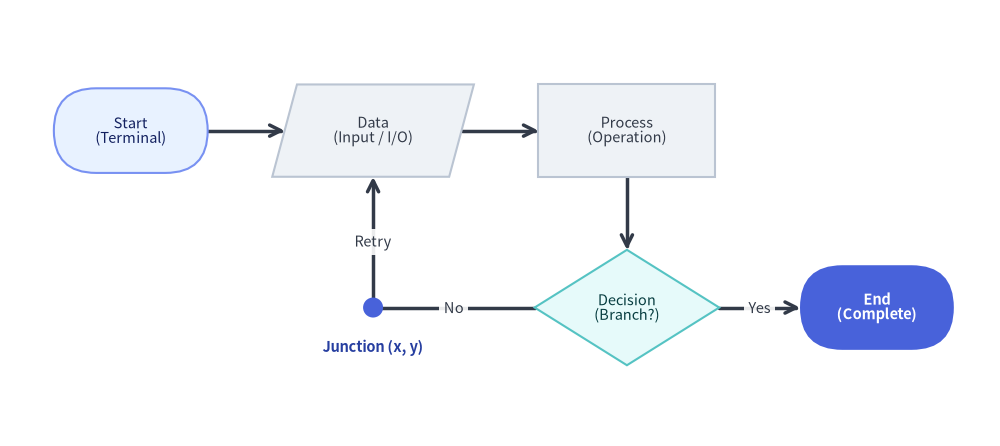
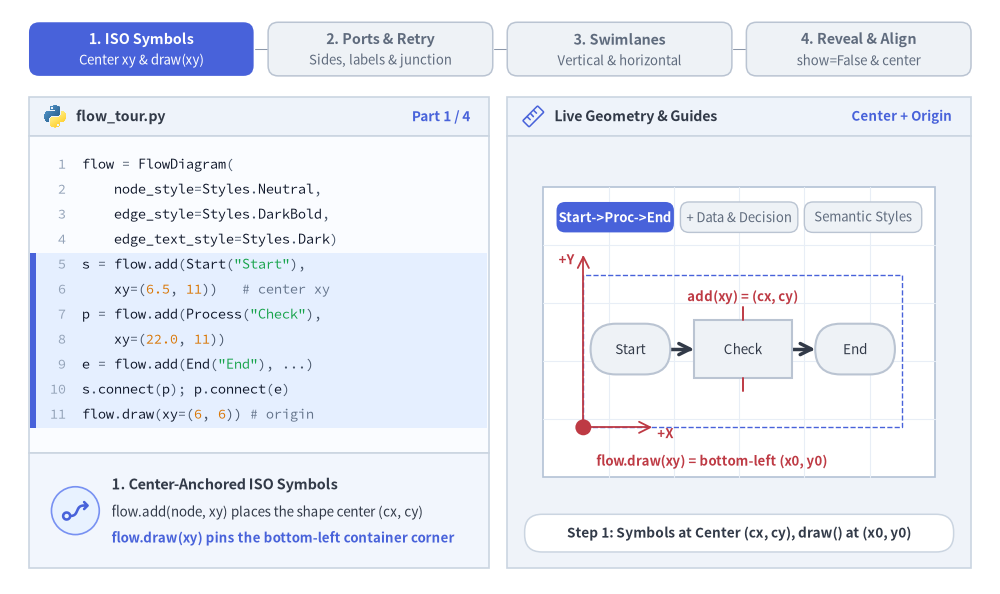
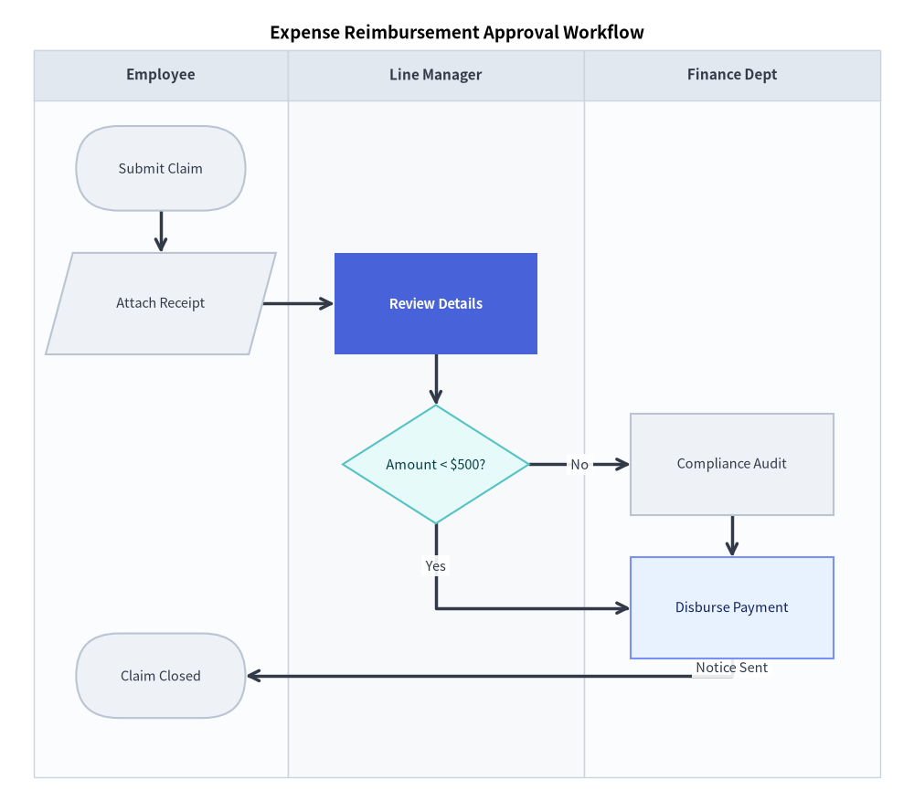
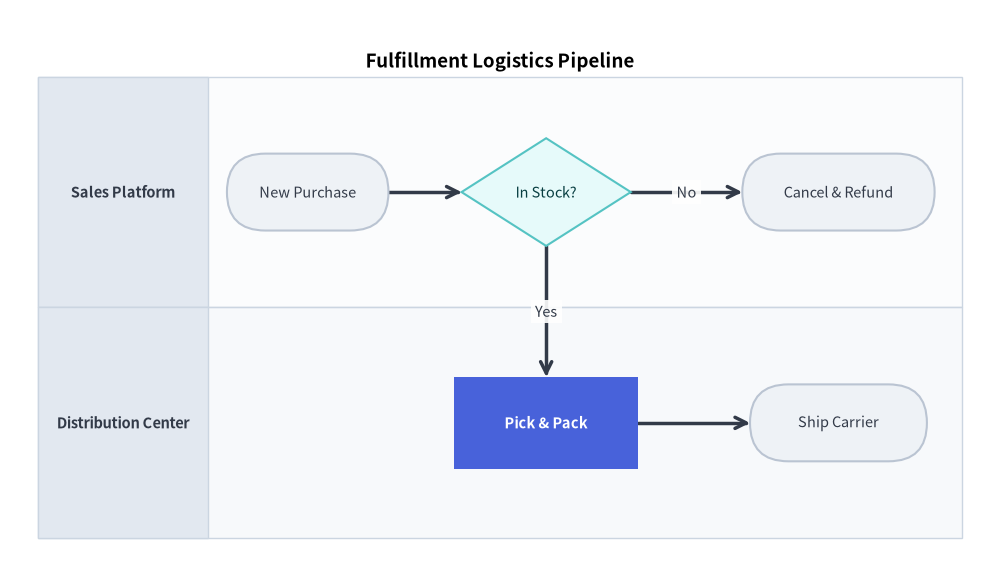

# フロー図 (FlowDiagram): ISO フローチャートと部門横断スイムレーン

`FlowDiagram` は、ISO 5807 および JIS X 0121 規格に準拠した標準フローチャート記号を実装しており、統一されたグローバル座標平面を共有する部門横断のスイムレーンレイアウト（垂直列または水平行）をネイティブにサポートします。


<figure class="drawlib-image" style="text-align: center;">
  
  <figcaption class="drawlib-caption">FlowDiagram における ISO 5807 フローチャート記号クラス</figcaption>
</figure>

<details class="drawlib-code-details">
<summary>Source Code</summary>

```python
from drawlib.canvas import save, setup
from drawlib.diagrams.flow import Data, Decision, End, FlowDiagram, Process, Start
from drawlib.shapes import circle
from drawlib.styles import Colors, Styles
from drawlib.text import text

setup(width=130, height=58)

flow = FlowDiagram(
    node_style=Styles.Neutral.patch(text_size=10.5),
    edge_style=Styles.DarkBold,
    edge_text_style=Styles.Dark.patch(text_size=10.5),
    width=122.0,
    height=50.0,
)

# 6 Standard Flowchart Symbol Classes: Start, Data, Process, Decision, Junction, End
s_start = flow.add(
    Start("Start\n(Terminal)", width=20.0, height=11.0, style=Styles.PrimaryNeutral.patch(text_size=10.5)),
    xy=(13.0, 37.0),
)
s_data = flow.add(Data("Data\n(Input / I/O)", width=23.0, height=12.0), xy=(44.5, 37.0))
s_proc = flow.add(Process("Process\n(Operation)", width=23.0, height=12.0), xy=(77.5, 37.0))
s_dec = flow.add(
    Decision("Decision\n(Branch?)", width=24.0, height=15.0, style=Styles.SecondaryNeutral.patch(text_size=10.5)),
    xy=(77.5, 14.0),
)

# Junction waypoint for orthogonal retry loop back to Data
j_retry = flow.junction((44.5, 14.0))
s_end = flow.add(
    End("End\n(Complete)", width=20.0, height=11.0, style=Styles.PrimaryFlat, text_style=Styles.WhiteBold.patch(text_size=10.5)),
    xy=(110.0, 14.0),
)

s_start.connect(s_data)
s_data.connect(s_proc)
s_proc.connect(s_dec, start_side="bottom", end_side="top")
s_dec.connect(s_end, label="Yes", start_side="right", end_side="left")
s_dec.connect(j_retry, label="No", start_side="left", end_side="right")
j_retry.connect(s_data, label="Retry", end_side="bottom")

flow.draw(xy=(4.0, 4.0))

# Highlight the zero-size Junction coordinate point (4 + 44.5 = 48.5, 4 + 14 = 18)
circle((48.5, 18.0), radius=1.3, style=Styles.PrimaryFlat)
text(
    (48.5, 12.8),
    "Junction (x, y)",
    style=Styles.DarkBold.patch(text_size=10.5, text_color=Colors.Primary5),
)

save()
```

</details>


---

## 1. 基本概念と基本的な使い方

`FlowDiagram` は、ISO 5807 準拠の記号ノード（`Start`、`Data`、`Process`、`Decision`、`End`）を**図形の中心 `(cx, cy)`** で配置する一方、`flow.draw(xy)` はコンテナの**左下 `(x0, y0)`** 角（または `align="center"` 指定時は中央）を基準に配置します。明示的な側面ポート（`start_side`、`end_side`）、`flow.junction()` によるループバック、`.fork()` によるファンアウトバスを使って条件分岐を配線できるほか、単一の統一座標平面上に部門横断の `"vertical"`（垂直列）や `"horizontal"`（水平行）スイムレーン（`add_lane`）を重ねて描画できます。


<figure class="drawlib-image" style="text-align: center;">
  
  <figcaption class="drawlib-caption">基本的な使い方とパラメータツアー: ISO 記号のアンカー、条件分岐ポートとジャンクション、部門横断スイムレーン、表示制御と中央配置 (APNG アニメーション)</figcaption>
</figure>


<div class="drawlib-source-link">
  <a href="https://github.com/yuichi110/drawlib/blob/main/docs/docs_src/ja/06_diagrams/flow.md" target="_blank" rel="noopener noreferrer">GitHub でアニメーションのソースコードを見る &rarr;</a>
</div>

- **中心基準の ISO 記号と左下基準のコンテナ (`add`, `draw`)**: `flow.add(node, xy)` は `Start`、`Data`、`Process`、`Decision`、`End` を図形の中心 `(cx, cy)` で配置する一方、`flow.draw(xy)` はコンテナの左下角 `(x0, y0)` を基準に配置します。
- **明示的な側面ポート・`Junction` ループバック・`.fork()`**: `start_side` / `end_side`（`"left"`、`"right"`、`"top"`、`"bottom"`、`"auto"`）による分岐接続位置の制御、`flow.junction(xy)` を使った整然としたリトライループ、または `node.fork(targets, at_x=..., at_y=...)` による 1 対 N 分岐を行えます。
- **統一座標系のスイムレーン (`add_lane`, `lane_orientation`)**: `flow.add_lane(title, size=...)` で `"vertical"`（垂直列）または `"horizontal"`（水平行）のレーンを重ねつつ、全ノードを単一の共通グローバル座標平面 `(cx, cy)` 上に配置できるため、レーンをまたぐ矢印もまっすぐ描画できます。
- **レイアウトを維持した表示制御と中央揃えスケーリング (`.show`, `align="center"`, `scale`)**: `node.show = False` を切り替えると残りのノード位置をずらさずにステップと接続済みの `FlowEdge` 線を非表示にでき、`flow.draw(xy, align="center", scale=...)` で中央配置とスケーリングを行えます。

### ISO 5807 フローチャート記号クラス

| クラス | 図形ジオメトリ | デフォルトサイズ (W x H) | 標準的な ISO 用途 |
|---|---|---|---|
| `Start` | スタジアム型 / ピル型 (`shape_r=5.0`) | `20.0 x 10.0` | 開始エントリポイント（端子） |
| `End` | スタジアム型 / ピル型 (`shape_r=5.0`) | `20.0 x 10.0` | 終了完了ポイント（端子） |
| `Process` | 長方形 | `24.0 x 12.0` | 実行タスク、計算、または処理ステップ |
| `Decision` | ひし形 (ダイヤモンド) | `22.0 x 14.0` | 条件分岐（Yes/No、True/False） |
| `Data` | 平行四辺形 | `24.0 x 12.0` | 入力、出力、またはファイル I/O |
| `Junction` | 座標点 | `0.0 x 0.0` | 分岐タップ、中継点、または合流ジャンクション |
| `Lane` | 境界コンテナ | 動的 | スイムレーンの列または行 |

---

## 2. グローバル座標アーキテクチャと主要 API リファレンス

Drawlib の `FlowDiagram` では、スイムレーンはノードをローカル相対座標の中に閉じ込めることなく、構造化された背景と列・行ヘッダーのみを提供します。

すべてのノードは単一のグローバルキャンバス座標系を共有します（`flow.add(node, xy=(cx, cy))` は図形の**中心 `(cx, cy)`** を配置します）。これにより、以下のメリットが得られます。
- 異なる部門（レーン）で同じ段階に発生するステップを、まったく同じ垂直 `Y` 座標に揃えて配置できます。
- 接続線がスイムレーンの境界をまたぐ際も、自動直角（orthogonal）ルーティングできれいに描画されます。

### パラメータリファレンス

#### `FlowDiagram` クラス
| パラメータ | 型 | デフォルト | 説明 |
|---|---|---|---|
| `node_style` | `Style` | *(必須)* | ダイアグラム内のフローチャート図形の基本 `Style` オブジェクト。 |
| `edge_style` | `Style` | *(必須)* | 接続線および矢印の基本 `Style` オブジェクト。 |
| `edge_text_style` | `Style` | *(必須)* | 接続テキストラベルの基本 `Style` オブジェクト。 |
| `title` | `str` | `""` | ダイアグラム上部に表示する任意のバナータイトル。 |
| `title_style` | `Style \| None` | `None` | ダイアグラムタイトル用の任意の `Style` 上書き設定。 |
| `width` | `float \| None` | `None` | ダイアグラムキャンバスの任意の固定幅（`None` の場合は自動フィット）。 |
| `height` | `float \| None` | `None` | ダイアグラムキャンバスの任意の固定高さ（`None` の場合は自動フィット）。 |
| `style` | `Style \| None` | `None` | ダイアグラム全体の背景カード用の任意の `Style`。 |
| `lane_orientation` | `Literal["vertical", "horizontal"]` | `"vertical"` | スイムレーンの配置方向（垂直列の `"vertical"` または水平行の `"horizontal"`）。 |

#### `FlowNode` および具象ノードクラス (`Start`, `End`, `Process`, `Decision`, `Data`)
| パラメータ | 型 | デフォルト | 説明 |
|---|---|---|---|
| `text` | `str` | `""`（端子では `"Start"` / `"End"`） | フローチャート記号の中央に表示するテキストラベル（`\n` による改行に対応）。 |
| `width` | `float` | `24.0`（`Start`/`End` は `20.0`、`Decision` は `22.0`） | キャンバス単位での記号の外形幅。 |
| `height` | `float` | `12.0`（`Start`/`End` は `10.0`、`Decision` は `14.0`） | キャンバス単位での記号の外形高さ。 |
| `style` | `Style \| None` | `None` | 図形の塗りつぶし、枠線ストローク、および `shape_r` の任意の `Style` 上書き設定。 |
| `text_style` | `Style \| None` | `None` | ノードのテキストラベル用の任意の `Style` 上書き設定。 |
| `shape_type` | `Literal["process", "decision", "start", "end", "data"]` | `"process"` | 内部の記号ジオメトリ種別（`FlowNode` 基底コンストラクタのみ）。 |
| `show` | `bool` | `True` | 表示フラグ（`False` の場合、接続された `FlowEdge` 線も自動的に非表示になります）。 |

- **`FlowNode` のアンカーおよびジオメトリプロパティ**: `node.xy`、`node.center`、`node.top`、`node.bottom`、`node.left`、`node.right`、`node.get_anchor(side="auto")`、および `node.get_bounds()`。

### ノード登録・スイムレーン・接続・中継点メソッド

- **ノードの登録 (`flow.add`)**:
  ```python
  flow.add(item: FlowNode | Junction, xy: tuple[float, float], *, show: bool | None = None) -> FlowNode | Junction
  ```
  中心座標 `xy` に `item` を配置し、変更可能なインスタンス（`node.show`、`node.style`、`node.text_style`）を返します。`show=False` の場合、ダイアグラム全体の境界サイズを維持したまま、描画時にノードおよび接続されたエッジを非表示にします。
- **スイムレーンの登録 (`flow.add_lane`)**:
  ```python
  flow.add_lane(
      title: str,
      size: float | None = None,
      width: float | None = None,
      height: float | None = None,
      style: Style | None = None,
      text_style: Style | None = None,
      header_size: float = 6.0,
      header_style: Style | None = None,
      show: bool = True,
  ) -> Lane
  ```
  垂直列（`width` または `size`、デフォルト `30.0`）または水平行（`height` または `size`、デフォルト `30.0`）のスイムレーンを追加し、`Lane` インスタンスを返します。`show=False` に設定すると、後続レーンのオフセット位置を維持したままレーンの描画のみを非表示にします。
- **ノード間の接続 (`FlowNode.connect` & `flow.connect`)**:
  ```python
  node.connect(
      target: FlowNode | Junction,
      label: str = "",
      arrow: Literal["->", "<-", "<->", "-"] | None = None,
      routing: Literal["orthogonal", "direct"] = "orthogonal",
      start_side: Literal["left", "right", "top", "bottom", "auto"] = "auto",
      end_side: Literal["left", "right", "top", "bottom", "auto"] = "auto",
      style: Style | None = None,
      text_style: Style | None = None,
      padding: float | tuple[float, float] = 0.0,
      show: bool = True,
  ) -> FlowEdge
  ```
  ダイアグラムレベルの `flow.connect(start, end, ...) -> FlowEdge`（または `flow.add_edge(edge, *, show=None) -> FlowEdge`）からも呼び出せます。`arrow=None` の場合、`target` が `Junction` であれば `"-"`、それ以外は `"->"` がデフォルトになります。
- **1 対 N バスファンアウト (`FlowNode.fork`) と `Junction`**:
  - **`node.fork(targets: list[Connectable], at_x: float | None = None, at_y: float | None = None, style: Style | None = None, padding: float | tuple[float, float] = 0.0, show: bool = True) -> list[FlowEdge]`**: 中間の `Junction` を経由して `node` から複数のターゲットへ分岐します。
  - **`flow.junction(xy: tuple[float, float], *, show: bool = True) -> Junction`**: `xy` にサイズゼロの接続可能な中継点を作成・登録します（`j.connect(...)`）。
- **`FlowEdge` 中継点メソッド**:
  - **`edge.points(waypoints: list[tuple[float, float]]) -> FlowEdge`**: 明示的な中間座標 `(x, y)` のリストを設定し、`self` を返します。
  - **`edge.via(*waypoints: tuple[float, float]) -> FlowEdge`**: `.points(list(waypoints))` の可変長引数ショートハンドです。
  - **`edge.add_point(xy: tuple[float, float]) -> Junction`**: `edge` 上の中継点として `xy` を追加し、分岐用の登録済み `Junction` を返します。
- **サイズ取得と描画 (`flow.get_size` & `flow.draw`)**:
  - **`flow.get_size() -> tuple[float, float]`**: ダイアグラム全体の `(width, height)` を返します。
  - **`flow.draw(xy=(0.0, 0.0), *, scale: float = 1.0) -> None`**: 左下 `xy` を基準として、すべての座標、レーン幅・高さ、ノード寸法、フォントサイズを `scale` 倍に比例スケーリングして描画します。

---

## 3. 垂直スイムレーン: 経費精算承認ワークフロー

次のサンプルは、3 つの垂直スイムレーンにまたがる部門横断の経費精算プロセスを表しています。


```python
from drawlib.canvas import save, setup
from drawlib.diagrams.flow import Data, Decision, End, FlowDiagram, Process, Start
from drawlib.styles import Styles

setup(width=108, height=96)

flow = FlowDiagram(
    node_style=Styles.Neutral.patch(text_size=10.5),
    edge_style=Styles.DarkBold,
    edge_text_style=Styles.Dark.patch(text_size=10.5),
    title="Expense Reimbursement Approval Workflow",
    title_style=Styles.BlackBold.patch(text_size=13.5),
    width=100.0,
    height=86.0,
)

# 1. Define vertical department lanes (columns from left to right)
lane_lbl = Styles.DarkBold.patch(text_size=11.0)
flow.add_lane("Employee", width=30.0, text_style=lane_lbl)
flow.add_lane("Line Manager", width=35.0, text_style=lane_lbl)
flow.add_lane("Finance Dept", width=35.0, text_style=lane_lbl)

# 2. Add nodes (Y coordinates align corresponding steps horizontally)
submit = flow.add(Start("Submit Claim"), xy=(15.0, 72.0))
receipt = flow.add(Data("Attach Receipt"), xy=(15.0, 56.0))
review = flow.add(
    Process("Review Details", style=Styles.PrimaryFlat, text_style=Styles.WhiteBold.patch(text_size=10.5)),
    xy=(47.5, 56.0),
)
decision = flow.add(
    Decision("Amount < $500?", style=Styles.SecondaryNeutral.patch(text_size=10.5)),
    xy=(47.5, 37.0),
)

audit = flow.add(Process("Compliance Audit"), xy=(82.5, 37.0))
auto_pay = flow.add(
    Process("Disburse Payment", style=Styles.PrimaryNeutral.patch(text_size=10.5)),
    xy=(82.5, 20.0),
)
end = flow.add(End("Claim Closed"), xy=(15.0, 12.0))

# 3. Connect steps
submit.connect(receipt)
receipt.connect(review)
review.connect(decision)

# Decision routing (separate vertical levels avoid label collisions)
decision.connect(audit, label="No", start_side="right", end_side="left")
decision.connect(auto_pay, label="Yes", start_side="bottom", end_side="left")
audit.connect(auto_pay, start_side="bottom", end_side="top")
auto_pay.connect(end, label="Notice Sent", start_side="bottom", end_side="right")

flow.draw(xy=(4.0, 4.0))
save()
```

<figure class="drawlib-image" style="text-align: center;">
  
  <figcaption class="drawlib-caption">部門横断の経費精算承認ワークフロー</figcaption>
</figure>


---

## 4. 水平スイムレーン: 注文・物流フルフィルメント

`lane_orientation="horizontal"` を指定すると、各スイムレーンが上下に積み重なる水平行バンドとして配置されます。


```python
from drawlib.canvas import save, setup
from drawlib.diagrams.flow import Decision, End, FlowDiagram, Process, Start
from drawlib.styles import Styles

setup(width=130, height=74)

flow = FlowDiagram(
    node_style=Styles.Neutral.patch(text_size=10.5),
    edge_style=Styles.DarkBold,
    edge_text_style=Styles.Dark.patch(text_size=10.5),
    title="Fulfillment Logistics Pipeline",
    title_style=Styles.BlackBold.patch(text_size=13.5),
    lane_orientation="horizontal",
    width=120.0,
    height=60.0,
)

lane_lbl = Styles.DarkBold.patch(text_size=10.5)
flow.add_lane("Sales Platform", height=30.0, header_size=22.0, text_style=lane_lbl)
flow.add_lane("Distribution Center", height=30.0, header_size=22.0, text_style=lane_lbl)

order = flow.add(Start("New Purchase", width=21.0), xy=(35.0, 45.0))
validate = flow.add(Decision("In Stock?", style=Styles.SecondaryNeutral.patch(text_size=10.5)), xy=(66.0, 45.0))
cancel = flow.add(End("Cancel & Refund", width=25.0), xy=(104.0, 45.0))
pack = flow.add(
    Process("Pick & Pack", style=Styles.PrimaryFlat, text_style=Styles.WhiteBold.patch(text_size=10.5)),
    xy=(66.0, 15.0),
)
dispatch = flow.add(End("Ship Carrier", width=23.0), xy=(104.0, 15.0))

order.connect(validate)
validate.connect(cancel, label="No", start_side="right", end_side="left")
validate.connect(pack, label="Yes", start_side="bottom", end_side="top")
pack.connect(dispatch)

flow.draw(xy=(5.0, 4.0))
save()
```

<figure class="drawlib-image" style="text-align: center;">
  
  <figcaption class="drawlib-caption">フルフィルメント物流の水平パイプライン</figcaption>
</figure>


---

## 5. ベストプラクティスとガイドライン

1. **分岐出口ポートの明示指定**: `Decision` ノードでは、分岐方向を明確かつ一貫させるために常に `start_side`（例: `"No"` には `start_side="right"`、`"Yes"` には `start_side="bottom"`）を明示指定してください。
2. **`flow.junction` による経路の合流**: 複数の経路が同一の遷移先へ合流する場合やボトルネックを通過する場合は、線の交差を防ぐために中間の `Junction` を経由してルーティングしてください。
3. **スイムレーン幅のバランス確保**: 各スイムレーンの幅は、最も幅の広いノードの両側にそれぞれ最低 5 座標単位以上の余白が確保できるように設定してください。
