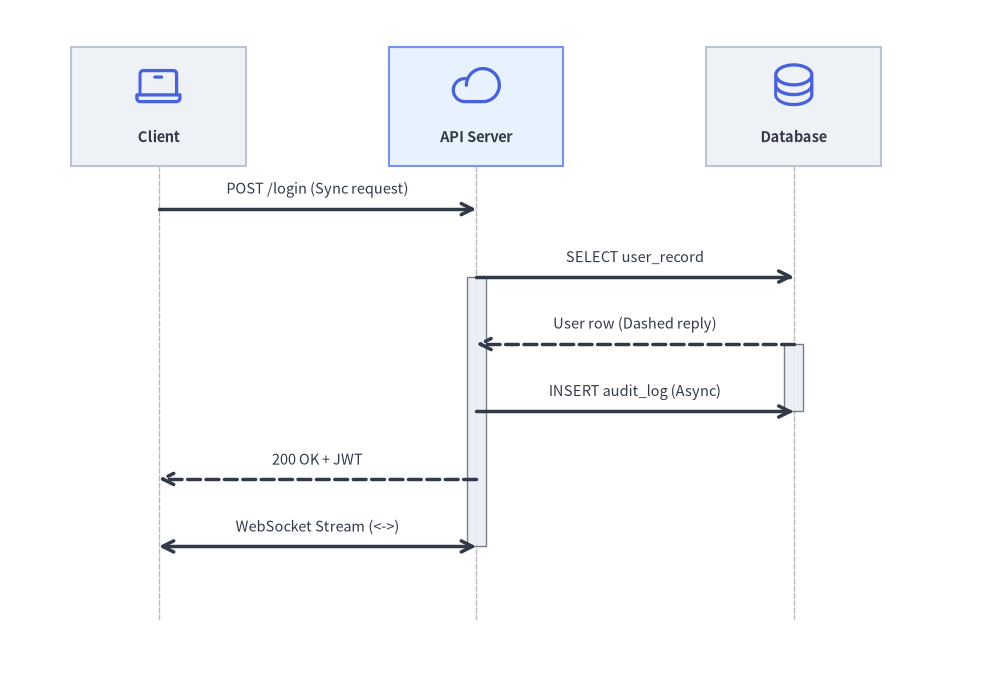
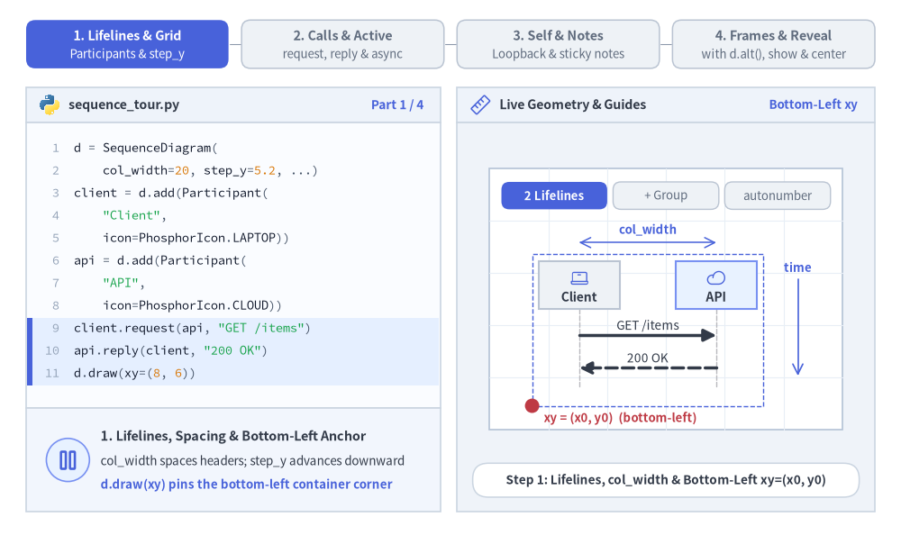
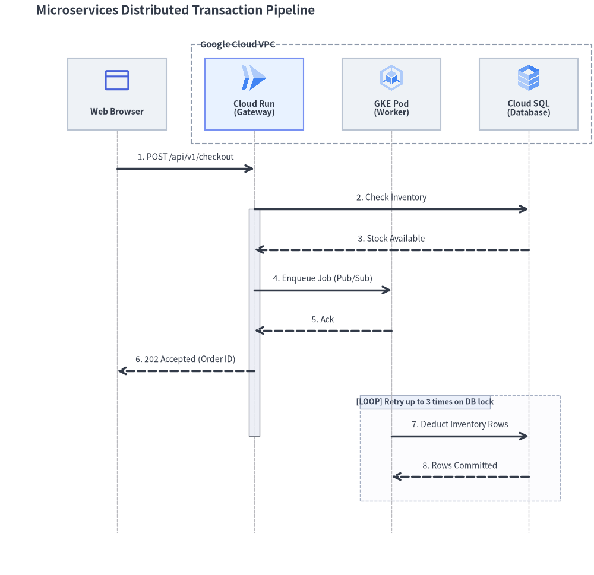
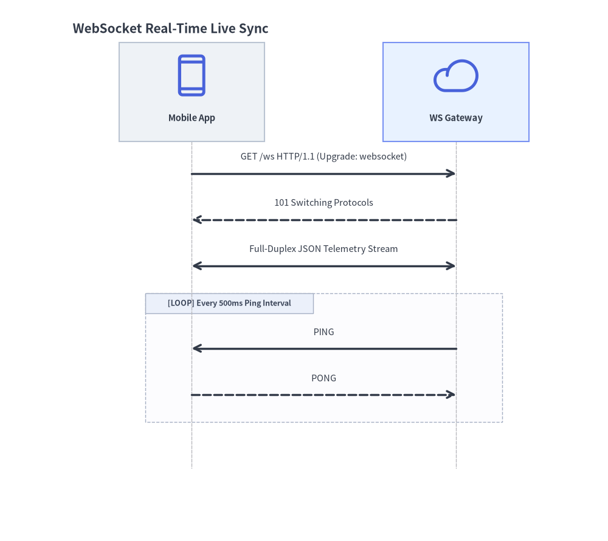
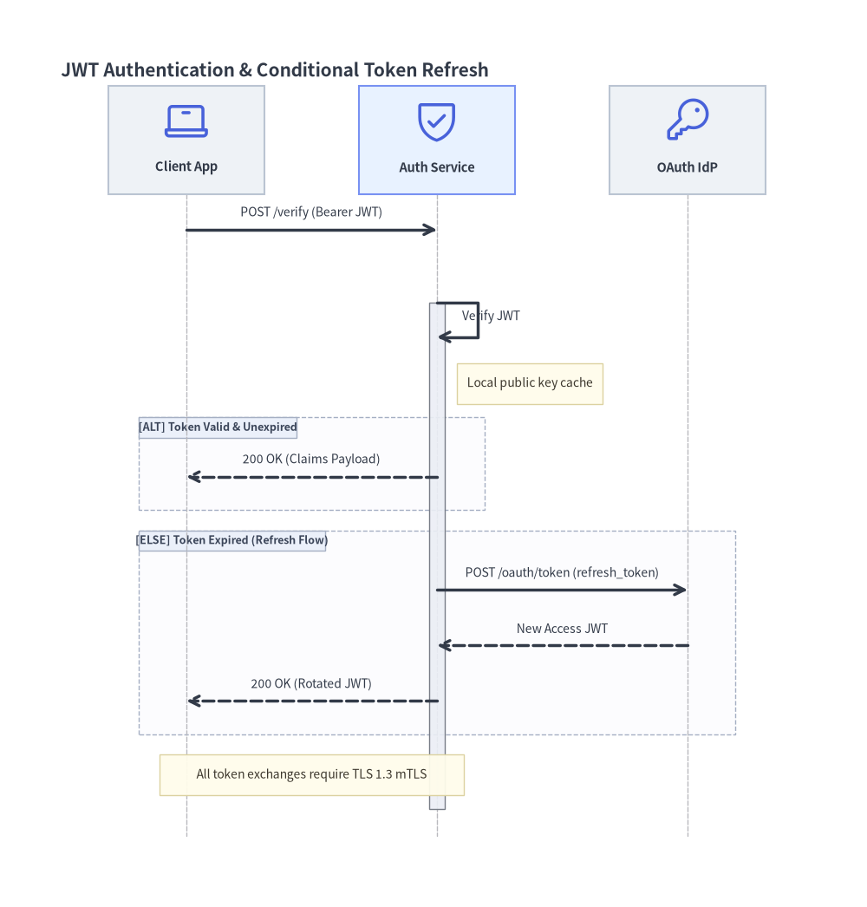

# シーケンス図 (SequenceDiagram): ライフライン・同期呼び出し・条件ブロック

`SequenceDiagram` は、協調して動作する参加者（Participant）間の時系列に沿った相互作用と通信プロトコルをモデル化します。時間は垂直なライフラインに沿って厳密に上から下へと進行し、水平方向の矢印がメッセージを表します。


<figure class="drawlib-image" style="text-align: center;">
  
  <figcaption class="drawlib-caption">SequenceDiagram のライフライン・アクティベーションバー・メッセージ表現</figcaption>
</figure>

<details class="drawlib-code-details">
<summary>Source Code</summary>

```python
from drawlib.canvas import save, setup
from drawlib.diagrams.sequence import Participant, PhosphorIcon, SequenceDiagram
from drawlib.styles import Styles

setup(width=126, height=88)

d = SequenceDiagram(
    node_style=Styles.Primary,
    node_text_style=Styles.DarkBold.patch(text_size=10.5),
    edge_style=Styles.DarkBold,
    edge_text_style=Styles.Dark.patch(text_size=10.5),
    node_card_style=Styles.Neutral,
    col_width=40.0,
    step_y=8.5,
)

client = d.add(Participant("Client", width=22, height=15, icon=PhosphorIcon.LAPTOP, icon_size=6.5))
api = d.add(
    Participant("API Server", width=22, height=15, icon=PhosphorIcon.CLOUD, icon_size=6.5, card_style=Styles.PrimaryNeutral)
)
db = d.add(Participant("Database", width=22, height=15, icon=PhosphorIcon.DATABASE, icon_size=6.5))

client.request(api, "POST /login (Sync request)")
api.activate()

api.request(db, "SELECT user_record")
db.activate()
db.reply(api, "User row (Dashed reply)")
db.deactivate()

api.request(db, "INSERT audit_log (Async)", is_async=True)
api.reply(client, "200 OK + JWT")
api.deactivate()

client.connect(api, "WebSocket Stream (<->)", arrow="<->")

d.draw(xy=(4.0, 3.0))
save()
```

</details>


---

## 1. 基本概念と基本的な使い方

`SequenceDiagram` は、`Participant` ヘッダーカードを水平方向（`col_width`）に並べ、デフォルトの**左下 `(x0, y0)`** アンカー（または `align="center"`）を基準として、メッセージ矢印を時系列順に下方向（`step_y`）へと進めます。`.activate()` / `.deactivate()` で実行区間を強調したり、ライフライン上または複数ライフラインをまたぐ付箋ノートを配置したり、条件分岐や反復ステップを Python の `with` 複合フラグメントフレーム（`d.alt()`、`d.loop()`、`d.opt()`）で囲んだりできます。


<figure class="drawlib-image" style="text-align: center;">
  
  <figcaption class="drawlib-caption">基本的な使い方とパラメータツアー: ライフラインとアンカー、同期/非同期とアクティベーション、自己呼び出しとノート、条件フレームと段階的表示 (APNG アニメーション)</figcaption>
</figure>


<div class="drawlib-source-link">
  <a href="https://github.com/yuichi110/drawlib/blob/main/docs/docs_src/ja/06_diagrams/sequence.md" target="_blank" rel="noopener noreferrer">GitHub でアニメーションのソースコードを見る &rarr;</a>
</div>

- **垂直ライフラインとグループ (`Participant`, `ParticipantGroup`, `col_width`, `step_y`)**: ヘッダーカードが上端に整列し、垂直の破線ライフラインが時系列に沿って下方向へ伸びます。`ParticipantGroup` を使うと関連するバックエンドサービス群をラベル付き境界枠でグループ化できます。
- **メッセージ表現 (`request`, `reply`, `connect`, 自己呼び出し)**: `request()` は同期呼び出し（`is_async=True` で開いた矢印の非同期送信）、`reply()` は破線の応答矢印、`connect(..., arrow="<->")` は全二重ストリームを描画し、`p.request(p, ...)` は自身のライフラインへ戻る自己呼び出しループを描画します。
- **実行フォーカス・付箋ノート・自動採番 (`activate`, `note`, `autonumber=True`)**: `p.activate()` / `p.deactivate()` で実行区間を表すアクティベーションバーを描画し、`p.note()` / `d.note(..., over=[...])` でライフライン横または複数ライフライン横断の付箋ノートを追加できます。`autonumber=True` で各ステップに連番（`1.`、`2.`、`3.`、...）を自動付与します。
- **コンテキストマネージャフレームと安定した段階表示 (`with d.alt()`, `show=False`, `align`)**: 条件分岐や反復処理を `with d.alt()` / `d.else_()` / `d.loop()` / `d.opt()` で囲み、`show=False` でライフライン位置をずらさずに段階的なステップ表示を行えます。配置基準は左下または `align="center"` を選択できます。

---

## 2. コンストラクタと参加者 (`Participant`) の管理

```python
from drawlib.diagrams.sequence import (
    Block,
    GcpIcon,
    Participant,
    ParticipantGroup,
    PhosphorIcon,
    SequenceDiagram,
)
from drawlib.styles import Styles

d = SequenceDiagram(
    node_style=Styles.Primary,
    node_text_style=Styles.DarkBold,
    edge_style=Styles.DarkBold,
    edge_text_style=Styles.Dark,
    node_card_style=Styles.Neutral,
    title="Checkout Transaction Pipeline",
    autonumber=True,            # Auto-number messages (1., 2., 3., ...)
)

# Participant group for clustered backend services
vpc = d.add(ParticipantGroup(title="Google Cloud VPC", padding=4.0))
api = vpc.add(Participant("Cloud Run\n(Gateway)", width=22, height=16, icon=GcpIcon.CLOUD_RUN, card_style=Styles.PrimaryNeutral))
db = vpc.add(Participant("Cloud SQL", width=22, height=16, icon=GcpIcon.CLOUD_SQL))

# External participant
client = d.add(Participant("Web Browser", width=22, height=16, icon=PhosphorIcon.BROWSER))
```

### パラメータリファレンス

#### `SequenceDiagram` クラス
| パラメータ | 型 | デフォルト | 説明 |
|---|---|---|---|
| `node_style` | `Style` | *(必須)* | 参加者アイコンおよび画像のベース `Style` オブジェクト。 |
| `node_text_style` | `Style` | *(必須)* | 参加者テキストラベルのベース `Style` オブジェクト。 |
| `edge_style` | `Style` | *(必須)* | メッセージ矢印およびライフラインのベース `Style` オブジェクト。 |
| `edge_text_style` | `Style` | *(必須)* | メッセージラベルのベース `Style` オブジェクト。 |
| `node_card_style` | `Style \| None` | `None` | 参加者ヘッダーカードのベース `Style`（`None` の場合は背景透明）。 |
| `title` | `str` | `""` | ダイアグラム上部に表示する任意のバナータイトル。 |
| `autonumber` | `bool` | `False` | `True` の場合、メッセージラベルの先頭に連番（`1.`、`2.`、`3.`、...）を自動付与。 |
| `width` | `float \| None` | `None` | 固定キャンバス幅（`None` の場合はライフライン群から自動計算）。 |
| `height` | `float \| None` | `None` | 固定キャンバス高さ（`None` の場合はタイムラインステップ数から自動計算）。 |
| `col_width` | `float` | `20.0` | 参加者ライフライン間のデフォルト水平中心間隔。 |
| `step_y` | `float` | `7.0` | 時系列メッセージまたはノート 1 ステップあたりの下方向進行距離。 |
| `margin` | `float` | `5.0` | 全ライフラインおよびヘッダー周囲の外側マージン。 |
| `style` | `Style \| None` | `None` | ダイアグラム全体の背景カード用 `Style`（任意）。 |
| `title_style` | `Style \| None` | `None` | ダイアグラムタイトルテキストの `Style` オーバーライド（任意）。 |

#### `Participant` クラス
| パラメータ | 型 | デフォルト | 説明 |
|---|---|---|---|
| `text` | `str` | `""` | 参加者ヘッダーカードに表示する名前（`\n` による改行に対応）。 |
| `width` | `float` | `20.0` | ヘッダーカードの幅（キャンバス単位）。 |
| `height` | `float` | `16.0` | ヘッダーカードの高さ（キャンバス単位）。 |
| `icon` | `IconType` | `None` | 34 種類の `*Icon` Enum（`PhosphorIcon`、`GcpIcon`、`AwsIcon`、`AzureIcon`、`AiIcon`〜`OriginalWorkspaceIcon`。詳細は[アイコン概要](../03_icons/overview.md)を参照）、`CustomIcon`、`Dimage`、`PIL.Image`、ファイルパス、またはアイコン関数。 |
| `icon_size` | `float` | `8.0` | アイコンの幅・高さ（座標単位）。 |
| `style` | `Style \| None` | `None` | 参加者アイコン／画像の `Style` オーバーライド（任意）。 |
| `text_style` | `Style \| None` | `None` | 参加者ラベルテキストの `Style` オーバーライド（任意）。 |
| `card_style` | `Style \| None` | `None` | 参加者ヘッダーカードの背景・枠線の `Style` オーバーライド（任意）。 |
| `lifeline_style` | `Style \| None` | `None` | 垂直破線ライフラインの `Style` オーバーライド（任意）。 |
| `show` | `bool` | `True` | 表示フラグ（`False` の場合、ヘッダー・ライフライン・接続メッセージ／ノートを非表示）。 |

- **ライフライン水平位置の固定とサイズ取得**:
  - `d.add(participant, x: float | None = None, *, show: bool | None = None) -> Participant`: 参加者を登録します。任意でライフラインの水平座標 `x` を明示固定できます。
  - `participant.set_x(x: float) -> Participant`: 参加者のライフライン水平位置 `x` を明示固定し、`self` を返します。
  - `participant.activate() -> None` / `participant.deactivate() -> None`: ライフライン上の実行フォーカス（アクティベーションバー）を開始・終了します。
  - `participant.get_size() -> tuple[float, float]` / `participant.get_header_size() -> tuple[float, float]`: `(width, height)` を返します。

#### `ParticipantGroup` クラス
| パラメータ | 型 | デフォルト | 説明 |
|---|---|---|---|
| `title` | `str` | `""` | 参加者グループ境界ボックスのヘッダータイトル。 |
| `padding` | `float` | `4.0` | 囲まれた参加者ヘッダーカード周囲の内側余白。 |
| `style` | `Style \| None` | `None` | グループ境界ボックスの `Style`（任意）。 |
| `text_style` | `Style \| None` | `None` | グループタイトルテキストの `Style`（任意）。 |
| `show` | `bool` | `True` | 表示フラグ（`False` の場合、列間隔を維持したままグループ枠のみを非表示）。 |

- **`group.add(participant: Participant, *, show: bool | None = None) -> Participant`**: グループに参加者を追加します（親ダイアグラムへも自動登録されます）。

---

### メッセージ・ノート・スペース調整・描画 API

- **参加者レベルおよびダイアグラムレベルのメッセージ**:
  - **`a.request(b, label="", is_async=False, style=None, text_style=None, show=True) -> Message`** または **`d.request(a, b, ...) -> Message`**: 実線のリクエスト矢印（`->`）を描画します。同一の参加者を指定（`a.request(a, "...")`）すると、3 線分の**自己呼び出し (self-call)** ループ（`msg.is_self_call == True`）を描画します。
  - **`b.reply(a, label="", is_async=False, style=None, text_style=None, show=True) -> Message`** または **`d.reply(b, a, ...) -> Message`**: 破線の応答矢印（`-->`）を描画します。
  - **`a.connect(b, label="", arrow="->", is_async=False, style=None, text_style=None, show=True) -> Message`** または **`d.connect(a, b, ...) -> Message`**: 任意の向きまたは双方向（`arrow="<->" | "->" | "-"`）のメッセージを描画します。
- **`Message` のメソッドチェーン用ミューテータ**:
  - `msg.set_label(text: str) -> Message`
  - `msg.set_reply(is_reply: bool = True) -> Message`
  - `msg.set_async(is_async: bool = True) -> Message`
  - `msg.set_arrow(arrow: Literal["->", "<->", "-"]) -> Message`
  - `msg.set_style(style: Style) -> Message`
  - `msg.set_text_style(text_style: Style) -> Message`
  - `msg.set_padding(padding: float | tuple[float, float]) -> Message`
- **付箋ノート (`d.note` & `p.note`)**:
  - **`d.note(text: str, on: Participant | None = None, over: list[Participant] | None = None, pos: Literal["left", "right", "over"] = "right", style: Style | None = None, show: bool = True) -> Note`**: 単一ライフラインの横（`on=p, pos="left"|"right"`）または複数ライフラインを横断する形（`over=[p1, p2]`）で付箋ノートを配置します。
  - **`p.note(text: str, pos: Literal["left", "right"] = "right", style: Style | None = None, show: bool = True) -> Note`**: `d.note(text, on=p, pos=pos, ...)` の便利なショートハンドです。
  - **`Note` ミューテータ**: `note.set_text(text) -> Note`、`note.set_style(style) -> Note`、`note.set_text_style(text_style) -> Note`。
- **タイムライン間隔調整・サイズ取得・描画**:
  - **`d.space(dy: float = 5.0) -> None`**: 垂直タイムラインを追加で `dy` 単位進め、フェーズ間に視覚的な余白を設けます。
  - **`d.get_size() -> tuple[float, float]`**: シーケンス図全体の `(width, height)` を計算して返します。
  - **`d.draw(xy=(0.0, 0.0), *, scale: float = 1.0) -> None`**: 左下 `xy` を基準として、列幅、垂直ステップ、アイコン、タイポグラフィを `scale` 倍に比例スケーリングしてシーケンス図を描画します。

---

## 3. 分散トランザクションパイプライン

次の完全なサンプルでは、参加者グループ、クラウドアイコン、アクティベーションバー、非同期ディスパッチ、およびリトライループフレームを組み合わせています。


```python
from drawlib.canvas import save, setup
from drawlib.diagrams.sequence import GcpIcon, Participant, ParticipantGroup, PhosphorIcon, SequenceDiagram
from drawlib.styles import Styles

setup(width=132, height=128)

d = SequenceDiagram(
    node_style=Styles.Primary,
    node_text_style=Styles.DarkBold.patch(text_size=10.0),
    edge_style=Styles.DarkBold,
    edge_text_style=Styles.Dark.patch(text_size=10.0),
    node_card_style=Styles.Neutral,
    title="Microservices Distributed Transaction Pipeline",
    autonumber=True,
    col_width=30.5,
    step_y=9.0,
)

# 1. Participants: Client on the left, Backend services in VPC group on the right
client = d.add(Participant("Web Browser", width=22, height=16, icon=PhosphorIcon.BROWSER, icon_size=6.5))

backend = d.add(
    ParticipantGroup(
        title="Google Cloud VPC",
        padding=3.0,
        style=Styles.MutedDashed,
        text_style=Styles.DarkBold.patch(text_size=10.5, halign="left", valign="top"),
    )
)
api = backend.add(
    Participant("Cloud Run\n(Gateway)", width=22, height=16, icon=GcpIcon.CLOUD_RUN, icon_size=6.5, card_style=Styles.PrimaryNeutral)
)
worker = backend.add(Participant("GKE Pod\n(Worker)", width=22, height=16, icon=GcpIcon.GOOGLE_KUBERNETES_ENGINE, icon_size=6.5))
db = backend.add(Participant("Cloud SQL\n(Database)", width=22, height=16, icon=GcpIcon.CLOUD_SQL, icon_size=6.5))

# 2. Interactions
client.request(api, "POST /api/v1/checkout")
api.activate()

api.request(db, "Check Inventory")
db.reply(api, "Stock Available")

api.request(worker, "Enqueue Job (Pub/Sub)", is_async=True)
worker.reply(api, "Ack", is_async=True)

api.reply(client, "202 Accepted (Order ID)")
api.deactivate()

with d.loop("Retry up to 3 times on DB lock"):
    worker.request(db, "Deduct Inventory Rows")
    db.reply(worker, "Rows Committed")

d.draw(xy=(3.0, 2.5))
save()
```

<figure class="drawlib-image" style="text-align: center;">
  
  <figcaption class="drawlib-caption">マイクロサービス分散トランザクションパイプライン</figcaption>
</figure>


---

## 4. WebSocket 全二重ストリーミング

リアルタイムの双方向ストリームを表現する場合は、`connect()` に `arrow="<->"` を指定します。


```python
from drawlib.canvas import save, setup
from drawlib.diagrams.sequence import Participant, PhosphorIcon, SequenceDiagram
from drawlib.styles import Styles

setup(width=92, height=82)

d = SequenceDiagram(
    node_style=Styles.Primary,
    node_text_style=Styles.DarkBold.patch(text_size=10.5),
    edge_style=Styles.DarkBold,
    edge_text_style=Styles.Dark.patch(text_size=10.5),
    node_card_style=Styles.Neutral,
    title="WebSocket Real-Time Live Sync",
    col_width=40.0,
)

app = d.add(Participant("Mobile App", width=22, height=15, icon=PhosphorIcon.DEVICE_MOBILE, icon_size=7.0))
gateway = d.add(
    Participant("WS Gateway", width=22, height=15, icon=PhosphorIcon.CLOUD, icon_size=7.0, card_style=Styles.PrimaryNeutral)
)

app.request(gateway, "GET /ws HTTP/1.1 (Upgrade: websocket)")
gateway.reply(app, "101 Switching Protocols")

# Bidirectional streaming channel
app.connect(gateway, "Full-Duplex JSON Telemetry Stream", arrow="<->")

with d.loop("Every 500ms Ping Interval"):
    gateway.request(app, "PING", is_async=True)
    app.reply(gateway, "PONG", is_async=True)

d.draw(xy=(6.0, 4.0))
save()
```

<figure class="drawlib-image" style="text-align: center;">
  
  <figcaption class="drawlib-caption">WebSocket 全二重テレメトリストリーム</figcaption>
</figure>


---

## 5. 条件フレーム（`alt` / `else_`）・自己呼び出し・付箋ノート

Drawlib は、`SequenceDiagram` のコンテキストマネージャまたは `Block(block_type, label="", diagram=d, style=None, text_style=None, show=True)` の直接インスタンス化によって、標準 UML の 7 種類の複合フラグメント演算子（`BlockType = Literal["loop", "alt", "else", "opt", "par", "critical", "break"]`）をすべてサポートしています。

| フレーム種別 | コンテキストマネージャ / コンストラクタ | 標準 UML 演算子 |
|---|---|---|
| **ループ (Loop)** | `with d.loop("condition", show=True):` | `loop` |
| **条件分岐 (Alternative)** | `with d.alt("condition", show=True):`<br>`with d.else_("fallback", show=True):` | `alt` / `else` |
| **任意実行 (Option)** | `with d.opt("condition", show=True):` | `opt` |
| **並列実行 (Parallel)** | `with d.par("description", show=True):` | `par` |
| **クリティカル領域 (Critical Region)** | `with Block("critical", "atomic lock", diagram=d):` | `critical` |
| **中断 (Break)** | `with Block("break", "fatal error", diagram=d):` | `break` |

フレームは内部に含まれるすべてのメッセージやノートを囲む外接矩形を自動計算し、左上に `[OPERATOR] label` タグを描画します。

次の例では、**自己呼び出し**（`auth.request(auth, ...)`）、**付箋ノート**（`auth.note(...)` および `d.note(..., over=[...])`）、そして **`alt` / `else_`** 条件分岐フレームを組み合わせています。


```python
from drawlib.canvas import save, setup
from drawlib.diagrams.sequence import Participant, PhosphorIcon, SequenceDiagram
from drawlib.styles import Styles

setup(width=128, height=134)

d = SequenceDiagram(
    node_style=Styles.Primary,
    node_text_style=Styles.DarkBold.patch(text_size=10.5),
    edge_style=Styles.DarkBold,
    edge_text_style=Styles.Dark.patch(text_size=10.0),
    node_card_style=Styles.Neutral,
    title="JWT Authentication & Conditional Token Refresh",
    col_width=37.0,
    step_y=8.2,
)

client = d.add(Participant("Client App", width=23, height=16, icon=PhosphorIcon.LAPTOP, icon_size=7.0))
auth = d.add(
    Participant("Auth Service", width=23, height=16, icon=PhosphorIcon.SHIELD_CHECK, icon_size=7.0, card_style=Styles.PrimaryNeutral)
)
idp = d.add(Participant("OAuth IdP", width=23, height=16, icon=PhosphorIcon.KEY, icon_size=7.0))

client.request(auth, "POST /verify (Bearer JWT)")
auth.activate()

# Self-call for local signature verification + attached participant note
auth.request(auth, "Verify JWT")
auth.note("Local public key cache", pos="right")

# Conditional alt / else_ blocks
with d.alt("Token Valid & Unexpired"):
    auth.reply(client, "200 OK (Claims Payload)")

with d.else_("Token Expired (Refresh Flow)"):
    auth.request(idp, "POST /oauth/token (refresh_token)")
    idp.reply(auth, "New Access JWT")
    auth.reply(client, "200 OK (Rotated JWT)")

auth.deactivate()

# Spanning note across multiple participants
d.note("All token exchanges require TLS 1.3 mTLS", over=[client, auth])

d.draw(xy=(4.0, 3.5))
save()
```

<figure class="drawlib-image" style="text-align: center;">
  
  <figcaption class="drawlib-caption">自己呼び出し・付箋ノート・alt/else_ 条件フレームを用いた認証フロー</figcaption>
</figure>


