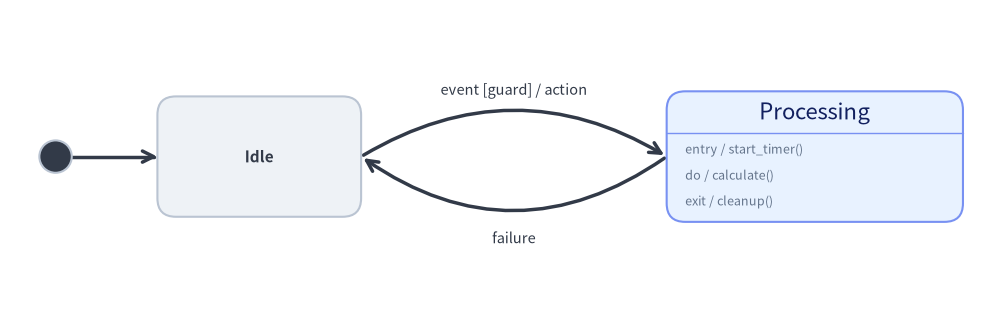
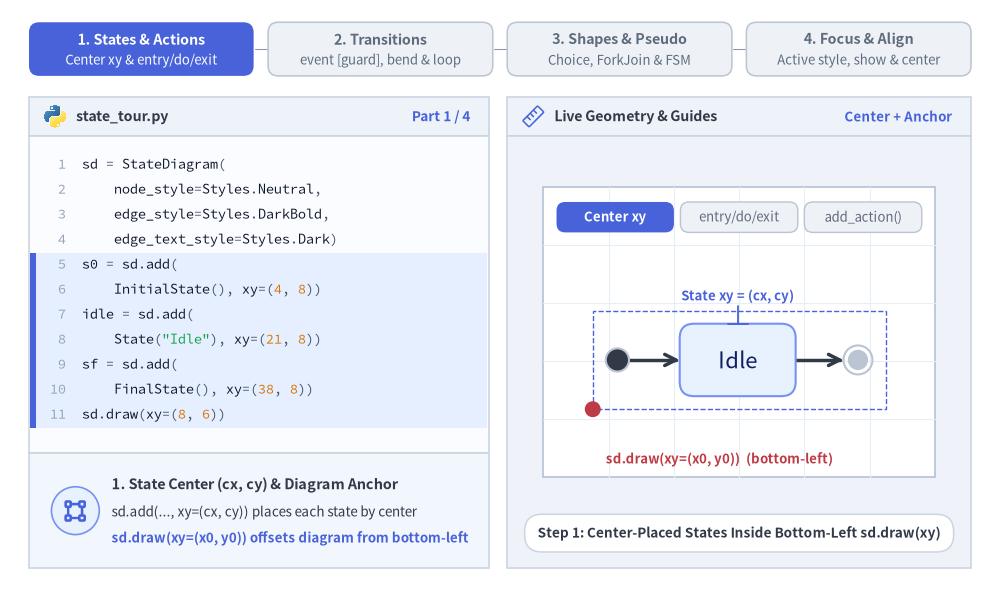
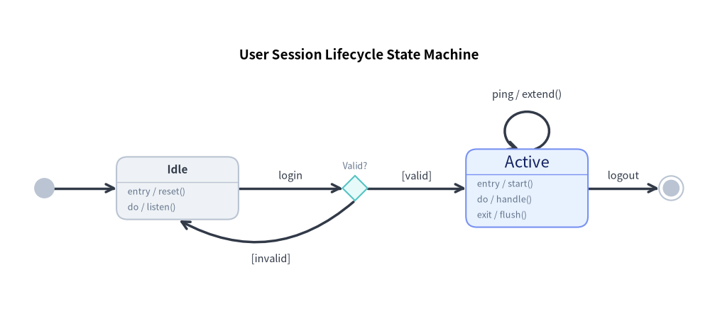
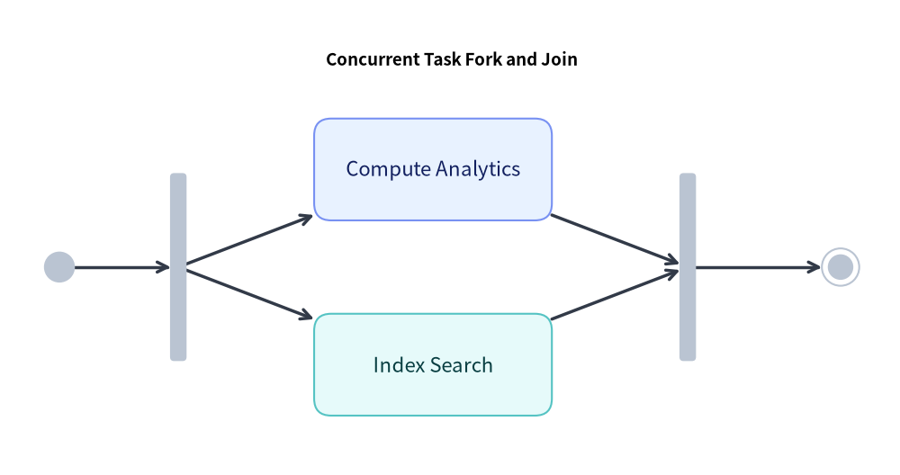
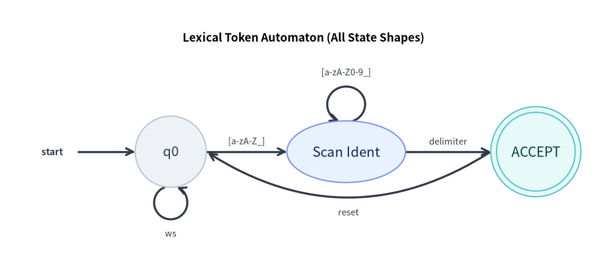

# ステートマシン図 (StateDiagram): UML ステートチャート・オートマトン・状態遷移

`StateDiagram` は、振る舞いの状態遷移、有限オートマトン（FSM: Finite State Machine）、および UML 2.0 ステートチャートをモデル化します。専用の擬似状態、内部アクション区画（`entry`、`do`、`exit`）、および曲線アーク遷移を備えています。


<figure class="drawlib-image" style="text-align: center;">
  
  <figcaption class="drawlib-caption">StateDiagram の基本構造: 開始状態、アクション区画、および双方向曲線アーク</figcaption>
</figure>

<details class="drawlib-code-details">
<summary>Source Code</summary>

```python
from drawlib.canvas import save, setup
from drawlib.diagrams.state import InitialState, State, StateDiagram
from drawlib.styles import Styles

setup(width=108, height=34)

sd = StateDiagram(
    node_style=Styles.Neutral,
    edge_style=Styles.DarkBold,
    edge_text_style=Styles.Dark.patch(text_size=10.5),
)

init = sd.add(InitialState(style=Styles.Dark), xy=(6.0, 17.0))
idle = sd.add(State("Idle", shape="box", width=22.0, height=13.0), xy=(28.0, 17.0))
proc = sd.add(
    State(
        "Processing",
        shape="box",
        entry="start_timer()",
        do="calculate()",
        exit="cleanup()",
        width=32.0,
        style=Styles.PrimaryNeutral,
    ),
    xy=(88.0, 17.0),
)

sd.connect(init, idle)
sd.connect(
    idle,
    proc,
    event="event",
    guard="guard",
    action="action",
    bend=-0.30,
    start_side="top_right",
    end_side="top_left",
)
sd.connect(
    proc,
    idle,
    event="failure",
    bend=-0.35,
    start_side="bottom_left",
    end_side="bottom_right",
    text_style=Styles.Dark.patch(text_size=10.5, valign="top"),
)

sd.draw(xy=(0.0, 0.0))
save()
```

</details>


---

## 1. 基本概念と基本的な使い方

`StateDiagram` は、**左下 `(x0, y0)`**（または `align="center"`）を基準とするコンテナ内に、各状態（`State`）および UML 擬似状態（`InitialState`、`FinalState`、`ChoiceState`、`ForkJoinState`）を**中心 `(cx, cy)`** 座標で配置します。`State` カードは UML アクション区画（`entry`、`do`、`exit`、`.add_action()`）の自動描画をサポートし、`sd.connect(...)` は `event [guard] / action` ラベルの自動整形、曲線の `bend` アーク、および自己遷移ループを描画します。


<figure class="drawlib-image" style="text-align: center;">
  
  <figcaption class="drawlib-caption">基本的な使い方とパラメータツアー: 状態アンカーと区画、状態遷移と曲線アーク、シェイプと擬似状態、表示制御と中央配置 (APNG アニメーション)</figcaption>
</figure>


<div class="drawlib-source-link">
  <a href="https://github.com/yuichi110/drawlib/blob/main/docs/docs_src/ja/06_diagrams/state_diagram.md" target="_blank" rel="noopener noreferrer">GitHub でアニメーションのソースコードを見る &rarr;</a>
</div>

- **5 種類の状態シェイプと中心配置 (`State`, `xy=(cx, cy)`)**: 各状態は `sd.draw(xy)` 内に中心座標 `(cx, cy)` で登録され、`"box"`（角丸カード）、`"ellipse"`、`"circle"`、`"double_circle"`（FSM の受理状態）、および `"text_only"` をサポートします。
- **UML アクション区画 (`entry`, `do`, `exit`, `.add_action()`)**: 内部トリガーを持つ `"box"` 状態は、自動的にヘッダー区切り線を描画して縦方向に拡張し、`entry / ...`、`do / ...`、`exit / ...` やカスタムの `.add_action(kind, action)` 行を一覧表示します。
- **UML 擬似状態 (`InitialState`, `FinalState`, `ChoiceState`, `ForkJoinState`)**: 専用のサブクラスにより、開始黒丸、二重丸の終了状態、条件分岐のひし形、水平/垂直の並行同期バーをモデル化できます。
- **遷移・曲線アーク・安定した段階的表示 (`sd.connect`, `bend`, `show=False`)**: `event [guard] / action` ラベルを自動整形し、対向する曲線アーク（`bend`）や自己遷移ループ（`side="top"`）を描画します。また `show=False` 指定時は、ダイアグラム全体の境界サイズを固定したまま接続アークを自動的に非表示にします。

---

## 2. コンストラクタ・主要クラス・パラメータリファレンス

```python
from drawlib.diagrams.state import (
    ChoiceState,
    FinalState,
    ForkJoinState,
    InitialState,
    State,
    StateAction,
    StateDiagram,
    StateNodeBase,
    StateTransition,
)
from drawlib.styles import Styles

sd = StateDiagram(
    node_style=Styles.Neutral,
    edge_style=Styles.DarkBold,
    edge_text_style=Styles.Dark,
    title="Session Lifecycle State Machine",
)

# State with action compartments + custom action
active = sd.add(
    State("Active", shape="box", entry="start_heartbeat()", do="handle_requests()", exit="flush()", style=Styles.PrimaryNeutral),
    xy=(60.0, 40.0),
)
active.add_action("on_timeout", "warn_idle()")

# Transition with guard and action
init = sd.add(InitialState(), xy=(10.0, 40.0))
sd.connect(init, active, event="login", guard="token_valid", action="init_session()")
```

### パラメータリファレンス

#### `StateDiagram` クラス
| パラメータ | 型 | デフォルト | 説明 |
|---|---|---|---|
| `node_style` | `Style` | *(必須)* | ダイアグラム内の状態ノードのベース `Style` オブジェクト。 |
| `edge_style` | `Style` | *(必須)* | 遷移エッジおよび矢印のベース `Style` オブジェクト。 |
| `edge_text_style` | `Style` | *(必須)* | 遷移ラベルのベース `Style` オブジェクト。 |
| `title` | `str` | `""` | ダイアグラム上部に表示する任意のタイトル。 |
| `title_style` | `Style \| None` | `None` | ダイアグラムタイトルの `Style` オブジェクト（任意）。 |
| `style` | `Style \| None` | `None` | ダイアグラム全体の背景を上書きする `Style`（任意）。 |
| `width` | `float \| None` | `None` | 固定キャンバス幅（`None` の場合はコンテンツから自動計算）。 |
| `height` | `float \| None` | `None` | 固定キャンバス高さ（`None` の場合はコンテンツから自動計算）。 |
| `margin` | `float` | `5.0` | 自動サイズ計算時に全状態の周囲に確保する外側マージン。 |

#### `State` クラス（`StateNodeBase` を継承）
| パラメータ | 型 | デフォルト | 説明 |
|---|---|---|---|
| `name` | `str` | *(必須)* | 状態名／ラベルテキスト。 |
| `shape` | `Literal["box", "ellipse", "circle", "double_circle", "text_only"]` | `"box"` | 状態ノードの幾何学形状。 |
| `entry` | `str` | `""` | 入場アクション（`shape="box"` 時に `entry / <entry>` として描画）。 |
| `do` | `str` | `""` | 継続アクティビティ（`shape="box"` 時に `do / <do>` として描画）。 |
| `exit` | `str` | `""` | 退場アクション（`shape="box"` 時に `exit / <exit>` として描画）。 |
| `width` | `float \| None` | `None` | 幅（`"circle"` / `"double_circle"` の場合は直径）。デフォルト: `"box"`=`22.0`、`"ellipse"`=`24.0`、`"circle"` / `"double_circle"` / `"text_only"`=`16.0`。 |
| `height` | `float \| None` | `None` | 状態の高さ。デフォルト: `"box"`=`12.0`（アクション数に応じて自動拡張）、`"ellipse"`=`13.0`、`"circle"` / `"double_circle"`=`width`、`"text_only"`=`8.0`。 |
| `size` | `tuple[float, float] \| None` | `None` | `width` と `height` をまとめて指定する `(width, height)` タプル（任意）。 |
| `style` | `Style \| None` | `None` | 枠線、塗りつぶし、文字色、`shape_r` の `Style` オーバーライド（任意）。 |
| `show` | `bool` | `True` | 表示フラグ（`False` の場合、接続されている `StateTransition` アークも自動非表示）。 |

- **`state.add_action(kind: str, action: str) -> State`**: `{kind} / {action}` として描画される `StateAction(kind=kind, action=action)` を `state.actions` に追加し、`self` を返します。

#### 擬似状態クラス（`StateNodeBase` のサブクラス）
| クラス | コンストラクタシグネチャ | デフォルトサイズ | 説明 |
|---|---|---|---|
| `InitialState` | `InitialState(name="", radius=1.75, style=None, show=True)` | 直径 `3.5` | 開始エントリポイントを表す塗りつぶし円。 |
| `FinalState` | `FinalState(name="", radius=2.2, style=None, show=True)` | 直径 `4.4` | ステートマシンの終了を表す二重同心円（ブルズアイ）。 |
| `ChoiceState` | `ChoiceState(name="", size=4.5, style=None, show=True)` | `4.5 × 4.5` | 条件ガード評価による動的分岐を表すひし形擬似状態。 |
| `ForkJoinState` | `ForkJoinState(name="", orientation="horizontal"\|"vertical", length=16.0, thickness=1.8, style=None, show=True)` | `16.0 × 1.8`（または `1.8 × 16.0`） | 並行遷移の分岐（Fork）および同期合流（Join）を表す太線バー。 |

#### `StateTransition` と `sd.connect(...)`
| パラメータ | 型 | デフォルト | 説明 |
|---|---|---|---|
| `source` / `start` | `StateNodeBase` | *(必須)* | 遷移元の状態または擬似状態（`sd.connect` では `source`、`StateTransition` では `start`）。 |
| `target` / `end` | `StateNodeBase` | *(必須)* | 遷移先の状態または擬似状態（`sd.connect` では `target`、`StateTransition` では `end`）。 |
| `label` | `str` | `""` | 明示的な遷移ラベル全文（空でない場合、`event` / `guard` / `action` より優先）。 |
| `event` | `str` | `""` | トリガーイベント名（例: `"login"`、`"timeout"`）。 |
| `guard` | `str` | `""` | `[{guard}]` 形式でフォーマットされるガード条件。 |
| `action` | `str` | `""` | `/ {action}` 形式でフォーマットされる遷移アクション（エフェクト）。 |
| `bend` | `float` | `0.0` | `"curved"` ルーティング時の曲率（`0.0` = 直線、正負の値で外側へ湾曲）。 |
| `start_side` | `Side` | `"auto"` | 出発側アンカー辺（`"left"`、`"right"`、`"top"`、`"bottom"`、`"auto"`、`"top_left"`、`"top_right"`、`"bottom_left"`、`"bottom_right"`）。 |
| `end_side` | `Side` | `"auto"` | 到着側アンカー辺（上下左右＋対角の 8 方向および `"auto"` に対応）。 |
| `routing` | `Literal["curved", "orthogonal", "direct"]` | `"curved"` | 遷移パスの配線戦略。 |
| `style` | `Style \| None` | `None` | 遷移線および矢印の `Style` オーバーライド（任意）。 |
| `text_style` | `Style \| None` | `None` | 遷移ラベルテキストの `Style` オーバーライド（任意）。 |
| `padding` | `float \| tuple[float, float]` | `0.0` | 状態境界と矢印端点の間の余白距離。 |
| `side` / `loop_side` | `LoopSide` | `"top"` | 自己遷移（`source is target`）時のループ接続辺（全 8 方向に対応）。 |
| `loop_width` | `float \| None` | `None` | 自己遷移ループ楕円の幅（任意）。 |
| `loop_height` | `float \| None` | `None` | 自己遷移ループ楕円の高さ（任意）。 |
| `loop_ratio` | `float` | `0.88` | 自己遷移ループ楕円の外周に対する円弧カバー率。 |
| `show` | `bool` | `True` | 遷移線の表示フラグ。 |

### 登録・サイズ取得・描画メソッド
- **`sd.add(item: StateNodeBase, xy=(cx, cy), width=None, height=None, style=None, show=None) -> StateNodeBase`**: 状態または擬似状態を中心 `(cx, cy)` に配置（任意の `width`、`height`、`style`、`show` オーバーライドに対応）し、ミュータブルな要素インスタンスを返します。`show=False` の場合、ダイアグラムの外接サイズを固定したまま、その状態および接続されているすべての遷移が `draw()` 時にスキップされます。
- **`sd.connect(source, target, *, label="", event="", guard="", action="", side="top", bend=0.0, start_side="auto", end_side="auto", routing="curved", style=None, text_style=None, padding=0.0, loop_width=None, loop_height=None, loop_ratio=0.88, show=True) -> StateTransition`**（および `sd.add_transition(trans) -> StateTransition`）。
- **`sd.get_bounds() -> tuple[float, float, float, float]`**: 全状態および自己遷移ループを囲む `(min_x, min_y, max_x, max_y)` を返します。
- **`sd.get_size() -> tuple[float, float]`**: ダイアグラムの `(width, height)`（`margin` を含む）を返します。
- **`sd.draw(xy=(0.0, 0.0), *, scale: float = 1.0) -> None`**: 左下 `xy` を基準として、状態座標、寸法、曲線アーク、フォントサイズを `scale` 倍に比例スケーリングしてステートマシン図を描画します。

---

## 3. セッションライフサイクルのステートマシン（`shape="box"`・`ChoiceState`・自己ループ）

次の完全なサンプルでは、擬似状態、選択ひし形 (`ChoiceState`)、内部アクション区画、自己ループ、および曲線の戻り遷移を組み合わせています。


```python
from drawlib.canvas import save, setup
from drawlib.diagrams.state import ChoiceState, FinalState, InitialState, State, StateDiagram
from drawlib.styles import Styles

setup(width=128, height=58)

sd = StateDiagram(
    node_style=Styles.Neutral,
    edge_style=Styles.DarkBold,
    edge_text_style=Styles.Dark.patch(text_size=10.5),
    title="User Session Lifecycle State Machine",
    title_style=Styles.BlackBold.patch(text_size=13.5),
)

# 1. Pseudo-states and state nodes
init = sd.add(InitialState(), xy=(8.0, 24.0))
idle = sd.add(
    State("Idle", shape="box", entry="reset()", do="listen()", width=22.0),
    xy=(32.0, 24.0),
)
valid_check = sd.add(ChoiceState(name="Valid?", style=Styles.SecondaryNeutral), xy=(64.0, 24.0))
active = sd.add(
    State(
        "Active",
        shape="box",
        entry="start()",
        do="handle()",
        exit="flush()",
        style=Styles.PrimaryNeutral,
        width=22.0,
    ),
    xy=(95.0, 24.0),
)
final = sd.add(FinalState(), xy=(121.0, 24.0))

# 2. Connect transitions
sd.connect(init, idle)
sd.connect(idle, valid_check, event="login")

# Choice branches (success vs failure)
sd.connect(valid_check, active, guard="valid")
sd.connect(
    valid_check,
    idle,
    guard="invalid",
    bend=-0.35,
    start_side="bottom",
    end_side="bottom",
    text_style=Styles.Dark.patch(text_size=10.5, valign="top"),
)

# Self-transition heartbeat loop
sd.connect(active, active, side="top", event="ping", action="extend()", loop_width=8.0, loop_height=7.0)

# Termination
sd.connect(active, final, event="logout")

sd.draw(xy=(0.0, 0.0))
save()
```

<figure class="drawlib-image" style="text-align: center;">
  
  <figcaption class="drawlib-caption">ユーザーセッションライフサイクルのステートマシン</figcaption>
</figure>


---

## 4. 並行タスク同期 (`ForkJoinState`)

並行スレッドの分岐と同期合流を表現するには `ForkJoinState` を使用します。


```python
from drawlib.canvas import save, setup
from drawlib.diagrams.state import FinalState, ForkJoinState, InitialState, State, StateDiagram
from drawlib.styles import Styles

setup(width=106, height=56)

sd = StateDiagram(
    node_style=Styles.Neutral,
    edge_style=Styles.DarkBold,
    edge_text_style=Styles.Dark.patch(text_size=10.5),
    title="Concurrent Task Fork and Join",
    title_style=Styles.BlackBold.patch(text_size=13.5),
)

init = sd.add(InitialState(), xy=(7.0, 24.5))
fork = sd.add(ForkJoinState(orientation="vertical", length=22.0), xy=(21.0, 24.5))
job_a = sd.add(State("Compute Analytics", shape="box", width=28.0, style=Styles.PrimaryNeutral), xy=(51.0, 36.0))
job_b = sd.add(State("Index Search", shape="box", width=28.0, style=Styles.SecondaryNeutral), xy=(51.0, 13.0))
join = sd.add(ForkJoinState(orientation="vertical", length=22.0), xy=(81.0, 24.5))
final = sd.add(FinalState(), xy=(99.0, 24.5))

sd.connect(init, fork)
sd.connect(fork, job_a)
sd.connect(fork, job_b)
sd.connect(job_a, join)
sd.connect(job_b, join)
sd.connect(join, final)

sd.draw(xy=(0.0, 0.0))
save()
```

<figure class="drawlib-image" style="text-align: center;">
  
  <figcaption class="drawlib-caption">Fork と Join による並行タスクの同期</figcaption>
</figure>


---

## 5. 有限オートマトンと全 5 種類の `State` 形状

UML の `"box"` カードに加えて、`State` は `"text_only"`（枠線なしの開始ラベルノード）、`"circle"`（標準オートマトン状態）、`"ellipse"`（カプセル型状態）、`"double_circle"`（受理状態）をサポートしており、対角アンカー辺（`"top_right"`、`"bottom_left"` など）とも組み合わせられます。


```python
from drawlib.canvas import save, setup
from drawlib.diagrams.state import State, StateDiagram
from drawlib.styles import Styles

setup(width=128, height=58)

sd = StateDiagram(
    node_style=Styles.Neutral,
    edge_style=Styles.DarkBold,
    edge_text_style=Styles.Dark.patch(text_size=10.5),
    title="Lexical Token Automaton (All State Shapes)",
    title_style=Styles.BlackBold.patch(text_size=13.5),
)

# 1. text_only start indicator, circle state, ellipse state, and double_circle accepting state
start_lbl = sd.add(State("start", shape="text_only", width=11.0), xy=(11.0, 26.0))
q0 = sd.add(State("q0", shape="circle", width=15.0, style=Styles.Neutral), xy=(36.0, 26.0))
q1 = sd.add(
    State("Scan Ident", shape="ellipse", width=25.0, height=13.0, style=Styles.PrimaryNeutral),
    xy=(73.0, 26.0),
)
q_accept = sd.add(
    State("ACCEPT", shape="double_circle", width=19.0, style=Styles.SecondaryNeutral),
    xy=(113.0, 26.0),
)

# 2. Transitions with self-loops and diagonal anchors
sd.connect(start_lbl, q0)
sd.connect(q0, q0, side="bottom", label="ws", loop_width=7.0, loop_height=7.0)
sd.connect(q0, q1, label="[a-zA-Z_]")
sd.connect(q1, q1, side="top", label="[a-zA-Z0-9_]", loop_width=8.0, loop_height=7.5)
sd.connect(q1, q_accept, label="delimiter")
sd.connect(
    q_accept,
    q0,
    label="reset",
    bend=-0.32,
    start_side="bottom_left",
    end_side="bottom_right",
    text_style=Styles.Dark.patch(text_size=10.5, valign="top"),
)

sd.draw(xy=(0.0, 0.0))
save()
```

<figure class="drawlib-image" style="text-align: center;">
  
  <figcaption class="drawlib-caption">text_only・circle・ellipse・double_circle の状態形状を用いた有限オートマトン</figcaption>
</figure>


---

## 6. ベストプラクティスとガイドライン

1. **双方向遷移には `bend` を使用**: 2 つの状態間で相互に遷移する場合（例: `Idle` ↔ `Active`）、往路に `bend=0.25`、復路に `bend=-0.25`（または対角ポートと負の `bend`）を設定してアーク同士が重ならないようにしてください。
2. **標準ラベルフォーマットの活用**: `label="login [valid] / init"` と手書きする代わりに、`event`、`guard`、`action` パラメータを個別に渡すことを推奨します。Drawlib が標準 UML のタイポグラフィとスペース調整を自動適用します。
3. **選択ひし形 (`ChoiceState`) の明確なガード表記**: `ChoiceState` から出る各分岐には、明示的な `guard` 条件（`guard="is_valid"` と `guard="is_invalid"` など）を付与してください。
