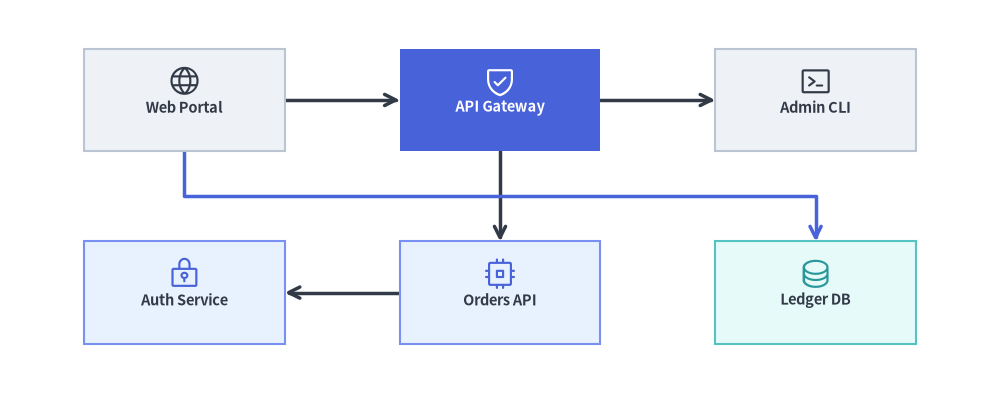
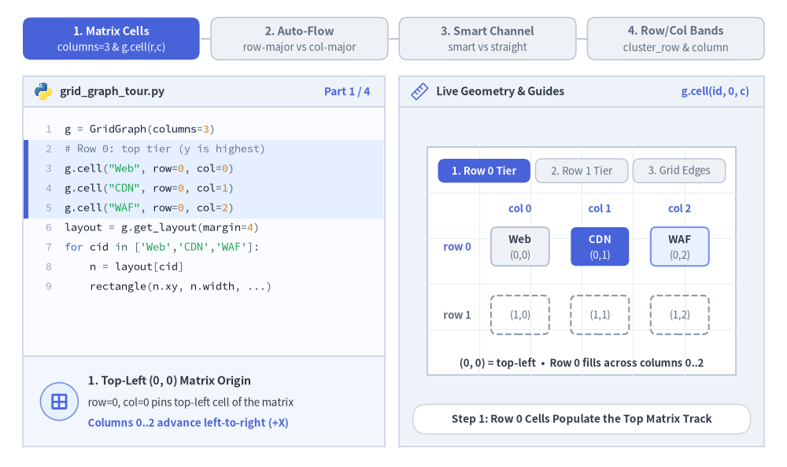
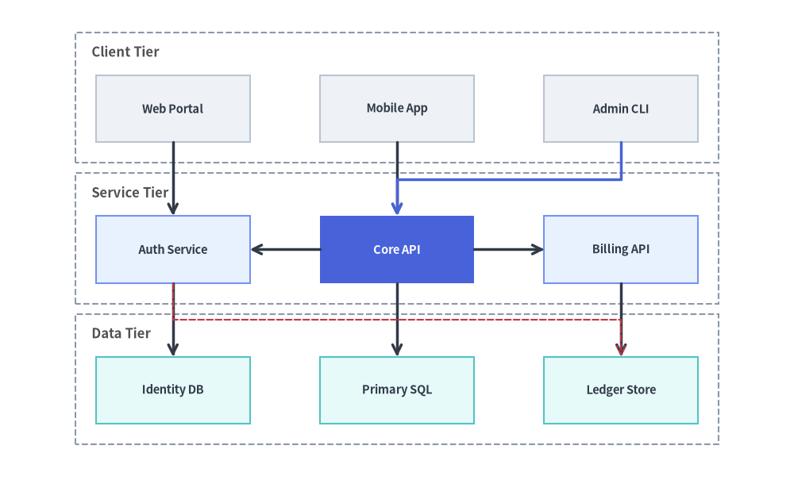
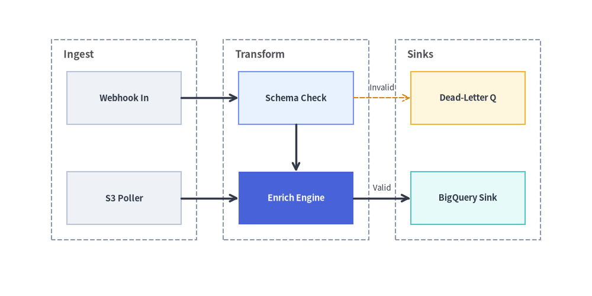

# GridGraph: 2D マトリクスレイアウトとチャネルエッジルーティング

`GridGraph` は、構造化された **2D `(row, col)` マトリクス**にノードを配置し、セル間のエッジを整然とルーティングします。水平・垂直に隣接するセル同士は直接接続される一方、非隣接セル間のクロスエッジは行間・列間のハイウェイチャネル（`edge_routing="smart"`）へ自動的に迂回ルーティングされるため、中間のノードを線が横切ることはありません。

マルチティアのサービスマトリクス、ステートグリッド、カタログ型トポロジ、グリッド整列されたコンポーネントアーキテクチャなど、行と列に沿った表形式の整列を行いたい場合に `GridGraph` を使用します。`layout = g.get_layout(margin=...)` を呼び出すことで、セル座標（`layout[id].xy` / `.local_xy`）、行・列クラスタのバウンディングボックス（`layout.clusters[cid].bottom_left`）、およびチャネルルーティングされたエッジのウェイポイント（`layout.edges`）を取得できます。


<figure class="drawlib-image" style="text-align: center;">
  
  <figcaption class="drawlib-caption">GridGraph の概要: 2D マトリクスセル配置とスマートチャネルエッジルーティング</figcaption>
</figure>

<details class="drawlib-code-details">
<summary>Source Code</summary>

```python
from drawlib.canvas import save, setup
from drawlib.graph import GridGraph
from drawlib.icons import phosphor
from drawlib.lines import lines
from drawlib.shapes import rectangle
from drawlib.styles import Styles

setup(width=122, height=48)

g = GridGraph(
    columns=3,
    col_sep=14.0,
    row_sep=11.0,
    edge_routing="smart",
    default_node_width=24.5,
    default_node_height=12.5,
)

# Row 0: Ingress & Routing Tier
g.cell("web", row=0, col=0)
g.cell("gateway", row=0, col=1)
g.cell("admin", row=0, col=2)

# Row 1: Service & Persistence Tier
g.cell("auth", row=1, col=0)
g.cell("orders", row=1, col=1)
g.cell("ledger", row=1, col=2)

# Direct grid edges + smart channel-routed edge through the inter-row corridor
g.edge("web", "gateway")
g.edge("gateway", "admin")
g.edge("gateway", "orders")
g.edge("orders", "auth")
g.edge("web", "ledger")

# 1. Solve 2D grid coordinates & smart inter-channel edge polylines
layout = g.get_layout(margin=5.0)

# 2. Render edges (highlighting the smart channel-routed cross-edge web -> ledger)
for e in layout.edges:
    edge_st = Styles.PrimaryBold if (e.src, e.dst) == ("web", "ledger") else Styles.DarkBold
    lines(e.points, arrow_head="->", style=edge_st)

# 3. Render cell cards & Phosphor icons
cells = {
    "web": ("\nWeb Portal", Styles.Neutral, Styles.DarkBold, phosphor.globe, Styles.Dark),
    "gateway": ("\nAPI Gateway", Styles.PrimaryFlat, Styles.WhiteBold, phosphor.shield_check, Styles.White),
    "admin": ("\nAdmin CLI", Styles.Neutral, Styles.DarkBold, phosphor.terminal_window, Styles.Dark),
    "auth": ("\nAuth Service", Styles.PrimaryNeutral, Styles.DarkBold, phosphor.lock_key, Styles.Primary),
    "orders": ("\nOrders API", Styles.PrimaryNeutral, Styles.DarkBold, phosphor.cpu, Styles.Primary),
    "ledger": ("\nLedger DB", Styles.SecondaryNeutral, Styles.DarkBold, phosphor.database, Styles.Secondary),
}

for cid, (label, box_st, txt_st, icon_fn, ic_st) in cells.items():
    n = layout[cid]
    rectangle(
        n.xy,
        width=n.width,
        height=n.height,
        style=box_st,
        text=label,
        text_style=txt_st.patch(text_size=10.5),
    )
    icon_fn((n.x, n.y + 2.3), width=4.2, style=ic_st)

save()
```

</details>


---

## 1. 基本概念と基本的な使い方

`GridGraph` は、`(0, 0)` を左上スロットとして行インデックスが下方向に増加する整然とした 2D `(row, col)` マトリクスにノードを配置します。`g.cell(id, row, col)` でセル位置を明示的に固定するか、未固定ノードを `"row-major"`（行優先）／`"column-major"`（列優先）順で自動流し込みでき、`edge_routing="smart"` によって非隣接クロスエッジを行間回廊へ迂回させて隣接セルとの重なりを回避できます。さらに `g.cluster_row(...)`、`g.cluster_column(...)`、`layout.offset(...)` を組み合わせることで、マトリクスの行や列を `ArchitectureDiagram` の `NodeGroup` コンテナで囲むことができます。


<figure class="drawlib-image" style="text-align: center;">
  
  <figcaption class="drawlib-caption">基本的な使い方とパラメータツアー: 明示的な (row, col) マトリクス展開、行優先と列優先の自動流し込み、スマートチャネル回廊ルーティング、行・列クラスタ（APNG アニメーション）</figcaption>
</figure>


<div class="drawlib-source-link">
  <a href="https://github.com/yuichi110/drawlib/blob/main/docs/docs_src/ja/07_graph/grid_graph.md" target="_blank" rel="noopener noreferrer">GitHub でアニメーションのソースコードを見る &rarr;</a>
</div>

- **明示的な `(row, col)` マトリクス配置**: `(0, 0)` が左上スロットの基点となり、`row` は下方向、`col` は右方向へ増加します。水平・垂直に隣接するエッジはカードの境界同士を直接結びます。
- **`"row-major"` と `"column-major"` の自動流し込み**: 座標未指定の `g.node()`／`g.cell()` は、各行を左から右へ埋める行優先（`order="row-major"`）または各列を上から下へ埋める列優先（`order="column-major", rows=...`）で自動配置され、`col_sep` と `row_sep` で回廊幅を制御できます。
- **スマートチャネルルーティング（`edge_routing="smart"`）**: 中間セルを斜めに横切る直線（`"straight"`）とは異なり、`"smart"` は非隣接エッジを行間のハイウェイ回廊へ整然と迂回させます。
- **行・列の `ClusterLayout` コンテナ**: `g.cluster_row(r, id)` と `g.cluster_column(c, id)` は、`ArchitectureDiagram` の `NodeGroup` 描画にそのまま使えるコンテナの `bottom_left` 境界と子セルの `local_xy` 中心座標を計算し、計算後の `layout.offset()` 微調整にも対応します。

---

## 2. コンストラクタ、マトリクスヘルパー、`get_layout()` API

```python
from drawlib.graph import GridGraph

g = GridGraph(
    columns=3,                       # Number of grid columns (default: 3)
    rows=None,                       # Optional fixed row count (used in column-major mode)
    order="row-major",               # Auto-flow fill order: "row-major" or "column-major"
    col_sep=16.0,                    # Horizontal gap between columns (auto-scales if None)
    row_sep=14.0,                    # Vertical gap between rows (auto-scales if None)
    edge_routing="smart",            # "smart" (channel routing), "orthogonal", or "straight"
    default_node_width=24.0,
    default_node_height=12.0,
)

layout = g.get_layout(margin=7.5)
print(layout)                        # Inspect solved cell centers, row/column clusters & edges
```

### パラメータリファレンス

| パラメータ | 型 | デフォルト | 説明 |
| :--- | :--- | :--- | :--- |
| `columns` | `int` | `3` | グリッドマトリクスの列数。 |
| `rows` | `int \| None` | `None` | 任意の固定行数（主に `order="column-major"` の場合に使用）。 |
| `order` | `Literal["row-major", "column-major"]` | `"row-major"` | 明示的な `(row, col)` 座標を持たないノードの自動スロット割り当て順。 |
| `col_sep` | `float \| None` | `None` | 列間の固定水平間隔。`None` の場合はキャンバスに合わせて自動スケーリングされます。 |
| `row_sep` | `float \| None` | `None` | 行間の固定垂直間隔。`None` の場合はキャンバスに合わせて自動スケーリングされます。 |
| `edge_routing` | `Literal["smart", "orthogonal", "straight"]` | `"smart"` | `"smart"` は非隣接エッジをセル間チャネル経由でルーティングし、`"orthogonal"` は標準の Z／L 字折れ、`"straight"` は直線を描画します。 |
| `default_node_width` | `float` | `20.0` | デフォルトのノード幅（キャンバス単位）。 |
| `default_node_height` | `float` | `12.0` | デフォルトのノード高さ（キャンバス単位）。 |

### マトリクスセルおよび行・列クラスタメソッド

- **`g.cell(cell_id, row=None, col=None, *, width=None, height=None) -> Node`**:
  0 始まりの `(row, col)`（`row=0, col=0` が左上セル）に固定されたノードを登録します。`row`／`col` を `None` のままにすると、次の空きスロットへ自動流し込みされます。
- **`g.cluster_row(row, cluster_id, *, padding=4.0, header_height=3.5) -> Cluster`**:
  指定した `row` に配置されたすべてのノードを水平バンドコンテナ（`ClusterLayout`）で自動的に囲み、各セルの `parent_id` と行コンテナの `bottom_left` からの相対座標 `local_xy` を設定します。
- **`g.cluster_column(col, cluster_id, *, padding=4.0, header_height=3.5) -> Cluster`**:
  指定した `col` に配置されたすべてのノードを垂直列コンテナ（`ClusterLayout`）で自動的に囲み、各セルの `parent_id` と列コンテナの `bottom_left` からの相対座標 `local_xy` を設定します。
- **`g.cluster(id, nodes=None, *, padding=4.0, header_height=3.5, parent=None, order=None, pos=None) -> Cluster`**:
  標準の `BaseGraph.cluster()` も `cluster_row()` や `cluster_column()` と併用でき、任意のグリッドセル部分集合を矩形境界で囲むことができます。

---

## 3. 行クラスタとクロスエッジを備えた明示的 `(row, col)` コンポーネントマトリクス

明示的な `(row, col)` 座標にノードを固定し、`g.cluster_row(...)` で行をグループ化することで、クライアント／サービス／ストレージの階層マトリクスをモデル化できます。`ArchitectureDiagram` が行バンドの `NodeGroup`（`xy=cl.bottom_left`）と `Node` カード（`xy=nl.local_xy`）を描画し、`layout.edges` が列をまたぐクロスエッジを隣接セルの周囲へ整然とルーティングします。


```python
from drawlib.canvas import save, setup
from drawlib.diagrams.architecture import ArchitectureDiagram, Node, NodeGroup
from drawlib.graph import GridGraph
from drawlib.lines import lines
from drawlib.styles import Styles

setup(width=124, height=78)

g = GridGraph(
    columns=3,
    col_sep=11.0,
    row_sep=11.5,
    default_node_width=24.0,
    default_node_height=10.5,
)

# Row 0: Client Interfaces
g.cell("fe_web", row=0, col=0)
g.cell("fe_mob", row=0, col=1)
g.cell("fe_cli", row=0, col=2)

# Row 1: Core Services
g.cell("svc_auth", row=1, col=0)
g.cell("svc_core", row=1, col=1)
g.cell("svc_bill", row=1, col=2)

# Row 2: Persistence Layer
g.cell("db_users", row=2, col=0)
g.cell("db_main", row=2, col=1)
g.cell("db_ledger", row=2, col=2)

# Enclose rows in horizontal containers
g.cluster_row(0, "row_clients", padding=3.2)
g.cluster_row(1, "row_services", padding=3.2)
g.cluster_row(2, "row_storage", padding=3.2)

# Direct vertical/horizontal edges + non-adjacent channel-routed cross-edges
g.edge("fe_web", "svc_auth")
g.edge("fe_mob", "svc_core")
g.edge("fe_cli", "svc_core")
g.edge("svc_core", "svc_auth")
g.edge("svc_core", "svc_bill")
g.edge("svc_auth", "db_users")
g.edge("svc_core", "db_main")
g.edge("svc_bill", "db_ledger")
g.edge("svc_auth", "db_ledger")

layout = g.get_layout(margin=7.5)

# Render NodeGroups and Nodes with ArchitectureDiagram
d = ArchitectureDiagram(
    node_style=Styles.PrimaryFlat,
    node_text_style=Styles.DarkBold.patch(text_size=10.5),
    edge_style=Styles.DarkBold,
    edge_text_style=Styles.Dark.patch(text_size=10.0),
    node_card_style=Styles.Neutral,
)

groups = {}
for cid, title in [
    ("row_clients", "Client Tier"),
    ("row_services", "Service Tier"),
    ("row_storage", "Data Tier"),
]:
    cl = layout.clusters[cid]
    groups[cid] = d.add(
        NodeGroup(title=title, width=cl.width, height=cl.height, style=Styles.MutedDashed),
        xy=cl.bottom_left,
    )

for nid, label, card_st, txt_st in [
    ("fe_web", "Web Portal", Styles.Neutral, Styles.DarkBold),
    ("fe_mob", "Mobile App", Styles.Neutral, Styles.DarkBold),
    ("fe_cli", "Admin CLI", Styles.Neutral, Styles.DarkBold),
    ("svc_auth", "Auth Service", Styles.PrimaryNeutral, Styles.DarkBold),
    ("svc_core", "Core API", Styles.PrimaryFlat, Styles.WhiteBold),
    ("svc_bill", "Billing API", Styles.PrimaryNeutral, Styles.DarkBold),
    ("db_users", "Identity DB", Styles.SecondaryNeutral, Styles.DarkBold),
    ("db_main", "Primary SQL", Styles.SecondaryNeutral, Styles.DarkBold),
    ("db_ledger", "Ledger Store", Styles.SecondaryNeutral, Styles.DarkBold),
]:
    nl = layout[nid]
    groups[nl.parent_id].add(
        Node(
            label,
            width=nl.width,
            height=nl.height,
            card_style=card_st,
            text_style=txt_st.patch(text_size=10.5),
        ),
        xy=nl.local_xy,
    )

d.draw()

# Overlay smart channel-routed edges from layout.edges
edge_styles = {
    ("fe_cli", "svc_core"): Styles.PrimaryBold,
    ("svc_auth", "db_ledger"): Styles.DangerDashed,
}
for e in layout.edges:
    st = edge_styles.get((e.src, e.dst), Styles.DarkBold)
    lines(e.points, arrow_head="->", style=st)

save()
```

<figure class="drawlib-image" style="text-align: center;">
  
  <figcaption class="drawlib-caption">ArchitectureDiagram の行グループとスマートチャネルルーティングを組み合わせた明示的 (row, col) サービスマトリクス</figcaption>
</figure>


---

## 4. 列クラスタを用いた自動流し込みグリッドトポロジ

`g.node()` や `g.cell()` で `row` と `col` を省略すると、`GridGraph` は `"row-major"`（左から右、上から下）または `"column-major"`（上から下、左から右）の順序でノードを連続するグリッドセルへ自動的に流し込みます。


```python
from drawlib.canvas import save, setup
from drawlib.diagrams.architecture import ArchitectureDiagram, Node, NodeGroup
from drawlib.graph import GridGraph
from drawlib.lines import lines
from drawlib.styles import Styles
from drawlib.text import text

setup(width=124, height=62)

# Column-major order fills each 2-row column top-to-bottom before moving right
g = GridGraph(
    columns=3,
    rows=2,
    order="column-major",
    col_sep=12.0,
    row_sep=10.0,
    default_node_width=24.0,
    default_node_height=11.0,
)

# Column 0 (Ingest Zone)
g.cell("webhook")
g.cell("poller")

# Column 1 (Processing Zone)
g.cell("validator")
g.cell("enricher")

# Column 2 (Sink Zone)
g.cell("dlq")
g.cell("warehouse")

# Group by column
g.cluster_column(0, "col_in", padding=3.2)
g.cluster_column(1, "col_proc", padding=3.2)
g.cluster_column(2, "col_out", padding=3.2)

g.edge("webhook", "validator")
g.edge("poller", "enricher")
g.edge("validator", "enricher")
g.edge("validator", "dlq")
g.edge("enricher", "warehouse")

layout = g.get_layout(margin=8.0)

d = ArchitectureDiagram(
    node_style=Styles.PrimaryFlat,
    node_text_style=Styles.DarkBold.patch(text_size=10.5),
    edge_style=Styles.DarkBold,
    edge_text_style=Styles.Dark.patch(text_size=10.0),
    node_card_style=Styles.Neutral,
)

col_groups = {}
for cid, title in [
    ("col_in", "Ingest"),
    ("col_proc", "Transform"),
    ("col_out", "Sinks"),
]:
    cl = layout.clusters[cid]
    col_groups[cid] = d.add(
        NodeGroup(title=title, width=cl.width, height=cl.height, style=Styles.MutedDashed),
        xy=cl.bottom_left,
    )

for nid, label, card_st, txt_st in [
    ("webhook", "Webhook In", Styles.Neutral, Styles.DarkBold),
    ("poller", "S3 Poller", Styles.Neutral, Styles.DarkBold),
    ("validator", "Schema Check", Styles.PrimaryNeutral, Styles.DarkBold),
    ("enricher", "Enrich Engine", Styles.PrimaryFlat, Styles.WhiteBold),
    ("dlq", "Dead-Letter Q", Styles.WarningNeutral, Styles.DarkBold),
    ("warehouse", "BigQuery Sink", Styles.SecondaryNeutral, Styles.DarkBold),
]:
    nl = layout[nid]
    col_groups[nl.parent_id].add(
        Node(
            label,
            width=nl.width,
            height=nl.height,
            card_style=card_st,
            text_style=txt_st.patch(text_size=10.5),
        ),
        xy=nl.local_xy,
    )

d.draw()

for e in layout.edges:
    is_dlq = (e.src, e.dst) == ("validator", "dlq")
    lines(e.points, arrow_head="->", style=Styles.WarningDashed if is_dlq else Styles.DarkBold)
    if is_dlq:
        text((e.mid_xy[0], e.mid_xy[1] + 2.2), "Invalid", style=Styles.Dark.patch(text_size=9.5))
    elif (e.src, e.dst) == ("enricher", "warehouse"):
        text((e.mid_xy[0], e.mid_xy[1] + 2.2), "Valid", style=Styles.Dark.patch(text_size=9.5))

save()
```

<figure class="drawlib-image" style="text-align: center;">
  
  <figcaption class="drawlib-caption">ArchitectureDiagram の列 NodeGroup で描画した自動流し込み 3 列グリッドトポロジ</figcaption>
</figure>


---

## 5. ベストプラクティス

1. **`GridGraph` と `SmartArts.GridLayout` の使い分け**:
   - セル同士が有向エッジ（`g.edge()`）で接続されている場合や、行・列クラスタ（`g.cluster_row()`／`g.cluster_column()`）でグループ化する場合は `GridGraph`（`drawlib.graph`）を使用します。
   - エッジを持たない見出し・箇条書き付きの機能紹介カードを並べる場合は、[`GridLayout`](../04_smartarts/grid_layout.md)（`drawlib.smartarts`）を使用します。
2. **同一セルに対する `cluster_row` と `cluster_column` の併用を避ける**: 破線のコンテナ枠が同じセル上で交差しないよう、`cluster_row(...)`（水平ティアバンド）または `cluster_column(...)`（垂直ステージ列）のいずれか一方を選択してください。
