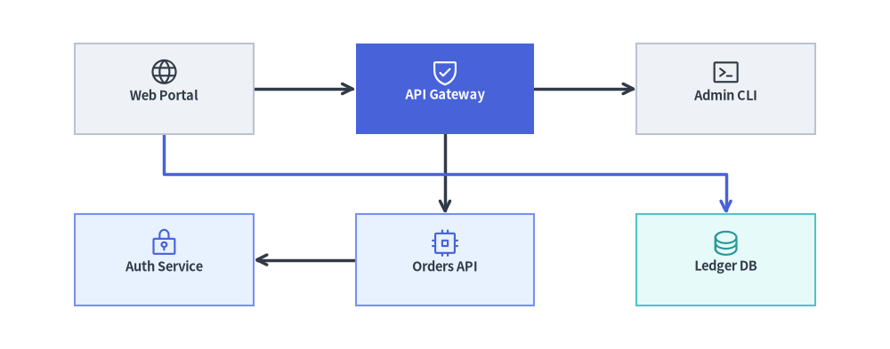
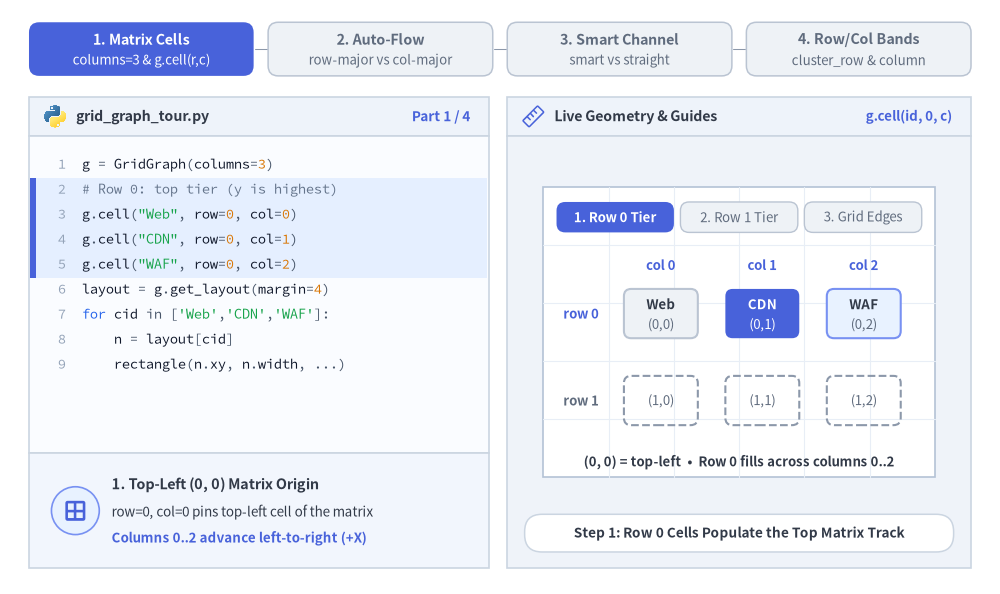
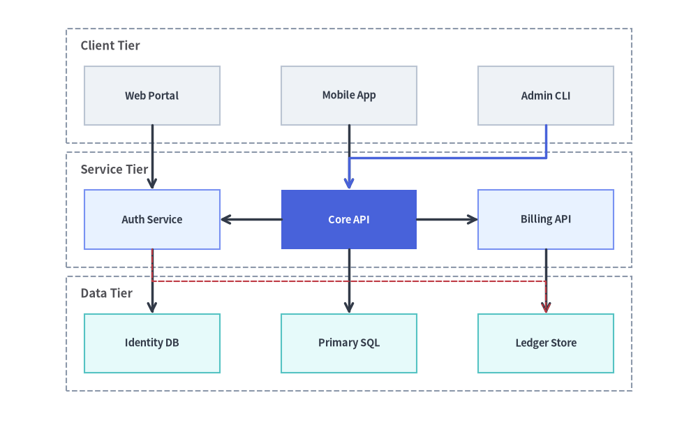
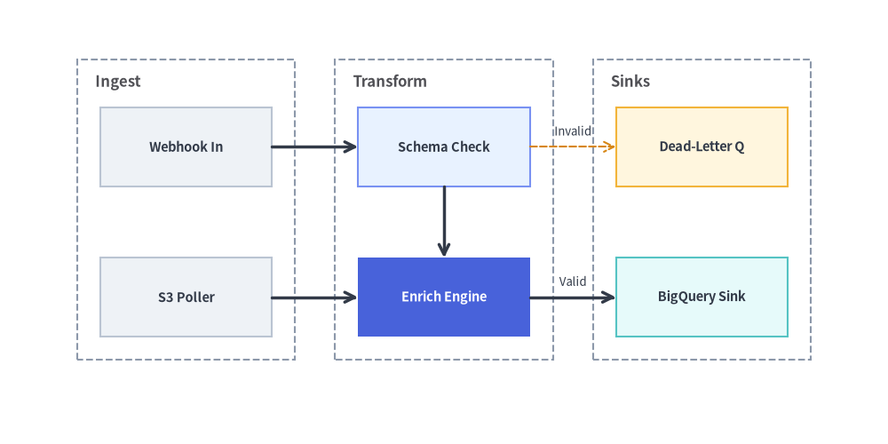

# GridGraph: 2D マトリクスレイアウトとチャネルエッジルーティング

`GridGraph` は、構造化された **2D `(row, col)` マトリクス**にノードを配置し、セル間のエッジを整然とルーティングします。水平・垂直に隣接するセル同士は直接接続される一方、非隣接セル間のクロスエッジは行間・列間のハイウェイチャネル（`edge_routing="smart"`）へ自動的に迂回ルーティングされるため、中間のノードを線が横切ることはありません。

マルチティアのサービスマトリクス、ステートグリッド、カタログ型トポロジ、グリッド整列されたコンポーネントアーキテクチャなど、行と列に沿った表形式の整列を行いたい場合に `GridGraph` を使用します。`layout = g.get_layout(margin=...)` を呼び出すことで、セル座標（`layout[id].xy` / `.local_xy`）、行・列クラスタのバウンディングボックス（`layout.clusters[cid].bottom_left`）、およびチャネルルーティングされたエッジのウェイポイント（`layout.edges`）を取得できます。


<figure class="drawlib-image" style="text-align: center;">
  
  <figcaption class="drawlib-caption">GridGraph の概要: 2D マトリクスセル配置とスマートチャネルエッジルーティング</figcaption>
</figure>

<details class="drawlib-code-details">
<summary>Source Code</summary>

```python
from drawlib.canvas import save, setup
from drawlib.graph import GridGraph
from drawlib.icons import phosphor
from drawlib.lines import lines
from drawlib.shapes import rectangle
from drawlib.styles import Styles

setup(width=122, height=48)

g = GridGraph(
    columns=3,
    col_sep=14.0,
    row_sep=11.0,
    edge_routing="smart",
    default_node_width=24.5,
    default_node_height=12.5,
)

# Row 0: Ingress & Routing Tier
g.cell("web", row=0, col=0)
g.cell("gateway", row=0, col=1)
g.cell("admin", row=0, col=2)

# Row 1: Service & Persistence Tier
g.cell("auth", row=1, col=0)
g.cell("orders", row=1, col=1)
g.cell("ledger", row=1, col=2)

# Direct grid edges + smart channel-routed edge through the inter-row corridor
g.edge("web", "gateway")
g.edge("gateway", "admin")
g.edge("gateway", "orders")
g.edge("orders", "auth")
g.edge("web", "ledger")

# 1. Solve 2D grid coordinates & smart inter-channel edge polylines
layout = g.get_layout(margin=5.0)

# 2. Render edges (highlighting the smart channel-routed cross-edge web -> ledger)
for e in layout.edges:
    edge_st = Styles.PrimaryBold if (e.src, e.dst) == ("web", "ledger") else Styles.DarkBold
    lines(e.points, arrow_head="->", style=edge_st)

# 3. Render cell cards & Phosphor icons
cells = {
    "web": ("\nWeb Portal", Styles.Neutral, Styles.DarkBold, phosphor.globe, Styles.Dark),
    "gateway": ("\nAPI Gateway", Styles.PrimaryFlat, Styles.WhiteBold, phosphor.shield_check, Styles.White),
    "admin": ("\nAdmin CLI", Styles.Neutral, Styles.DarkBold, phosphor.terminal_window, Styles.Dark),
    "auth": ("\nAuth Service", Styles.PrimaryNeutral, Styles.DarkBold, phosphor.lock_key, Styles.Primary),
    "orders": ("\nOrders API", Styles.PrimaryNeutral, Styles.DarkBold, phosphor.cpu, Styles.Primary),
    "ledger": ("\nLedger DB", Styles.SecondaryNeutral, Styles.DarkBold, phosphor.database, Styles.Secondary),
}

for cid, (label, box_st, txt_st, icon_fn, ic_st) in cells.items():
    n = layout[cid]
    rectangle(
        n.xy,
        width=n.width,
        height=n.height,
        style=box_st,
        text=label,
        text_style=txt_st.patch(text_size=10.5),
    )
    icon_fn((n.x, n.y + 2.3), width=4.2, style=ic_st)

save()
```

</details>


---

## 1. 基本概念と基本的な使い方

`GridGraph` は、`(0, 0)` を左上スロットとして行インデックスが下方向に増加する整然とした 2D `(row, col)` マトリクスにノードを配置します。`g.cell(id, row, col)` でセル位置を明示的に固定するか、未固定ノードを `"row-major"`（行優先）／`"column-major"`（列優先）順で自動流し込みでき、`edge_routing="smart"` によって非隣接クロスエッジを行間回廊へ迂回させて隣接セルとの重なりを回避できます。さらに `g.cluster_row(...)`、`g.cluster_column(...)`、`layout.offset(...)` を組み合わせることで、マトリクスの行や列を `ArchitectureDiagram` の `NodeGroup` コンテナで囲むことができます。


<figure class="drawlib-image" style="text-align: center;">
  
  <figcaption class="drawlib-caption">基本的な使い方とパラメータツアー: 明示的な (row, col) マトリクス展開、行優先と列優先の自動流し込み、スマートチャネル回廊ルーティング、行・列クラスタ（APNG アニメーション）</figcaption>
</figure>

<details class="drawlib-code-details">
<summary>Source Code</summary>

```python
from __future__ import annotations

from drawlib.anim import Animation
from drawlib.canvas import save, setup
from drawlib.diagrams.architecture import (
    ArchitectureDiagram,
    Node,
    NodeGroup,
    PhosphorIcon,
)
from drawlib.graph import GraphLayout, GridGraph
from drawlib.icons import code as code_icons
from drawlib.icons import phosphor
from drawlib.lines import line, lines
from drawlib.shapes import circle, rectangle
from drawlib.smartarts import SourceCode, SourceCodeStyles
from drawlib.styles import Styles
from drawlib.text import text

W, H = 138.0, 82.0
setup(width=W, height=H)
anim = Animation(fps=10.0, loop=0)

CODE_TEXT_SIZE = 10.0
PT_TO_CANVAS = W / 720.0
FONT_CANVAS = CODE_TEXT_SIZE * PT_TO_CANVAS
LINE_H = FONT_CANVAS * 1.8
PAD_Y = FONT_CANVAS * 1.2

CODE_STYLES = SourceCodeStyles.get("default", font_lang="en", text_size=CODE_TEXT_SIZE).patch(
    box_style=Styles.Neutral.patch(shape_fill_color=(0, 0, 0, 0), shape_line_width=0),
)

PANE_HEADER = Styles.Neutral.patch(
    shape_fill_color=(238, 243, 250),
    shape_line_color=(203, 213, 225),
    shape_line_width=1.2,
    shape_r=0.0,
)
EDITOR_BODY = Styles.Neutral.patch(
    shape_fill_color=(250, 252, 255),
    shape_line_color=(203, 213, 225),
    shape_line_width=1.2,
    shape_r=0.0,
)
TAKEAWAY_BODY = Styles.Neutral.patch(
    shape_fill_color=(242, 246, 253),
    shape_line_color=(203, 213, 225),
    shape_line_width=1.2,
    shape_r=0.0,
)
STUDIO_BODY = Styles.Neutral.patch(
    shape_fill_color=(239, 243, 249),
    shape_line_color=(203, 213, 225),
    shape_line_width=1.2,
    shape_r=0.0,
)

PART_ITEMS = [
    ("1. Matrix Cells", "columns=3 & g.cell(r,c)"),
    ("2. Auto-Flow", "row-major vs col-major"),
    ("3. Smart Channel", "smart vs straight"),
    ("4. Row/Col Bands", "cluster_row & column"),
]


def shift_layout(layout: GraphLayout, dx: float, dy: float) -> GraphLayout:
    """Translate a solved GraphLayout into the right studio coordinate sheet."""
    for nl in layout.nodes.values():
        nl.xy = (round(nl.x + dx, 2), round(nl.y + dy, 2))
        if nl.parent_id is None:
            nl.local_xy = nl.xy
    for cl in layout.clusters.values():
        cl.bbox = (round(cl.cx + dx, 2), round(cl.cy + dy, 2), cl.width, cl.height)
        if cl.parent_id is None:
            cl.local_bottom_left = cl.bottom_left
    for el in layout.edges:
        el.src_port = (round(el.src_port[0] + dx, 2), round(el.src_port[1] + dy, 2))
        el.dst_port = (round(el.dst_port[0] + dx, 2), round(el.dst_port[1] + dy, 2))
        el.waypoints = [(round(wx + dx, 2), round(wy + dy, 2)) for wx, wy in el.waypoints]
    return layout


def draw_step_bar(active_part: int) -> None:
    """Draw top 4-part progress bar (active_part is 1..4)."""
    pill_w = 31.0
    pill_h = 7.4
    gap = 2.0
    start_x = 4.0 + pill_w / 2.0
    cy = 75.2

    for idx, (label, sublabel) in enumerate(PART_ITEMS, start=1):
        cx = start_x + (idx - 1) * (pill_w + gap)
        if idx > 1:
            prev_cx = cx - (pill_w + gap)
            line(
                (prev_cx + pill_w / 2.0 + 0.2, cy),
                (cx - pill_w / 2.0 - 0.2, cy),
                style=Styles.PrimaryBold if idx <= active_part else Styles.MutedThin,
            )

        if idx == active_part:
            st = Styles.PrimaryFlat.patch(shape_r=1.4)
            tst = Styles.WhiteBold.patch(text_size=10.3)
            sub_tst = Styles.White.patch(text_size=9.5)
        elif idx < active_part:
            st = Styles.PrimaryNeutral.patch(shape_r=1.4, shape_line_width=1.1)
            tst = Styles.PrimaryBold.patch(text_size=10.3)
            sub_tst = Styles.Primary.patch(text_size=9.5)
        else:
            st = Styles.Neutral.patch(shape_r=1.4, shape_line_width=1.1)
            tst = Styles.MutedBold.patch(text_size=10.3)
            sub_tst = Styles.Muted.patch(text_size=9.5)

        rectangle((cx, cy), width=pill_w, height=pill_h, style=st)
        text((cx, cy + 1.35), label, style=tst)
        text((cx, cy - 1.55), sublabel, style=sub_tst)


def draw_left_pane(
    active_part: int,
    code_lines: list[str],
    hl_range: tuple[int, int],
    icon_fn: object,
    summary_title: str,
    summary_line1: str,
    summary_line2: str,
) -> None:
    """Draw left Python code editor + bottom concept takeaway card."""
    x0, w = 4.0, 63.5
    cx = x0 + w / 2.0
    top_y = 63.2
    header_h = 5.4
    editor_h = 43.8
    takeaway_h = 15.8

    rectangle((cx, top_y + header_h / 2.0), width=w, height=header_h, style=PANE_HEADER)
    code_icons.python((x0 + 3.6, top_y + header_h / 2.0), width=3.4, style=Styles.Neutral)
    text(
        (x0 + 6.5, top_y + header_h / 2.0),
        "grid_graph_tour.py",
        style=Styles.DarkBold.patch(text_size=10.2, halign="left"),
    )
    text(
        (x0 + w - 2.6, top_y + header_h / 2.0),
        f"Part {active_part} / 4",
        style=Styles.PrimaryBold.patch(text_size=9.8, halign="right"),
    )

    rectangle((cx, top_y - editor_h / 2.0), width=w, height=editor_h, style=EDITOR_BODY)

    hl_start, hl_end = hl_range
    hl_top = top_y - PAD_Y - hl_start * LINE_H
    hl_bot = top_y - PAD_Y - (hl_end + 1) * LINE_H
    hl_cy = (hl_top + hl_bot) / 2.0
    hl_h = hl_top - hl_bot
    rectangle(
        (cx, hl_cy),
        width=w - 0.6,
        height=hl_h,
        style=Styles.Neutral.patch(shape_fill_color=(229, 239, 255), shape_line_width=0),
    )
    rectangle(
        (x0 + 0.55, hl_cy),
        width=0.9,
        height=hl_h,
        style=Styles.PrimaryFlat.patch(shape_line_width=0),
    )

    SourceCode.draw(
        xy=(x0, top_y),
        width=w,
        code="\n".join(code_lines),
        styles=CODE_STYLES,
        code_lang="python",
        show_linenum=True,
        align="top_left",
    )

    take_cy = 3.6 + takeaway_h / 2.0
    rectangle((cx, take_cy), width=w, height=takeaway_h, style=TAKEAWAY_BODY)
    circle(
        (x0 + 6.4, take_cy),
        radius=3.3,
        style=Styles.PrimaryNeutral.patch(shape_line_width=1.2),
    )
    icon_fn((x0 + 6.4, take_cy), width=3.8, style=Styles.PrimaryBold)  # type: ignore[operator]
    text(
        (x0 + 11.4, take_cy + 3.6),
        summary_title,
        style=Styles.DarkBold.patch(text_size=10.4, halign="left"),
    )
    text(
        (x0 + 11.4, take_cy - 0.2),
        summary_line1,
        style=Styles.Dark.patch(text_size=9.7, halign="left"),
    )
    text(
        (x0 + 11.4, take_cy - 3.8),
        summary_line2,
        style=Styles.PrimaryBold.patch(text_size=9.6, halign="left"),
    )


def draw_geometry_studio(param_badge: str, footer_caption: str) -> tuple[float, float]:
    """Draw right geometry lab shell, inner coordinate sheet with subtle grid, and footer."""
    x0, w = 70.0, 64.0
    cx = x0 + w / 2.0
    top_y = 63.2
    header_h = 5.4
    body_h = 59.6

    rectangle((cx, top_y + header_h / 2.0), width=w, height=header_h, style=PANE_HEADER)
    phosphor.ruler((x0 + 3.6, top_y + header_h / 2.0), width=3.4, style=Styles.Primary)
    text(
        (x0 + 6.5, top_y + header_h / 2.0),
        "Live Geometry & Guides",
        style=Styles.DarkBold.patch(text_size=10.2, halign="left"),
    )
    text(
        (x0 + w - 2.6, top_y + header_h / 2.0),
        param_badge,
        style=Styles.PrimaryBold.patch(text_size=9.6, halign="right"),
    )

    rectangle((cx, 3.6 + body_h / 2.0), width=w, height=body_h, style=STUDIO_BODY)

    sheet_cx, sheet_cy = cx, 36.2
    sheet_w, sheet_h = 54.0, 40.0
    sx0, sy0 = sheet_cx - sheet_w / 2.0, sheet_cy - sheet_h / 2.0
    rectangle(
        (sheet_cx, sheet_cy),
        width=sheet_w,
        height=sheet_h,
        style=Styles.Neutral.patch(
            shape_fill_color=(255, 255, 255),
            shape_line_color=(180, 194, 214),
            shape_line_width=1.2,
        ),
    )
    g_st = Styles.MutedThin.patch(line_color=(232, 238, 246), line_width=0.8)
    for gx in range(1, 6):
        vx = sx0 + gx * (sheet_w / 6.0)
        line((vx, sy0), (vx, sy0 + sheet_h), style=g_st)
    for gy in range(1, 5):
        vy = sy0 + gy * (sheet_h / 5.0)
        line((sx0, vy), (sx0 + sheet_w, vy), style=g_st)

    rectangle(
        (cx, 8.4),
        width=59.2,
        height=5.2,
        style=Styles.Neutral.patch(
            shape_fill_color=(255, 255, 255),
            shape_line_color=(203, 213, 225),
            shape_line_width=1.1,
            shape_r=2.4,
        ),
        text=footer_caption,
        text_style=Styles.DarkBold.patch(text_size=9.8),
    )
    return sheet_cx, sheet_cy


def draw_sub_pills(scx: float, labels: list[str], active_idx: int) -> None:
    """Draw 3-step tracker pills near the top of the studio sheet."""
    pw, ph, pgap = 16.2, 4.2, 0.9
    p_start = scx - (3 * pw + 2 * pgap) / 2.0 + pw / 2.0
    for idx, lbl in enumerate(labels):
        px = p_start + idx * (pw + pgap)
        if idx == active_idx:
            pst = Styles.PrimaryFlat.patch(shape_r=1.2)
            ptst = Styles.WhiteBold.patch(text_size=9.5)
        elif idx < active_idx:
            pst = Styles.PrimaryNeutral.patch(shape_r=1.2, shape_line_width=1.0)
            ptst = Styles.PrimaryBold.patch(text_size=9.5)
        else:
            pst = Styles.Neutral.patch(shape_r=1.2, shape_line_width=1.0)
            ptst = Styles.Muted.patch(text_size=9.5)
        rectangle((px, 52.0), width=pw, height=ph, style=pst, text=lbl, text_style=ptst)


GRP_TXT = Styles.DarkBold.patch(text_size=9.5, halign="left", valign="top")


# =========================================================================
# Part 1: Matrix Cells — Explicit (row, col) slots & neighbor grid edges
# =========================================================================
def build_part1_layout() -> GraphLayout:
    g = GridGraph(
        columns=3,
        col_sep=3.8,
        row_sep=5.2,
        default_node_width=10.2,
        default_node_height=6.8,
    )
    g.cell("Web", row=0, col=0)
    g.cell("CDN", row=0, col=1)
    g.cell("WAF", row=0, col=2)
    g.cell("Auth", row=1, col=0)
    g.cell("API", row=1, col=1)
    g.cell("DB", row=1, col=2)
    g.edge("Web", "CDN")
    g.edge("CDN", "WAF")
    g.edge("Web", "Auth")
    g.edge("CDN", "API")
    g.edge("API", "DB")
    raw = g.get_layout(width=42.0, height=23.0, margin=2.0)
    return shift_layout(raw, 84.2, 21.2)


P1_GRID = build_part1_layout()

PART1_STATES = [
    (
        "row0",
        3.3,
        [
            "g = GridGraph(columns=3)",
            "# Row 0: top tier (y is highest)",
            'g.cell("Web", row=0, col=0)',
            'g.cell("CDN", row=0, col=1)',
            'g.cell("WAF", row=0, col=2)',
            "layout = g.get_layout(margin=4)",
            "for cid in ['Web','CDN','WAF']:",
            "    n = layout[cid]",
            "    rectangle(n.xy, n.width, ...)",
        ],
        (1, 4),
        "g.cell(id, 0, c)",
        "Step 1: Row 0 Cells Populate the Top Matrix Track",
        "1. Top-Left (0, 0) Matrix Origin",
        "row=0, col=0 pins top-left cell of the matrix",
        "Columns 0..2 advance left-to-right (+X)",
    ),
    (
        "row1",
        3.3,
        [
            "g = GridGraph(columns=3)",
            'g.cell("Web", row=0, col=0) # top',
            'g.cell("CDN", row=0, col=1)',
            'g.cell("WAF", row=0, col=2)',
            "# Row 1: next tier downward (-Y)",
            'g.cell("Auth", row=1, col=0)',
            'g.cell("API", row=1, col=1)',
            'g.cell("DB", row=1, col=2)',
            "layout = g.get_layout(margin=4)",
        ],
        (4, 7),
        "g.cell(id, 1, c)",
        "Step 2: Row 1 Cells Populate Downward Below Row 0",
        "2. Row Index Grows Downward",
        "row=1 places Auth, API, DB cleanly under row=0",
        "Matching col indices align vertically by X",
    ),
    (
        "edges",
        3.5,
        [
            "g = GridGraph(columns=3)",
            "# 6 cells pinned in 2x3 matrix...",
            "# Connect adjacent H & V cells",
            'g.edge("Web", "CDN")',
            'g.edge("CDN", "WAF")',
            'g.edge("Web", "Auth")',
            'g.edge("CDN", "API")',
            'g.edge("API", "DB")',
            "layout = g.get_layout(margin=4)",
            "for e in layout.edges:",
            "    lines(e.points, ...)",
        ],
        (2, 7),
        "layout.edges",
        "Step 3: Adjacent Grid Edges Snap to Card Perimeters",
        "3. Direct Neighbor Connections",
        "Horizontal & vertical neighbor edges stay straight",
        "e.points clips cleanly at exact card borders",
    ),
]

ROW0_META = [
    ("Web", "(0,0)", Styles.Neutral, Styles.DarkBold),
    ("CDN", "(0,1)", Styles.PrimaryFlat, Styles.WhiteBold),
    ("WAF", "(0,2)", Styles.PrimaryNeutral, Styles.DarkBold),
]
ROW1_META = [
    ("Auth", "(1,0)", Styles.SecondaryNeutral, Styles.DarkBold),
    ("API", "(1,1)", Styles.PrimaryNeutral, Styles.DarkBold),
    ("DB", "(1,2)", Styles.White, Styles.DarkBold),
]

for p1_idx, (mode_1, dur, code_1, hl_rng, badge_txt, foot_txt, s_t, s_1, s_2) in enumerate(PART1_STATES):
    with anim.frame(duration=dur):
        draw_step_bar(1)
        draw_left_pane(1, code_1, hl_rng, phosphor.grid_four, s_t, s_1, s_2)
        scx, _scy = draw_geometry_studio(badge_txt, foot_txt)
        draw_sub_pills(scx, ["1. Row 0 Tier", "2. Row 1 Tier", "3. Grid Edges"], p1_idx)

        for c_idx, ref_id in enumerate(["Web", "CDN", "WAF"]):
            cx_col = P1_GRID[ref_id].x
            text((cx_col, 45.4), f"col {c_idx}", style=Styles.PrimaryBold.patch(text_size=9.5))

        y_r0 = P1_GRID["Web"].y
        y_r1 = P1_GRID["Auth"].y
        text((80.2, y_r0), "row 0", style=Styles.PrimaryBold.patch(text_size=9.5))
        text(
            (80.2, y_r1),
            "row 1",
            style=(Styles.PrimaryBold if mode_1 != "row0" else Styles.MutedBold).patch(text_size=9.5),
        )

        if mode_1 == "edges":
            for e in P1_GRID.edges:
                lines(e.points, arrow_head="->", style=Styles.DarkBold)

        for cid, rc_lbl, box_st, txt_st in ROW0_META:
            nl = P1_GRID[cid]
            sub_txt = Styles.White.patch(text_size=9.5) if cid == "CDN" else Styles.Muted.patch(text_size=9.5)
            rectangle(nl.xy, width=nl.width, height=nl.height, style=box_st.patch(shape_r=1.0))
            text((nl.x, nl.y + 1.3), cid, style=txt_st.patch(text_size=9.6))
            text((nl.x, nl.y - 1.5), rc_lbl, style=sub_txt)

        for cid, rc_lbl, box_st, txt_st in ROW1_META:
            nl = P1_GRID[cid]
            if mode_1 == "row0":
                rectangle(
                    nl.xy,
                    width=nl.width,
                    height=nl.height,
                    style=Styles.MutedDashed.patch(shape_fill_color=(0, 0, 0, 0), shape_r=1.0),
                    text=rc_lbl,
                    text_style=Styles.Muted.patch(text_size=9.5),
                )
            else:
                rectangle(nl.xy, width=nl.width, height=nl.height, style=box_st.patch(shape_r=1.0))
                text((nl.x, nl.y + 1.3), cid, style=txt_st.patch(text_size=9.6))
                text((nl.x, nl.y - 1.5), rc_lbl, style=Styles.Muted.patch(text_size=9.5))

        p1_note = (
            "(0, 0) = top-left  •  Row 0 fills across columns 0..2"
            if mode_1 == "row0"
            else (
                "row index increases downward (row 0 -> row 1)"
                if mode_1 == "row1"
                else "5 orthogonal grid edges connect adjacent cells"
            )
        )
        text((scx, 18.2), p1_note, style=Styles.DarkBold.patch(text_size=9.5))


# =========================================================================
# Part 2: Auto-Flow — row-major vs column-major & col_sep / row_sep gutters
# =========================================================================
PART2_STATES = [
    (
        "row_major",
        3.3,
        [
            "g = GridGraph(",
            "    columns=3,",
            '    order="row-major", # L->R',
            ")",
            "# Unpinned nodes stream across",
            'for nid in ["N1","N2","N3",',
            '            "N4","N5"]:',
            "    g.node(nid)",
            "layout = g.get_layout(margin=4)",
        ],
        (1, 2),
        'order="row-major"',
        'order="row-major" Fills Left-to-Right Across Each Row',
        "Row-Major Auto-Flow (Default)",
        "Unpinned nodes fill (0,0)->(0,1)->(0,2) first",
        "Wraps to (1,0)->(1,1) when row reaches columns=3",
    ),
    (
        "col_major",
        3.3,
        [
            "g = GridGraph(",
            "    columns=3, rows=2,",
            '    order="column-major", # T->B',
            ")",
            "# Fills Col 0, Col 1, Col 2...",
            'for nid in ["N1","N2","N3",',
            '            "N4","N5"]:',
            "    g.node(nid)",
            "layout = g.get_layout(margin=4)",
        ],
        (1, 2),
        'order="column-major"',
        'order="column-major" Fills Top-to-Bottom Per Column',
        "Column-Major Auto-Flow",
        "Set rows=2 to stream top-to-bottom per column",
        "Fills Col 0 (N1,N2), Col 1 (N3,N4), Col 2 (N5)",
    ),
    (
        "gutters",
        3.5,
        [
            "g = GridGraph(",
            "    columns=3,",
            "    col_sep=7.0,  # X corridor",
            "    row_sep=7.2,  # Y corridor",
            "    default_node_width=9.6,",
            "    default_node_height=6.2,",
            ")",
            'for nid in ["N1","N2","N3",',
            '            "N4","N5","N6"]:',
            "    g.cell(nid)",
            "layout = g.get_layout(margin=4)",
        ],
        (2, 3),
        "col_sep & row_sep",
        "col_sep & row_sep Control Inter-Cell Corridor Gutters",
        "Matrix Corridor Spacing",
        "col_sep sets horizontal gap between columns",
        "row_sep sets vertical gap for smart channel routes",
    ),
]

for p2_idx, (mode_2, dur, code_2, hl_rng, badge_txt, foot_txt, s_t, s_1, s_2) in enumerate(PART2_STATES):
    with anim.frame(duration=dur):
        draw_step_bar(2)
        draw_left_pane(2, code_2, hl_rng, phosphor.ruler, s_t, s_1, s_2)
        scx, _scy = draw_geometry_studio(badge_txt, foot_txt)
        draw_sub_pills(scx, ["row-major", "column-major", "col_sep / row_sep"], p2_idx)

        if mode_2 in {"row_major", "col_major"}:
            g2 = GridGraph(
                columns=3,
                rows=2 if mode_2 == "col_major" else None,
                order="row-major" if mode_2 == "row_major" else "column-major",
                col_sep=4.6,
                row_sep=5.4,
                default_node_width=10.6,
                default_node_height=6.8,
            )
            nids_2 = ["N1", "N2", "N3", "N4", "N5"]
            for nid in nids_2:
                g2.node(nid)
            lay2 = shift_layout(g2.get_layout(width=50.0, height=26.0, margin=3.2), 77.0, 20.6)

            open_x = lay2["N3"].x if mode_2 == "row_major" else lay2["N5"].x
            open_y = lay2["N4"].y if mode_2 == "row_major" else lay2["N2"].y
            rectangle(
                (open_x, open_y),
                width=10.6,
                height=6.8,
                style=Styles.MutedDashed.patch(shape_fill_color=(0, 0, 0, 0), shape_r=1.0),
                text="(1,2)",
                text_style=Styles.Muted.patch(text_size=9.5),
            )

            flow_pairs = (
                [("N1", "N2"), ("N2", "N3"), ("N4", "N5")]
                if mode_2 == "row_major"
                else [("N1", "N2"), ("N3", "N4")]
            )
            for a_id, b_id in flow_pairs:
                na, nb = lay2[a_id], lay2[b_id]
                if mode_2 == "row_major":
                    line((na.right, na.y), (nb.left, nb.y), arrow_head="->", style=Styles.PrimaryBold)
                else:
                    line((na.x, na.bottom), (nb.x, nb.top), arrow_head="->", style=Styles.PrimaryBold)

            slot_labels = (
                ["(0,0)", "(0,1)", "(0,2)", "(1,0)", "(1,1)"]
                if mode_2 == "row_major"
                else ["(0,0)", "(1,0)", "(0,1)", "(1,1)", "(0,2)"]
            )
            st_cycle = [
                Styles.PrimaryFlat,
                Styles.PrimaryNeutral,
                Styles.PrimaryNeutral,
                Styles.SecondaryNeutral,
                Styles.Neutral,
            ]
            for idx, nid in enumerate(nids_2):
                nl = lay2[nid]
                is_first = idx == 0
                rectangle(nl.xy, width=nl.width, height=nl.height, style=st_cycle[idx].patch(shape_r=1.0))
                text(
                    (nl.x, nl.y + 1.3),
                    nid,
                    style=(Styles.WhiteBold if is_first else Styles.DarkBold).patch(text_size=9.6),
                )
                text(
                    (nl.x, nl.y - 1.5),
                    slot_labels[idx],
                    style=(Styles.White if is_first else Styles.Muted).patch(text_size=9.5),
                )

            msg_2 = (
                "row-major: N1->N2->N3 (Row 0), then N4->N5 (Row 1)"
                if mode_2 == "row_major"
                else "column-major: N1->N2 (Col 0), N3->N4 (Col 1), N5"
            )
            text((scx, 18.2), msg_2, style=Styles.PrimaryBold.patch(text_size=9.5))
        else:
            g2 = GridGraph(
                columns=3,
                col_sep=7.0,
                row_sep=7.2,
                default_node_width=9.6,
                default_node_height=6.2,
            )
            for nid in ["N1", "N2", "N3", "N4", "N5", "N6"]:
                g2.cell(nid)
            lay2 = shift_layout(g2.get_layout(width=50.0, height=26.0, margin=3.2), 77.0, 20.6)

            n1, n2, n4 = lay2["N1"], lay2["N2"], lay2["N4"]
            gx_mid = (n1.right + n2.left) / 2.0
            gy_mid = (n1.bottom + n4.top) / 2.0

            rectangle(
                (gx_mid, (n1.top + n4.bottom) / 2.0),
                width=n2.left - n1.right,
                height=n1.top - n4.bottom,
                style=Styles.Neutral.patch(shape_fill_color=(232, 241, 255), shape_line_width=0),
            )
            rectangle(
                (scx, gy_mid),
                width=lay2["N3"].right - n1.left,
                height=n1.bottom - n4.top,
                style=Styles.Neutral.patch(shape_fill_color=(235, 248, 242), shape_line_width=0),
            )

            for idx, nid in enumerate(["N1", "N2", "N3", "N4", "N5", "N6"]):
                nl = lay2[nid]
                st_c = Styles.PrimaryNeutral if idx < 3 else Styles.White
                rectangle(
                    nl.xy,
                    width=nl.width,
                    height=nl.height,
                    style=st_c.patch(shape_r=1.0),
                    text=nid,
                    text_style=Styles.DarkBold.patch(text_size=9.6),
                )

            line((n1.right, n1.y), (n2.left, n2.y), arrow_head="<->", style=Styles.PrimaryBold)
            text((gx_mid, n1.top + 1.8), "col_sep", style=Styles.PrimaryBold.patch(text_size=9.5))

            line((n2.x, n2.bottom), (lay2["N5"].x, lay2["N5"].top), arrow_head="<->", style=Styles.DangerBold)
            text((n2.x + 6.2, gy_mid), "row_sep", style=Styles.DangerBold.patch(text_size=9.5))

            text(
                (scx, 18.2),
                "col_sep = 7.0  •  row_sep = 7.2 corridor gutters",
                style=Styles.DarkBold.patch(text_size=9.5),
            )


# =========================================================================
# Part 3: Smart Channel — straight collision vs smart corridor highways
# =========================================================================
PART3_STATES = [
    (
        "blocked",
        3.3,
        [
            "g = GridGraph(",
            "    columns=3,",
            '    edge_routing="straight",',
            ")",
            "# Cross-edge cuts middle cells!",
            'g.cell("Web", row=0, col=0)',
            'g.cell("CDN", row=0, col=1)',
            'g.cell("API", row=1, col=1)',
            'g.cell("DB", row=1, col=2)',
            'g.edge("Web", "DB")  # collision!',
        ],
        (1, 3),
        'routing="straight"',
        'edge_routing="straight" Cuts Across Intermediate Cells',
        "Why Direct Diagonal Lines Fail",
        "Non-adjacent (0,0)->(1,2) ray crosses col=1 cells",
        "Creates visual clutter over CDN (0,1) & API (1,1)",
    ),
    (
        "smart1",
        3.3,
        [
            "g = GridGraph(",
            "    columns=3,",
            '    edge_routing="smart", # clean',
            ")",
            "# Detours into row 0..1 corridor",
            'g.cell("Web", row=0, col=0)',
            'g.cell("DB", row=1, col=2)',
            'g.edge("Web", "DB")',
            "layout = g.get_layout(margin=4)",
            "for e in layout.edges:",
            "    lines(e.points, ...)",
        ],
        (1, 3),
        'edge_routing="smart"',
        'Default edge_routing="smart" Uses Inter-Row Corridor',
        "Smart Channel Corridor Detour",
        "Exits Web bottom into the Row 0..1 gutter channel",
        "Travels horizontally & enters DB top cleanly",
    ),
    (
        "multi",
        3.5,
        [
            'g = GridGraph(columns=3, ...)',
            "# 3x3 matrix: 2 smart corridors",
            "# Corridor A: Row 0 -> Row 1",
            'g.edge("Web", "API")  # 0,0->1,2',
            "# Corridor B: Row 1 -> Row 2",
            'g.edge("API", "Auth") # 1,2->2,0',
            "layout = g.get_layout(margin=4)",
            "for e in layout.edges:",
            "    lines(e.points, ...)",
        ],
        (2, 5),
        "Multi-Corridor",
        "Multiple Smart Channel Highways Route Without Overlap",
        "Multi-Tier Channel Highways",
        "Each row gap acts as a clean horizontal highway",
        "Cross-matrix edges bypass every intermediate cell",
    ),
]

for p3_idx, (mode_3, dur, code_3, hl_rng, badge_txt, foot_txt, s_t, s_1, s_2) in enumerate(PART3_STATES):
    with anim.frame(duration=dur):
        draw_step_bar(3)
        draw_left_pane(3, code_3, hl_rng, phosphor.path, s_t, s_1, s_2)
        scx, _scy = draw_geometry_studio(badge_txt, foot_txt)
        draw_sub_pills(scx, ["Blocked Direct", "edge='smart'", "Multi-Corridor"], p3_idx)

        if mode_3 in {"blocked", "smart1"}:
            is_straight = mode_3 == "blocked"
            g3 = GridGraph(
                columns=3,
                col_sep=3.8 if is_straight else 4.2,
                row_sep=4.6 if is_straight else 6.4,
                edge_routing="straight" if is_straight else "smart",
                default_node_width=11.4 if is_straight else 11.0,
                default_node_height=8.4 if is_straight else 6.8,
            )
            for cid, r_i, c_i in [
                ("Web", 0, 0),
                ("CDN", 0, 1),
                ("WAF", 0, 2),
                ("Auth", 1, 0),
                ("API", 1, 1),
                ("DB", 1, 2),
            ]:
                g3.cell(cid, row=r_i, col=c_i)
            g3.edge("Web", "DB")
            lay3 = shift_layout(g3.get_layout(width=50.0, height=26.0, margin=3.0), 77.0, 20.6)

            if not is_straight:
                corridor_y = (lay3["Web"].bottom + lay3["Auth"].top) / 2.0
                rectangle(
                    (scx, corridor_y),
                    width=45.0,
                    height=lay3["Web"].bottom - lay3["Auth"].top - 0.8,
                    style=Styles.Neutral.patch(shape_fill_color=(229, 239, 255), shape_line_width=0),
                )

            for cid in ["Web", "CDN", "WAF", "Auth", "API", "DB"]:
                nl = lay3[cid]
                if cid in {"Web", "DB"}:
                    st3 = Styles.PrimaryFlat if cid == "Web" else Styles.PrimaryNeutral
                    tst3 = Styles.WhiteBold if cid == "Web" else Styles.DarkBold
                elif is_straight and cid in {"CDN", "API"}:
                    st3 = Styles.WarningNeutral
                    tst3 = Styles.DarkBold
                else:
                    st3 = Styles.Neutral
                    tst3 = Styles.DarkBold
                rectangle(
                    nl.xy,
                    width=nl.width,
                    height=nl.height,
                    style=st3.patch(shape_r=1.0),
                    text=cid,
                    text_style=tst3.patch(text_size=9.6),
                )

            e3 = lay3.edges[0]
            lines(
                e3.points,
                arrow_head="->",
                style=Styles.DangerDashed if is_straight else Styles.PrimaryBold,
            )
            text(
                (scx, 18.2),
                (
                    'edge_routing="straight" collides with CDN & API!'
                    if is_straight
                    else 'edge_routing="smart" detours cleanly via row corridor'
                ),
                style=(Styles.DangerBold if is_straight else Styles.PrimaryBold).patch(text_size=9.5),
            )
        else:
            g3 = GridGraph(
                columns=3,
                col_sep=4.2,
                row_sep=4.8,
                edge_routing="smart",
                default_node_width=10.8,
                default_node_height=5.0,
            )
            cells_3x3 = [
                ("Web", 0, 0),
                ("CDN", 0, 1),
                ("WAF", 0, 2),
                ("Ing", 1, 0),
                ("Core", 1, 1),
                ("API", 1, 2),
                ("Auth", 2, 0),
                ("SQL", 2, 1),
                ("Log", 2, 2),
            ]
            for cid, r_i, c_i in cells_3x3:
                g3.cell(cid, row=r_i, col=c_i)
            g3.edge("Web", "API")
            g3.edge("API", "Auth")
            lay3 = shift_layout(g3.get_layout(width=50.0, height=27.6, margin=2.6), 77.0, 20.6)

            for top_id, bot_id in [("Web", "Ing"), ("Ing", "Auth")]:
                cy_band = (lay3[top_id].bottom + lay3[bot_id].top) / 2.0
                rectangle(
                    (scx, cy_band),
                    width=44.0,
                    height=3.4,
                    style=Styles.Neutral.patch(shape_fill_color=(233, 241, 255), shape_line_width=0),
                )

            lines(lay3.edges[0].points, arrow_head="->", style=Styles.PrimaryBold)
            lines(lay3.edges[1].points, arrow_head="->", style=Styles.SecondaryBold)

            for cid, _, _ in cells_3x3:
                nl = lay3[cid]
                if cid == "Web":
                    st_m, tst_m = Styles.PrimaryFlat, Styles.WhiteBold
                elif cid == "API":
                    st_m, tst_m = Styles.PrimaryNeutral, Styles.DarkBold
                elif cid == "Auth":
                    st_m, tst_m = Styles.SecondaryNeutral, Styles.DarkBold
                else:
                    st_m, tst_m = Styles.White, Styles.DarkBold
                rectangle(
                    nl.xy,
                    width=nl.width,
                    height=nl.height,
                    style=st_m.patch(shape_r=0.9),
                    text=cid,
                    text_style=tst_m.patch(text_size=9.5),
                )

            text(
                (scx, 18.2),
                "2 distinct inter-row channels  •  zero cell collisions",
                style=Styles.PrimaryBold.patch(text_size=9.5),
            )


# =========================================================================
# Part 4: Row/Col Bands — cluster_row(), cluster_column() & layout.offset()
# =========================================================================
PART4_STATES = [
    (
        "crow",
        3.3,
        [
            "g = GridGraph(columns=3, ...)",
            "# 6 cells across Row 0 & Row 1",
            "# Horizontal tier ClusterLayouts",
            'g.cluster_row(0, "edge_tier")',
            'g.cluster_row(1, "core_tier")',
            "layout = g.get_layout(margin=4)",
            'cl = layout.clusters["edge_tier"]',
            "d.add(NodeGroup(",
            '    title="Edge Tier",',
            "    width=cl.width, ...),",
            "    xy=cl.bottom_left)",
        ],
        (2, 4),
        "g.cluster_row()",
        "g.cluster_row(r, id) Wraps Horizontal Matrix Tiers",
        "Horizontal Row Bands (cluster_row)",
        "Computes cl.bottom_left & nl.local_xy per row",
        "Maps directly to ArchitectureDiagram NodeGroups",
    ),
    (
        "ccol",
        3.3,
        [
            "g = GridGraph(columns=3, ...)",
            "# Vertical stage ClusterLayouts",
            'g.cluster_column(0, "ingest")',
            'g.cluster_column(1, "process")',
            'g.cluster_column(2, "store")',
            "layout = g.get_layout(margin=4)",
            "for cid in layout.clusters:",
            "    cl = layout.clusters[cid]",
            "    d.add(NodeGroup(...),",
            "        xy=cl.bottom_left)",
        ],
        (1, 4),
        "g.cluster_column()",
        "g.cluster_column(c, id) Wraps Vertical Pipeline Zones",
        "Vertical Column Zones (cluster_column)",
        "Encloses each column in a tall stage NodeGroup",
        "Ideal for Ingest -> Process -> Store matrices",
    ),
    (
        "offset",
        3.5,
        [
            "layout = g.get_layout(margin=4)",
            "# Fine-tune cell + update ports!",
            "layout.offset(",
            '    "DB", dx=4.2, dy=0.0)',
            "d = ArchitectureDiagram(...)",
            "for nid, ic in CELLS:",
            "    nl = layout[nid]",
            "    d.add(Node(nid, icon=ic,",
            "        width=nl.width, ...),",
            "        xy=nl.xy)",
            "d.draw()",
        ],
        (1, 3),
        "layout.offset()",
        "layout.offset('DB', dx=4.2) Nudges Cell & Edge Ports",
        "Post-Solve Fine-Tuning (.offset)",
        "Shifts nl.xy & updates incident edge endpoints",
        "Pair PhosphorIcon cards with smart channel routes",
    ),
]

for p4_idx, (mode_4, dur, code_4, hl_rng, badge_txt, foot_txt, s_t, s_1, s_2) in enumerate(PART4_STATES):
    with anim.frame(duration=dur):
        draw_step_bar(4)
        draw_left_pane(4, code_4, hl_rng, phosphor.bounding_box, s_t, s_1, s_2)
        scx, _scy = draw_geometry_studio(badge_txt, foot_txt)
        draw_sub_pills(scx, ["cluster_row()", "cluster_column()", "offset() Tune"], p4_idx)

        if mode_4 == "crow":
            g4 = GridGraph(
                columns=3,
                col_sep=3.6,
                row_sep=7.6,
                default_node_width=10.8,
                default_node_height=5.2,
            )
            for cid, r_i, c_i in [
                ("Web", 0, 0),
                ("CDN", 0, 1),
                ("WAF", 0, 2),
                ("Auth", 1, 0),
                ("API", 1, 1),
                ("DB", 1, 2),
            ]:
                g4.cell(cid, row=r_i, col=c_i)
            g4.cluster_row(0, "edge_tier", padding=1.5, header_height=2.8)
            g4.cluster_row(1, "core_tier", padding=1.5, header_height=2.8)
            g4.edge("Web", "CDN")
            g4.edge("CDN", "API")
            g4.edge("WAF", "DB")
            lay4 = shift_layout(g4.get_layout(width=50.0, height=26.0, margin=2.5), 77.0, 20.6)

            d4 = ArchitectureDiagram(
                node_style=Styles.Primary,
                node_text_style=Styles.DarkBold.patch(text_size=9.5),
                edge_style=Styles.DarkBold,
                edge_text_style=Styles.DarkBold.patch(text_size=9.5),
                node_card_style=Styles.White,
            )
            groups4 = {}
            for cid, title, gst in [
                ("edge_tier", "Edge Tier", Styles.PrimaryNeutral),
                ("core_tier", "Core Tier", Styles.SecondaryNeutral),
            ]:
                cl = lay4.clusters[cid]
                groups4[cid] = d4.add(
                    NodeGroup(title=title, width=cl.width, height=cl.height, style=gst, text_style=GRP_TXT),
                    xy=cl.bottom_left,
                )
            for nid in ["Web", "CDN", "WAF", "Auth", "API", "DB"]:
                nl = lay4[nid]
                cst = Styles.PrimaryFlat if nid == "API" else Styles.White
                tst = Styles.WhiteBold if nid == "API" else Styles.DarkBold
                groups4[nl.parent_id].add(  # type: ignore[index]
                    Node(
                        nid,
                        width=nl.width,
                        height=nl.height,
                        card_style=cst,
                        text_style=tst.patch(text_size=9.5),
                    ),
                    xy=nl.local_xy,
                )
            d4.draw()
            for e in lay4.edges:
                lines(e.points, arrow_head="->", style=Styles.DarkBold)
            text(
                (scx, 18.0),
                "cluster_row(0..1) -> horizontal NodeGroup bands",
                style=Styles.PrimaryBold.patch(text_size=9.5),
            )

        elif mode_4 == "ccol":
            g4 = GridGraph(
                columns=3,
                col_sep=4.8,
                row_sep=4.8,
                default_node_width=10.2,
                default_node_height=5.8,
            )
            for cid, r_i, c_i in [
                ("Web", 0, 0),
                ("CLI", 1, 0),
                ("API", 0, 1),
                ("Job", 1, 1),
                ("SQL", 0, 2),
                ("Log", 1, 2),
            ]:
                g4.cell(cid, row=r_i, col=c_i)
            g4.cluster_column(0, "ingest", padding=1.4, header_height=2.8)
            g4.cluster_column(1, "process", padding=1.4, header_height=2.8)
            g4.cluster_column(2, "store", padding=1.4, header_height=2.8)
            g4.edge("Web", "API")
            g4.edge("CLI", "Job")
            g4.edge("API", "SQL")
            g4.edge("Job", "Log")
            lay4 = shift_layout(g4.get_layout(width=50.0, height=25.6, margin=2.5), 77.0, 21.2)

            d4 = ArchitectureDiagram(
                node_style=Styles.Primary,
                node_text_style=Styles.DarkBold.patch(text_size=9.5),
                edge_style=Styles.DarkBold,
                edge_text_style=Styles.DarkBold.patch(text_size=9.5),
                node_card_style=Styles.White,
            )
            groups4 = {}
            for cid, title, gst in [
                ("ingest", "Ingest", Styles.Neutral),
                ("process", "Process", Styles.PrimaryNeutral),
                ("store", "Store", Styles.SecondaryNeutral),
            ]:
                cl = lay4.clusters[cid]
                groups4[cid] = d4.add(
                    NodeGroup(title=title, width=cl.width, height=cl.height, style=gst, text_style=GRP_TXT),
                    xy=cl.bottom_left,
                )
            for nid in ["Web", "CLI", "API", "Job", "SQL", "Log"]:
                nl = lay4[nid]
                cst = Styles.PrimaryFlat if nid == "API" else Styles.White
                tst = Styles.WhiteBold if nid == "API" else Styles.DarkBold
                groups4[nl.parent_id].add(  # type: ignore[index]
                    Node(
                        nid,
                        width=nl.width,
                        height=nl.height,
                        card_style=cst,
                        text_style=tst.patch(text_size=9.5),
                    ),
                    xy=nl.local_xy,
                )
            d4.draw()
            for e in lay4.edges:
                lines(e.points, arrow_head="->", style=Styles.DarkBold)
            text(
                (scx, 18.0),
                "cluster_column(0..2) -> vertical zone NodeGroups",
                style=Styles.PrimaryBold.patch(text_size=9.5),
            )

        else:
            g4 = GridGraph(
                columns=3,
                col_sep=3.8,
                row_sep=7.2,
                edge_routing="smart",
                default_node_width=10.2,
                default_node_height=6.2,
            )
            meta_4 = [
                ("Web", 0, 0, PhosphorIcon.GLOBE, Styles.Dark, Styles.Neutral),
                ("CDN", 0, 1, PhosphorIcon.SHIELD_CHECK, Styles.Primary, Styles.PrimaryNeutral),
                ("WAF", 0, 2, PhosphorIcon.LOCK_KEY, Styles.Dark, Styles.Neutral),
                ("Auth", 1, 0, PhosphorIcon.USER, Styles.Dark, Styles.White),
                ("API", 1, 1, PhosphorIcon.CPU, Styles.White, Styles.PrimaryFlat),
                ("DB", 1, 2, PhosphorIcon.DATABASE, Styles.Secondary, Styles.SecondaryNeutral),
            ]
            for cid, r_i, c_i, _, _, _ in meta_4:
                g4.cell(cid, row=r_i, col=c_i)
            g4.edge("Web", "API")
            g4.edge("API", "DB")
            lay4 = shift_layout(g4.get_layout(width=48.0, height=25.6, margin=2.4), 76.0, 21.2)

            old_db_xy = lay4["DB"].xy
            lay4.offset("DB", dx=4.2, dy=0.0)

            rectangle(
                old_db_xy,
                width=10.2,
                height=6.2,
                style=Styles.MutedDashed.patch(shape_fill_color=(0, 0, 0, 0), shape_line_width=1.0),
            )

            d4 = ArchitectureDiagram(
                node_style=Styles.Primary,
                node_text_style=Styles.DarkBold.patch(text_size=9.5),
                edge_style=Styles.DarkBold,
                edge_text_style=Styles.DarkBold.patch(text_size=9.5),
                node_card_style=Styles.Neutral,
            )
            for cid, _, _, ic_enum, ic_st, card_st in meta_4:
                nl = lay4[cid]
                tst4 = Styles.WhiteBold if cid == "API" else Styles.DarkBold
                d4.add(
                    Node(
                        cid,
                        width=nl.width,
                        height=nl.height,
                        icon=ic_enum,
                        icon_size=3.0,
                        style=ic_st,
                        card_style=card_st,
                        text_style=tst4.patch(text_size=9.5),
                    ),
                    xy=nl.xy,
                )
            d4.draw()

            for idx, e in enumerate(lay4.edges):
                lines(
                    e.points,
                    arrow_head="->",
                    style=Styles.PrimaryBold if idx == 0 else Styles.DarkBold,
                )

            db_nl = lay4["DB"]
            badge_cy = (lay4["WAF"].bottom + db_nl.top) / 2.0
            rectangle(
                (db_nl.x + 1.4, badge_cy),
                width=7.2,
                height=2.6,
                style=Styles.AccentFlat.patch(shape_r=0.9),
                text="dx=+4.2",
                text_style=Styles.WhiteBold.patch(text_size=9.5),
            )
            text(
                (scx, 18.0),
                "layout.offset('DB', dx=4.2) + ArchitectureDiagram",
                style=Styles.PrimaryBold.patch(text_size=9.5),
            )

save()
```

</details>


- **明示的な `(row, col)` マトリクス配置**: `(0, 0)` が左上スロットの基点となり、`row` は下方向、`col` は右方向へ増加します。水平・垂直に隣接するエッジはカードの境界同士を直接結びます。
- **`"row-major"` と `"column-major"` の自動流し込み**: 座標未指定の `g.node()`／`g.cell()` は、各行を左から右へ埋める行優先（`order="row-major"`）または各列を上から下へ埋める列優先（`order="column-major", rows=...`）で自動配置され、`col_sep` と `row_sep` で回廊幅を制御できます。
- **スマートチャネルルーティング（`edge_routing="smart"`）**: 中間セルを斜めに横切る直線（`"straight"`）とは異なり、`"smart"` は非隣接エッジを行間のハイウェイ回廊へ整然と迂回させます。
- **行・列の `ClusterLayout` コンテナ**: `g.cluster_row(r, id)` と `g.cluster_column(c, id)` は、`ArchitectureDiagram` の `NodeGroup` 描画にそのまま使えるコンテナの `bottom_left` 境界と子セルの `local_xy` 中心座標を計算し、計算後の `layout.offset()` 微調整にも対応します。

---

## 2. コンストラクタ、マトリクスヘルパー、`get_layout()` API

```python
from drawlib.graph import GridGraph

g = GridGraph(
    columns=3,                       # Number of grid columns (default: 3)
    rows=None,                       # Optional fixed row count (used in column-major mode)
    order="row-major",               # Auto-flow fill order: "row-major" or "column-major"
    col_sep=16.0,                    # Horizontal gap between columns (auto-scales if None)
    row_sep=14.0,                    # Vertical gap between rows (auto-scales if None)
    edge_routing="smart",            # "smart" (channel routing), "orthogonal", or "straight"
    default_node_width=24.0,
    default_node_height=12.0,
)

layout = g.get_layout(margin=7.5)
print(layout)                        # Inspect solved cell centers, row/column clusters & edges
```

### パラメータリファレンス

| パラメータ | 型 | デフォルト | 説明 |
| :--- | :--- | :--- | :--- |
| `columns` | `int` | `3` | グリッドマトリクスの列数。 |
| `rows` | `int \| None` | `None` | 任意の固定行数（主に `order="column-major"` の場合に使用）。 |
| `order` | `Literal["row-major", "column-major"]` | `"row-major"` | 明示的な `(row, col)` 座標を持たないノードの自動スロット割り当て順。 |
| `col_sep` | `float \| None` | `None` | 列間の固定水平間隔。`None` の場合はキャンバスに合わせて自動スケーリングされます。 |
| `row_sep` | `float \| None` | `None` | 行間の固定垂直間隔。`None` の場合はキャンバスに合わせて自動スケーリングされます。 |
| `edge_routing` | `Literal["smart", "orthogonal", "straight"]` | `"smart"` | `"smart"` は非隣接エッジをセル間チャネル経由でルーティングし、`"orthogonal"` は標準の Z／L 字折れ、`"straight"` は直線を描画します。 |
| `default_node_width` | `float` | `20.0` | デフォルトのノード幅（キャンバス単位）。 |
| `default_node_height` | `float` | `12.0` | デフォルトのノード高さ（キャンバス単位）。 |

### マトリクスセルおよび行・列クラスタメソッド

- **`g.cell(cell_id, row=None, col=None, *, width=None, height=None) -> Node`**:
  0 始まりの `(row, col)`（`row=0, col=0` が左上セル）に固定されたノードを登録します。`row`／`col` を `None` のままにすると、次の空きスロットへ自動流し込みされます。
- **`g.cluster_row(row, cluster_id, *, padding=4.0, header_height=3.5) -> Cluster`**:
  指定した `row` に配置されたすべてのノードを水平バンドコンテナ（`ClusterLayout`）で自動的に囲み、各セルの `parent_id` と行コンテナの `bottom_left` からの相対座標 `local_xy` を設定します。
- **`g.cluster_column(col, cluster_id, *, padding=4.0, header_height=3.5) -> Cluster`**:
  指定した `col` に配置されたすべてのノードを垂直列コンテナ（`ClusterLayout`）で自動的に囲み、各セルの `parent_id` と列コンテナの `bottom_left` からの相対座標 `local_xy` を設定します。
- **`g.cluster(id, nodes=None, *, padding=4.0, header_height=3.5, parent=None, order=None, pos=None) -> Cluster`**:
  標準の `BaseGraph.cluster()` も `cluster_row()` や `cluster_column()` と併用でき、任意のグリッドセル部分集合を矩形境界で囲むことができます。

---

## 3. 行クラスタとクロスエッジを備えた明示的 `(row, col)` コンポーネントマトリクス

明示的な `(row, col)` 座標にノードを固定し、`g.cluster_row(...)` で行をグループ化することで、クライアント／サービス／ストレージの階層マトリクスをモデル化できます。`ArchitectureDiagram` が行バンドの `NodeGroup`（`xy=cl.bottom_left`）と `Node` カード（`xy=nl.local_xy`）を描画し、`layout.edges` が列をまたぐクロスエッジを隣接セルの周囲へ整然とルーティングします。


```python
from drawlib.canvas import save, setup
from drawlib.diagrams.architecture import ArchitectureDiagram, Node, NodeGroup
from drawlib.graph import GridGraph
from drawlib.lines import lines
from drawlib.styles import Styles

setup(width=124, height=78)

g = GridGraph(
    columns=3,
    col_sep=11.0,
    row_sep=11.5,
    default_node_width=24.0,
    default_node_height=10.5,
)

# Row 0: Client Interfaces
g.cell("fe_web", row=0, col=0)
g.cell("fe_mob", row=0, col=1)
g.cell("fe_cli", row=0, col=2)

# Row 1: Core Services
g.cell("svc_auth", row=1, col=0)
g.cell("svc_core", row=1, col=1)
g.cell("svc_bill", row=1, col=2)

# Row 2: Persistence Layer
g.cell("db_users", row=2, col=0)
g.cell("db_main", row=2, col=1)
g.cell("db_ledger", row=2, col=2)

# Enclose rows in horizontal containers
g.cluster_row(0, "row_clients", padding=3.2)
g.cluster_row(1, "row_services", padding=3.2)
g.cluster_row(2, "row_storage", padding=3.2)

# Direct vertical/horizontal edges + non-adjacent channel-routed cross-edges
g.edge("fe_web", "svc_auth")
g.edge("fe_mob", "svc_core")
g.edge("fe_cli", "svc_core")
g.edge("svc_core", "svc_auth")
g.edge("svc_core", "svc_bill")
g.edge("svc_auth", "db_users")
g.edge("svc_core", "db_main")
g.edge("svc_bill", "db_ledger")
g.edge("svc_auth", "db_ledger")

layout = g.get_layout(margin=7.5)

# Render NodeGroups and Nodes with ArchitectureDiagram
d = ArchitectureDiagram(
    node_style=Styles.PrimaryFlat,
    node_text_style=Styles.DarkBold.patch(text_size=10.5),
    edge_style=Styles.DarkBold,
    edge_text_style=Styles.Dark.patch(text_size=10.0),
    node_card_style=Styles.Neutral,
)

groups = {}
for cid, title in [
    ("row_clients", "Client Tier"),
    ("row_services", "Service Tier"),
    ("row_storage", "Data Tier"),
]:
    cl = layout.clusters[cid]
    groups[cid] = d.add(
        NodeGroup(title=title, width=cl.width, height=cl.height, style=Styles.MutedDashed),
        xy=cl.bottom_left,
    )

for nid, label, card_st, txt_st in [
    ("fe_web", "Web Portal", Styles.Neutral, Styles.DarkBold),
    ("fe_mob", "Mobile App", Styles.Neutral, Styles.DarkBold),
    ("fe_cli", "Admin CLI", Styles.Neutral, Styles.DarkBold),
    ("svc_auth", "Auth Service", Styles.PrimaryNeutral, Styles.DarkBold),
    ("svc_core", "Core API", Styles.PrimaryFlat, Styles.WhiteBold),
    ("svc_bill", "Billing API", Styles.PrimaryNeutral, Styles.DarkBold),
    ("db_users", "Identity DB", Styles.SecondaryNeutral, Styles.DarkBold),
    ("db_main", "Primary SQL", Styles.SecondaryNeutral, Styles.DarkBold),
    ("db_ledger", "Ledger Store", Styles.SecondaryNeutral, Styles.DarkBold),
]:
    nl = layout[nid]
    groups[nl.parent_id].add(
        Node(
            label,
            width=nl.width,
            height=nl.height,
            card_style=card_st,
            text_style=txt_st.patch(text_size=10.5),
        ),
        xy=nl.local_xy,
    )

d.draw()

# Overlay smart channel-routed edges from layout.edges
edge_styles = {
    ("fe_cli", "svc_core"): Styles.PrimaryBold,
    ("svc_auth", "db_ledger"): Styles.DangerDashed,
}
for e in layout.edges:
    st = edge_styles.get((e.src, e.dst), Styles.DarkBold)
    lines(e.points, arrow_head="->", style=st)

save()
```

<figure class="drawlib-image" style="text-align: center;">
  
  <figcaption class="drawlib-caption">ArchitectureDiagram の行グループとスマートチャネルルーティングを組み合わせた明示的 (row, col) サービスマトリクス</figcaption>
</figure>


---

## 4. 列クラスタを用いた自動流し込みグリッドトポロジ

`g.node()` や `g.cell()` で `row` と `col` を省略すると、`GridGraph` は `"row-major"`（左から右、上から下）または `"column-major"`（上から下、左から右）の順序でノードを連続するグリッドセルへ自動的に流し込みます。


```python
from drawlib.canvas import save, setup
from drawlib.diagrams.architecture import ArchitectureDiagram, Node, NodeGroup
from drawlib.graph import GridGraph
from drawlib.lines import lines
from drawlib.styles import Styles
from drawlib.text import text

setup(width=124, height=62)

# Column-major order fills each 2-row column top-to-bottom before moving right
g = GridGraph(
    columns=3,
    rows=2,
    order="column-major",
    col_sep=12.0,
    row_sep=10.0,
    default_node_width=24.0,
    default_node_height=11.0,
)

# Column 0 (Ingest Zone)
g.cell("webhook")
g.cell("poller")

# Column 1 (Processing Zone)
g.cell("validator")
g.cell("enricher")

# Column 2 (Sink Zone)
g.cell("dlq")
g.cell("warehouse")

# Group by column
g.cluster_column(0, "col_in", padding=3.2)
g.cluster_column(1, "col_proc", padding=3.2)
g.cluster_column(2, "col_out", padding=3.2)

g.edge("webhook", "validator")
g.edge("poller", "enricher")
g.edge("validator", "enricher")
g.edge("validator", "dlq")
g.edge("enricher", "warehouse")

layout = g.get_layout(margin=8.0)

d = ArchitectureDiagram(
    node_style=Styles.PrimaryFlat,
    node_text_style=Styles.DarkBold.patch(text_size=10.5),
    edge_style=Styles.DarkBold,
    edge_text_style=Styles.Dark.patch(text_size=10.0),
    node_card_style=Styles.Neutral,
)

col_groups = {}
for cid, title in [
    ("col_in", "Ingest"),
    ("col_proc", "Transform"),
    ("col_out", "Sinks"),
]:
    cl = layout.clusters[cid]
    col_groups[cid] = d.add(
        NodeGroup(title=title, width=cl.width, height=cl.height, style=Styles.MutedDashed),
        xy=cl.bottom_left,
    )

for nid, label, card_st, txt_st in [
    ("webhook", "Webhook In", Styles.Neutral, Styles.DarkBold),
    ("poller", "S3 Poller", Styles.Neutral, Styles.DarkBold),
    ("validator", "Schema Check", Styles.PrimaryNeutral, Styles.DarkBold),
    ("enricher", "Enrich Engine", Styles.PrimaryFlat, Styles.WhiteBold),
    ("dlq", "Dead-Letter Q", Styles.WarningNeutral, Styles.DarkBold),
    ("warehouse", "BigQuery Sink", Styles.SecondaryNeutral, Styles.DarkBold),
]:
    nl = layout[nid]
    col_groups[nl.parent_id].add(
        Node(
            label,
            width=nl.width,
            height=nl.height,
            card_style=card_st,
            text_style=txt_st.patch(text_size=10.5),
        ),
        xy=nl.local_xy,
    )

d.draw()

for e in layout.edges:
    is_dlq = (e.src, e.dst) == ("validator", "dlq")
    lines(e.points, arrow_head="->", style=Styles.WarningDashed if is_dlq else Styles.DarkBold)
    if is_dlq:
        text((e.mid_xy[0], e.mid_xy[1] + 2.2), "Invalid", style=Styles.Dark.patch(text_size=9.5))
    elif (e.src, e.dst) == ("enricher", "warehouse"):
        text((e.mid_xy[0], e.mid_xy[1] + 2.2), "Valid", style=Styles.Dark.patch(text_size=9.5))

save()
```

<figure class="drawlib-image" style="text-align: center;">
  
  <figcaption class="drawlib-caption">ArchitectureDiagram の列 NodeGroup で描画した自動流し込み 3 列グリッドトポロジ</figcaption>
</figure>


---

## 5. ベストプラクティス

1. **`GridGraph` と `SmartArts.GridLayout` の使い分け**:
   - セル同士が有向エッジ（`g.edge()`）で接続されている場合や、行・列クラスタ（`g.cluster_row()`／`g.cluster_column()`）でグループ化する場合は `GridGraph`（`drawlib.graph`）を使用します。
   - エッジを持たない見出し・箇条書き付きの機能紹介カードを並べる場合は、[`GridLayout`](../04_smartarts/grid_layout.md)（`drawlib.smartarts`）を使用します。
2. **同一セルに対する `cluster_row` と `cluster_column` の併用を避ける**: 破線のコンテナ枠が同じセル上で交差しないよう、`cluster_row(...)`（水平ティアバンド）または `cluster_column(...)`（垂直ステージ列）のいずれか一方を選択してください。
