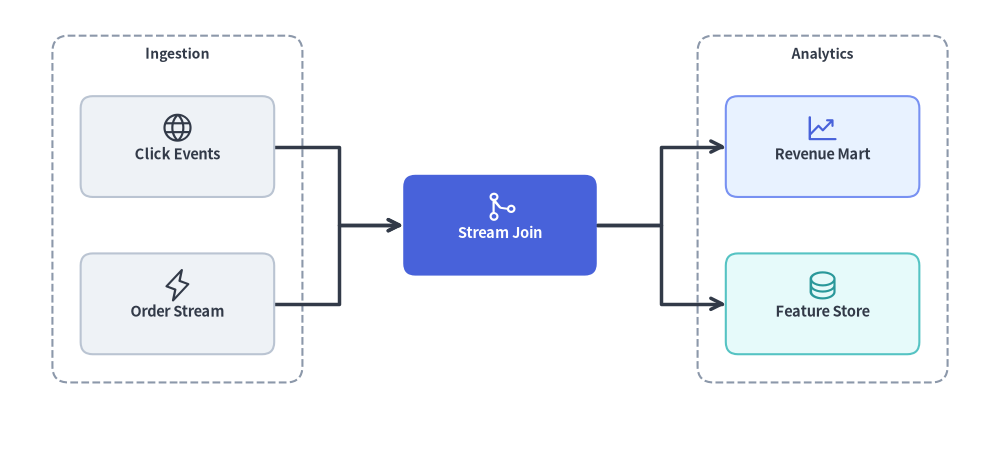
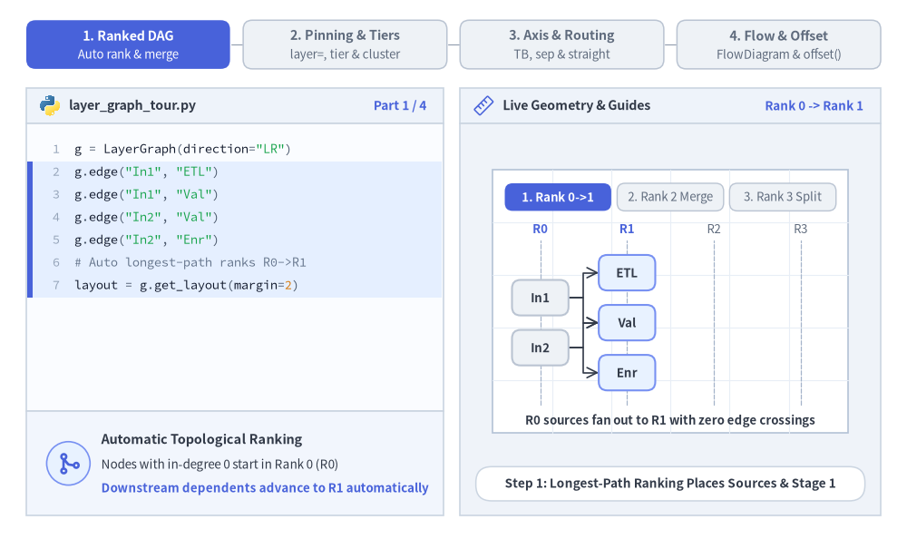
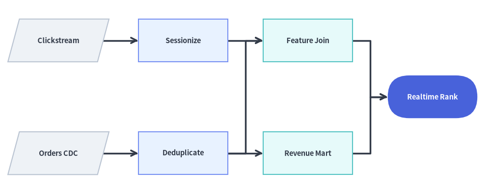
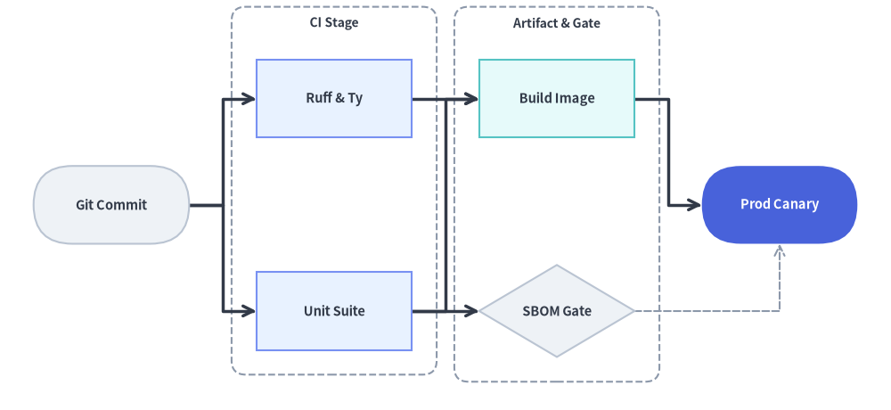
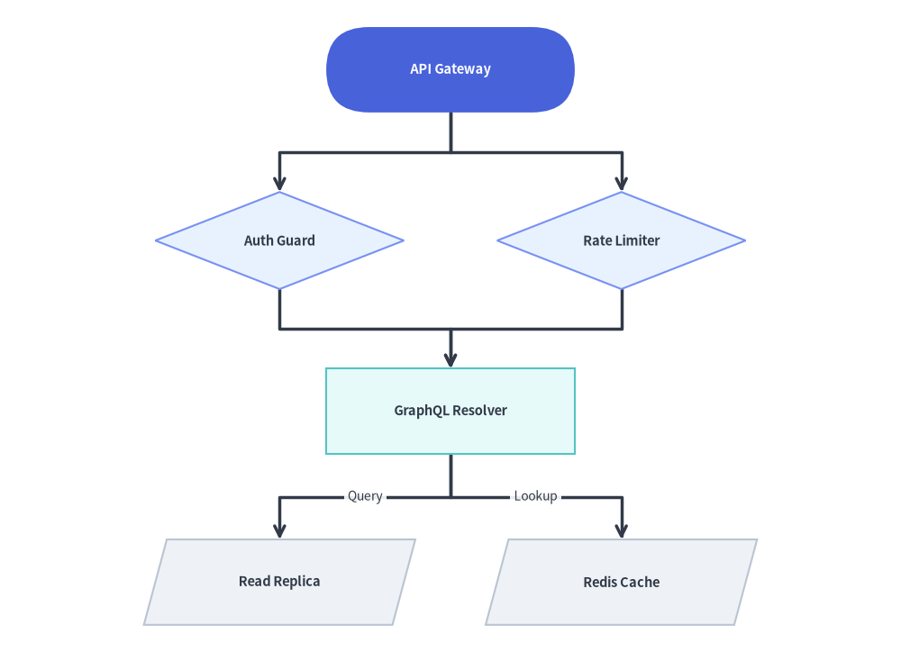

# LayerGraph: 杉山法による階層型 DAG とパイプライン

`LayerGraph` は、DFS による閉路除去、最長経路によるトポロジカルランク割り当て、重心法（バリセンタ法）によるエッジ交差最小化、およびマンハッタン直交ルーティングを組み合わせた**杉山法（Sugiyama-style）の階層型有向非巡回グラフ（DAG）座標ソルバー**です。

左から右（`direction="LR"`）または上から下（`direction="TB"`）へと順次ランクが進行する CI/CD パイプライン、ETL／データリネージグラフ（dbt、Airflow）、ビルド依存関係グラフ、マルチステージワークフローに最適な座標計算エンジンです。`layout = g.get_layout()` を [`FlowDiagram`](../06_diagrams/flow.md)（`Start`、`Process`、`Decision`、`Data`、`End`）や [`drawlib.shapes`](../02_drawing_primitives/shapes_overview.md)、[`drawlib.lines`](../02_drawing_primitives/lines.md) と組み合わせて、リッチなワークフローパイプラインを描画できます。


<figure class="drawlib-image" style="text-align: center;">
  
  <figcaption class="drawlib-caption">LayerGraph の概要: get_layout() による杉山法トポロジカルランク付けとステージクラスタの自動計算</figcaption>
</figure>

<details class="drawlib-code-details">
<summary>Source Code</summary>

```python
from drawlib.canvas import save, setup
from drawlib.graph import LayerGraph
from drawlib.icons import phosphor
from drawlib.lines import lines
from drawlib.shapes import rectangle
from drawlib.styles import Styles
from drawlib.text import text

setup(width=124, height=56)

# Step 1: Declare ranked pipeline topology & calculate coordinates
g = LayerGraph(
    direction="LR",
    rank_sep=16.0,
    node_sep=7.0,
    default_node_width=24.0,
    default_node_height=12.5,
)

# Rank 0: Ingestion Cluster
g.node("events", layer=0)
g.node("orders", layer=0)
g.cluster("ingest_box", ["events", "orders"], padding=3.5, header_height=4.0)

# Rank 1: Stream Processing Focal Node
g.node("joiner", layer=1)

# Rank 2: Analytics Cluster
g.node("mart", layer=2)
g.node("features", layer=2)
g.cluster("analytics_box", ["mart", "features"], padding=3.5, header_height=4.0)

g.edge("events", "joiner")
g.edge("orders", "joiner")
g.edge("joiner", "mart")
g.edge("joiner", "features")

layout = g.get_layout(width=124.0, height=56.0, margin=7.5)

# Step 2: Render stage clusters, routed edges, cards, and icons
for cid, label in [("ingest_box", "Ingestion"), ("analytics_box", "Analytics")]:
    c = layout.clusters[cid]
    rectangle(c.xy, width=c.width, height=c.height, style=Styles.MutedDashed.patch(shape_r=2.0))
    text((c.cx, c.top - 2.3), label, style=Styles.DarkBold.patch(text_size=10.0))

for e in layout.edges:
    lines(e.points, arrow_head="->", style=Styles.DarkBold)

cards = [
    ("events", "\nClick Events", Styles.Neutral, Styles.DarkBold.patch(text_size=10.5), phosphor.globe, Styles.Dark),
    ("orders", "\nOrder Stream", Styles.Neutral, Styles.DarkBold.patch(text_size=10.5), phosphor.lightning, Styles.Dark),
    ("joiner", "\nStream Join", Styles.PrimaryFlat, Styles.WhiteBold.patch(text_size=10.5), phosphor.git_merge, Styles.White),
    ("mart", "\nRevenue Mart", Styles.PrimaryNeutral, Styles.DarkBold.patch(text_size=10.5), phosphor.chart_line_up, Styles.Primary),
    ("features", "\nFeature Store", Styles.SecondaryNeutral, Styles.DarkBold.patch(text_size=10.5), phosphor.database, Styles.Secondary),
]
for nid, label, box_st, txt_st, icon_fn, ic_st in cards:
    n = layout.nodes[nid]
    rectangle(n.xy, width=n.width, height=n.height, style=box_st.patch(shape_r=1.5), text=label, text_style=txt_st)
    icon_fn((n.x, n.y + 2.3), width=4.2, style=ic_st)

save()
```

</details>


---

## 1. 基本概念と基本的な使い方

`LayerGraph` は**トポロジカルなランク計算**とレンダリングを分離します。有向エッジ（`g.edge(src, dst)`）、任意の明示的なランク固定（`layer=...` または `g.tier(...)`）、およびステージコンテナ（`g.cluster(...)`）を宣言してから `layout = g.get_layout()` を呼び出すと、重なりのないノード中心座標（`layout[id].xy`）、ルーティング済みエッジポリライン（`e.points`）、クラスタ境界（`layout.clusters[cid]`）が得られます。計算された座標はプリミティブで直接描画できるほか、`layout[id].xy` を [`FlowDiagram`](../06_diagrams/flow.md) に渡して `layout.offset()` で個別の分岐を微調整することもできます。


<figure class="drawlib-image" style="text-align: center;">
  
  <figcaption class="drawlib-caption">基本的な使い方とパラメータツアー: 杉山法ランク付き DAG の展開、明示的なレイヤ固定とクラスタ、進行方向とエッジルーティング、FlowDiagram レンダリング（APNG アニメーション）</figcaption>
</figure>


<div class="drawlib-source-link">
  <a href="https://github.com/yuichi110/drawlib/blob/main/docs/docs_src/ja/07_graph/layer_graph.md" target="_blank" rel="noopener noreferrer">GitHub でアニメーションのソースコードを見る &rarr;</a>
</div>

- **杉山法による自動ランク割り当てと交差最小化**: `LayerGraph` は最長入力依存パスに基づいてトポロジカルランク（`0, 1, 2, ...`）を割り当て、重心法ヒューリスティックで兄弟ノードを並べ替えることで、ファンアウトや多対一の DAG 合流を整然と保ちます。
- **明示的なランク固定とステージクラスタ**: `g.node(id, layer=...)` や `g.tier(name, nodes, layer=...)` で特定のノードや並列ステージを正確なランクに固定し、`g.cluster(id, nodes, padding=..., header_height=...)` でステージコンテナ境界を計算できます。
- **柔軟な進行軸とルーティング**: 水平パイプライン（`direction="LR"`）と上から下への階層（`direction="TB"`）を切り替え、`rank_sep` や `node_sep` を調整し、`"orthogonal"`（マンハッタン直交ポリライン）または `"straight"`（ユークリッド直線セグメント）を選択できます。
- **`FlowDiagram` とのシームレスな統合と `.offset()`**: 計算された `layout[id].xy` 中心座標に `Start`、`Process`、`Decision`、`End` シンボルを直接配置し、`layout.offset(id, dx=..., dy=...)` で個別の分岐を微調整したうえで、`fd.draw(xy=...)` でラベル付きコネクタを描画できます。

---

## 2. コンストラクタとランク固定 API

```python
from drawlib.graph import LayerGraph

g = LayerGraph(
    direction="LR",                  # "LR" (Left-to-Right) or "TB" (Top-to-Bottom)
    rank_sep=14.0,                   # Fixed gap between layers (auto-scales if None)
    node_sep=8.0,                    # Fixed gap between nodes in the same layer (auto-scales if None)
    edge_routing="orthogonal",       # "orthogonal" or "straight"
    default_node_width=22.0,
    default_node_height=12.0,
)
```

### パラメータリファレンス

| パラメータ | 型 | デフォルト | 説明 |
| :--- | :--- | :--- | :--- |
| `direction` | `Literal["LR", "TB"]` | `"LR"` | フローの進行軸（`"LR"` は水平方向のランク、`"TB"` は垂直方向のランク）。 |
| `rank_sep` | `float \| None` | `None` | 連続するレイヤ／ランク間の固定距離。`None` の場合はキャンバスに合わせて自動スケーリングされます。 |
| `node_sep` | `float \| None` | `None` | 同一レイヤ内の兄弟ノード間の最小距離。`None` の場合は自動スケーリングされます。 |
| `edge_routing` | `Literal["orthogonal", "straight"]` | `"orthogonal"` | エッジ経路のルーティングモード（Z 字折れの `"orthogonal"` またはユークリッド直線の `"straight"`）。 |
| `default_node_width` | `float` | `22.0` | デフォルトのノード幅（キャンバス単位）。 |
| `default_node_height` | `float` | `12.0` | デフォルトのノード高さ（キャンバス単位）。 |

### 自動トポロジカルランク付けと明示的な `layer` 固定

デフォルトでは、`LayerGraph` は最長入力依存パスから各ノードのランク（`0, 1, 2, ...`）を自動的に割り当てます。特定のステージ間で厳密に列・行を揃えたい場合は、以下の方法を使用します。
- **ノード単位の固定**: `g.node(id, layer=2)` のように `layer: int` を渡します。
- **ティア単位の一括固定（`g.tier`）**:
  ```python
  g.tier(
      name: str,
      nodes: list[str],
      *,
      layer: int | None = None,
  ) -> None
  ```
  `nodes` リストのノード群を同一の水平／垂直ランク（`layer`）に固定します。`nodes` 内の未宣言ノード ID はデフォルト寸法で自動登録され、`layer` が指定されている場合は `nodes` 内のすべてのノードの `node.layer` が `layer` に設定されます。
- **ステージクラスタ**: `g.tier(...)` と `g.cluster(id, nodes, padding=..., header_height=...)` を組み合わせることで、特定のランクを囲むステージ境界ボックスを計算できます。

---

## 3. `FlowDiagram` で描画する自動 DAG ワークフロー

この例では、`LayerGraph.get_layout()` がデータエンジニアリングのリネージ DAG（ソース → ステージング → フィーチャーストア／集計 → ML サービング）の 4 つのトポロジカルランクを自動推論し、重心法によってエッジ交差を最小化します。計算された `n.xy` 座標には、[`FlowDiagram`](../06_diagrams/flow.md) を使って ISO 5807 シンボル（`Data`、`Process`、`End`）を描画しています。


```python
from drawlib.canvas import save, setup
from drawlib.diagrams.flow import Data, End, FlowDiagram, Process
from drawlib.graph import LayerGraph
from drawlib.styles import Styles

setup(width=126, height=50)

# Step 1: Declare DAG topology and solve coordinates automatically
g = LayerGraph(
    direction="LR",
    rank_sep=9.0,
    default_node_width=23.0,
    default_node_height=11.0,
)

g.edge("raw_events", "clean_events")
g.edge("raw_orders", "clean_orders")
g.edge("clean_events", "user_features")
g.edge("clean_orders", "user_features")
g.edge("clean_orders", "rev_rollup")
g.edge("user_features", "ml_ranker")
g.edge("rev_rollup", "ml_ranker")

layout = g.get_layout(width=126.0, height=50.0, margin=5.0)

# Step 2: Render ISO flowchart shapes at solved coordinates with FlowDiagram
flow = FlowDiagram(
    node_style=Styles.Neutral,
    edge_style=Styles.DarkBold,
    edge_text_style=Styles.Dark.patch(text_size=10.0),
)
ts_dark = Styles.DarkBold.patch(text_size=10.5)
ts_white = Styles.WhiteBold.patch(text_size=10.5)

f_nodes = {
    "raw_events": flow.add(Data("Clickstream", *layout["raw_events"].size, style=Styles.Neutral, text_style=ts_dark), xy=layout["raw_events"].xy),
    "raw_orders": flow.add(Data("Orders CDC", *layout["raw_orders"].size, style=Styles.Neutral, text_style=ts_dark), xy=layout["raw_orders"].xy),
    "clean_events": flow.add(Process("Sessionize", *layout["clean_events"].size, style=Styles.PrimaryNeutral, text_style=ts_dark), xy=layout["clean_events"].xy),
    "clean_orders": flow.add(Process("Deduplicate", *layout["clean_orders"].size, style=Styles.PrimaryNeutral, text_style=ts_dark), xy=layout["clean_orders"].xy),
    "user_features": flow.add(Process("Feature Join", *layout["user_features"].size, style=Styles.SecondaryNeutral, text_style=ts_dark), xy=layout["user_features"].xy),
    "rev_rollup": flow.add(Process("Revenue Mart", *layout["rev_rollup"].size, style=Styles.SecondaryNeutral, text_style=ts_dark), xy=layout["rev_rollup"].xy),
    "ml_ranker": flow.add(End("Realtime Rank", *layout["ml_ranker"].size, style=Styles.PrimaryFlat, text_style=ts_white), xy=layout["ml_ranker"].xy),
}

for e in layout.edges:
    flow.connect(f_nodes[e.src], f_nodes[e.dst], start_side="right", end_side="left")

flow.draw()
save()
```

<figure class="drawlib-image" style="text-align: center;">
  
  <figcaption class="drawlib-caption">LayerGraph による自動トポロジカルランク付けと FlowDiagram シンボルによる描画</figcaption>
</figure>


---

## 4. 明示的な `layer=` および `tier()` 固定を用いたマルチステージパイプライン

経路の深さが異なっていても特定のノード群を垂直方向に揃えたいリリースパイプラインなどでは、`g.tier(..., layer=...)` や `g.node(..., layer=...)` で明示的にランクを固定し、並列ステージを `g.cluster(...)` で囲みます。


```python
from drawlib.canvas import save, setup
from drawlib.diagrams.flow import Decision, End, FlowDiagram, Process, Start
from drawlib.graph import LayerGraph
from drawlib.shapes import rectangle
from drawlib.styles import Styles
from drawlib.text import text

setup(width=126, height=58)

# 1. Solve ranked pipeline and stage cluster coordinates
g = LayerGraph(
    direction="LR",
    rank_sep=9.5,
    default_node_width=22.0,
    default_node_height=11.0,
)

# Stage 0: Source Trigger
g.node("git", layer=0)

# Stage 1: Parallel CI Checks (pinned via g.tier + enclosed in a cluster)
g.tier("ci_stage", ["lint", "pytest"], layer=1)
g.cluster("ci_cluster", ["lint", "pytest"], padding=3.5, header_height=4.0)

# Stage 2: Artifact Packaging & Security Gate
g.node("docker", layer=2)
g.node("sbom", layer=2, height=13.0)
g.cluster("pkg_cluster", ["docker", "sbom"], padding=3.5, header_height=4.0)

# Stage 3: Production Rollout (Hero focal node)
g.node("prod", layer=3)

g.edge("git", "lint")
g.edge("git", "pytest")
g.edge("lint", "docker")
g.edge("pytest", "docker")
g.edge("pytest", "sbom")
g.edge("docker", "prod")
g.edge("sbom", "prod")

layout = g.get_layout(width=126.0, height=58.0, margin=7.5)

# 2. Draw stage cluster boundaries (Z-Layer 1)
for cid, title in [("ci_cluster", "CI Stage"), ("pkg_cluster", "Artifact & Gate")]:
    c = layout.clusters[cid]
    rectangle(c.xy, width=c.width, height=c.height, style=Styles.MutedDashed.patch(shape_r=2.0))
    text((c.cx, c.top - 2.3), title, style=Styles.DarkBold.patch(text_size=10.0))

# 3. Render workflow nodes & edges with FlowDiagram
flow = FlowDiagram(
    node_style=Styles.Neutral,
    edge_style=Styles.DarkBold,
    edge_text_style=Styles.Dark.patch(text_size=10.0),
)
ts_dark = Styles.DarkBold.patch(text_size=10.5)
ts_white = Styles.WhiteBold.patch(text_size=10.5)

git = flow.add(Start("Git Commit", *layout["git"].size, style=Styles.Neutral, text_style=ts_dark), xy=layout["git"].xy)
lint = flow.add(Process("Ruff & Ty", *layout["lint"].size, style=Styles.PrimaryNeutral, text_style=ts_dark), xy=layout["lint"].xy)
pytest = flow.add(Process("Unit Suite", *layout["pytest"].size, style=Styles.PrimaryNeutral, text_style=ts_dark), xy=layout["pytest"].xy)
docker = flow.add(Process("Build Image", *layout["docker"].size, style=Styles.SecondaryNeutral, text_style=ts_dark), xy=layout["docker"].xy)
sbom = flow.add(Decision("SBOM Gate", *layout["sbom"].size, style=Styles.Neutral, text_style=ts_dark), xy=layout["sbom"].xy)
prod = flow.add(End("Prod Canary", *layout["prod"].size, style=Styles.PrimaryFlat, text_style=ts_white), xy=layout["prod"].xy)

flow.connect(git, lint, start_side="right", end_side="left")
flow.connect(git, pytest, start_side="right", end_side="left")
flow.connect(lint, docker, start_side="right", end_side="left")
flow.connect(pytest, docker, start_side="right", end_side="left")
flow.connect(pytest, sbom, start_side="right", end_side="left")
flow.connect(docker, prod, start_side="right", end_side="left")
flow.connect(sbom, prod, start_side="right", end_side="bottom", style=Styles.MutedDashed)

flow.draw()
save()
```

<figure class="drawlib-image" style="text-align: center;">
  
  <figcaption class="drawlib-caption">明示的なレイヤ固定、ステージクラスタ、FlowDiagram ノードを組み合わせた CI/CD リリースパイプライン</figcaption>
</figure>


---

## 5. 上から下（`direction="TB"`）のランク階層

`direction="TB"` に切り替えると、トポロジカルレイヤが上から下へ垂直方向に進行します。`rank_sep` と `node_sep` を組み合わせることで、ランク間の垂直間隔と同一ランク内の兄弟ノード間の水平間隔を制御できます。


```python
from drawlib.canvas import save, setup
from drawlib.diagrams.flow import Data, Decision, FlowDiagram, Process, Start
from drawlib.graph import LayerGraph
from drawlib.styles import Styles

setup(width=116, height=84)

# 1. Solve vertical TB ranked coordinates
g = LayerGraph(
    direction="TB",
    rank_sep=9.5,
    node_sep=12.0,
    default_node_width=32.0,
    default_node_height=11.0,
)

g.node("gateway")
g.node("auth", height=12.5)
g.node("ratelimit", height=12.5)
g.node("resolver")
g.node("sql_db")
g.node("redis")

g.edge("gateway", "auth")
g.edge("gateway", "ratelimit")
g.edge("auth", "resolver")
g.edge("ratelimit", "resolver")
g.edge("resolver", "sql_db")
g.edge("resolver", "redis")

layout = g.get_layout(width=116.0, height=84.0, margin=6.0)

# 2. Render with FlowDiagram
flow = FlowDiagram(
    node_style=Styles.Neutral,
    edge_style=Styles.DarkBold,
    edge_text_style=Styles.Dark.patch(text_size=10.0),
)
ts_dark = Styles.DarkBold.patch(text_size=10.5)
ts_white = Styles.WhiteBold.patch(text_size=10.5)

gw = flow.add(Start("API Gateway", *layout["gateway"].size, style=Styles.PrimaryFlat, text_style=ts_white), xy=layout["gateway"].xy)
auth = flow.add(Decision("Auth Guard", *layout["auth"].size, style=Styles.PrimaryNeutral, text_style=ts_dark), xy=layout["auth"].xy)
rl = flow.add(Decision("Rate Limiter", *layout["ratelimit"].size, style=Styles.PrimaryNeutral, text_style=ts_dark), xy=layout["ratelimit"].xy)
res = flow.add(Process("GraphQL Resolver", *layout["resolver"].size, style=Styles.SecondaryNeutral, text_style=ts_dark), xy=layout["resolver"].xy)
sql = flow.add(Data("Read Replica", *layout["sql_db"].size, style=Styles.Neutral, text_style=ts_dark), xy=layout["sql_db"].xy)
redis = flow.add(Data("Redis Cache", *layout["redis"].size, style=Styles.Neutral, text_style=ts_dark), xy=layout["redis"].xy)

flow.connect(gw, auth, start_side="bottom", end_side="top")
flow.connect(gw, rl, start_side="bottom", end_side="top")
flow.connect(auth, res, start_side="bottom", end_side="top")
flow.connect(rl, res, start_side="bottom", end_side="top")
flow.connect(res, sql, label="Query", start_side="bottom", end_side="top")
flow.connect(res, redis, label="Lookup", start_side="bottom", end_side="top")

flow.draw()
save()
```

<figure class="drawlib-image" style="text-align: center;">
  
  <figcaption class="drawlib-caption">FlowDiagram で描画した上から下（direction='TB'）の杉山法ランク付き DAG</figcaption>
</figure>


---

## 6. ベストプラクティス

1. **横長パイプラインには `direction="LR"`、深い階層には `"TB"` を選ぶ**: 3〜5 ステージのパイプラインでは、左から右（`"LR"`）のレイアウトがワイドスクリーンのキャンバスやドキュメントのカラム幅に自然に収まります。ノードのテキストラベルが横長な場合や、1 ランクあたりの並列ブランチが多い場合は `"TB"` を使用してください。
2. **エッジラベルには `rank_sep` と `node_sep` で余白を確保する**: `FlowDiagram`（または `e.mid_xy` での `text()`）でエッジにテキストラベルを付与する場合は、`rank_sep=12.0` 以上に設定することで、ラベルバッジ用の十分なクリアランスを確保できます。
3. **並列ランクを `g.cluster()` でグループ化する**: 同じ `layer` を共有するノードを `g.cluster(..., header_height=4.0)` で囲むと、ステージ境界ボックス（`c.xy`、`c.width`、`c.height`）が算出され、`flow.draw()` を呼び出す前に破線の背景コンテナ（`Styles.MutedDashed`）として描画できます。
