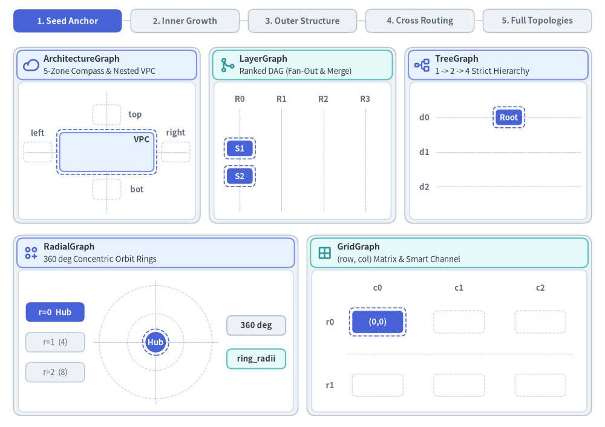
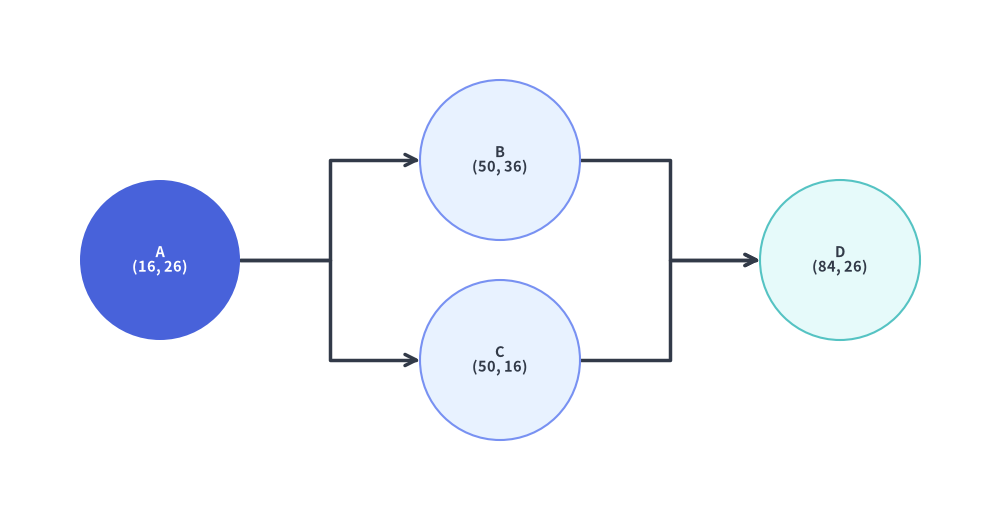
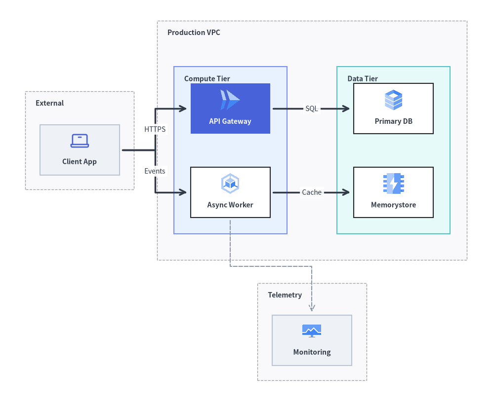
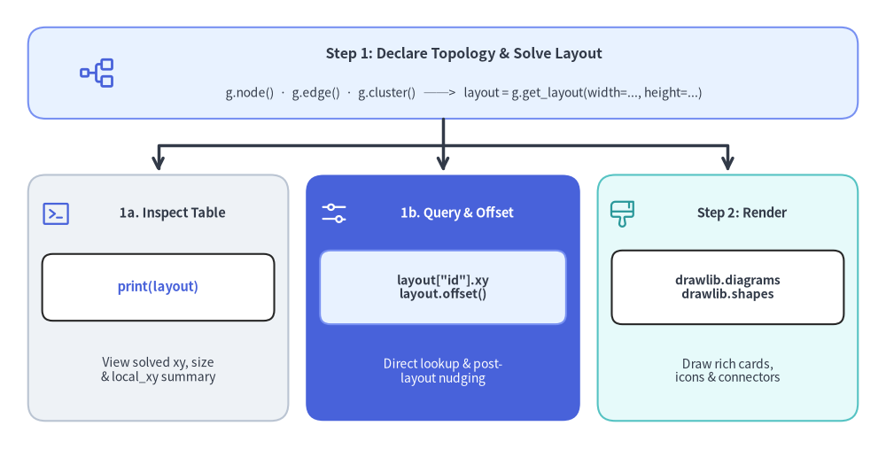
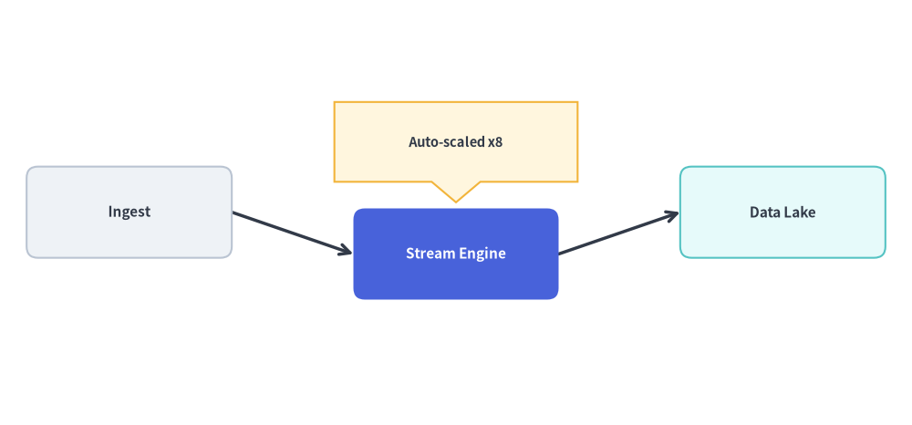

# グラフエンジン概要 (`drawlib.graph`)

`drawlib.graph` は、5 つの専用レイアウトソルバー（`ArchitectureGraph`、`LayerGraph`、`TreeGraph`、`RadialGraph`、`GridGraph`）を備えた宣言型の**純粋な座標・レイアウト計算エンジン**です。

複雑なトポロジを設計する際にすべての頂点やコンテナの `(x, y)` 座標を手計算する代わりに、ノード・エッジ・クラスタといった**構造的な関係**を宣言して `layout = g.get_layout(width=..., height=...)` を呼び出すだけで、Drawlib の純粋 Python レイアウトアルゴリズムが整然とした座標、コンテナのバウンディングボックス、直交または放射状のエッジ経路を自動計算します。以下のステップアニメーションが示すとおり、各ソルバーは固有のトポロジ座標モデル（5 ゾーンのネスト VPC コンテナ、ランク付き DAG のファンアウト／マージ列、厳密なツリー階層、360 度の同心円軌道リング、スマートチャネル付き 2D マトリクススロット）に沿って段階的に展開されます。計算された座標は、[`drawlib.diagrams`](../06_diagrams/overview.md) や [`drawlib.shapes`](../02_drawing_primitives/shapes_overview.md)、[`drawlib.lines`](../02_drawing_primitives/lines.md) を使って描画します。


<figure class="drawlib-image" style="text-align: center;">
  
  <figcaption class="drawlib-caption">トポロジ座標モデルに沿って展開する 5 つの専用自動レイアウト座標ソルバー（APNG アニメーション）</figcaption>
</figure>


<div class="drawlib-source-link">
  <a href="https://github.com/yuichi110/drawlib/blob/main/docs/docs_src/ja/07_graph/overview.md" target="_blank" rel="noopener noreferrer">GitHub でアニメーションのソースコードを見る &rarr;</a>
</div>

---

## 1. 責務の分離: `drawlib.graph` + `drawlib.diagrams`

Drawlib では、**トポロジ座標の計算**（`drawlib.graph`）と**視覚的なダイアグラム描画**（[`drawlib.diagrams`](../06_diagrams/overview.md) および [`drawlib.shapes`](../02_drawing_primitives/shapes_overview.md)）を明確に分離しています。

### 1.1 最小構成の概念: `get_layout()` の確認と円の接続

最もシンプルな使い方では、`g.get_layout()` がノードとエッジのトポロジを受け取り、各ノードの解決済み `(x, y)` 座標（`nl.xy`）と各エッジのルーティング済みポリライン頂点列（`e.points`）を格納した `GraphLayout` を返します。これらの値は `print(layout)` で確認でき、シンプルな `circle()` と `lines()` の呼び出しだけで描画できます。


```python
from drawlib.canvas import save, setup
from drawlib.graph import LayerGraph
from drawlib.lines import lines
from drawlib.shapes import circle
from drawlib.styles import Styles

setup(width=100, height=52)

# Step 1: Declare topology & solve coordinates with get_layout()
g = LayerGraph(direction="LR", default_node_width=16.0, default_node_height=16.0)
g.edge("A", "B")
g.edge("A", "C")
g.edge("B", "D")
g.edge("C", "D")

layout = g.get_layout(margin=8.0)

# print(layout) outputs:
# GraphLayout(width=100.0, height=52.0)
# Nodes:
#   A : xy=(16.0, 26.0), bottom_left=(8.0, 18.0), size=(16.0, 16.0)
#   B : xy=(50.0, 36.0), bottom_left=(42.0, 28.0), size=(16.0, 16.0)
#   C : xy=(50.0, 16.0), bottom_left=(42.0, 8.0), size=(16.0, 16.0)
#   D : xy=(84.0, 26.0), bottom_left=(76.0, 18.0), size=(16.0, 16.0)
# Edges:
#   A -> B : points=[(24.0, 26.0), (33.0, 26.0), (33.0, 36.0), (42.0, 36.0)], mid_xy=(33.0, 31.0)
#   A -> C : points=[(24.0, 26.0), (33.0, 26.0), (33.0, 16.0), (42.0, 16.0)], mid_xy=(33.0, 21.0)
#   B -> D : points=[(58.0, 36.0), (67.0, 36.0), (67.0, 26.0), (76.0, 26.0)], mid_xy=(67.0, 31.0)
#   C -> D : points=[(58.0, 16.0), (67.0, 16.0), (67.0, 26.0), (76.0, 26.0)], mid_xy=(67.0, 21.0)

# Step 2: Connect circles with lines using the solved coordinates
for e in layout.edges:
    lines(e.points, arrow_head="->", style=Styles.DarkBold)

circle(layout["A"].xy, radius=8.0, style=Styles.PrimaryFlat, text="A\n(16, 26)", text_style=Styles.WhiteBold.patch(text_size=10.5))
circle(layout["B"].xy, radius=8.0, style=Styles.PrimaryNeutral, text="B\n(50, 36)", text_style=Styles.DarkBold.patch(text_size=10.5))
circle(layout["C"].xy, radius=8.0, style=Styles.PrimaryNeutral, text="C\n(50, 16)", text_style=Styles.DarkBold.patch(text_size=10.5))
circle(layout["D"].xy, radius=8.0, style=Styles.SecondaryNeutral, text="D\n(84, 26)", text_style=Styles.DarkBold.patch(text_size=10.5))

save()
```

<figure class="drawlib-image" style="text-align: center;">
  
  <figcaption class="drawlib-caption">最小構成の概念: get_layout() による座標計算と線による円の接続</figcaption>
</figure>


### 1.2 本格的なアーキテクチャ構成のワークフロー: `ArchitectureGraph` + `ArchitectureDiagram`

ネストされた VPC、サブネット、クラウドアイコンを備えた本番環境レベルのアーキテクチャ図では、`ArchitectureGraph.get_layout()` と `ArchitectureDiagram` を組み合わせます。


```python
from drawlib.canvas import save, setup
from drawlib.diagrams.architecture import ArchitectureDiagram, GcpIcon, Node, NodeGroup, PhosphorIcon
from drawlib.graph import ArchitectureGraph
from drawlib.styles import Styles

setup(width=118, height=96)

# Step 1: Declare topology & solve coordinates with ArchitectureGraph.get_layout()
g = ArchitectureGraph(
    direction="LR",
    container_sep=5.5,
    default_node_width=19.0,
    default_node_height=12.0,
)

g.cluster("clients", ["client"], pos="left", padding=3.5, header_height=4.5)
g.group("vpc", pos="center", padding=4.0, header_height=4.8)
g.cluster("app_tier", ["api", "worker"], parent="vpc", order=1, padding=4.0, header_height=4.5)
g.cluster("data_tier", ["db", "cache"], parent="vpc", order=2, padding=4.0, header_height=4.5)
g.cluster("obs", ["metrics"], pos="bottom", padding=3.5, header_height=4.2)

g.edge("client", "api")
g.edge("client", "worker")
g.edge("api", "db")
g.edge("worker", "cache")
g.edge("worker", "metrics")

layout = g.get_layout()

# Step 2: Render rich icon cards & boundaries using ArchitectureDiagram
d = ArchitectureDiagram(
    node_style=Styles.Primary,
    node_text_style=Styles.DarkBold.patch(text_size=10.0),
    edge_style=Styles.DarkBold,
    edge_text_style=Styles.Dark.patch(text_size=10.0),
    node_card_style=Styles.Neutral,
)
grp_hdr = Styles.DarkBold.patch(text_size=10.0, halign="left", valign="top")

c_cli = layout.clusters["clients"]
grp_cli = d.add(NodeGroup("External", width=c_cli.width, height=c_cli.height, text_style=grp_hdr), xy=c_cli.bottom_left)

c_vpc = layout.clusters["vpc"]
grp_vpc = d.add(NodeGroup("Production VPC", width=c_vpc.width, height=c_vpc.height, text_style=grp_hdr), xy=c_vpc.bottom_left)

c_app = layout.clusters["app_tier"]
grp_app = grp_vpc.add(
    NodeGroup("Compute Tier", width=c_app.width, height=c_app.height, style=Styles.PrimaryNeutral, text_style=grp_hdr),
    xy=c_app.local_bottom_left,
)

c_data = layout.clusters["data_tier"]
grp_data = grp_vpc.add(
    NodeGroup("Data Tier", width=c_data.width, height=c_data.height, style=Styles.SecondaryNeutral, text_style=grp_hdr),
    xy=c_data.local_bottom_left,
)

c_obs = layout.clusters["obs"]
grp_obs = d.add(NodeGroup("Telemetry", width=c_obs.width, height=c_obs.height, text_style=grp_hdr), xy=c_obs.bottom_left)

n_cli = grp_cli.add(Node("Client App", *layout["client"].size, icon=PhosphorIcon.LAPTOP, icon_size=5.0), xy=layout["client"].local_xy)
n_api = grp_app.add(
    Node(
        "API Gateway",
        *layout["api"].size,
        icon=GcpIcon.CLOUD_RUN,
        icon_size=5.5,
        style=Styles.White,
        text_style=Styles.WhiteBold.patch(text_size=10.0),
        card_style=Styles.PrimaryFlat,
    ),
    xy=layout["api"].local_xy,
)
n_wrk = grp_app.add(
    Node("Async Worker", *layout["worker"].size, icon=GcpIcon.GOOGLE_KUBERNETES_ENGINE, icon_size=5.5, card_style=Styles.White),
    xy=layout["worker"].local_xy,
)
n_db = grp_data.add(
    Node("Primary DB", *layout["db"].size, icon=GcpIcon.CLOUD_SQL, icon_size=5.5, card_style=Styles.White),
    xy=layout["db"].local_xy,
)
n_cache = grp_data.add(
    Node("Memorystore", *layout["cache"].size, icon=GcpIcon.MEMORYSTORE, icon_size=5.5, card_style=Styles.White),
    xy=layout["cache"].local_xy,
)
n_obs = grp_obs.add(
    Node("Monitoring", *layout["metrics"].size, icon=GcpIcon.CLOUD_MONITORING, icon_size=5.0),
    xy=layout["metrics"].local_xy,
)

d.connect(n_cli, n_api, label="HTTPS", padding=0.8)
d.connect(n_cli, n_wrk, label="Events", padding=0.8)
d.connect(n_api, n_db, label="SQL", padding=0.8)
d.connect(n_wrk, n_cache, label="Cache", padding=0.8)
d.connect(n_wrk, n_obs, style=Styles.MutedDashed, padding=0.8)

d.draw(xy=(-4.0, -5.0))
save()
```

<figure class="drawlib-image" style="text-align: center;">
  
  <figcaption class="drawlib-caption">2 ステップワークフロー: ArchitectureGraph.get_layout() による座標計算と ArchitectureDiagram による描画</figcaption>
</figure>


| 観点 | `drawlib.graph`（座標・レイアウト計算エンジン） | [`drawlib.diagrams`](../06_diagrams/overview.md) ＆ [`drawlib.shapes`](../02_drawing_primitives/shapes_overview.md)（ビジュアルレンダラー） |
| :--- | :--- | :--- |
| **責務** | **純粋な幾何ソルバー**: `g.get_layout()` により、ノードの中心 `(cx, cy)`、左下原点 `.bottom_left`、コンテナ相対座標 `.local_xy`／`.local_bottom_left`、バウンディングボックス `(width, height)`、およびエッジの頂点列 `.points` を計算します。 | **リッチな視覚記法**: クラウドアイコンカード（`GcpIcon`、`PhosphorIcon`）、ネストされた `NodeGroup` 境界、ISO フローチャート記号、UML クラス、Crow's Foot ER テーブル、または基本図形や線を描画します。 |
| **主な強み** | ネスト VPC、杉山法 DAG、ツリー、同心円リング、2D グリッドにおける**初期座標の手計算問題（コールドスタート問題）**を算術計算なしで解決します。 | 高度な視覚的カスタマイズ、ドメイン固有のコンパートメント、明示的なポート面（`start_side`、`end_side`）、`Junction` バス、`show=False` による表示制御を提供します。 |
| **確認と微調整** | `print(layout)` で人間が読みやすい座標テーブルを出力したり、`layout["id"]` で直接参照したり、`layout.offset(node_id, dx, dy)` で計算後にノード位置を微調整したりできます。 | `c.bottom_left`、`c.local_bottom_left`、`n.xy`、`n.local_xy`、`e.points` をそのまま受け取って描画するか、確認した座標値を静的スクリプトに貼り付けて利用できます。 |

---

## 2. 5 つの専用レイアウトソルバー

`drawlib.graph` は、あらゆるトポロジを単一の汎用ヒューリスティックに無理やり押し込むのではなく、構造パターンごとに最適化された 5 つの専用座標ソルバーを提供しています。

| ソルバークラス | レイアウトアルゴリズム | 主な用途 | 主要ヘルパーメソッド | ガイドリンク |
| :--- | :--- | :--- | :--- | :--- |
| **[`ArchitectureGraph`](./architecture_graph.md)** | 2 階層マクロ／ミクロパッキング + 5 ゾーンコンパス | クラウド VPC、ネストサブネット、マルチゾーンのマイクロサービス | `.group()`, `.cluster(parent=..., pos=...)` | [ArchitectureGraph](./architecture_graph.md) |
| **[`LayerGraph`](./layer_graph.md)** | 杉山法による階層型 DAG（閉路除去、重心法順序付け） | CI/CD パイプライン、ETL データフロー、階層的な依存関係 DAG | `.tier(name, nodes, layer=...)`, `node(..., layer=...)` | [LayerGraph](./layer_graph.md) |
| **[`TreeGraph`](./tree_graph.md)** | Reingold-Tilford / Buchheim コンパクトツリー | 組織図、AST、決定木、コール階層 | `.child(parent, child_id, ...)` | [TreeGraph](./tree_graph.md) |
| **[`RadialGraph`](./radial_graph.md)** | 同心円 BFS リングと角度セクタ配分 | ハブ＆スポークメッシュ、Pub/Sub トポロジ、依存関係レーダー | `.spoke(parent, spoke_id, ring=...)`, `layout.ring_radii` | [RadialGraph](./radial_graph.md) |
| **[`GridGraph`](./grid_graph.md)** | 2D マトリクス配置とスマートチャネルルーティング | サービスカタログ、ステートマトリクス、表形式のコンポーネントグリッド | `.cell(id, row, col)`, `.cluster_row()`, `.cluster_column()` | [GridGraph](./grid_graph.md) |

---

## 3. 共通アーキテクチャ (`BaseGraph` & `GraphLayout`)

5 つのソルバーはすべて `BaseGraph` を継承しており、トポロジ要素の登録と `GraphLayout` の計算を行う統一された幾何計算専用 API を共有しています。

```python
from drawlib.graph import (
    ArchitectureGraph,
    BaseGraph,
    Cluster,
    ClusterLayout,
    Edge,
    EdgeLayout,
    GraphLayout,
    GridGraph,
    LayerGraph,
    Node,
    NodeLayout,
    RadialGraph,
    TreeGraph,
)
```

### 3.1. トポロジの構築 (`node`, `edge`, `cluster`, `group`)

#### `BaseGraph(*, default_node_width=20.0, default_node_height=12.0)`
すべてのグラフソルバーで共有される基底コンストラクタであり、ノードの明示的な `width` または `height` が省略された際に割り当てられるデフォルトのバウンディングボックス寸法 `(default_node_width, default_node_height)` を定義します。

#### `g.node(...) -> Node`
グラフにノードを登録し、構造メタデータとサイズ情報を保持する `Node` データクラスインスタンスを返します。
- **シグネチャ**:
  ```python
  g.node(
      id: str,
      *,
      width: float | None = None,
      height: float | None = None,
      ring: int | None = None,
      row: int | None = None,
      col: int | None = None,
      layer: int | None = None,
      group: str | None = None,
      subgroup: str | None = None,
  ) -> Node
  ```

#### `g.edge(...) -> Edge`
`src` から `dst` への有向トポロジ接続を登録します（未宣言の端点ノードがある場合はデフォルト寸法で自動登録されます）。
- **シグネチャ**:
  ```python
  g.edge(
      src: str,
      dst: str,
  ) -> Edge
  ```

#### `g.cluster(...) -> Cluster` および `g.group(...) -> Cluster`
指定した `padding` と上部の見出し用余白 `header_height` を持つコンテナバウンディングボックス内に、ノードのリスト（または `parent=...` による子クラスタ）をグループ化します。
- **シグネチャ**:
  ```python
  g.cluster(
      id: str,
      nodes: list[str] | None = None,
      *,
      padding: float = 4.0,
      header_height: float = 3.5,
      parent: str | None = None,
      order: int | None = None,
      pos: Literal["top", "bottom", "left", "right", "center"] | None = None,
  ) -> Cluster

  g.group(
      id: str,
      *,
      nodes: list[str] | None = None,
      padding: float = 4.0,
      header_height: float = 3.5,
      parent: str | None = None,
      order: int | None = None,
      pos: Literal["top", "bottom", "left", "right", "center"] | None = None,
  ) -> Cluster
  ```

---

### 3.2. 2 ステップワークフロー (`get_layout`, `print(layout)`, `offset`, 描画)


<figure class="drawlib-image" style="text-align: center;">
  
  <figcaption class="drawlib-caption">drawlib.graph における 2 ステップワークフロー: get_layout() で座標を計算・確認し、Diagrams または Shapes で描画</figcaption>
</figure>

<details class="drawlib-code-details">
<summary>Source Code</summary>

```python
from drawlib.canvas import save, setup
from drawlib.icons import phosphor
from drawlib.lines import line, lines
from drawlib.shapes import rectangle
from drawlib.styles import Styles
from drawlib.text import text

setup(width=126, height=64)

# Top Header / Input Node
rectangle(
    (63, 53.5),
    width=118,
    height=13,
    style=Styles.PrimaryNeutral.patch(shape_r=2.5),
)
phosphor.tree_structure((14, 53.5), width=5.5, style=Styles.Primary)
text((66, 56.2), "Step 1: Declare Topology & Solve Layout", style=Styles.DarkBold.patch(text_size=11.5))
text((66, 50.6), "g.node()  ·  g.edge()  ·  g.cluster()   ──>   layout = g.get_layout(width=..., height=...)", style=Styles.Dark.patch(text_size=10.0))

# Orthogonal fan-out lines from top header into the 3 cards
line((63, 47.0), (63, 39.5), arrow_head="->", style=Styles.DarkBold)
lines([(63, 43.2), (22.5, 43.2), (22.5, 39.5)], arrow_head="->", style=Styles.DarkBold)
lines([(63, 43.2), (103.5, 43.2), (103.5, 39.5)], arrow_head="->", style=Styles.DarkBold)

# Card 1: Inspect Coordinates via print(layout)
rectangle((22.5, 21.5), width=37, height=35, style=Styles.Neutral.patch(shape_r=2.5))
phosphor.terminal_window((8.0, 33.5), width=4.4, style=Styles.Primary)
text((24.5, 33.5), "1a. Inspect Table", style=Styles.DarkBold.patch(text_size=10.5))
rectangle((22.5, 23.0), width=33, height=9.5, style=Styles.White.patch(shape_r=1.5))
text((22.5, 23.0), "print(layout)", style=Styles.PrimaryBold.patch(text_size=10.5))
text((22.5, 11.2), "View solved xy, size\n& local_xy summary", style=Styles.Dark.patch(text_size=10.0))

# Card 2: Access & Offset Coordinates (PrimaryFlat focal card)
rectangle((63, 21.5), width=39, height=35, style=Styles.PrimaryFlat.patch(shape_r=2.5))
phosphor.sliders_horizontal((47.5, 33.5), width=4.4, style=Styles.White)
text((65.0, 33.5), "1b. Query & Offset", style=Styles.WhiteBold.patch(text_size=10.5))
rectangle((63, 23.0), width=35, height=10.5, style=Styles.PrimaryNeutral.patch(shape_r=1.5))
text((63, 23.0), 'layout["id"].xy\nlayout.offset()', style=Styles.DarkBold.patch(text_size=10.0))
text((63, 11.0), "Direct lookup & post-\nlayout nudging", style=Styles.White.patch(text_size=10.0))

# Card 3: Step 2 Render with Diagrams or Shapes (SecondaryNeutral)
rectangle((103.5, 21.5), width=37, height=35, style=Styles.SecondaryNeutral.patch(shape_r=2.5))
phosphor.paint_brush_broad((88.5, 33.5), width=4.4, style=Styles.Secondary)
text((105.5, 33.5), "Step 2: Render", style=Styles.DarkBold.patch(text_size=10.5))
rectangle((103.5, 23.0), width=33, height=10.5, style=Styles.White.patch(shape_r=1.5))
text((103.5, 23.0), "drawlib.diagrams\ndrawlib.shapes", style=Styles.DarkBold.patch(text_size=10.0))
text((103.5, 11.2), "Draw rich cards,\nicons & connectors", style=Styles.Dark.patch(text_size=10.0))

save()
```

</details>


#### ステップ 1: 座標の計算と確認 (`layout = g.get_layout(*, width=None, height=None, margin=10.0) -> GraphLayout`)
`g.get_layout()` を呼び出すとレイアウトソルバーが実行され、`GraphLayout` オブジェクトが返されます。
- **`print(layout)` (`GraphLayout.__str__()`)**: 解決されたすべてのクラスタ・ノード・エッジの整形済み座標テーブルを出力します。対話的な開発中に座標を確認したり、正確な数値を静的なダイアグラムスクリプトへコピーしたりする際に便利です。
  ```text
  GraphLayout(width=120.0, height=80.0)
  Clusters:
    vpc : bottom_left=(18.0, 22.5), center=(38.0, 40.0), size=(40.0, 35.0)
    app : bottom_left=(22.0, 28.25), center=(38.0, 38.25), size=(32.0, 20.0), parent='vpc', local_bottom_left=(4.0, 5.75)
  Nodes:
    api    : xy=(38.0, 38.25), bottom_left=(26.0, 32.25), size=(24.0, 12.0), parent='app', local_xy=(16.0, 10.0)
    client : xy=(86.0, 38.25), bottom_left=(74.0, 32.25), size=(24.0, 12.0)
  Edges:
    client -> api : points=[(74.0, 38.25), (50.0, 38.25)], mid_xy=(62.0, 38.25)
  ```
- **直接参照 (`layout["id"]`)**: `layout[key]` でインデックス参照すると、対応する `NodeLayout` または `ClusterLayout` を直接取得できます（`layout.nodes[id]`、`layout.clusters[id]`、`layout.edges`、`layout.ring_radii` からもアクセス可能です）。
- **レイアウト後の微調整 (`layout.offset(node_id, dx=0.0, dy=0.0) -> Self`)**: 指定したノードを `(dx, dy)` だけ移動させ（`.xy` と `.local_xy` の両方を更新）、接続されているすべてのエッジの接続ポートも自動調整します。メソッドチェーン用に `self` を返します。

#### ステップ 2: `drawlib.diagrams` または `drawlib.shapes` による描画
`GraphLayout` 内の各ジオメトリオブジェクトは、`drawlib.diagrams` と `drawlib.shapes` の両方で使いやすいプロパティを備えています。

| レイアウトオブジェクト | 座標・ジオメトリプロパティ | 主な描画先 |
| :--- | :--- | :--- |
| **`NodeLayout`** | `.xy` / `.center` `(cx, cy)`, `.x`, `.y`, `.bottom_left` `(left, bottom)`, `.local_xy`（親クラスタの `bottom_left` からの相対中心座標）, `.local_bottom_left`, `.width`, `.height`, `.size` `(w, h)`, `.left`, `.right`, `.top`, `.bottom`, `.parent_id` | トップレベルの `d.add(Node(...), xy=n.xy)` または `rectangle(n.xy, ...)`。`NodeGroup` 内では `grp.add(Node(...), xy=n.local_xy)` |
| **`ClusterLayout`** | `.bottom_left` `(left, bottom)`, `.local_bottom_left`（親クラスタの `bottom_left` からの相対座標）, `.xy` / `.center` `(cx, cy)`, `.cx`, `.cy`, `.width`, `.height`, `.size` `(w, h)`, `.bbox` `(l, b, r, t)`, `.left`, `.right`, `.top`, `.bottom`, `.parent_id` | トップレベルの `d.add(NodeGroup(...), xy=c.bottom_left)`、ネストされた `parent_grp.add(NodeGroup(...), xy=c.local_bottom_left)`、または `rectangle(c.xy, width=c.width, height=c.height)` |
| **`EdgeLayout`** | `.src`, `.dst`, `.src_port`, `.dst_port`, `.waypoints`, `.points` (`[src_port, *waypoints, dst_port]`), `.mid_xy`（ポリライン上の中点 `(x, y)`） | `lines(e.points, arrow_head="->")` と `text(e.mid_xy, "Label")`（または `drawlib.diagrams` の `d.connect(u, v)`） |


```python
from drawlib.canvas import save, setup
from drawlib.graph import LayerGraph
from drawlib.lines import lines
from drawlib.shapes import bubblespeech, rectangle
from drawlib.styles import Styles

setup(width=120, height=56)

# 1. Declare pipeline topology and calculate coordinates
g = LayerGraph(
    direction="LR",
    default_node_width=27.0,
    default_node_height=12.0,
)
g.node("ingest")
g.node("process")
g.node("store")

g.edge("ingest", "process")
g.edge("process", "store")

layout = g.get_layout(width=120.0, height=56.0, margin=8.0)

# 2. Fine-tune the middle node position downward
layout.offset("process", dy=-5.5)

# 3. Render edges and nodes using solved coordinates
for e in layout.edges:
    lines(e.points, arrow_head="->", style=Styles.DarkBold)

node_specs = [
    ("ingest", "Ingest", Styles.Neutral, Styles.DarkBold.patch(text_size=11.0)),
    ("process", "Stream Engine", Styles.PrimaryFlat, Styles.WhiteBold.patch(text_size=11.0)),
    ("store", "Data Lake", Styles.SecondaryNeutral, Styles.DarkBold.patch(text_size=11.0)),
]
for nid, label, box_style, txt_style in node_specs:
    n = layout.nodes[nid]
    rectangle(
        n.xy,
        width=n.width,
        height=n.height,
        style=box_style.patch(shape_r=1.5),
        text=label,
        text_style=txt_style,
    )

# 4. Overlay a custom speech callout anchored to the computed node coordinates
proc = layout.nodes["process"]
bubblespeech(
    (proc.x - 16.0, proc.top + 3.5),
    width=32.0,
    height=10.5,
    tail_edge="bottom",
    tail_start_ratio=0.4,
    tail_end_ratio=0.6,
    tail_vertex_xy=(proc.x, proc.top + 0.8),
    style=Styles.WarningNeutral,
    text="Auto-scaled x8",
    text_style=Styles.DarkBold.patch(text_size=10.5),
)

save()
```

<figure class="drawlib-image" style="text-align: center;">
  
  <figcaption class="drawlib-caption">get_layout() による座標計算、offset() によるノード移動、およびプリミティブと吹き出しによる描画</figcaption>
</figure>


---

## 4. ベストプラクティスと 50% 以上のニュートラルベースライン

1. **ノード寸法と `header_height` をレンダラーに合わせる**:
   - `ArchitectureDiagram`、`FlowDiagram`、または `rectangle()` で描画するカード寸法と一致する `default_node_width` および `default_node_height` をグラフのコンストラクタに渡します（または `*layout["id"].size` をそのまま `Node(title, *layout["id"].size, ...)` にアンパックして渡します）。
   - `ArchitectureDiagram` でクラスタを `NodeGroup` として描画する場合は、`g.cluster()` / `g.group()` に `header_height=4.5` を設定し、各コンテナの上部にグループタイトル用の垂直余白をソルバーに確保させます。
2. **描画時は 50% 以上のニュートラルベースラインを守る**:
   - 描画するノードの少なくとも 50% を落ち着いたニュートラルまたはティント系ニュートラルスタイル（`Styles.Neutral`、`Styles.PrimaryNeutral`、`Styles.SecondaryNeutral`）で統一し、高彩度なベタ塗り（`Styles.PrimaryFlat` + `Styles.WhiteBold`）は **1〜2 個の主要な注目ノード**のみに限定します。
3. **`print(layout)` または `layout.offset()` で素早く調整する**:
   - まずは `layout["id"]` の座標をそのまま描画コードに渡します。特定のノードやコールアウトに追加の余白が必要な場合は、`layout.offset("node_id", dx=..., dy=...)` をチェーンするか、`print(layout)` を呼び出して算出された座標を確認・コピーして微調整します。

---

## 5. 章ナビゲーション

5 つのグラフソルバーの詳細をそれぞれのページで確認できます。
- **[ArchitectureGraph](./architecture_graph.md)**: マルチティアクラウドトポロジー、ネストされた VPC／サブネットクラスタ、および `ArchitectureDiagram` で描画する 5 ゾーンコンパス配置。
- **[LayerGraph](./layer_graph.md)**: 杉山法（Sugiyama）による階層型 DAG、CI/CD パイプライン、および `FlowDiagram` やプリミティブで描画する明示的なランク／ティア固定。
- **[TreeGraph](./tree_graph.md)**: Reingold-Tilford / Buchheim アルゴリズムを用いたバランスの取れた親子ツリー（`TB` および `LR`）。
- **[RadialGraph](./radial_graph.md)**: ハブ＆スポークネットワークおよびマルチリングの同心円依存関係レーダー。
- **[GridGraph](./grid_graph.md)**: 2D `(row, col)` マトリクス配置、行／列クラスタ、およびスマートなチャネルルーティング。
