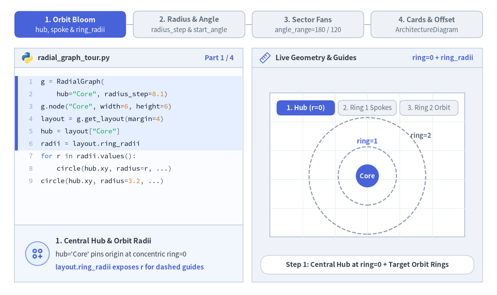
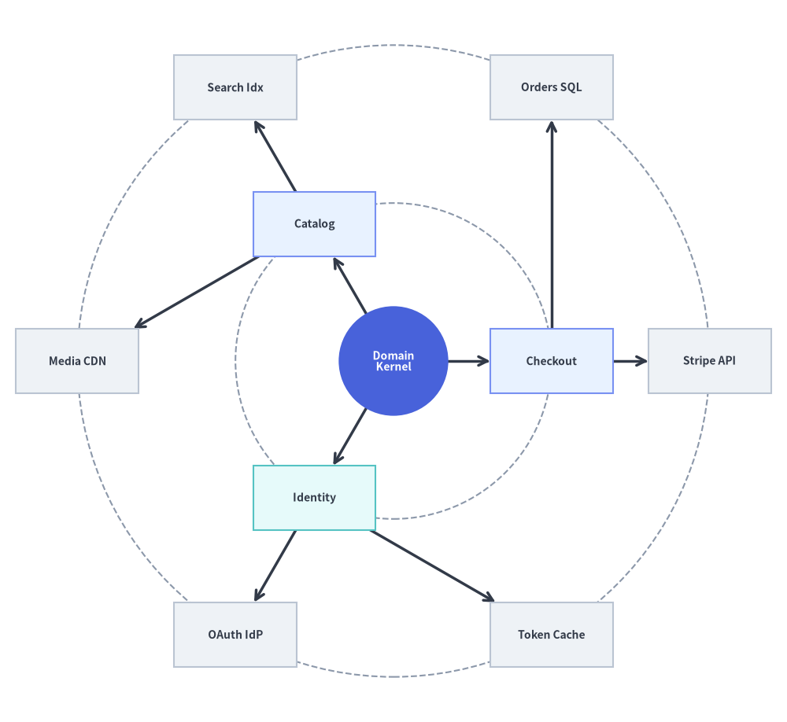
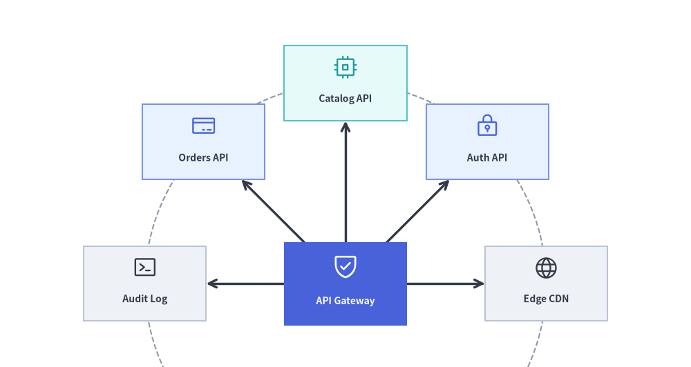

# RadialGraph: 同心円軌道とハブ＆スポークトポロジ

`RadialGraph` は、中心ハブノードを原点（`ring=0`）に配置し、接続されたノードを**同心円状の軌道リング**（`ring=1, 2, ...`）上に配置します。サブツリーの大きさに応じて角度セクタが比例配分されるため、マルチホップのスポークが線交差なしに外側へ放射状に広がります。

イベント駆動のメッセージメッシュ、Pub/Sub ブローカートポロジ、マイクロサービスのハブ＆スポークネットワーク、同心円状の依存関係レーダー向けに特化して設計されています。`layout = g.get_layout(margin=...)` を呼び出すことで、ノード中心座標（`layout[id].xy`）、放射状スポークのポリライン（`layout.edges`）、および同心円軌道の半径（`layout.ring_radii`）を取得できます。


<figure class="drawlib-image" style="text-align: center;">
  
  <figcaption class="drawlib-caption">RadialGraph の概要: 同心円 BFS 軌道リング、layout.ring_radii ガイド、およびスポークアイコン</figcaption>
</figure>

<details class="drawlib-code-details">
<summary>Source Code</summary>

```python
from drawlib.canvas import save, setup
from drawlib.graph import RadialGraph
from drawlib.icons import phosphor
from drawlib.lines import lines
from drawlib.shapes import circle, rectangle
from drawlib.styles import Styles

setup(width=122, height=112)

g = RadialGraph(
    hub="core",
    radius_step=24.5,
    start_angle=35.0,
    default_node_width=19.5,
    default_node_height=11.0,
)

# Ring 0: Central Hub
g.node("core", width=17.5, height=17.5)

# Ring 1: Core Services
g.spoke("core", "auth", ring=1)
g.spoke("core", "orders", ring=1)
g.spoke("core", "billing", ring=1)
g.spoke("core", "audit", ring=1)

# Ring 2: Outer Adapters
g.spoke("auth", "idp", ring=2)
g.spoke("orders", "db", ring=2)
g.spoke("billing", "stripe", ring=2)
g.spoke("audit", "siem", ring=2)

# 1. Solve concentric coordinates & orbit ring radii
layout = g.get_layout(margin=5.0)
hub_n = layout["core"]

# 2. Draw dashed circular orbit guides from layout.ring_radii
for r in layout.ring_radii.values():
    circle(hub_n.xy, radius=r, style=Styles.MutedDashed)

# 3. Draw radial spoke edges (from hub center for ring 0->1 so lines meet the circular hub perimeter)
for e in layout.edges:
    pts = [hub_n.xy, e.dst_port] if e.src == "core" else e.points
    lines(pts, arrow_head="->", style=Styles.DarkBold)

# 4. Draw central circular hub and satellite cards with Phosphor icons
circle(
    hub_n.xy,
    radius=hub_n.width / 2,
    style=Styles.PrimaryFlat,
    text="\nEvent Hub",
    text_style=Styles.WhiteBold.patch(text_size=10.0),
)
phosphor.circles_three_plus((hub_n.x, hub_n.y + 2.7), width=3.8, style=Styles.White)

spokes = {
    "auth": ("\nAuth API", Styles.PrimaryNeutral, phosphor.shield_check, Styles.Primary),
    "orders": ("\nOrders", Styles.SecondaryNeutral, phosphor.cpu, Styles.Secondary),
    "billing": ("\nBilling", Styles.PrimaryNeutral, phosphor.credit_card, Styles.Primary),
    "audit": ("\nAudit Log", Styles.Neutral, phosphor.chart_line_up, Styles.Dark),
    "idp": ("\nOAuth IdP", Styles.Neutral, phosphor.lock_key, Styles.Dark),
    "db": ("\nOrders DB", Styles.Neutral, phosphor.database, Styles.Dark),
    "stripe": ("\nStripe GW", Styles.Neutral, phosphor.globe, Styles.Dark),
    "siem": ("\nSIEM Sink", Styles.Neutral, phosphor.terminal_window, Styles.Dark),
}

for nid, (label, box_st, icon_fn, ic_st) in spokes.items():
    n = layout[nid]
    rectangle(
        n.xy,
        width=n.width,
        height=n.height,
        style=box_st,
        text=label,
        text_style=Styles.DarkBold.patch(text_size=10.0),
    )
    icon_fn((n.x, n.y + 2.0), width=3.8, style=ic_st)

save()
```

</details>


---

## 1. 基本概念と基本的な使い方

`RadialGraph` は三角関数を手書きすることなく極座標のハブ＆スポーク配置を計算します。中心ハブを `ring=0` に置き、`g.spoke(parent, child, ring=...)` でサテライトノードを接続して `g.get_layout(margin=...)` を呼び出すと、カード中心座標（`layout[id].xy`）、境界クリップ済みの放射状エッジ（`layout.edges`）、および同心円軌道ガイドの半径（`layout.ring_radii`）が得られます。`radius_step` と `start_angle` でリング間隔と開始角度を調整したり、`angle_range`（`180.0` や `110.0` など）を絞って指向性のある扇形（アークファン）を作ったり、計算済み座標を `ArchitectureDiagram` に直接渡して `layout.offset(...)` で微調整したりできます。


<figure class="drawlib-image" style="text-align: center;">
  
  <figcaption class="drawlib-caption">基本的な使い方とパラメータツアー: 同心円軌道の展開、半径ステップと開始角度、半円アークファン、ArchitectureDiagram との連携（APNG アニメーション）</figcaption>
</figure>


<div class="drawlib-source-link">
  <a href="https://github.com/yuichi110/drawlib/blob/main/docs/docs_src/ja/07_graph/radial_graph.md" target="_blank" rel="noopener noreferrer">GitHub でアニメーションのソースコードを見る &rarr;</a>
</div>

- **同心円リングの展開（`hub`、`g.spoke`、`ring_radii`）**: `RadialGraph(hub=...)` は中心ハブを `ring=0` に配置し、BFS ホップ距離（または明示的な `ring=` 指定）によってサテライトノードを `ring=1, 2, ...` に割り当て、正確な軌道半径を `layout.ring_radii` として公開します。
- **角度方向とリング間隔（`start_angle`、`radius_step`）**: `start_angle` でスポークを軸方向（`0.0`）または対角象限（`45.0`）へ回転させ、`radius_step` でコンパクト／広めのリング間隔を制御できます。
- **指向性アークファン（`angle_range`）**: `angle_range` を `360.0`（全周）から `180.0`（半円ファン）やさらに狭い指向性レーダーコーンへと絞り、明示的な `center=(cx, cy)` を基点に扇状に展開できます。
- **`ArchitectureDiagram` カードと `layout.offset()`**: `layout[id].xy` を `PhosphorIcon`／`GcpIcon` バッジ付きの `Node` カードに直接渡し、背面に `circle()` の軌道ガイドを重ね、`layout.offset(id, dx, dy)` で個別のスポーク位置を微調整できます。

---

## 2. コンストラクタ、`.spoke()`、`get_layout()` API

```python
from drawlib.graph import RadialGraph

g = RadialGraph(
    hub="core",                      # Central hub node ID (auto-detects highest degree if None)
    center=None,                     # Explicit (cx, cy) origin (defaults to canvas center)
    radius_step=36.0,                # Radial distance between rings (auto-scales if None)
    start_angle=0.0,                 # Starting angle in degrees (0.0 = East, 90.0 = North)
    angle_range=360.0,               # Total angular sweep (e.g. 360.0 full circle, 180.0 arc)
    default_node_width=22.0,
    default_node_height=11.0,
)

layout = g.get_layout(margin=8.0)
print(layout)                        # Inspect solved node coordinates & layout.ring_radii
```

### パラメータリファレンス

| パラメータ | 型 | デフォルト | 説明 |
| :--- | :--- | :--- | :--- |
| `hub` | `str \| None` | `None` | 中心となる `ring=0` ハブノードの ID。`None` の場合、接続次数が最も高いノードが選択されます。 |
| `center` | `tuple[float, float] \| None` | `None` | 同心円リングの中心座標 `(cx, cy)`。デフォルトは `(width / 2, height / 2)` です。 |
| `radius_step` | `float \| None` | `None` | 連続するリング間の固定半径ステップ。`None` の場合はキャンバスに合わせて自動スケーリングされます。 |
| `start_angle` | `float` | `0.0` | 度数法による開始角度（`0.0` = 右／東、`90.0` = 上／北）。 |
| `angle_range` | `float` | `360.0` | 度数法による全体の角度範囲（`360.0` で全周軌道、`180.0` で半円ファン）。 |
| `default_node_width` | `float` | `20.0` | デフォルトのノード幅（キャンバス単位）。 |
| `default_node_height` | `float` | `12.0` | デフォルトのノード高さ（キャンバス単位）。 |

### `g.spoke(...)`、`ring=`、`layout.ring_radii` による軌道割り当て

`g.node(id, *, ring=None, width=None, height=None)` と `g.edge(src, dst)` に加え、`RadialGraph` はサテライトノードの登録と `parent` からの接続を 1 回の呼び出しで行う `.spoke()` を提供します。

```python
g.spoke(
    parent: str,
    spoke_id: str,
    *,
    ring: int | None = None,
    width: float | None = None,
    height: float | None = None,
) -> Node
```

- **BFS による自動リング割り当て**: デフォルト（`ring=None`）では、各ノードのリング番号は `hub` からの最短ホップ距離に一致します（ハブは `ring=0`、直接の隣接ノードは `ring=1`、2 ホップ先は `ring=2`）。
- **明示的なリング割り当て（`ring=int`）**: `g.node(id, ring=...)` または `g.spoke(parent, spoke_id, ring=...)` に `ring=1` や `ring=2` を渡すことで、特定の同心円軌道にノードを固定できます。
- **軌道ガイド円（`layout.ring_radii`）**: `GraphLayout.ring_radii`（`dict[int, float]`）は各リング番号（`1, 2, ...`）からハブ中心からの計算済み半径へのマッピングを保持しており、`circle(layout[hub].xy, radius=r, style=Styles.MutedDashed)` で破線の軌道ガイド円を簡単に描画できます。

---

## 3. 単一リングのハブ＆スポーク型マイクロサービスメッシュ

単一リングの `RadialGraph` は、中央のブローカーや API ゲートウェイの周囲にサテライトサービスを均等に配置します。


```python
from drawlib.canvas import save, setup
from drawlib.graph import RadialGraph
from drawlib.lines import lines
from drawlib.shapes import circle, rectangle
from drawlib.styles import Styles

setup(width=118, height=84)

g = RadialGraph(
    hub="broker",
    radius_step=29.0,
    default_node_width=23.0,
    default_node_height=10.5,
)

# Central Hub (ring=0)
g.node("broker", width=22.0, height=22.0)

# 6 Spoke Microservices on Ring 1
for sid in ["auth", "orders", "billing", "inventory", "notify", "audit"]:
    g.spoke("broker", sid)

layout = g.get_layout(margin=8.0)
hub = layout["broker"]

# Draw dashed orbit guide circle
for r in layout.ring_radii.values():
    circle(hub.xy, radius=r, style=Styles.MutedDashed)

# Draw spoke edges
for e in layout.edges:
    lines([hub.xy, e.dst_port], arrow_head="->", style=Styles.DarkBold)

# Draw central hub circle
circle(
    hub.xy,
    radius=hub.width / 2,
    style=Styles.PrimaryFlat,
    text="Event\nBroker",
    text_style=Styles.WhiteBold.patch(text_size=10.5),
)

# Draw Ring 1 spoke cards (calm Neutral & Tinted-Neutral baseline)
for sid, label, st in [
    ("auth", "Auth Service", Styles.PrimaryNeutral),
    ("orders", "Orders API", Styles.SecondaryNeutral),
    ("billing", "Billing Job", Styles.Neutral),
    ("inventory", "Inventory", Styles.Neutral),
    ("notify", "Email & Push", Styles.Neutral),
    ("audit", "Audit Log", Styles.PrimaryNeutral),
]:
    nl = layout[sid]
    rectangle(
        nl.xy,
        width=nl.width,
        height=nl.height,
        style=st,
        text=label,
        text_style=Styles.DarkBold.patch(text_size=10.5),
    )

save()
```

<figure class="drawlib-image" style="text-align: center;">
  
  <figcaption class="drawlib-caption">イベントブローカーを中心とした単一リングのハブ＆スポーク型マイクロサービスメッシュ</figcaption>
</figure>


---

## 4. マルチリングの同心円依存関係レーダー (`ring=0, 1, 2`)

2 ホップ目のスポークを接続するか明示的に `ring=2` を渡すことで、内側のリングがコアドメインサービス（`ring=1`）、外側のリングが外部アダプタやストレージエンジン（`ring=2`）を表すマルチリングの同心円アーキテクチャを構築できます。


```python
from drawlib.canvas import save, setup
from drawlib.graph import RadialGraph
from drawlib.lines import lines
from drawlib.shapes import circle, rectangle
from drawlib.styles import Styles

setup(width=122, height=112)

g = RadialGraph(
    hub="domain_core",
    radius_step=24.5,
    default_node_width=19.0,
    default_node_height=10.0,
)

# Ring 0: Central Domain Kernel
g.node("domain_core", width=17.0, height=17.0)

# Ring 1: Application Services
g.spoke("domain_core", "checkout", ring=1)
g.spoke("domain_core", "catalog", ring=1)
g.spoke("domain_core", "identity", ring=1)

# Ring 2: External Infrastructure Adapters
g.spoke("checkout", "stripe", ring=2)
g.spoke("checkout", "orders_db", ring=2)
g.spoke("catalog", "elastic", ring=2)
g.spoke("catalog", "cdn", ring=2)
g.spoke("identity", "oauth", ring=2)
g.spoke("identity", "redis", ring=2)

layout = g.get_layout(margin=5.0)
hub = layout["domain_core"]

for r in layout.ring_radii.values():
    circle(hub.xy, radius=r, style=Styles.MutedDashed)

for e in layout.edges:
    pts = [hub.xy, e.dst_port] if e.src == "domain_core" else e.points
    lines(pts, arrow_head="->", style=Styles.DarkBold)

circle(
    hub.xy,
    radius=hub.width / 2,
    style=Styles.PrimaryFlat,
    text="Domain\nKernel",
    text_style=Styles.WhiteBold.patch(text_size=10.0),
)

for nid, label, st in [
    ("checkout", "Checkout", Styles.PrimaryNeutral),
    ("catalog", "Catalog", Styles.PrimaryNeutral),
    ("identity", "Identity", Styles.SecondaryNeutral),
    ("stripe", "Stripe API", Styles.Neutral),
    ("orders_db", "Orders SQL", Styles.Neutral),
    ("elastic", "Search Idx", Styles.Neutral),
    ("cdn", "Media CDN", Styles.Neutral),
    ("oauth", "OAuth IdP", Styles.Neutral),
    ("redis", "Token Cache", Styles.Neutral),
]:
    nl = layout[nid]
    rectangle(
        nl.xy,
        width=nl.width,
        height=nl.height,
        style=st,
        text=label,
        text_style=Styles.DarkBold.patch(text_size=10.0),
    )

save()
```

<figure class="drawlib-image" style="text-align: center;">
  
  <figcaption class="drawlib-caption">マルチリング同心円依存関係レーダー（Ring 0 コア、Ring 1 ドメイン、Ring 2 アダプタ）</figcaption>
</figure>


---

## 5. `ArchitectureDiagram` による半円依存関係ファン (`angle_range=180.0`)

`360.0` 度の全周軌道だけでなく、`start_angle` と `angle_range`（および明示的な `center=(cx, cy)` と `radius_step`）を使うことでスポークを半円や四分円の扇状に制限し、得られた座標を `ArchitectureDiagram`（`Node` + `PhosphorIcon`）と `circle()` で描画することもできます。


```python
from drawlib.canvas import save, setup
from drawlib.diagrams.architecture import ArchitectureDiagram, Node, PhosphorIcon
from drawlib.graph import RadialGraph
from drawlib.lines import lines
from drawlib.shapes import circle
from drawlib.styles import Styles

setup(width=124, height=66)

g = RadialGraph(
    hub="gateway",
    center=(62.0, 15.0),
    radius_step=36.0,
    start_angle=0.0,
    angle_range=180.0,
    default_node_width=22.0,
    default_node_height=13.5,
)

# Hub anchored near the bottom center
g.node("gateway", width=22.0, height=15.0)

# 5 downstream services fanned across the upper 0°..180° arc
for sid in ["cdn", "auth", "catalog", "orders", "audit"]:
    g.spoke("gateway", sid)

layout = g.get_layout(margin=6.0)
hub = layout["gateway"]

# 1. Draw dashed orbit guide circle and radial spoke lines from layout
for r in layout.ring_radii.values():
    circle(hub.xy, radius=r, style=Styles.MutedDashed)

for e in layout.edges:
    lines([hub.xy, e.dst_port], arrow_head="->", style=Styles.DarkBold)

# 2. Place styled ArchitectureDiagram nodes at solved radial coordinates
d = ArchitectureDiagram(
    node_style=Styles.PrimaryFlat,
    node_text_style=Styles.DarkBold.patch(text_size=10.0),
    edge_style=Styles.DarkBold,
    edge_text_style=Styles.Dark.patch(text_size=9.5),
    node_card_style=Styles.Neutral,
)

d.add(
    Node(
        "API Gateway",
        width=hub.width,
        height=hub.height,
        icon=PhosphorIcon.SHIELD_CHECK,
        icon_size=5.0,
        style=Styles.White,
        text_style=Styles.WhiteBold.patch(text_size=10.0),
        card_style=Styles.PrimaryFlat,
    ),
    xy=hub.xy,
)

for sid, label, icon_enum, ic_st, card_st in [
    ("cdn", "Edge CDN", PhosphorIcon.GLOBE, Styles.Dark, Styles.Neutral),
    ("auth", "Auth API", PhosphorIcon.LOCK_KEY, Styles.Primary, Styles.PrimaryNeutral),
    ("catalog", "Catalog API", PhosphorIcon.CPU, Styles.Secondary, Styles.SecondaryNeutral),
    ("orders", "Orders API", PhosphorIcon.CREDIT_CARD, Styles.Primary, Styles.PrimaryNeutral),
    ("audit", "Audit Log", PhosphorIcon.TERMINAL_WINDOW, Styles.Dark, Styles.Neutral),
]:
    nl = layout[sid]
    d.add(
        Node(
            label,
            width=nl.width,
            height=nl.height,
            icon=icon_enum,
            icon_size=4.5,
            style=ic_st,
            card_style=card_st,
        ),
        xy=nl.xy,
    )

d.draw()
save()
```

<figure class="drawlib-image" style="text-align: center;">
  
  <figcaption class="drawlib-caption">ArchitectureDiagram とリングガイドで描画した半円依存関係ファン（angle_range=180.0）</figcaption>
</figure>


---

## 6. ベストプラクティス

1. **`layout.ring_radii` で軌道リングのガイド線を描画する**: エッジやノードを描画する前に `layout.ring_radii.values()` を反復処理して `circle(layout[hub].xy, radius=r, style=Styles.MutedDashed)` を描画することで、同心円の階層レベル（`ring=1` と `ring=2` など）を一目で判別できるようになります。
2. **中央ハブには `circle()` を使用する**: 中央ハブを円（`circle(hub.xy, radius=hub.width / 2, style=Styles.PrimaryFlat, ...)`）として描画すると、放射状に伸びるスポークの自然な視覚的アンカーになります。
3. **外側リングには十分なキャンバス余白を確保する**: 外周リングの上下左右の端にある矩形カードの周囲にゆとりを持たせるため、`g.get_layout(margin=8.0)` のように `margin=8.0`（またはそれ以上）を渡してください。
