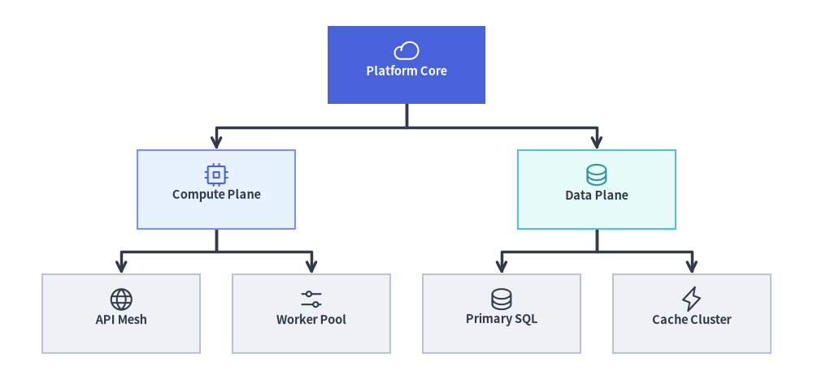
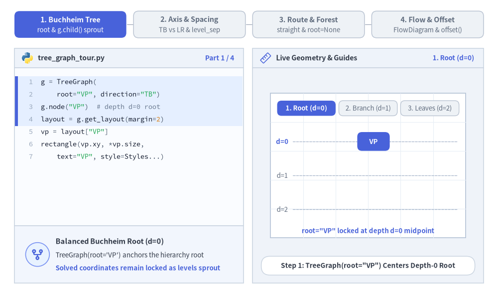
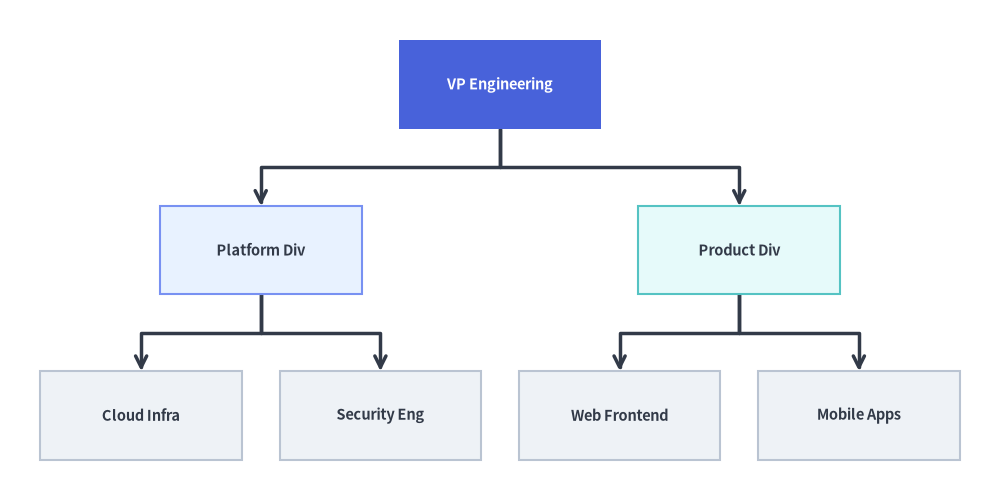
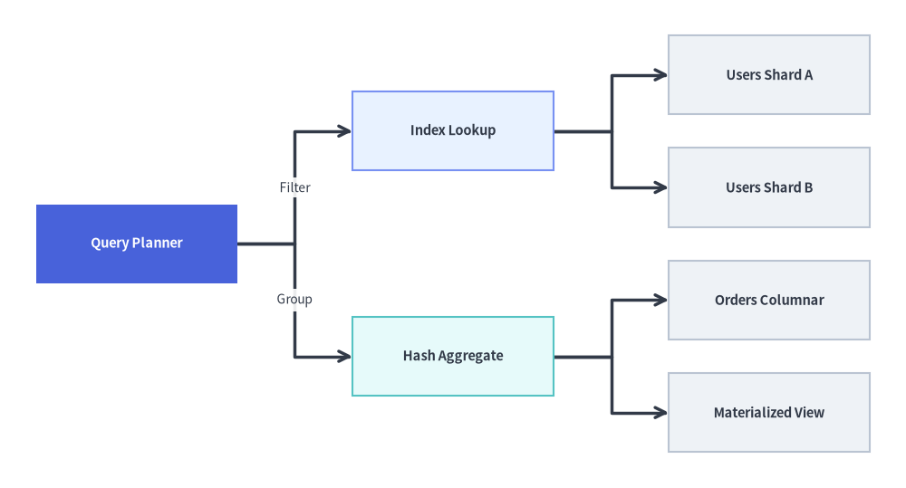
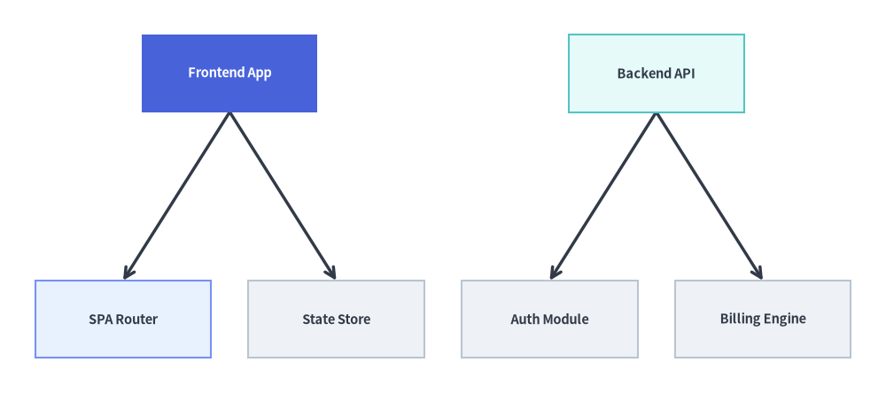

# TreeGraph: バランスの取れた階層構造と分解ツリー

`TreeGraph` は **Reingold-Tilford / Buchheim のコンパクトツリーレイアウトアルゴリズム**を実装しており、兄弟サブツリー同士の衝突を防いで密にパッキングしながら、すべての親ノードが子ノードの中央（上下または左右）に対称配置されるようバランスの取れた `(cx, cy)` ノード中心座標と分岐ウェイポイントを計算します。

組織図、抽象構文木（AST）、コール階層、分類体系（タクソノミー）、フォルトツリーなど、トポロジが厳密な木構造（すべてのノードの親が高々 1 つ）である場合に `TreeGraph` を使用します。`layout = g.get_layout(margin=...)` を呼び出して座標を計算し、[`FlowDiagram`](../06_diagrams/flow.md)、[`ArchitectureDiagram`](../06_diagrams/architecture.md)、または [`drawlib.shapes`](../02_drawing_primitives/shapes_overview.md) と [`drawlib.lines`](../02_drawing_primitives/lines.md) で描画します。


<figure class="drawlib-image" style="text-align: center;">
  
  <figcaption class="drawlib-caption">TreeGraph の概要: 直交ブランチポリラインとアイコンで描画した Buchheim バランスツリー座標</figcaption>
</figure>

<details class="drawlib-code-details">
<summary>Source Code</summary>

```python
from drawlib.canvas import save, setup
from drawlib.graph import TreeGraph
from drawlib.icons import phosphor
from drawlib.lines import lines
from drawlib.shapes import rectangle
from drawlib.styles import Styles

setup(width=124, height=58)

g = TreeGraph(
    root="core",
    direction="TB",
    level_sep=7.0,
    sibling_sep=5.0,
    edge_routing="orthogonal",
    default_node_width=24.0,
    default_node_height=12.0,
)

# Level 0: Root Node
g.node("core")

# Level 1: Division Branches
g.child("core", "compute")
g.child("core", "data")

# Level 2: Leaf Subsystems
g.child("compute", "api")
g.child("compute", "workers")
g.child("data", "sql")
g.child("data", "cache")

# 1. Compute balanced tree coordinates & orthogonal branch waypoints
layout = g.get_layout(margin=4.5)

# 2. Render orthogonal tree branches from layout.edges
for e in layout.edges:
    lines(e.points, arrow_head="->", style=Styles.DarkBold)

# 3. Render node cards & Phosphor icons at solved (cx, cy) coordinates
node_meta = {
    "core": ("\nPlatform Core", Styles.PrimaryFlat, Styles.WhiteBold, phosphor.cloud, Styles.White),
    "compute": ("\nCompute Plane", Styles.PrimaryNeutral, Styles.DarkBold, phosphor.cpu, Styles.Primary),
    "data": ("\nData Plane", Styles.SecondaryNeutral, Styles.DarkBold, phosphor.database, Styles.Secondary),
    "api": ("\nAPI Mesh", Styles.Neutral, Styles.DarkBold, phosphor.globe, Styles.Dark),
    "workers": ("\nWorker Pool", Styles.Neutral, Styles.DarkBold, phosphor.sliders_horizontal, Styles.Dark),
    "sql": ("\nPrimary SQL", Styles.Neutral, Styles.DarkBold, phosphor.database, Styles.Dark),
    "cache": ("\nCache Cluster", Styles.Neutral, Styles.DarkBold, phosphor.lightning, Styles.Dark),
}

for nid, (label, box_st, txt_st, icon_fn, ic_st) in node_meta.items():
    n = layout[nid]
    rectangle(
        n.xy,
        width=n.width,
        height=n.height,
        style=box_st,
        text=label,
        text_style=txt_st.patch(text_size=10.5),
    )
    icon_fn((n.x, n.y + 2.2), width=4.0, style=ic_st)

save()
```

</details>


---

## 1. 基本概念と基本的な使い方

`TreeGraph` は `layout = g.get_layout()` によって**バランスの取れた Reingold-Tilford / Buchheim ツリー座標**を計算します。`g.child(parent, child_id)` で階層構造を簡潔に宣言し、`direction`（`"TB"` または `"LR"`）・`level_sep`・`sibling_sep` を調整したり、`edge_routing` を `"orthogonal"`（直交フォーク）と `"straight"`（直線）の間で切り替えたり（あるいは `root=None` を指定して独立した複数ルートのフォレストを横並びに自動配置したり）できます。解決された `layout[id].xy` 中心座標は、プリミティブや [`FlowDiagram`](../06_diagrams/flow.md) と `layout.offset()` を組み合わせて描画できます。


<figure class="drawlib-image" style="text-align: center;">
  
  <figcaption class="drawlib-caption">基本的な使い方とパラメータツアー: Buchheim バランス展開、進行方向とサブツリー間隔、直交分岐とマルチルートフォレスト、FlowDiagram レンダリング（APNG アニメーション）</figcaption>
</figure>


<div class="drawlib-source-link">
  <a href="https://github.com/yuichi110/drawlib/blob/main/docs/docs_src/ja/07_graph/tree_graph.md" target="_blank" rel="noopener noreferrer">GitHub でアニメーションのソースコードを見る &rarr;</a>
</div>

- **Buchheim 法によるバランスの取れたツリー展開**: `TreeGraph` は不等サイズのサブツリー同士を輪郭（コントゥア）に沿って重なりなく密にパッキングしながら、すべての親ノードを子ノードの中央（上下または左右）に対称配置します。
- **進行軸と間隔の制御**: 上から下への組織図・AST 階層（`direction="TB"`）と左から右への分解ツリー（`direction="LR"`）をシームレスに切り替え、`level_sep` と `sibling_sep` で世代間および兄弟間の余白を調整できます。
- **直交フォーク・直線・マルチルートフォレスト**: `e.points` に格納される経路として直角分岐ポリラインの `"orthogonal"` またはユークリッド直線の `"straight"` を選択でき、`root=None`（省略時）にすると複数の独立したルート階層を横並びのフォレストとして自動配置します。
- **`FlowDiagram` による描画と `.offset()`**: 計算済みの `layout[id].xy` 中心座標を `FlowDiagram` に渡してクリティカルパスの分岐を強調したり、`layout.offset(id, dx=..., dy=...)` で計算後の細かな位置調整を行ったりできます。

---

## 2. コンストラクタ、`.child()`、`get_layout()` API

```python
from drawlib.graph import TreeGraph

g = TreeGraph(
    root="vp",                       # Explicit root node ID (auto-detected if None)
    direction="TB",                  # "TB" (Top-to-Bottom) or "LR" (Left-to-Right)
    level_sep=12.0,                  # Fixed gap between tree depths (auto-scales if None)
    sibling_sep=6.0,                 # Minimum gap between sibling nodes (auto-scales if None)
    edge_routing="orthogonal",       # "orthogonal" or "straight"
    default_node_width=24.0,
    default_node_height=11.0,
)

layout = g.get_layout(margin=5.0)
print(layout)                        # Inspect solved node centers & branch waypoints
```

### パラメータリファレンス

| パラメータ | 型 | デフォルト | 説明 |
| :--- | :--- | :--- | :--- |
| `root` | `str \| None` | `None` | 明示的なルートノード ID。`None` の場合、入次数 `0` のすべてのノードを自動検出し、マルチルートフォレストとして横並びに配置します。 |
| `direction` | `Literal["TB", "LR"]` | `"TB"` | ツリーの成長方向（`"TB"` は上から下、`"LR"` は左から右）。 |
| `level_sep` | `float \| None` | `None` | 連続するツリー階層（深さ）間の固定距離。`None` の場合はキャンバスに合わせて自動スケーリングされます。 |
| `sibling_sep` | `float \| None` | `None` | 隣接する兄弟ノード間の最小間隔。`None` の場合はキャンバスに合わせて自動スケーリングされます。 |
| `edge_routing` | `Literal["orthogonal", "straight"]` | `"orthogonal"` | `edge_layout.points` に格納されるエッジ経路のルーティング方式（直角分岐の `"orthogonal"` またはユークリッド直線の `"straight"`）。 |
| `default_node_width` | `float` | `22.0` | デフォルトのノード幅（キャンバス単位）。 |
| `default_node_height` | `float` | `12.0` | デフォルトのノード高さ（キャンバス単位）。 |

### `g.child(...)` による簡潔なツリー構築

`g.node(id, *, width=None, height=None)` と `g.edge(src, dst)` に加え、`TreeGraph` は子ノードの登録と `parent` からのエッジ接続を 1 回の呼び出しで行う `.child()` ヘルパーを提供します。

```python
g.child(
    parent: str,
    child_id: str,
    *,
    width: float | None = None,
    height: float | None = None,
) -> Node
```

> **注記**:
> - **マルチルートフォレスト（`root=None`）**: `root=None` かつ入次数 `0`（入力エッジなし）のノードが複数存在する場合、`TreeGraph` はレイアウト計算時に仮想スーパールートを自動生成し、独立した各ツリーをバランスの取れたフォレストとして横並びに配置します。
> - **厳密な木構造の検証**: `TreeGraph` はグラフが厳密な非巡回木（各ノードの親が高々 1 つ）であることを検証します。複数の親を持つノード（ダイヤモンド型 DAG）がある場合は、代わりに [`LayerGraph`](./layer_graph.md) または [`ArchitectureGraph`](./architecture_graph.md) を使用してください。

---

## 3. `FlowDiagram` によるトップダウン（`TB`）エンジニアリング組織階層図

上から下へ展開するツリー（`direction="TB"`）は、組織構造、クラスの分類体系、AST の表現に最適です。Buchheim の輪郭ソルバー（`g.get_layout()`）が 2 つの部門ヘッドの中央上部に `VP Engineering` を配置し、4 つのリーフチームを均等な間隔で整列させ、その座標に `FlowDiagram`（`Process`）でスタイル付きカードと直交ツリー分岐を描画している点に注目してください。


```python
from drawlib.canvas import save, setup
from drawlib.diagrams.flow import FlowDiagram, Process
from drawlib.graph import TreeGraph
from drawlib.styles import Styles

setup(width=124, height=62)

# Step 1: Declare tree topology & solve coordinates
g = TreeGraph(
    root="vp",
    direction="TB",
    default_node_width=25.0,
    default_node_height=11.0,
)
g.node("vp")
g.child("vp", "plat")
g.child("vp", "prod")
g.child("plat", "infra")
g.child("plat", "sec")
g.child("prod", "web")
g.child("prod", "mob")

layout = g.get_layout(margin=5.0)

# Step 2: Place Process nodes at solved layout[id].xy centers in FlowDiagram
fd = FlowDiagram(
    node_style=Styles.Neutral.patch(text_size=10.5),
    edge_style=Styles.DarkBold,
    edge_text_style=Styles.Dark.patch(text_size=10.0),
)

nodes = {}
for nid, label, st, tst in [
    ("vp", "VP Engineering", Styles.PrimaryFlat, Styles.WhiteBold),
    ("plat", "Platform Div", Styles.PrimaryNeutral, Styles.DarkBold),
    ("prod", "Product Div", Styles.SecondaryNeutral, Styles.DarkBold),
    ("infra", "Cloud Infra", Styles.Neutral, Styles.DarkBold),
    ("sec", "Security Eng", Styles.Neutral, Styles.DarkBold),
    ("web", "Web Frontend", Styles.Neutral, Styles.DarkBold),
    ("mob", "Mobile Apps", Styles.Neutral, Styles.DarkBold),
]:
    nl = layout[nid]
    nodes[nid] = fd.add(
        Process(
            label,
            width=nl.width,
            height=nl.height,
            style=st,
            text_style=tst.patch(text_size=10.5),
        ),
        xy=nl.xy,
    )

for e in layout.edges:
    fd.connect(nodes[e.src], nodes[e.dst], start_side="bottom", end_side="top")

fd.draw()
save()
```

<figure class="drawlib-image" style="text-align: center;">
  
  <figcaption class="drawlib-caption">TreeGraph で座標計算し FlowDiagram で描画したトップダウン（TB）エンジニアリング組織階層図</figcaption>
</figure>


---

## 4. 左から右（`LR`）へのサービス分解・コールツリー

`direction="LR"` に切り替えると、階層が左から右へ水平方向に展開されます。このレイアウトは、API リクエストのファンアウトツリー、WBS（作業分解構成図）、クエリ実行プランなど、横長のラベルを持つ図に特に適しています。


```python
from drawlib.canvas import save, setup
from drawlib.diagrams.flow import FlowDiagram, Process
from drawlib.graph import TreeGraph
from drawlib.styles import Styles

setup(width=126, height=68)

# Step 1: Solve Left-to-Right tree coordinates
g = TreeGraph(
    root="query_plan",
    direction="LR",
    default_node_width=28.0,
    default_node_height=11.0,
)
g.node("query_plan")
g.child("query_plan", "index_scan")
g.child("query_plan", "agg_stage")
g.child("index_scan", "shard_1")
g.child("index_scan", "shard_2")
g.child("agg_stage", "col_store")
g.child("agg_stage", "cache_hit")

layout = g.get_layout(margin=5.0)

# Step 2: Render with FlowDiagram and labeled branch connectors
fd = FlowDiagram(
    node_style=Styles.Neutral.patch(text_size=10.5),
    edge_style=Styles.DarkBold,
    edge_text_style=Styles.Dark.patch(text_size=10.0),
)

nodes = {}
for nid, label, st, tst in [
    ("query_plan", "Query Planner", Styles.PrimaryFlat, Styles.WhiteBold),
    ("index_scan", "Index Lookup", Styles.PrimaryNeutral, Styles.DarkBold),
    ("agg_stage", "Hash Aggregate", Styles.SecondaryNeutral, Styles.DarkBold),
    ("shard_1", "Users Shard A", Styles.Neutral, Styles.DarkBold),
    ("shard_2", "Users Shard B", Styles.Neutral, Styles.DarkBold),
    ("col_store", "Orders Columnar", Styles.Neutral, Styles.DarkBold),
    ("cache_hit", "Materialized View", Styles.Neutral, Styles.DarkBold),
]:
    nl = layout[nid]
    nodes[nid] = fd.add(
        Process(
            label,
            width=nl.width,
            height=nl.height,
            style=st,
            text_style=tst.patch(text_size=10.5),
        ),
        xy=nl.xy,
    )

fd.connect(nodes["query_plan"], nodes["index_scan"], label="Filter", start_side="right", end_side="left")
fd.connect(nodes["query_plan"], nodes["agg_stage"], label="Group", start_side="right", end_side="left")
fd.connect(nodes["index_scan"], nodes["shard_1"], start_side="right", end_side="left")
fd.connect(nodes["index_scan"], nodes["shard_2"], start_side="right", end_side="left")
fd.connect(nodes["agg_stage"], nodes["col_store"], start_side="right", end_side="left")
fd.connect(nodes["agg_stage"], nodes["cache_hit"], start_side="right", end_side="left")

fd.draw()
save()
```

<figure class="drawlib-image" style="text-align: center;">
  
  <figcaption class="drawlib-caption">FlowDiagram で描画した左から右（LR）のクエリ実行分解ツリー</figcaption>
</figure>


---

## 5. 自動マルチルートフォレスト (`root=None`) と直線エッジルーティング

`root=None` を指定すると、`TreeGraph` は入次数 `0` のすべてのノードを自動検出し、複数の独立したツリーをバランスの取れたフォレストとして横並びに配置します。また `edge_routing="straight"` を渡すと、`edge_layout.points` に親子ポート間を直接結ぶユークリッド直線セグメントが格納されます。


```python
from drawlib.canvas import save, setup
from drawlib.graph import TreeGraph
from drawlib.lines import lines
from drawlib.shapes import rectangle
from drawlib.styles import Styles

setup(width=126, height=56)

g = TreeGraph(
    direction="TB",
    root=None,
    edge_routing="straight",
    default_node_width=25.0,
    default_node_height=11.0,
)

# Tree 1: Frontend App Hierarchy (Root 1)
g.node("fe_app")
g.child("fe_app", "fe_router")
g.child("fe_app", "fe_store")

# Tree 2: Backend API Hierarchy (Root 2)
g.node("be_api")
g.child("be_api", "be_auth")
g.child("be_api", "be_billing")

layout = g.get_layout(margin=5.0)

for e in layout.edges:
    lines(e.points, arrow_head="->", style=Styles.DarkBold)

for nid, label, st, tst in [
    ("fe_app", "Frontend App", Styles.PrimaryFlat, Styles.WhiteBold),
    ("fe_router", "SPA Router", Styles.PrimaryNeutral, Styles.DarkBold),
    ("fe_store", "State Store", Styles.Neutral, Styles.DarkBold),
    ("be_api", "Backend API", Styles.SecondaryNeutral, Styles.DarkBold),
    ("be_auth", "Auth Module", Styles.Neutral, Styles.DarkBold),
    ("be_billing", "Billing Engine", Styles.Neutral, Styles.DarkBold),
]:
    nl = layout[nid]
    rectangle(
        nl.xy,
        width=nl.width,
        height=nl.height,
        style=st,
        text=label,
        text_style=tst.patch(text_size=10.5),
    )

save()
```

<figure class="drawlib-image" style="text-align: center;">
  
  <figcaption class="drawlib-caption">layout.edges の直線エッジルーティングを用いた自動マルチルートフォレスト（root=None）</figcaption>
</figure>


---

## 6. ベストプラクティス

1. **`TreeGraph` と `SmartArts.TreeNode` を使い分ける**:
   - `FlowDiagram`、`ArchitectureDiagram`、またはカスタムプリミティブで描画するためにバランスの取れたノード＆エッジのグラフ座標（`layout = g.get_layout()`）が必要な場合は、`TreeGraph`（`drawlib.graph`）を使用します。
   - コンパクトなファイルエクスプローラ風／インデント付きのディレクトリツリーリストを描画したい場合は、[`TreeNode`](../04_smartarts/tree.md)（`drawlib.smartarts`）を使用します。
2. **幅の広いツリーには `direction="LR"` を使用する**: リーフノードが多いツリー（リーフ `6` 個以上）では、`direction="LR"` を指定してリーフを縦方向に積むことで、ラベル同士が横方向に窮屈になるのを防げます。
