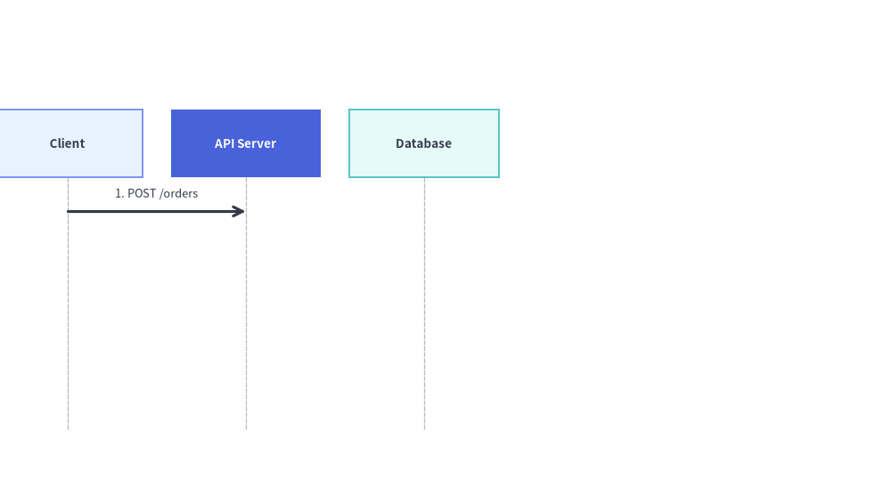

# ダイアグラムのアニメーション

[`drawlib.diagrams`](../06_diagrams/overview.md) に含まれる座標制御型の 6 つのダイアグラムエンジン（`FlowDiagram`、`ArchitectureDiagram`、`SequenceDiagram`、`StateDiagram`、`ClassDiagram`、`ERDiagram`）はすべて、**パターン B（事前構築・フレーム内変更）**に従います。


<figure class="drawlib-image" style="text-align: center;">
  
  <figcaption class="drawlib-caption">テクニカルダイアグラムのアニメーション：ノード・コンテナ・エッジの段階的ウォークスルー</figcaption>
</figure>

<details class="drawlib-code-details">
<summary>Source Code</summary>

```python
from drawlib.anim import Animation
from drawlib.canvas import save, setup
from drawlib.diagrams.architecture import ArchitectureDiagram, Node, NodeGroup, PhosphorIcon
from drawlib.styles import Styles

setup(width=124, height=46)
anim = Animation(fps=2.0)

d = ArchitectureDiagram(
    node_style=Styles.Primary,
    node_text_style=Styles.DarkBold.patch(text_size=10.5),
    edge_style=Styles.DarkBold,
    edge_text_style=Styles.Dark.patch(text_size=10.0),
    node_card_style=Styles.Neutral,
)

client = d.add(
    Node("Client App", width=24, height=15, icon=PhosphorIcon.LAPTOP, icon_size=6.2, card_style=Styles.Neutral),
    xy=(15.0, 21.0),
)
vpc = d.add(NodeGroup(title="Production VPC", padding=4.2, show=False), xy=(46.0, 5.0))
gw = vpc.add(
    Node(
        "API Gateway",
        width=24,
        height=15,
        icon=PhosphorIcon.SHIELD_CHECK,
        icon_size=6.2,
        card_style=Styles.PrimaryFlat,
        style=Styles.White,
        text_style=Styles.WhiteBold.patch(text_size=10.5),
        show=False,
    ),
    xy=(16.0, 16.0),
)
svc = vpc.add(
    Node(
        "Order Service",
        width=24,
        height=15,
        icon=PhosphorIcon.CPU,
        icon_size=6.2,
        card_style=Styles.PrimaryNeutral,
        show=False,
    ),
    xy=(54.0, 16.0),
)

e1 = d.connect(client, gw, label="HTTPS")
e2 = d.connect(gw, svc, label="gRPC")

# Frame 1: Client entry point
with anim.frame(duration=0.7):
    d.draw(xy=(2.0, 1.0))

# Frame 2: Reveal VPC container and API Gateway (active focal node)
vpc.show = True
gw.show = True
e1.style = Styles.PrimaryBold
with anim.frame(duration=0.7):
    d.draw(xy=(2.0, 1.0))

# Frame 3: Settle Gateway into PrimaryNeutral and highlight Order Service
e1.style = Styles.DarkBold
gw.card_style = Styles.PrimaryNeutral
gw.style = Styles.Primary
gw.text_style = Styles.DarkBold.patch(text_size=10.5)
svc.show = True
svc.card_style = Styles.PrimaryFlat
svc.style = Styles.White
svc.text_style = Styles.WhiteBold.patch(text_size=10.5)
e2.style = Styles.PrimaryBold
with anim.frame(duration=0.7):
    d.draw(xy=(2.0, 1.0))

# Frame 4: Completed topology settled with Gateway as primary focal point
e2.style = Styles.DarkBold
svc.card_style = Styles.SecondaryNeutral
svc.style = Styles.Primary
svc.text_style = Styles.DarkBold.patch(text_size=10.5)
gw.card_style = Styles.PrimaryFlat
gw.style = Styles.White
gw.text_style = Styles.WhiteBold.patch(text_size=10.5)
with anim.frame(duration=2.5):
    d.draw(xy=(2.0, 1.0))

save()
```

</details>


1. **トポロジを一度だけ構築する**: アニメーションループの外側でダイアグラムをインスタンス化し、すべてのノード・コンテナ・レーン・ブロック・ノート・接続を**一度だけ**登録して、返されたオブジェクトへの参照を保持します。
2. **フレームごとに属性を変更して再描画する**: `with anim.frame():` の内部で `.show`、`.style`、`.text_style`、`.label` / `.set_label()`、`.set_style()` を変更し、`d.draw(xy=..., scale=...)` を呼び出します。

*（`drawlib.graph` の宣言的な自動レイアウトソルバーについては、[グラフのアニメーション](./graphs.md)を参照してください。）*

---

## 1. ダイアグラムエンジン共通の主なアニメーション機能

| 機能 | 対象プロパティ・オブジェクト | 動作の仕組み |
| :--- | :--- | :--- |
| **表示切り替えとエッジ・Junction の自動非表示** | `node.show`, `edge.show`, `group.show`, `lane.show`, `block.show`, `note.show` | `node.show = False` を設定すると、そのノードが非表示になるだけでなく、**接続されているすべてのエッジ（`Edge`、`Transition`、`Relationship`）も自動的に非表示**になります。`FlowDiagram` や `ArchitectureDiagram` の `Junction` 分岐点（`node.fork([t1, t2])` など）では、下流ターゲットが少なくとも 1 つ表示されるまでジャンクションへ入る上流ラインも非表示に保たれます。 |
| **アクティブ経路の動的ハイライト** | `node.style`, `node.text_style`, `edge.style`, `edge.text_style` | フレーム間で `node.style = Styles.PrimaryFlat`（テキストは `Styles.WhiteBold`）および `edge.style = Styles.PrimaryBold` を設定して実行中の経路を強調し、通過済みノードは落ち着いた `Styles.PrimaryNeutral` へ戻します。 |
| **ラベル・スタイルのインプレース変更** | `msg.set_label(...)`, `msg.set_style(...)`, `note.set_text(...)`, `note.set_style(...)`, `edge.label` | ライフラインやノード座標をずらすことなく、フレーム間でメッセージラベル・ノート本文・コネクタのスタイルを動的に更新できます。 |
| **構造化コンテナ (`Lane`, `Block`, `Note`)** | `flow.add_lane(...) -> Lane`, `with seq.loop(...) as blk:`, `seq.note(...) -> Note` | スイムレーン（`Lane`）、シーケンス条件フレーム（`loop`、`alt`、`opt`、`par` から返る `Block`）、付箋ノート（`Note`）も `.show` と `.style` を備えたミュータブルなオブジェクトを返します。 |
| **カメラのパン＆ズーム** | `d.draw(xy=(ox, oy), scale=s)` | `draw()` に `xy=(ox, oy)` と `scale=s` を渡すと、ダイアグラムの原点を平行移動しつつ、すべての座標・ボックス寸法・線幅・アイコン・フォントサイズを均一にスケーリングします。 |

---

## 2. ノード・Junction・アクティブ経路の段階的ウォークスルー (`FlowDiagram`)

`node.show`（ターゲットが表示された時点ではじめて接続エッジや `Junction` の分岐幹を自動表示する機能）と `node.style`、`edge.style` の変更を組み合わせることで、**50% 以上をニュートラルカラーに保つ**配色原則を守りながら、パイプラインを流れるリクエストをステップバイステップでアニメーション化できます。


```python
from drawlib.anim import Animation
from drawlib.canvas import save, setup
from drawlib.diagrams.flow import Decision, End, FlowDiagram, Process, Start
from drawlib.styles import Styles

setup(width=120, height=34)
anim = Animation(fps=1.5)

# 1. Build topology once outside the loop
flow = FlowDiagram(
    node_style=Styles.Neutral,
    edge_style=Styles.DarkBold,
    edge_text_style=Styles.Dark.patch(text_size=10.0),
)
n1 = flow.add(
    Start("Request", width=22, height=11.5, text_style=Styles.DarkBold.patch(text_size=10.5)),
    xy=(16, 17),
)
n2 = flow.add(
    Process("Authorize", width=25, height=12.5, style=Styles.PrimaryFlat, text_style=Styles.WhiteBold.patch(text_size=10.5)),
    xy=(49, 17),
    show=False,
)
n3 = flow.add(
    Decision("Valid?", width=22, height=13.5, style=Styles.SecondaryNeutral, text_style=Styles.DarkBold.patch(text_size=10.5)),
    xy=(80, 17),
    show=False,
)
n4 = flow.add(
    End("200 OK", width=20, height=11.5, style=Styles.PrimaryFlat, text_style=Styles.WhiteBold.patch(text_size=10.5)),
    xy=(106, 17),
    show=False,
)
e1 = n1.connect(n2)
e2 = n2.connect(n3)
e3 = n3.connect(n4, label="Yes")

# 2. Frame 1: Initial entry point (e1, e2, e3 are automatically hidden)
with anim.frame(duration=0.8):
    flow.draw()

# 3. Frame 2: Reveal Authorize node and highlight incoming edge e1
n2.show = True
e1.style = Styles.PrimaryBold
with anim.frame(duration=0.8):
    flow.draw()

# 4. Frame 3: Settle Authorize into PrimaryNeutral, reveal Decision gate, highlight e2
e1.style = Styles.DarkBold
n2.style = Styles.PrimaryNeutral
n2.text_style = Styles.DarkBold.patch(text_size=10.5)
n3.show = True
n3.style = Styles.PrimaryFlat
n3.text_style = Styles.WhiteBold.patch(text_size=10.5)
e2.style = Styles.PrimaryBold
with anim.frame(duration=0.8):
    flow.draw()

# 5. Frame 4: Settle Decision gate, reveal 200 OK, highlight e3 (hold final frame)
e2.style = Styles.DarkBold
n3.style = Styles.SecondaryNeutral
n3.text_style = Styles.DarkBold.patch(text_size=10.5)
n4.show = True
e3.style = Styles.PrimaryBold
with anim.frame(duration=2.5):
    flow.draw()

save()
```

<figure class="drawlib-image" style="text-align: center;">
  
  <figcaption class="drawlib-caption">エッジ・Junction の自動表示とアクティブ経路ハイライトを用いた FlowDiagram ウォークスルー</figcaption>
</figure>


---

## 3. カメラのパン・ズームとメッセージ / ブロックの段階的表示 (`SequenceDiagram`)

すべてのダイアグラムの `draw(xy=(x, y), *, scale=s)` メソッドは、ダイアグラムの原点を `(x, y)` に移動し、すべての座標・ボックス寸法・線幅・フォントサイズに `scale` を乗算します。`SequenceDiagram` では、後続の `Message`、`Block`（`loop`、`alt`、`opt`、`par`）、または `Note` オブジェクトが `show=False` であっても、参加者のライフラインと垂直方向のタイムライン間隔はフレーム間で 100% 固定されたまま維持されます。


```python
from drawlib.anim import Animation
from drawlib.canvas import save, setup
from drawlib.diagrams.sequence import Participant, SequenceDiagram
from drawlib.styles import Styles

setup(width=115, height=62)
anim = Animation(fps=8.0)

seq = SequenceDiagram(
    node_style=Styles.Primary,
    node_text_style=Styles.DarkBold.patch(text_size=10.5),
    edge_style=Styles.DarkBold,
    edge_text_style=Styles.Dark.patch(text_size=10.0),
    node_card_style=Styles.Neutral,
    autonumber=True,
)
client = seq.add(Participant("Client", width=21, height=9.5, card_style=Styles.PrimaryNeutral, text_style=Styles.DarkBold.patch(text_size=10.5)))
api = seq.add(Participant("API Server", width=21, height=9.5, card_style=Styles.PrimaryFlat, text_style=Styles.WhiteBold.patch(text_size=10.5)))
db = seq.add(Participant("Database", width=21, height=9.5, card_style=Styles.SecondaryNeutral, text_style=Styles.DarkBold.patch(text_size=10.5)))

m1 = client.request(api, "POST /orders")
with seq.opt("Idempotent Write", show=False) as blk:
    m2 = api.request(db, "INSERT order", show=False)
m3 = api.reply(client, "201 Created", show=False)

# Phase 1: Camera pan & zoom-in onto stage via draw(xy=..., scale=...)
for ox, sc in [(-12, 0.92), (-6, 0.96), (0, 1.0)]:
    with anim.frame(duration=0.14):
        seq.draw(xy=(ox, 0), scale=sc)

# Phase 2: Reveal opt Block and DB write message with active highlight
blk.show = True
m2.show = True
m2.set_style(Styles.PrimaryBold)
with anim.frame(duration=0.7):
    seq.draw()

# Phase 3: Settle m2 and reveal final reply m3 with updated label
m2.set_style(Styles.DarkBold)
m3.show = True
m3.set_label("201 Created (Committed)").set_style(Styles.PrimaryBold)
with anim.frame(duration=2.5):
    seq.draw()

save()
```

<figure class="drawlib-image" style="text-align: center;">
  
  <figcaption class="drawlib-caption">draw(xy, scale) と .show / .set_style() による SequenceDiagram のスライド・拡大縮小・段階表示</figcaption>
</figure>


---

## 4. `ArchitectureDiagram`・`StateDiagram`・`ClassDiagram`・`ERDiagram` の実践ポイント

- **`ArchitectureDiagram`**: `group.show` と `node.show` を切り替えることで、VPC・サブネット・マイクロサービスを階層ごとに順に表示できます。`node.show = False` のときは接続された `Edge` が自動的に非表示になり、`lb.fork([pod1, pod2])` のようなファンアウト分岐でも、少なくとも 1 つのターゲット Pod が表示されるまで `Junction` へ入る上流の幹線は非表示に保たれます。
- **`StateDiagram`**: `state.show` や `note.show` の切り替えと `state.style`・`transition.style` の変更を組み合わせることで、すべての状態を正確な座標に固定したままステートマシンのライフサイクルを順にたどれます。
- **`ClassDiagram` & `ERDiagram`**: `cls.show` や `entity.show` を切り替えてドメインクラスやデータベーステーブルを段階的に表示できます（両端の要素が表示された時点で UML や Crow's Foot の `Relationship` 線が自動的に現れます）。また、`rel.style = Styles.PrimaryBold` で注目する関連線を強調できます。


```python
from drawlib.anim import Animation
from drawlib.canvas import save, setup
from drawlib.diagrams.architecture import ArchitectureDiagram, Node, NodeGroup, PhosphorIcon
from drawlib.styles import Styles

setup(width=122, height=62)
anim = Animation(fps=1.5)

d = ArchitectureDiagram(
    node_style=Styles.Primary,
    node_text_style=Styles.DarkBold.patch(text_size=10.5),
    edge_style=Styles.DarkBold,
    edge_text_style=Styles.Dark.patch(text_size=10.0),
    node_card_style=Styles.Neutral,
)

# 1. External Load Balancer (Visible on Frame 1)
lb = d.add(
    Node(
        "Load Balancer",
        width=26,
        height=16,
        icon=PhosphorIcon.GLOBE,
        icon_size=6.5,
        card_style=Styles.PrimaryFlat,
        style=Styles.White,
        text_style=Styles.WhiteBold.patch(text_size=10.5),
    ),
    xy=(18.0, 31.0),
)

# 2. Private Subnet Group & App Pods (Revealed progressively across frames)
group = d.add(NodeGroup(title="Compute Subnet (group.show)", padding=5.0, show=False), xy=(52.0, 4.0))
app1 = group.add(
    Node("App Pod 1", width=24, height=15.5, icon=PhosphorIcon.CPU, icon_size=6.5, card_style=Styles.PrimaryNeutral, show=False),
    xy=(28.0, 35.0),
)
app2 = group.add(
    Node("App Pod 2", width=24, height=15.5, icon=PhosphorIcon.CPU, icon_size=6.5, card_style=Styles.SecondaryNeutral, show=False),
    xy=(28.0, 12.5),
)

# Junction fan-out (automatically stays hidden while app1 & app2 have show=False)
lb.fork([app1, app2], at_x=42.0, padding=1.5)

# Frame 1: Only Load Balancer visible (Junction trunk is automatically hidden)
with anim.frame(duration=0.8):
    d.draw(xy=(2.0, 1.0))

# Frame 2: Reveal Subnet container + App Pod 1 (upper fork branch appears automatically)
group.show = True
app1.show = True
with anim.frame(duration=0.8):
    d.draw(xy=(2.0, 1.0))

# Frame 3: Reveal App Pod 2 (full 1-to-2 fan-out completed)
app2.show = True
with anim.frame(duration=2.5):
    d.draw(xy=(2.0, 1.0))

save()
```

<figure class="drawlib-image" style="text-align: center;">
  
  <figcaption class="drawlib-caption">ArchitectureDiagram における階層ごとのコンテナ表示と Junction 分岐の自動非表示</figcaption>
</figure>


