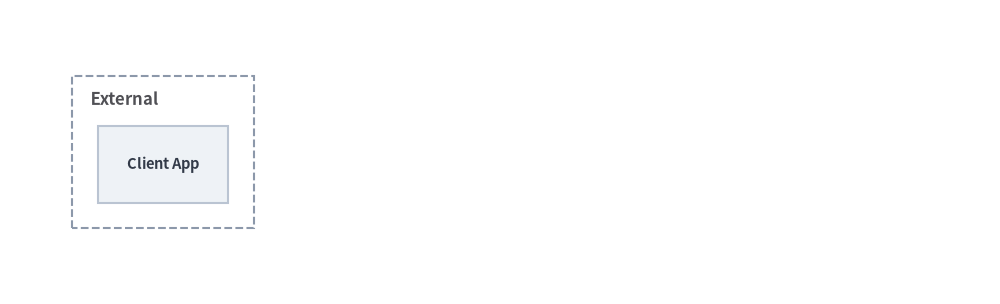
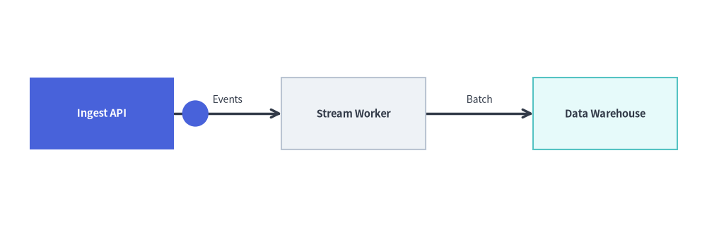

# グラフのアニメーション

[`drawlib.graph`](../07_graph/overview.md) に含まれる宣言的な 5 つの自動レイアウトグラフソルバー（`ArchitectureGraph`、`LayerGraph`、`TreeGraph`、`RadialGraph`、`GridGraph`）はすべて**純粋な座標・レイアウト計算機**であり、**パターン B（`get_layout()` で一度だけ座標を解決し、変更・アニメーション描画する）**と自然に組み合わせて使用できます。


<figure class="drawlib-image" style="text-align: center;">
  
  <figcaption class="drawlib-caption">自動レイアウトグラフのアニメーション：get_layout() で一度だけ解決・完全固定されたノード座標による段階的表示</figcaption>
</figure>

<details class="drawlib-code-details">
<summary>Source Code</summary>

```python
from drawlib.anim import Animation
from drawlib.canvas import save, setup
from drawlib.graph import TreeGraph
from drawlib.icons import phosphor
from drawlib.lines import lines
from drawlib.shapes import rectangle
from drawlib.styles import Styles

setup(width=124, height=52)
anim = Animation(fps=2.0)

# 1. Declare full tree topology once & lock 100% of coordinates via get_layout()
g = TreeGraph(
    root="gw",
    direction="LR",
    default_node_width=26.0,
    default_node_height=12.5,
)
g.node("gw")
g.child("gw", "auth")
g.child("gw", "bill")
g.child("auth", "cache")
g.child("bill", "ledger")

layout = g.get_layout(margin=5.0)

node_meta = {
    "gw": ("\nAPI Gateway", Styles.PrimaryNeutral, phosphor.shield_check),
    "auth": ("\nAuth Service", Styles.PrimaryNeutral, phosphor.lock_key),
    "bill": ("\nBilling API", Styles.SecondaryNeutral, phosphor.credit_card),
    "cache": ("\nToken Cache", Styles.Neutral, phosphor.lightning),
    "ledger": ("\nLedger DB", Styles.Neutral, phosphor.database),
}


def draw_step(visible: set[str], focal: str) -> None:
    for e in layout.edges:
        if e.src in visible and e.dst in visible:
            lines(e.points, arrow_head="->", style=Styles.DarkBold)
    for nid in visible:
        label, base_st, icon_fn = node_meta[nid]
        nl = layout[nid]
        is_focal = nid == focal
        box_st = Styles.PrimaryFlat if is_focal else base_st
        txt_st = (Styles.WhiteBold if is_focal else Styles.DarkBold).patch(text_size=10.5)
        ic_st = Styles.White if is_focal else Styles.PrimaryFlat
        rectangle(nl.xy, width=nl.width, height=nl.height, style=box_st, text=label, text_style=txt_st)
        icon_fn((nl.x, nl.y + 2.4), width=4.2, style=ic_st)


# Frame 1: Root node at its final auto-solved position
with anim.frame(duration=0.7):
    draw_step({"gw"}, focal="gw")

# Frame 2: Reveal Tier 1 services (Auth Service highlighted)
with anim.frame(duration=0.7):
    draw_step({"gw", "auth", "bill"}, focal="auth")

# Frame 3: Reveal Leaf data stores (Ledger DB highlighted)
with anim.frame(duration=0.7):
    draw_step({"gw", "auth", "bill", "cache", "ledger"}, focal="ledger")

# Frame 4: Settled full hierarchy with Root Gateway as focal node
with anim.frame(duration=2.5):
    draw_step({"gw", "auth", "bill", "cache", "ledger"}, focal="gw")

save()
```

</details>


1. **トポロジ全体の座標を一度だけ解決する (`layout = g.get_layout()`)**: アニメーションループの前にすべてのノード（`g.node()`）、クラスタ（`g.cluster()` / `g.group()`）、エッジ（`g.edge()`）を**一度だけ**登録し、`layout = g.get_layout(margin=...)` を呼び出します。
2. **ダイアグラム要素を変更するか、`edge_layout.points` に沿ってアニメーション化する**:
   - **方法 1 (`drawlib.diagrams`)**: ループの外側で `layout` の座標（`nl.xy`、`nl.local_xy`、`cl.bottom_left`）に `ArchitectureDiagram` や `FlowDiagram` のノード・グループを一度だけ配置し、`with anim.frame():` 内で `.show` や `.style` / `.card_style` を変更してから `d.draw()` を呼び出します。
   - **方法 2 (`drawlib.shapes` と `drawlib.lines`)**: 表示対象のノード（`layout[id].xy`）と折れ線（`edge_layout.points`）を描画するか、`get_intermediate_path_points()` を使って `edge_layout.points` に沿ってデータパケットを移動させます。

*（`drawlib.diagrams` の座標制御型ダイアグラムについては、[ダイアグラムのアニメーション](./diagrams.md)を参照してください。）*

---

## 1. 決定論的なレイアウト固定 (`layout = g.get_layout()`)

従来のツールで自動レイアウトグラフをアニメーション化する際の大きな課題は**レイアウトジャンプ（位置ずれ）**です。第 2 フレームでノードを追加するとレイアウトエンジンが全座標を再計算してしまい、第 1 フレームのノード位置が予期せず移動してしまいます。

Drawlib は**座標解決（`g.get_layout()`）**と**フレームごとの描画**を分離することで、このレイアウトジャンプを解消しています。
- アニメーションループの外側で `layout = g.get_layout(width=None, height=None, margin=10.0)` を**一度だけ**呼び出すことで、トポロジ全体のすべてのノード中心座標（`layout[id].xy` / `.local_xy`）、クラスタの境界ボックス（`layout[cid].bottom_left` / `.size`）、直交エッジ軌道（`edge_layout.points`）が解決・固定されます。
- `FlowDiagram` や `ArchitectureDiagram` で描画する場合、`node.show = False` を設定すると非表示ノードがスキップされると同時に**そのノードに接続されたエッジも自動的に非表示**になるため、両端のノードが表示されたタイミングでエッジが自然に現れます。

| レイアウト / ダイアグラムのプロパティ | アニメーションにおける役割 |
| :--- | :--- |
| **`layout = g.get_layout(margin=...)`** | アニメーションループ開始前に、すべてのノード・クラスタ・エッジ座標を一度だけ計算して固定します。 |
| **`node.show` / `group.show` / `edge.show`** | 配置座標を 100% 固定したまま、`layout` 座標に配置された `FlowDiagram` や `ArchitectureDiagram` 要素の表示・非表示をフレームごとに切り替えます。 |
| **`node.style` / `node.card_style` / `node.text_style`** | 新たに表示されたステップやアクティブなステップを `Styles.PrimaryFlat`（テキストは `Styles.WhiteBold`）で強調し、前のステップを `Styles.PrimaryNeutral` や `Styles.Neutral` に落ち着かせます。 |
| **`edge_layout.points`** | 自動ルーティング済みの完全な折れ線座標列（`[src_port, *waypoints, dst_port]`）。`lines(e.points)` での描画や `get_intermediate_path_points(e.points, num=...)` によるパケットアニメーションにそのまま渡せます。 |

---

## 2. パイプラインのステップバイステップ段階表示 (`LayerGraph` + `FlowDiagram`)

`LayerGraph.get_layout()` で水平方向のランク座標を一度解決した後、`FlowDiagram` 内の `xy=layout[nid].xy` に `Process` ノードを配置します。フレームループ内で `fn.show = (i <= step)` の切り替えと `fn.style` の更新を行うことで、水平レイアウトを固定したまま各パイプライン段階を順に表示できます。


```python
from drawlib.anim import Animation
from drawlib.canvas import save, setup
from drawlib.diagrams.flow import FlowDiagram, Process
from drawlib.graph import LayerGraph
from drawlib.styles import Styles

setup(width=124, height=34)
anim = Animation(fps=1.5)

# Step 1: Solve pipeline coordinates once via LayerGraph.get_layout()
g = LayerGraph(
    direction="LR",
    rank_sep=8.0,
    default_node_width=23.0,
    default_node_height=11.5,
)
stages = [
    ("edge", "Edge Router", 0),
    ("auth", "Auth Guard", 1),
    ("core", "Core API", 2),
    ("db", "Primary DB", 3),
]
for nid, _, layer_idx in stages:
    g.node(nid, layer=layer_idx)

g.edge("edge", "auth")
g.edge("auth", "core")
g.edge("core", "db")

layout = g.get_layout(margin=5.0)

# Step 2: Register Process nodes at locked layout[nid].xy coordinates
fd = FlowDiagram(
    node_style=Styles.PrimaryNeutral.patch(text_size=10.5),
    edge_style=Styles.DarkBold,
    edge_text_style=Styles.Dark.patch(text_size=10.0),
)
flow_nodes = []
for nid, label, _ in stages:
    nl = layout[nid]
    flow_nodes.append(fd.add(Process(label, width=nl.width, height=nl.height), xy=nl.xy))

for i in range(len(flow_nodes) - 1):
    fd.connect(flow_nodes[i], flow_nodes[i + 1])

# Step 3: Reveal stages one by one without layout jumping
for step in range(len(flow_nodes)):
    for i, fn in enumerate(flow_nodes):
        fn.show = (i <= step)
        fn.style = Styles.PrimaryFlat if i == step else Styles.PrimaryNeutral
        fn.text_style = (Styles.WhiteBold if i == step else Styles.DarkBold).patch(text_size=10.5)

    is_last = (step == len(flow_nodes) - 1)
    with anim.frame(duration=2.5 if is_last else 0.8):
        fd.draw()

save()
```

<figure class="drawlib-image" style="text-align: center;">
  
  <figcaption class="drawlib-caption">LayerGraph の自動レイアウト座標を FlowDiagram で段階表示するアニメーション</figcaption>
</figure>


---

## 3. クラスタとエッジの段階的表示 (`ArchitectureGraph` + `ArchitectureDiagram`)

`ArchitectureGraph` で `layout = g.get_layout()` を呼び出すと、外側コンテナの境界ボックス（`cl.bottom_left`、`cl.width`、`cl.height`）と子ノードの相対座標（`nl.local_xy`）の両方が計算されます。これらの固定座標を使って `ArchitectureDiagram` を構築することで、クラウドゾーン（`group.show`）、サービスノード（`node.show`）、アクティブなリクエスト経路（`edge.style`）を段階的に表示できます。


```python
from drawlib.anim import Animation
from drawlib.canvas import save, setup
from drawlib.diagrams.architecture import ArchitectureDiagram, Node, NodeGroup
from drawlib.graph import ArchitectureGraph
from drawlib.styles import Styles

setup(width=138, height=42)
anim = Animation(fps=1.5)

# Step 1: Solve multi-zone container and node coordinates once
g = ArchitectureGraph(
    direction="LR",
    container_sep=6.0,
    default_node_width=18.0,
    default_node_height=10.5,
)
g.cluster("ext", ["client"], pos="left", padding=3.5)
g.node("client")

g.cluster("app", ["gw", "worker"], pos="center", padding=4.0)
g.node("gw")
g.node("worker")

g.cluster("data", ["db"], pos="right", padding=3.5)
g.node("db")

g.edge("client", "gw")
g.edge("gw", "worker")
g.edge("worker", "db")

layout = g.get_layout()

# Step 2: Populate ArchitectureDiagram at solved layout coordinates
d = ArchitectureDiagram(
    node_style=Styles.PrimaryFlat,
    node_text_style=Styles.DarkBold.patch(text_size=10.5),
    edge_style=Styles.DarkBold,
    edge_text_style=Styles.Dark.patch(text_size=10.0),
    node_card_style=Styles.Neutral,
)


def make_group(cid: str, title: str, *, show: bool = True) -> NodeGroup:
    cl = layout.clusters[cid]
    return d.add(
        NodeGroup(title=title, width=cl.width, height=cl.height, style=Styles.MutedDashed, show=show),
        xy=cl.bottom_left,
    )


def make_node(grp: NodeGroup, nid: str, label: str, card_st, txt_st, *, show: bool = True) -> Node:
    nl = layout[nid]
    return grp.add(
        Node(
            label,
            width=nl.width,
            height=nl.height,
            card_style=card_st,
            text_style=txt_st.patch(text_size=10.5),
            show=show,
        ),
        xy=nl.local_xy,
    )


c_ext = make_group("ext", "External", show=True)
n_client = make_node(c_ext, "client", "Client App", Styles.Neutral, Styles.DarkBold, show=True)

c_app = make_group("app", "Compute VPC", show=False)
n_gw = make_node(c_app, "gw", "API Gateway", Styles.PrimaryFlat, Styles.WhiteBold, show=False)
n_worker = make_node(c_app, "worker", "Task Worker", Styles.PrimaryNeutral, Styles.DarkBold, show=False)

c_data = make_group("data", "Data Tier", show=False)
n_db = make_node(c_data, "db", "Primary DB", Styles.SecondaryNeutral, Styles.DarkBold, show=False)

e1 = d.connect(n_client, n_gw, label="HTTPS")
e2 = d.connect(n_gw, n_worker, label="Queue")
e3 = d.connect(n_worker, n_db, label="Write")

# Frame 1: External Client entry point
with anim.frame(duration=0.8):
    d.draw()

# Frame 2: Reveal Compute VPC & API Gateway with active incoming edge
c_app.show = True
n_gw.show = True
e1.style = Styles.PrimaryBold
with anim.frame(duration=0.8):
    d.draw()

# Frame 3: Reveal Task Worker inside Compute VPC
e1.style = Styles.DarkBold
n_gw.card_style = Styles.PrimaryNeutral
n_gw.text_style = Styles.DarkBold.patch(text_size=10.5)
n_worker.show = True
n_worker.card_style = Styles.PrimaryFlat
n_worker.text_style = Styles.WhiteBold.patch(text_size=10.5)
e2.style = Styles.PrimaryBold
with anim.frame(duration=0.8):
    d.draw()

# Frame 4: Reveal Data Tier and complete architecture (hold final frame)
e2.style = Styles.DarkBold
n_worker.card_style = Styles.PrimaryNeutral
n_worker.text_style = Styles.DarkBold.patch(text_size=10.5)
c_data.show = True
n_db.show = True
n_gw.card_style = Styles.PrimaryFlat
n_gw.text_style = Styles.WhiteBold.patch(text_size=10.5)
e3.style = Styles.PrimaryBold
with anim.frame(duration=2.5):
    d.draw()

save()
```

<figure class="drawlib-image" style="text-align: center;">
  
  <figcaption class="drawlib-caption">ArchitectureGraph + ArchitectureDiagram によるクラスタ・ノード・エッジの段階的表示</figcaption>
</figure>


---

## 4. 自動ルーティングされたエッジ上のパケットアニメーション (`g.get_layout()` と `edge_layout.points`)

`layout.edges` 内の各 `EdgeLayout` は、ノード境界間を結ぶ自動ルーティング済みの完全な折れ線軌道を表す `edge_layout.points: list[tuple[float, float]]`（`[src_port, *waypoints, dst_port]`）を公開しています。

`edge_layout.points` を `get_intermediate_path_points(edge_layout.points, num=..., include_ends=True)` に渡すことで、自動ルーティングされたグラフエッジに沿って滑らかに移動するデータパケット（`circle`）をアニメーション化できます。


```python
from drawlib.anim import Animation
from drawlib.canvas import save, setup
from drawlib.graph import LayerGraph
from drawlib.lines import lines
from drawlib.math import get_intermediate_path_points
from drawlib.shapes import circle, rectangle
from drawlib.styles import Styles
from drawlib.text import text

setup(width=118, height=38)
anim = Animation(fps=10.0)

g = LayerGraph(
    direction="LR",
    default_node_width=24.0,
    default_node_height=12.0,
)
g.node("ingest", layer=0)
g.node("worker", layer=1)
g.node("store", layer=2)
g.edge("ingest", "worker")
g.edge("worker", "store")

# 1. Solve layout once to inspect auto-routed edge polylines
layout = g.get_layout(margin=5.0)
pts_e0 = get_intermediate_path_points(layout.edges[0].points, num=4, include_ends=False)
pts_e1 = get_intermediate_path_points(layout.edges[1].points, num=4, include_ends=False)

edge_labels = {("ingest", "worker"): "Events", ("worker", "store"): "Batch"}
base_nodes = [
    ("ingest", "Ingest API", Styles.PrimaryNeutral),
    ("worker", "Stream Worker", Styles.Neutral),
    ("store", "Data Warehouse", Styles.SecondaryNeutral),
]


def draw_pipeline(active_id: str | None = None) -> None:
    for e in layout.edges:
        lines(e.points, arrow_head="->", style=Styles.DarkBold)
        lbl = edge_labels[(e.src, e.dst)]
        text((e.mid_xy[0], e.mid_xy[1] + 2.4), lbl, style=Styles.Dark.patch(text_size=10.0))
    for nid, label, base_st in base_nodes:
        nl = layout[nid]
        is_active = nid == active_id
        st = Styles.PrimaryFlat if is_active else base_st
        tst = (Styles.WhiteBold if is_active else Styles.DarkBold).patch(text_size=10.5)
        rectangle(nl.xy, width=nl.width, height=nl.height, style=st, text=label, text_style=tst)


# 2. Hop 1: Packet travels along layout.edges[0].points
for pkt_xy in pts_e0:
    with anim.frame(duration=0.12):
        draw_pipeline(active_id="ingest")
        circle(pkt_xy, radius=2.2, style=Styles.PrimaryFlat)

# 3. Hop 2: Highlight worker and move packet along layout.edges[1].points
for pkt_xy in pts_e1:
    with anim.frame(duration=0.12):
        draw_pipeline(active_id="worker")
        circle(pkt_xy, radius=2.2, style=Styles.PrimaryFlat)

# 4. Final settled frame: Data Warehouse active
with anim.frame(duration=2.2):
    draw_pipeline(active_id="store")

save()
```

<figure class="drawlib-image" style="text-align: center;">
  
  <figcaption class="drawlib-caption">layout = g.get_layout() と edge_layout.points を用いた自動ルーティングエッジ上のデータパケット移動</figcaption>
</figure>


