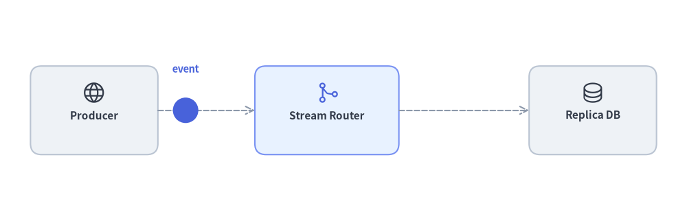
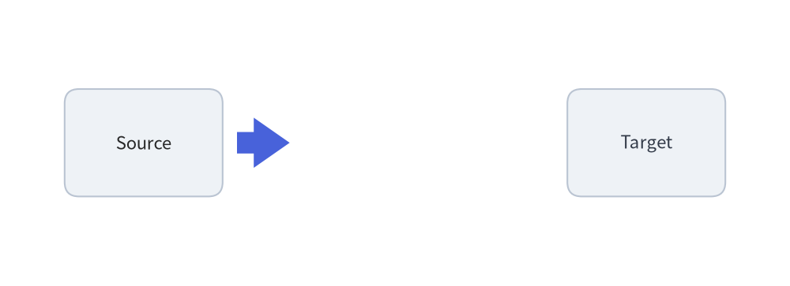
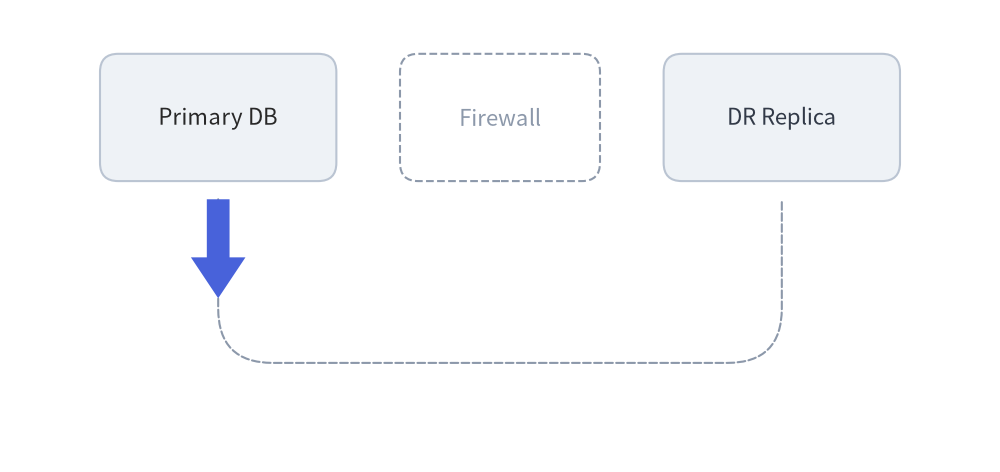
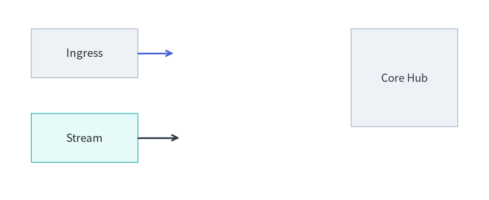
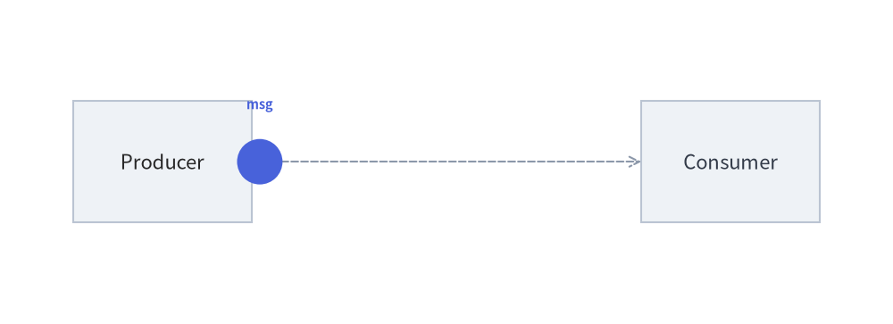
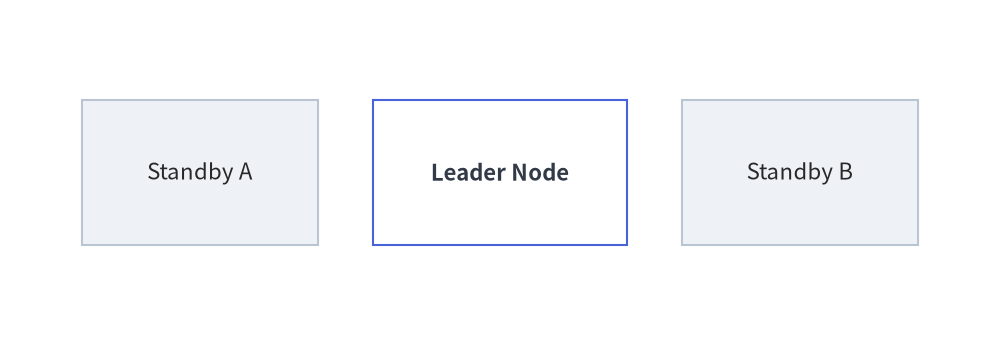
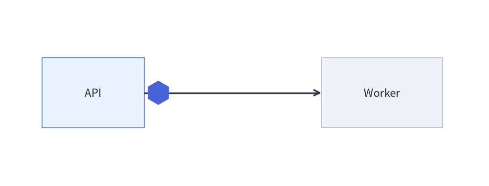

# プリミティブと色のアニメーション

低レベルの描画プリミティブ（`drawlib.shapes`、`drawlib.lines`、`drawlib.text`、`drawlib.icons`）は、キャンバスへ直接描画するステートレスな関数です。これらをアニメーション化するには、`with anim.frame():` のデフォルトである `clear=True` を用いた**パターン A（フレーム内構築）**を採用し、ループ内でフレームごとの座標・サイズ・スタイルを計算して描画します。


<figure class="drawlib-image" style="text-align: center;">
  
  <figcaption class="drawlib-caption">マルチフレームのプリミティブアニメーション：軌道移動・カラーフェード・動的スケーリング</figcaption>
</figure>

<details class="drawlib-code-details">
<summary>Source Code</summary>

```python
from drawlib.anim import Animation
from drawlib.canvas import save, setup
from drawlib.icons import phosphor
from drawlib.lines import line
from drawlib.math import get_intermediate_points
from drawlib.shapes import arrow, circle, rectangle
from drawlib.styles import Colors, Styles, get_intermediate_colors
from drawlib.text import text

setup(width=124, height=40)
anim = Animation(fps=10.0)

pkt_points = get_intermediate_points((33.5, 20), (43.5, 20), num=3, include_ends=True)
arrow_tips = [*get_intermediate_points((73, 20), (93, 20), num=3), (93, 20)]
fade_colors = get_intermediate_colors(Colors.White, Colors.Primary, num=3, include_ends=True)
scales = [1.0, 1.05, 1.10, 1.05, 1.0]

# Phase 1: Packet travels from Producer to Router
for pkt_xy in pkt_points:
    with anim.frame(duration=0.11):
        rectangle((17, 20), width=23, height=16, style=Styles.Neutral.patch(shape_r=2.0), text="\nProducer", text_style=Styles.DarkBold.patch(text_size=11.0))
        phosphor.globe((17, 23.2), width=4.4, style=Styles.Dark)
        rectangle((59, 20), width=26, height=16, style=Styles.PrimaryNeutral.patch(shape_r=2.0), text="\nStream Router", text_style=Styles.DarkBold.patch(text_size=11.0))
        phosphor.git_merge((59, 23.2), width=4.4, style=Styles.Primary)
        rectangle((107, 20), width=23, height=16, style=Styles.Neutral.patch(shape_r=2.0), text="\nReplica DB", text_style=Styles.DarkBold.patch(text_size=11.0))
        phosphor.database((107, 23.2), width=4.4, style=Styles.Dark)
        line((28.5, 20), (46, 20), style=Styles.MutedDashed, arrow_head="->")
        line((72, 20), (95.5, 20), style=Styles.MutedDashed, arrow_head="->")
        circle(pkt_xy, radius=2.3, style=Styles.PrimaryFlat)
        text((pkt_xy[0], 27.5), "event", style=Styles.PrimaryBold.patch(text_size=10.5))

# Phase 2: Block arrow grows from Router to Replica DB
for tip_xy in arrow_tips:
    with anim.frame(duration=0.11):
        rectangle((17, 20), width=23, height=16, style=Styles.Neutral.patch(shape_r=2.0), text="\nProducer", text_style=Styles.DarkBold.patch(text_size=11.0))
        phosphor.globe((17, 23.2), width=4.4, style=Styles.Dark)
        rectangle((59, 20), width=26, height=16, style=Styles.PrimaryNeutral.patch(shape_r=2.0), text="\nStream Router", text_style=Styles.DarkBold.patch(text_size=11.0))
        phosphor.git_merge((59, 23.2), width=4.4, style=Styles.Primary)
        rectangle((107, 20), width=23, height=16, style=Styles.Neutral.patch(shape_r=2.0), text="\nReplica DB", text_style=Styles.DarkBold.patch(text_size=11.0))
        phosphor.database((107, 23.2), width=4.4, style=Styles.Dark)
        line((28.5, 20), (46, 20), style=Styles.DarkBold, arrow_head="->")
        arrow((73, 20), tip_xy, tail_width=2.6, head_width=6.0, head_length=4.5, style=Styles.PrimaryFlat)

# Phase 3: Replica DB scales and smoothly fades into Primary active state
for i, (bg, sc) in enumerate(zip(fade_colors, scales)):
    is_last = (i == len(fade_colors) - 1)
    with anim.frame(duration=2.0 if is_last else 0.12):
        rectangle((17, 20), width=23, height=16, style=Styles.Neutral.patch(shape_r=2.0), text="\nProducer", text_style=Styles.DarkBold.patch(text_size=11.0))
        phosphor.globe((17, 23.2), width=4.4, style=Styles.Dark)
        rectangle((59, 20), width=26, height=16, style=Styles.PrimaryNeutral.patch(shape_r=2.0), text="\nStream Router", text_style=Styles.DarkBold.patch(text_size=11.0))
        phosphor.git_merge((59, 23.2), width=4.4, style=Styles.Primary)
        line((28.5, 20), (46, 20), style=Styles.DarkBold, arrow_head="->")
        arrow((73, 20), (93, 20), tail_width=2.6, head_width=6.0, head_length=4.5, style=Styles.PrimaryFlat)
        dst_style = Styles.PrimaryOutline.patch(shape_fill_color=bg, shape_r=2.0)
        dst_text = (Styles.WhiteBold if i >= 2 else Styles.DarkBold).patch(text_size=11.0)
        ic_style = Styles.White if i >= 2 else Styles.Dark
        rectangle(
            (107, 20),
            width=23 * sc,
            height=16 * sc,
            style=dst_style,
            text="\nReplica DB",
            text_style=dst_text,
        )
        phosphor.database((107, 23.2), width=4.4 * sc, style=ic_style)
        if is_last:
            text((83, 28.0), "Synced", style=Styles.PrimaryBold.patch(text_size=10.5))

save()
```

</details>


---

## 1. 座標・パス補間 (`get_intermediate_points` と `get_intermediate_paths`)

直線セグメントや複数頂点からなる軌道（L 字型・U 字型パスなど）に沿って図形を移動させたり、ブロック矢印や折れ線を段階的に伸ばしたりするには、`drawlib.math` の純粋な座標・パス補間ヘルパー関数を使用します。

```python
from drawlib.math import (
    get_intermediate_path_point,
    get_intermediate_path_points,
    get_intermediate_paths,
    get_intermediate_point,
    get_intermediate_points,
)
```

| 関数 | シグネチャ | 説明 |
| :--- | :--- | :--- |
| **`get_intermediate_point`** | `(xy1: Coordinate, xy2: Coordinate) -> tuple[float, float]` | `xy1` と `xy2` のちょうど 50% の中間点 `(mx, my)` を 1 つ返します。 |
| **`get_intermediate_points`** | `(xy1: Coordinate, xy2: Coordinate, num: int = 1, *, include_ends: bool = False) -> list[tuple[float, float]]` | `xy1` から `xy2` までの線分上に等間隔に並んだ `num` 個の中間点 `(x, y)` を返します。`include_ends=True` を指定すると `[xy1, ..., xy2]`（合計 `num + 2` 点）を返します。 |
| **`get_intermediate_path_point`** | `(xys: Coordinates) -> tuple[float, float]` | 複数頂点の折れ線 `xys` に沿った全弧長の 50% 位置にあたる座標を返します（U 字型パスの底辺中央など）。 |
| **`get_intermediate_path_points`** | `(xys: Coordinates, num: int = 1, *, include_ends: bool = False) -> list[tuple[float, float]]` | `xys` の弧長に沿って等間隔に並んだ `num` 個の `(x, y)` 座標を返します（`include_ends=True` の場合は合計 `num + 2` 点）。 |
| **`get_intermediate_paths`** | `(xys: Coordinates, num: int = 1, *, include_ends: bool = False) -> list[list[tuple[float, float]]]` | `xys` に沿って段階的に伸びる `num` 個のプレフィックス部分パス `[(x0, y0), ..., (xt, yt)]` を返します（`include_ends=True` の場合は末尾に完全なパス `xys` を追加）。`lines()`、`lines_curved()`、`arrow_polyline()` にそのまま渡せます。 |

### 伸びるブロック矢印のアニメーション (`arrow`)
`start_xy` から `end_xy` までの中間先端座標を順に走査することで、フレーム間でブロック矢印を滑らかに伸ばすことができます。


```python
from drawlib.anim import Animation
from drawlib.canvas import save, setup
from drawlib.math import get_intermediate_points
from drawlib.shapes import arrow, rectangle
from drawlib.styles import Styles
from drawlib.text import text

setup(width=110, height=40)
anim = Animation(fps=10.0)

start_xy = (33, 20)
end_xy = (77, 20)
tip_points = [*get_intermediate_points(start_xy, end_xy, num=5), end_xy]

for i, tip_xy in enumerate(tip_points):
    is_last = (i == len(tip_points) - 1)
    with anim.frame(duration=1.8 if is_last else 0.12):
        rectangle((20, 20), width=22, height=15, style=Styles.Neutral.patch(shape_r=2), text="Source")
        dst_style = Styles.PrimaryFlat if is_last else Styles.Neutral
        dst_text = Styles.WhiteBold if is_last else Styles.Dark
        rectangle((90, 20), width=22, height=15, style=dst_style.patch(shape_r=2), text="Target", text_style=dst_text)

        arrow(
            start_xy,
            tip_xy,
            tail_width=3.0,
            head_width=7.0,
            head_length=5.0,
            style=Styles.PrimaryFlat,
        )
        if is_last:
            text((55, 28), "Replicated", style=Styles.PrimaryBold.patch(text_size=10.5))

save()
```

<figure class="drawlib-image" style="text-align: center;">
  
  <figcaption class="drawlib-caption">get_intermediate_points() を使って段階的に伸びるブロック矢印</figcaption>
</figure>


### 伸びる U 字型折れ線矢印のアニメーション (`get_intermediate_paths` と `get_intermediate_path_point`)
L 字型や U 字型の経路では、`get_intermediate_paths(u_path, num=..., include_ends=True)` を使うことで通過済みのすべての角（コーナー）を維持した段階的な部分折れ線を生成でき、`get_intermediate_path_point(u_path)` によって軌道に沿った真の中間点を算出できます。


```python
from drawlib.anim import Animation
from drawlib.canvas import save, setup
from drawlib.lines import lines_curved
from drawlib.math import get_intermediate_path_point, get_intermediate_paths
from drawlib.shapes import arrow_polyline, rectangle
from drawlib.styles import Styles
from drawlib.text import text

setup(width=110, height=52)
anim = Animation(fps=12.0)

u_path = [(24, 30), (24, 12), (86, 12), (86, 30)]
mid_xy = get_intermediate_path_point(u_path)
sub_paths = get_intermediate_paths(u_path, num=8, include_ends=True)

for i, sub_xys in enumerate(sub_paths):
    is_last = (i == len(sub_paths) - 1)
    with anim.frame(duration=1.8 if is_last else 0.12):
        # Guide track & service cards
        lines_curved(u_path, r=6, style=Styles.MutedDashed)
        rectangle((24, 39), width=26, height=14, style=Styles.Neutral.patch(shape_r=2), text="Primary DB")
        rectangle((55, 39), width=22, height=14, style=Styles.MutedDashed.patch(shape_r=2), text="Firewall")
        dst_style = Styles.PrimaryFlat if is_last else Styles.Neutral
        dst_text = Styles.WhiteBold if is_last else Styles.Dark
        rectangle((86, 39), width=26, height=14, style=dst_style.patch(shape_r=2), text="DR Replica", text_style=dst_text)

        # Growing U-shaped arrow with rounded corners
        arrow_polyline(
            sub_xys,
            tail_width=2.5,
            head_width=6.0,
            head_length=4.5,
            style=Styles.PrimaryFlat.patch(shape_r=6),
        )
        if is_last:
            text((mid_xy[0], mid_xy[1] + 5.5), "Bypass Tunnel", style=Styles.PrimaryBold.patch(text_size=10.5))

save()
```

<figure class="drawlib-image" style="text-align: center;">
  
  <figcaption class="drawlib-caption">段階的に伸びる U 字型矢印と軌道中間点ラベル</figcaption>
</figure>


### プリミティブな線の段階的描画 (`line`, `lines`, `lines_curved`)
同じ補間関数は `drawlib.lines` のプリミティブな線コネクタにもそのまま適用できます。
- **直線 `line(start_xy, tip_xy, arrow_head="->")`**: `tip_xy` を `[*get_intermediate_points(start_xy, end_xy, num=5), end_xy]` に沿って走査することで、線と `"->"` の矢印先端をターゲットへ向かって滑らかに伸ばせます。
- **複数セグメント折れ線 `lines(sub_xys, arrow_head="->")` または `lines_curved(sub_xys, r=..., arrow_head="->")`**: `sub_xys` を `get_intermediate_paths(full_path, num=8, include_ends=True)` に沿って走査することで、屈曲部を含む直交コネクタや角丸コネクタを段階的に描画できます。


```python
from drawlib.anim import Animation
from drawlib.canvas import save, setup
from drawlib.lines import line, lines_curved
from drawlib.math import get_intermediate_paths, get_intermediate_points
from drawlib.shapes import rectangle
from drawlib.styles import Styles

setup(width=110, height=45)
anim = Animation(fps=12.0)

# 1. Straight line growing from (31, 33) to (79, 33)
straight_tips = get_intermediate_points((31, 33), (79, 33), num=5, include_ends=True)[1:]

# 2. Multi-segment curved line growing along an orthogonal Z-bend path
curved_path = [(31, 14), (55, 14), (55, 22), (79, 22)]
curved_subpaths = get_intermediate_paths(curved_path, num=5, include_ends=True)

for i, (tip_xy, sub_path) in enumerate(zip(straight_tips, curved_subpaths)):
    is_last = (i == len(straight_tips) - 1)
    with anim.frame(duration=2.0 if is_last else 0.1):
        rectangle((19, 33), width=24, height=11, style=Styles.Neutral, text="Ingress")
        rectangle((19, 14), width=24, height=11, style=Styles.SecondaryNeutral, text="Stream")

        dst_style = Styles.PrimaryFlat if is_last else Styles.Neutral
        dst_text = Styles.WhiteBold if is_last else Styles.Dark
        rectangle((91, 27.5), width=24, height=22, style=dst_style, text="Core Hub", text_style=dst_text)

        line((31, 33), tip_xy, arrow_head="->", style=Styles.PrimaryBold)
        lines_curved(sub_path, r=4.0, arrow_head="->", style=Styles.DarkBold)

save()
```

<figure class="drawlib-image" style="text-align: center;">
  
  <figcaption class="drawlib-caption">フレームごとに段階的に伸びる直線および角丸折れ線コネクタ</figcaption>
</figure>


### 線に沿って移動するパケットのアニメーション


```python
from drawlib.anim import Animation
from drawlib.canvas import save, setup
from drawlib.lines import line
from drawlib.math import get_intermediate_points
from drawlib.shapes import circle, rectangle
from drawlib.styles import Styles
from drawlib.text import text

setup(width=110, height=40)
anim = Animation(fps=10.0)

pts = get_intermediate_points((32, 20), (77, 20), num=4, include_ends=True)

for i, pkt_xy in enumerate(pts):
    is_last = (i == len(pts) - 1)
    with anim.frame(duration=1.8 if is_last else 0.12):
        # Static baseline endpoints
        rectangle((20, 20), width=22, height=15, style=Styles.Neutral, text="Producer")
        recv_style = Styles.PrimaryFlat if is_last else Styles.Neutral
        recv_text = Styles.WhiteBold if is_last else Styles.Dark
        rectangle((90, 20), width=22, height=15, style=recv_style, text="Consumer", text_style=recv_text)

        # Wire and moving packet
        line((31, 20), (79, 20), style=Styles.MutedDashed, arrow_head="->")
        if not is_last:
            circle(pkt_xy, radius=2.8, style=Styles.PrimaryFlat)
            text((pkt_xy[0], 27), "msg", style=Styles.PrimaryBold.patch(text_size=10.5))

save()
```

<figure class="drawlib-image" style="text-align: center;">
  
  <figcaption class="drawlib-caption">サービス間のパケット送信アニメーション</figcaption>
</figure>


---

## 2. 滑らかな色補間 (`get_intermediate_color` と `get_intermediate_colors`)

フレーム間で図形の塗りつぶし色・枠線色・テキスト色を**色 A** から**色 B** へと滑らかに変化させたい場合は、`drawlib.styles`（`drawlib.preset_colors` からも利用可能）の色補間ヘルパー関数を使用します。

```python
from drawlib.styles import Colors, get_intermediate_color, get_intermediate_colors
```

| 関数 | シグネチャ | 説明 |
| :--- | :--- | :--- |
| **`get_intermediate_color`** | `(color1: ColorType, color2: ColorType) -> Color` | `color1` と `color2` のちょうど 50% の中間色 `Color` を 1 つ返します（`get_intermediate_colors(color1, color2, num=1)[0]` のラッパー）。 |
| **`get_intermediate_colors`** | `(color1: ColorType, color2: ColorType, num: int = 1, *, include_ends: bool = False) -> list[Color]` | RGBA 色空間において等間隔に補間された `num` 個の中間 `Color` オブジェクトを返します。`include_ends=True` を指定すると `[color1, ..., color2]`（合計 `num + 2` 色）を返します。 |

どちらの関数も任意の `ColorType`（`Color` インスタンス、`(R, G, B)` / `(R, G, B, A)` タプル、または `"#3B82F6"` のような 16 進カラーコード文字列）を受け付けます。

### `Style.patch()` を使ったスタイルフェードのアニメーション
ループの前に `include_ends=True` を指定して色シーケンスを一度生成し、各フレームの色を `.patch(shape_fill_color=bg)` で適用します。


```python
from drawlib.anim import Animation
from drawlib.canvas import save, setup
from drawlib.shapes import rectangle
from drawlib.styles import Colors, Styles, get_intermediate_colors

setup(width=110, height=38)
anim = Animation(fps=10.0)

# Generate 7 colors from White -> Primary (including both endpoints)
fade_in = get_intermediate_colors(Colors.White, Colors.Primary, num=5, include_ends=True)

for i, bg_color in enumerate(fade_in):
    is_last = (i == len(fade_in) - 1)
    with anim.frame(duration=2.0 if is_last else 0.12):
        # Static neutral peers
        rectangle((22, 19), width=26, height=16, style=Styles.Neutral, text="Standby A")
        rectangle((88, 19), width=26, height=16, style=Styles.Neutral, text="Standby B")

        # Hero node smoothly fading from White to Primary
        active_style = Styles.PrimaryOutline.patch(shape_fill_color=bg_color)
        active_text = Styles.WhiteBold if i >= 3 else Styles.DarkBold
        rectangle((55, 19), width=28, height=16, style=active_style, text="Leader Node", text_style=active_text)

save()
```

<figure class="drawlib-image" style="text-align: center;">
  
  <figcaption class="drawlib-caption">get_intermediate_colors() による滑らかな色補間アニメーション</figcaption>
</figure>


---

## 3. 移動・スケーリング・回転・色変化の組み合わせ

座標補間（`get_intermediate_points()`）、動的な幾何スケーリング（`width`、`height`、`radius`）、回転（`Style.patch(angle=...)`）、滑らかな色変化（`get_intermediate_colors()`）を組み合わせることで、マルチフェーズのアニメーションを構築できます。たとえば、リンク上でペイロードトークンを回転・移動させたのち、受信側ノードの幅と高さをパルス状に拡大縮小しながらアクティブ色へフェードインさせる表現が可能です。


```python
from drawlib.anim import Animation
from drawlib.canvas import save, setup
from drawlib.lines import line
from drawlib.shapes import rectangle, regularpolygon
from drawlib.styles import Colors, Styles, get_intermediate_colors

setup(width=105, height=40)
anim = Animation(fps=10.0)

packet_xs = [34, 44, 54, 64]
packet_angles = [0, 30, 60, 90]
packet_radii = [2.6, 3.0, 3.4, 3.0]
fade_colors = get_intermediate_colors(Colors.White, Colors.Primary, num=3, include_ends=True)
scale_factors = [1.0, 1.06, 1.12, 1.06, 1.0]

# Phase 1: Rotating & scaling hexagon token travels from API to Worker
for pkt_x, ang, rad in zip(packet_xs, packet_angles, packet_radii):
    with anim.frame(duration=0.1):
        rectangle((20, 20), width=22, height=15, style=Styles.PrimaryNeutral, text="API")
        rectangle((82, 20), width=26, height=15, style=Styles.Neutral, text="Worker")
        line((31, 20), (69, 20), style=Styles.DarkBold, arrow_head="->")
        regularpolygon((pkt_x, 20), radius=rad, num_vertex=6, style=Styles.PrimaryFlat.patch(angle=ang))

# Phase 2: Worker pulses in scale (width/height) while smoothly transitioning from White to Primary
for i, (bg, s) in enumerate(zip(fade_colors, scale_factors)):
    is_last = (i == len(fade_colors) - 1)
    with anim.frame(duration=2.0 if is_last else 0.12):
        rectangle((20, 20), width=22, height=15, style=Styles.PrimaryNeutral, text="API")
        worker_style = Styles.PrimaryOutline.patch(shape_fill_color=bg)
        worker_text = Styles.WhiteBold if i >= 2 else Styles.DarkBold
        rectangle(
            (82, 20),
            width=26 * s,
            height=15 * s,
            style=worker_style,
            text="Worker",
            text_style=worker_text,
        )
        line((31, 20), (69, 20), style=Styles.DarkBold, arrow_head="->")

save()
```

<figure class="drawlib-image" style="text-align: center;">
  
  <figcaption class="drawlib-caption">移動・回転 (angle)・スケーリング (width/height)・色変化を組み合わせたアニメーション</figcaption>
</figure>


