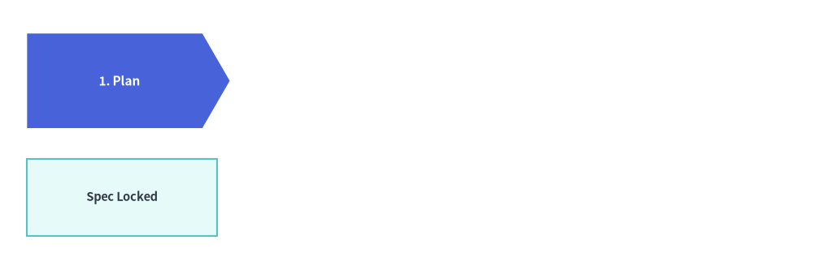
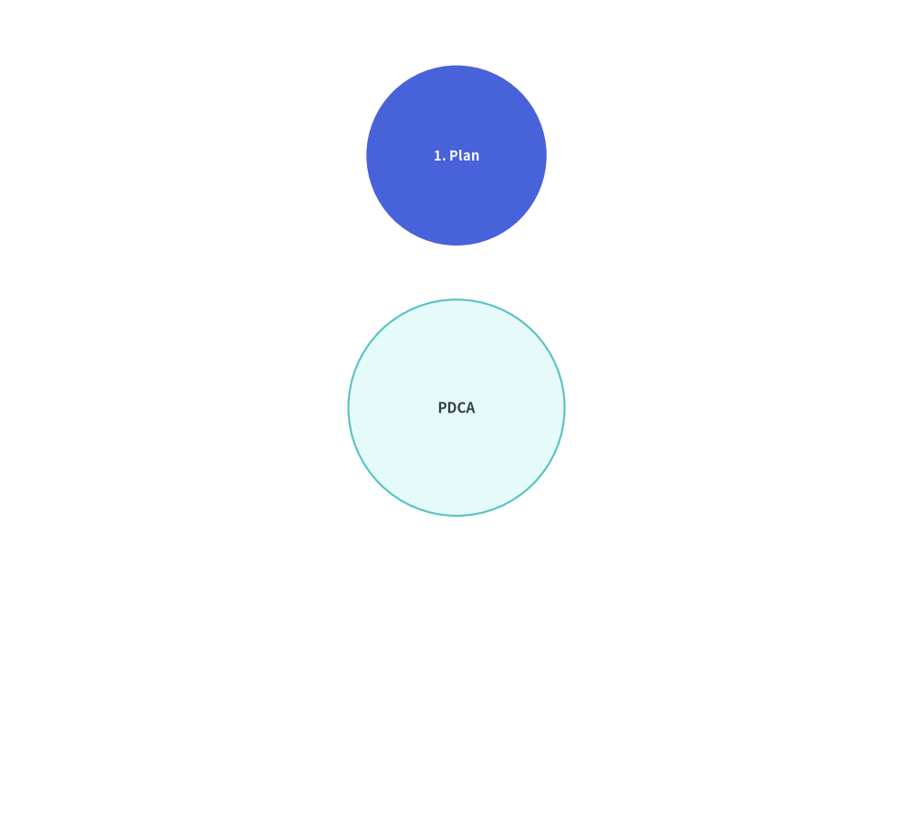
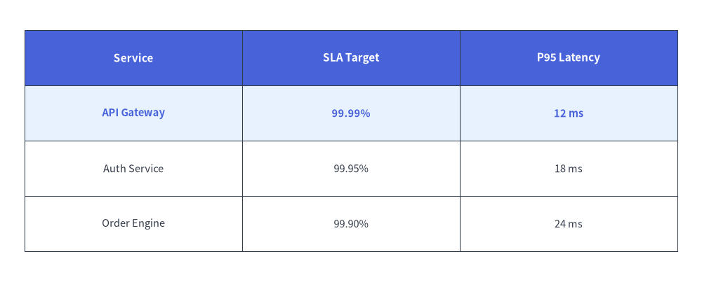

# SmartArts のアニメーション

アイテムベースのすべての SmartArt コンポーネント（`ChevronProcess`、`Cycle`、`GridLayout`、`Pyramid`、`BoxList`、`BulletPoints`、`TreeNode`、`MindMapNode`）は、統一された**事前構築・フレーム内変更（Pre-Build & Mutate）**ライフサイクルに従います。


<figure class="drawlib-image" style="text-align: center;">
  
  <figcaption class="drawlib-caption">SmartArt アニメーション概要：レイアウトのずれを発生させない段階的表示とアクティブ強調</figcaption>
</figure>

<details class="drawlib-code-details">
<summary>Source Code</summary>

```python
from drawlib.anim import Animation
from drawlib.canvas import save, setup
from drawlib.smartarts import BoxList, ChevronProcess
from drawlib.styles import Styles

setup(width=120, height=40)
anim = Animation(fps=2.0)

proc = ChevronProcess(
    style=Styles.Neutral,
    text_style=Styles.DarkBold.patch(text_size=11.0),
    description_style=Styles.Dark,
    flat_left_end=True,
)
chev_items = [
    proc.add("1. Plan"),
    proc.add("2. Build"),
    proc.add("3. Verify"),
    proc.add("4. Deploy"),
]

cards = BoxList(
    style=Styles.Neutral,
    text_style=Styles.Dark.patch(text_size=10.5),
)
box_items = [
    cards.add("Spec Locked"),
    cards.add("Artifact Built"),
    cards.add("Checks Green"),
    cards.add("Prod Live"),
]

for step in range(len(chev_items)):
    for i, (c_item, b_item) in enumerate(zip(chev_items, box_items)):
        is_visible = (i <= step)
        is_active = (i == step)
        c_item.show = is_visible
        b_item.show = is_visible
        c_item.style = Styles.PrimaryFlat if is_active else Styles.PrimaryNeutral
        c_item.text_style = Styles.WhiteBold.patch(text_size=11.0) if is_active else Styles.DarkBold.patch(text_size=11.0)
        b_item.style = Styles.SecondaryNeutral if is_active else Styles.Neutral
        b_item.text_style = Styles.DarkBold.patch(text_size=10.5) if is_active else Styles.Dark.patch(text_size=10.5)

    is_last = (step == len(chev_items) - 1)
    with anim.frame(duration=2.5 if is_last else 0.7):
        proc.draw(xy=(4.0, 21.0), width=112.0, height=14.0)
        cards.draw(xy=(4.0, 5.0), box_width=28.0, box_height=11.5, align="bottom_left")

save()
```

</details>


1. ループの外側でコンポーネントをインスタンス化し、`item = comp.add(..., show=...)` によってすべてのアイテムを**一度だけ**登録します。
2. `with anim.frame():` の内部で `item.show`、`item.style`、`item.text_style` などを変更し、`comp.draw(xy=..., scale=1.0)` を呼び出します。

---

## 1. ミュータブルなアイテムクラス・`item.show = False`・比例スケーリング (`scale=1.0`)

アイテムベースのすべての SmartArt は `.add(..., show=True)` からミュータブル（変更可能）なアイテムモデルを返します（また `cycle.center` は `CycleCenter` を公開します）。これにより、`draw(..., scale=1.0)` や `draw_flexible(..., scale=1.0)` を呼び出す前に、フレームごとに表示状態・スタイル・テキストを変更できます。

| SmartArt コンポーネント | 返されるアイテムクラス | 変更可能な属性 | 描画メソッドと `scale` サポート |
| :--- | :--- | :--- | :--- |
| **`ChevronProcess`** | `ChevronItem` | `.show`, `.style`, `.text_style`, `.description_style`, `.text`, `.description` | `draw(xy, width, height, scale=1.0)` |
| **`Cycle`** | `CycleItem`, `CycleCenter` (`cycle.center`) | `.show`, `.style`, `.text_style`, `.description_style`, `.arrow_style`, `.text`, `.description` | `draw(xy, radius, align="center", scale=1.0)` |
| **`GridLayout`** | `GridItem` | `.show`, `.style`, `.text_style`, `.text`, `.position`, `.width`, `.height` | `draw(xy, width, height, margin, scale=1.0)`, `draw_flexible(..., scale=1.0)` |
| **`Pyramid`** | `PyramidItem` | `.show`, `.style`, `.text_style`, `.text` | `draw(xy, width, height, margin, scale=1.0)`, `draw_flexible(..., scale=1.0)` |
| **`BoxList`** | `BoxListItem` | `.show`, `.style`, `.text_style`, `.text` | `draw(xy, box_width, box_height, margin, direction, scale=1.0)` |
| **`BulletPoints`** | `BulletPointItem` | `.show`, `.style`（`.text_style` のエイリアス）, `.text_style`, `.text`, `.indent` | `draw(xy, scale=1.0)` |
| **`TreeNode`** | `TreeNode` | `.show`, `.text_style`, `.line_style`, `.text` | `draw(xy, scale=1.0)` |
| **`MindMapNode`** | `MindMapNode` | `.show`, `.style`, `.text_style`, `.line_style`, `.text` | `draw(xy, branch=..., scale=1.0)` |
| **`Table`** | *（ステートフルな `Table`）* | `reset_styles()`, `set_style_cell(..., rows=..., columns=...)` | `draw(xy, width, height, data, scale=1.0)`, `draw_flexible(..., scale=1.0)` |

どの SmartArt アイテムでも、`item.show = False` を設定すると次のように動作します。
- 非表示のアイテムも**自身の空間スロット（シェブロンの幅、円周上の角度、グリッドセル、ピラミッドの階層、ツリーの行）を正確に確保し続けます**。
- `item.show = (i <= step)` によってアイテムを 1 つずつ段階的に表示しても、すでに表示されているアイテムの位置がずれたりサイズが変わったりすることはありません。
- `draw(..., scale=s)` や `draw_flexible(..., scale=s)` に `scale != 1.0` を渡すと、アンカー座標 `xy` を基準としてすべての図形・余白・線幅・フォントサイズが均一にスケーリングされます。

---

## 2. リニアパイプラインとサイクル (`ChevronProcess`, `Cycle`)

ループの外側で `ChevronProcess` または `Cycle` を一度だけ構築し、返された `ChevronItem` や `CycleItem` オブジェクトのリスト（放射状サイクルの場合は `cycle.center`（`CycleCenter`）も含む）を保持して、フレームごとに `.show`、`.style`、`.text_style` を変更します。`Cycle` では、非表示のステップ（`item.show = False`）も円周上の配置角度を維持し、そのステップから出る接続矢印も自動的に非表示になります。


```python
from drawlib.anim import Animation
from drawlib.canvas import save, setup
from drawlib.smartarts import ChevronProcess
from drawlib.styles import Styles

setup(width=114, height=30)
anim = Animation(fps=1.5)

proc = ChevronProcess(
    style=Styles.Neutral,
    text_style=Styles.DarkBold.patch(text_size=11.0),
    description_style=Styles.Dark,
    flat_left_end=True,
)
items = [
    proc.add("1. Plan"),
    proc.add("2. Build"),
    proc.add("3. Verify"),
    proc.add("4. Deploy"),
]

for step in range(len(items)):
    for i, item in enumerate(items):
        item.show = (i <= step)
        item.style = Styles.PrimaryFlat if i == step else Styles.PrimaryNeutral
        item.text_style = Styles.WhiteBold.patch(text_size=11.0) if i == step else Styles.DarkBold.patch(text_size=11.0)

    is_last = (step == len(items) - 1)
    with anim.frame(duration=2.5 if is_last else 0.8):
        proc.draw(xy=(4.0, 6.5), width=106, height=17)

save()
```

<figure class="drawlib-image" style="text-align: center;">
  
  <figcaption class="drawlib-caption">アクティブなステージを強調したステップバイステップのパイプライン段階表示</figcaption>
</figure>


同様に、`Cycle` でも次のように記述できます。


```python
from drawlib.anim import Animation
from drawlib.canvas import save, setup
from drawlib.smartarts import Cycle
from drawlib.styles import Styles

setup(width=76, height=68)
anim = Animation(fps=1.5)

cycle = Cycle(
    style=Styles.Neutral,
    text_style=Styles.DarkBold.patch(text_size=10.5),
    arrow_style=Styles.DarkBold,
    node_shape="circle",
    node_radius=7.5,
)
cycle.set_center(
    text="PDCA",
    radius=9.0,
    style=Styles.SecondaryNeutral,
    text_style=Styles.DarkBold.patch(text_size=11.0),
)
steps = [
    cycle.add("1. Plan"),
    cycle.add("2. Do"),
    cycle.add("3. Check"),
    cycle.add("4. Act"),
]

for step_idx in range(len(steps)):
    for i, item in enumerate(steps):
        item.show = (i <= step_idx)
        item.style = Styles.PrimaryFlat if i == step_idx else Styles.PrimaryNeutral
        item.text_style = (
            Styles.WhiteBold.patch(text_size=10.5) if i == step_idx else Styles.DarkBold.patch(text_size=10.5)
        )

    is_last = (step_idx == len(steps) - 1)
    with anim.frame(duration=2.5 if is_last else 0.8):
        cycle.draw(xy=(38.0, 34.0), radius=21.0)

save()
```

<figure class="drawlib-image" style="text-align: center;">
  
  <figcaption class="drawlib-caption">Cycle SmartArt における段階的ステップ表示とアクティブ強調</figcaption>
</figure>


---

## 3. マトリクスグリッドとテーブル (`GridLayout`, `Table`)

`GridLayout` では、`grid.add((col, row), width, height, ...)` がミュータブルな `GridItem`（`cell.show`、`cell.style`、`cell.text_style`）を返します。`Table` では、`table.draw(xy, width, height, data)` を呼び出す前に `table.reset_styles()` と `table.set_style_cell(..., rows=[active_row])` を実行することで、マトリクスの行ハイライトを上から下へ順に走査できます。


```python
from drawlib.anim import Animation
from drawlib.canvas import save, setup
from drawlib.smartarts import Table
from drawlib.styles import Colors, Styles

setup(width=114, height=46)
anim = Animation(fps=1.5)

tbl = Table(
    cell_style=Styles.White,
    text_style=Styles.Dark.patch(text_size=10.5),
    header_cell_style=Styles.PrimaryFlat,
    header_text_style=Styles.WhiteBold.patch(text_size=11.0),
    border_style=Styles.DarkThin,
)

data = [
    ["Service", "SLA Target", "P95 Latency"],
    ["API Gateway", "99.99%", "12 ms"],
    ["Auth Service", "99.95%", "18 ms"],
    ["Order Engine", "99.90%", "24 ms"],
]

for row_idx in [1, 2, 3]:
    tbl.reset_styles()
    tbl.set_style_cell(
        background_color=Colors.Primary1,
        text_style=Styles.PrimaryBold.patch(text_size=10.5),
        rows=[row_idx],
    )
    is_last = (row_idx == 3)
    with anim.frame(duration=2.5 if is_last else 0.8):
        tbl.draw(xy=(4.0, 41.0), width=106, height=36, data=data)

save()
```

<figure class="drawlib-image" style="text-align: center;">
  
  <figcaption class="drawlib-caption">フレームごとに行ハイライトを走査する Table アニメーション</figcaption>
</figure>


---

## 4. 階層ツリーとマインドマップ (`TreeNode`, `MindMapNode`)

`TreeNode` と `MindMapNode` では、**ループの外側で一度だけ**階層構造をインスタンス化し、`root.draw(xy=..., scale=1.0)` を呼び出す前にフレームごとに `.show` を変更します。
- `child.show = False` を設定すると、子ノードのラベル・親ノードから伸びる枝線・配下のサブツリー全体が非表示になりますが、後続の兄弟ノードの垂直方向の Y 座標は正確に維持されます。


```python
from drawlib.anim import Animation
from drawlib.canvas import save, setup
from drawlib.icons import phosphor
from drawlib.smartarts import TreeNode
from drawlib.styles import Styles

setup(width=96, height=52)
anim = Animation(fps=1.5)

TreeNode.register_drawing_item(
    name="folder", location="before", padding_width=4.2, function=phosphor.folder,
    style=Styles.PrimaryFlat, args={"width": 3.4},
)
TreeNode.register_drawing_item(
    name="file", location="before", padding_width=4.2, function=phosphor.file_text,
    style=Styles.Dark, args={"width": 3.4},
)

n_api = TreeNode("api.py", text_style=Styles.Dark.patch(text_size=11.0), show=False).set_drawing_item("file")
n_auth = TreeNode("auth.py", text_style=Styles.Dark.patch(text_size=11.0), show=False).set_drawing_item("file")
n_services = TreeNode("services/", text_style=Styles.DarkBold.patch(text_size=11.0), children=[n_api, n_auth], show=False).set_drawing_item("folder")
n_main = TreeNode("main.py", text_style=Styles.Dark.patch(text_size=11.0), show=False).set_drawing_item("file")

root = TreeNode(
    "src/",
    text_style=Styles.DarkBold.patch(text_size=11.0),
    line_style=Styles.DarkThin,
    line_horizontal_margin=3.0,
    line_horizontal_length=3.5,
    line_vertical_margin=6.0,
    children=[n_services, n_main],
).set_drawing_item("folder")

steps = [
    (False, False, False, False),
    (True, False, False, False),
    (True, True, True, False),
    (True, True, True, True),
]

for idx, (s_svc, s_api, s_auth, s_main) in enumerate(steps):
    n_services.show = s_svc
    n_api.show = s_api
    n_auth.show = s_auth
    n_main.show = s_main
    is_last = (idx == len(steps) - 1)
    with anim.frame(duration=2.5 if is_last else 0.8):
        root.draw(xy=(20, 44))

save()
```

<figure class="drawlib-image" style="text-align: center;">
  
  <figcaption class="drawlib-caption">TreeNode 階層構造の段階的表示アニメーション</figcaption>
</figure>


