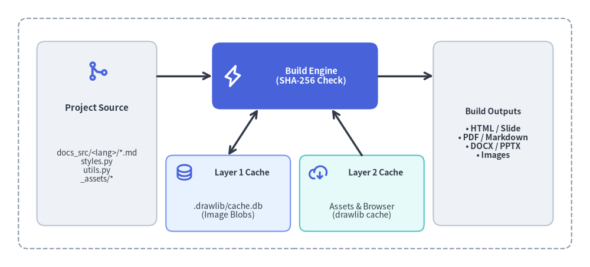
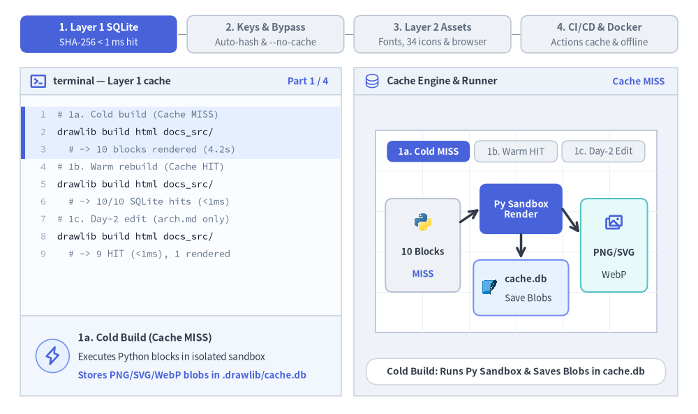
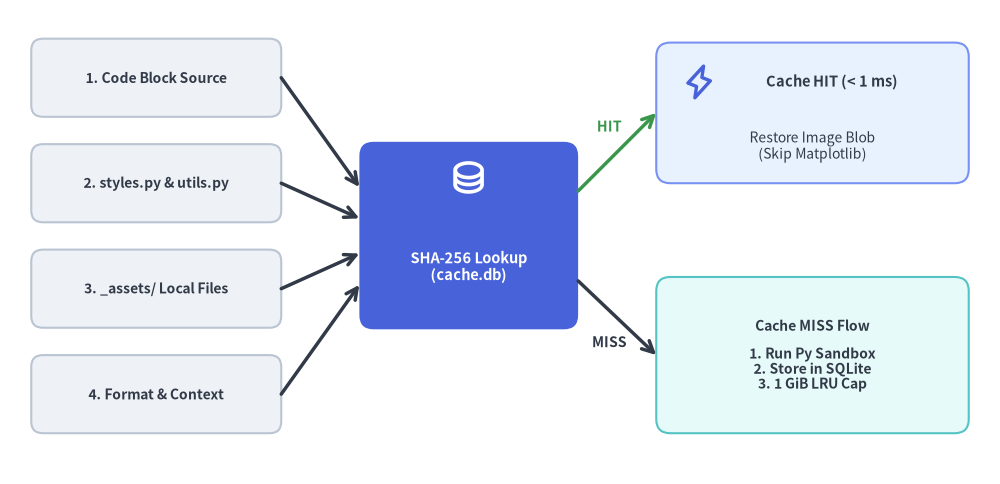

# キャッシュ機構と CI/CD

Drawlib は **2 層構造のキャッシュアーキテクチャ** を採用しており、ローカルでの反復ビルドを瞬時に完了させるとともに、CI/CD パイプラインを決定論的・高速・オフライン実行可能にします。


<figure class="drawlib-image" style="text-align: center;">
  
  <figcaption class="drawlib-caption">Drawlib の 2 層キャッシュアーキテクチャと CI/CD パイプライン</figcaption>
</figure>

<details class="drawlib-code-details">
<summary>Source Code</summary>

```python
from drawlib.canvas import save, setup
from drawlib.icons import phosphor
from drawlib.lines import line
from drawlib.shapes import rectangle
from drawlib.styles import Styles
from drawlib.text import text

setup(width=128, height=58)

# Outer pipeline boundary
rectangle((64, 29), width=120, height=50, style=Styles.MutedDashed.patch(shape_r=2.0))

# Left: Source inputs
rectangle((21, 29), width=26, height=40, style=Styles.Neutral.patch(shape_r=1.8))
phosphor.git_merge((21, 42.5), width=4.8, style=Styles.PrimaryBold)
text((21, 34.5), "Project Source", style=Styles.DarkBold.patch(text_size=10.8))
text((21, 22.0), "docs_src/*.md\nstyles.py\nutils.py\n_assets/*", style=Styles.Dark.patch(text_size=10.0))

# Center: Drawlib Compiler (Hero focal point)
rectangle((64, 41.5), width=36, height=14.5, style=Styles.PrimaryFlat.patch(shape_r=1.8))
phosphor.lightning((50.5, 41.5), width=4.8, style=Styles.WhiteBold)
text((67.5, 41.5), "Build Engine\n(SHA-256 Check)", style=Styles.WhiteBold.patch(text_size=10.5))

# Bottom Center: Two Cache Tiers
rectangle((49.5, 16.0), width=27, height=16.5, style=Styles.PrimaryNeutral.patch(shape_r=1.5))
phosphor.database((40.0, 20.5), width=4.2, style=Styles.PrimaryBold)
text((52.5, 20.5), "Layer 1 Cache", style=Styles.DarkBold.patch(text_size=10.2))
text((49.5, 12.2), ".drawlib/cache.db\n(Image Blobs)", style=Styles.Dark.patch(text_size=10.0))

rectangle((78.5, 16.0), width=27, height=16.5, style=Styles.SecondaryNeutral.patch(shape_r=1.5))
phosphor.cloud_arrow_down((69.0, 20.5), width=4.2, style=Styles.PrimaryBold)
text((81.5, 20.5), "Layer 2 Cache", style=Styles.DarkBold.patch(text_size=10.2))
text((78.5, 12.2), "Assets & Browser\n(drawlib cache)", style=Styles.Dark.patch(text_size=10.0))

# Right: Published Artifacts
rectangle(
    (107, 29),
    width=26,
    height=40,
    style=Styles.Neutral.patch(shape_r=1.8),
    text="Build Outputs\n\n• HTML / Slide\n• PDF / Markdown\n• DOCX / PPTX\n• Images",
    text_style=Styles.DarkBold.patch(text_size=10.0),
)

# Connectors
line((34, 41.5), (46, 41.5), arrow_head="->", style=Styles.DarkBold)
line((82, 41.5), (94, 41.5), arrow_head="->", style=Styles.DarkBold)
line((56, 34.25), (49.5, 24.25), arrow_head="<->", style=Styles.DarkBold)
line((72, 34.25), (78.5, 24.25), arrow_head="<-", style=Styles.DarkBold)

save()
```

</details>


1. **レイヤー 1 — 差分ビルドキャッシュ (`.drawlib/cache.db`)**: レンダリング済みの図解バイナリを SHA-256 コンテンツハッシュでキャッシュし、変更のない図解を 1 ミリ秒未満で復元するプロジェクトローカルな SQLite データベースです。
2. **レイヤー 2 — グローバルアセット＆ブラウザキャッシュ (`drawlib cache`)**: 外部フォントファミリー、ベクター／PNG アイコンパック、Natural Earth 地図データセット、および Playwright のヘッドレス Chromium バイナリ（`chromium-headless-shell`）を管理するパッケージキャッシュです。

---

## 1. インタラクティブな 2 層キャッシュ＆CI/CD ツアー

レイヤー 1 の SHA-256 SQLite キャッシュ、キャッシュキーの自動無効化、レイヤー 2 のオフラインアセット事前取得、そして GitHub Actions やエアギャップ Docker パイプラインがエンドツーエンドでどのように連携するかを確認しましょう。


<figure class="drawlib-image" style="text-align: center;">
  
  <figcaption class="drawlib-caption">2 層キャッシュ機構と CI/CD ライフサイクル: レイヤー 1 SHA-256 差分キャッシュ、キャッシュ無効化、レイヤー 2 オフラインアセット取得、GitHub Actions & Docker パイプライン (APNG アニメーション)</figcaption>
</figure>


<div class="drawlib-source-link">
  <a href="https://github.com/yuichi110/drawlib/blob/main/docs/docs_src/ja/09_doc_builder_and_cli/caching_and_cicd.md" target="_blank" rel="noopener noreferrer">GitHub でアニメーションのソースコードを見る &rarr;</a>
</div>

---

## 2. レイヤー 1: SQLite 差分ビルドキャッシュ (`.drawlib/cache.db`)

`drawlib build` または `drawlib show` を実行すると、Drawlib は `.drawlib/cache.db` にローカル SQLite データベースを自動作成します（キャッシュバイナリが誤って Git にコミットされないよう、`*` を含む `.drawlib/.gitignore` と `.drawlib/CACHEDIR.TAG` も同時に自動生成されます）。

### 2.1. SHA-256 キャッシュキーに含まれる要素
埋め込み ````drawlib```` ブロックまたは単体の `.py` スクリプトを実行する前に、Drawlib は以下の要素全体に対する決定論的な SHA-256 ダイジェストを計算します。
1. **描画コード本文**: ブロックまたはスクリプト内の正確な Python コード文字列。
2. **プロジェクトの `styles.py` & `utils.py`**: 有効な `--styles` および `--utils` スクリプトのファイル内容全体。
3. **参照されているローカルアセット**: コード内で文字列リテラルとして参照されているローカルファイルの内容（Markdown ファイル、プロジェクトルート、または `_assets/` からの相対パスで解決）。
4. **実行コンテキスト**: ソース／ターゲットパス、出力フォーマット（`png`、`webp`、`svg`）、およびプレゼンテーションの総スライド枚数（`total_slides`）。

ダイジェストが `.drawlib/cache.db` 内のエントリと一致した場合、Drawlib は Python や Matplotlib を一切起動することなく、レンダリング済み画像バイナリを **1 ミリ秒未満** で SQLite から直接復元します。


<figure class="drawlib-image" style="text-align: center;">
  
  <figcaption class="drawlib-caption">差分ビルドキャッシュにおける SHA-256 ダイジェスト計算とヒット／ミス判定フロー</figcaption>
</figure>

<details class="drawlib-code-details">
<summary>Source Code</summary>

```python
from drawlib.canvas import save, setup
from drawlib.icons import phosphor
from drawlib.lines import line
from drawlib.shapes import rectangle
from drawlib.styles import Styles
from drawlib.text import text

setup(width=128, height=62)

# Left Stack: 4 Input Cards
inputs = [
    (52.0, "1. Code Block Source"),
    (38.5, "2. styles.py & utils.py"),
    (25.0, "3. _assets/ Local Files"),
    (11.5, "4. Format & Context"),
]
for iy, ilabel in inputs:
    rectangle(
        (20, iy),
        width=32,
        height=10.0,
        style=Styles.Neutral.patch(shape_r=1.5),
        text=ilabel,
        text_style=Styles.DarkBold.patch(text_size=10.0),
    )

# Center Focal Card: SHA-256 Digest Lookup
rectangle((60, 31.8), width=28, height=24, style=Styles.PrimaryFlat.patch(shape_r=1.8))
phosphor.database((60, 39.2), width=4.8, style=Styles.WhiteBold)
text((60, 27.8), "SHA-256 Lookup\n(cache.db)", style=Styles.WhiteBold.patch(text_size=10.5))

# Converging arrows from 4 inputs to SHA-256 Digest Lookup
line((36, 52.0), (46, 38.0), arrow_head="->", style=Styles.DarkBold)
line((36, 38.5), (46, 34.0), arrow_head="->", style=Styles.DarkBold)
line((36, 25.0), (46, 29.5), arrow_head="->", style=Styles.DarkBold)
line((36, 11.5), (46, 25.5), arrow_head="->", style=Styles.DarkBold)

# Top Branch: Cache HIT
line((74, 37.5), (84, 47.5), arrow_head="->", style=Styles.SuccessBold)
text((78.0, 45.8), "HIT", style=Styles.SuccessBold.patch(text_size=10.2))
rectangle((104, 47.5), width=40, height=18, style=Styles.PrimaryNeutral.patch(shape_r=1.8))
phosphor.lightning((89.5, 51.5), width=4.6, style=Styles.PrimaryBold)
text((106.5, 51.5), "Cache HIT (< 1 ms)", style=Styles.DarkBold.patch(text_size=10.5))
text((104, 43.2), "Restore Image Blob\n(Skip Matplotlib)", style=Styles.Dark.patch(text_size=10.0))

# Bottom Branch: Cache MISS
line((74, 26.0), (84, 16.5), arrow_head="->", style=Styles.DarkBold)
text((78.0, 18.2), "MISS", style=Styles.DarkBold.patch(text_size=10.2))
rectangle(
    (104, 16.5),
    width=40,
    height=20,
    style=Styles.SecondaryNeutral.patch(shape_r=1.8),
    text="Cache MISS Flow\n\n1. Run Py Sandbox\n2. Store in SQLite\n3. 1 GiB LRU Cap",
    text_style=Styles.DarkBold.patch(text_size=10.0),
)

save()
```

</details>


### 2.2. 自動キャッシュメンテナンスと環境変数
- **ライブラリバージョン更新時の自動無効化**: インストールされている `drawlib` または `matplotlib` のバージョンが変更されると、キャッシュテーブルは自動的に無効化されます。
- **1 GiB の容量上限**: キャッシュされた画像バイナリの合計が `1 GiB` を超えると、古い方から 50% のエントリが自動的に削除（LRU 方式）されます。
- **カスタムキャッシュパス**: CI/CD ランナーでは、`DRAWLIB_CACHE_DB=/path/to/cache.db` または `DRAWLIB_CACHE_DIR=/path/to/dir` 環境変数によって SQLite データベースの保存先を上書きできます。

### 2.3. レイヤー 1 キャッシュをバイパスまたはクリアすべきケース
描画スクリプトが `styles.py` や `utils.py` *以外* の外部カスタム Python モジュールをインポートしている場合、その外部モジュールを編集してもブロックの SHA-256 ハッシュは自動では変化しません。その場合は `--no-cache` または `drawlib cache clear --images` を使用して強制的に再レンダリングを実行してください。

```bash
# Force full re-rendering for a single build or preview command:
uv run drawlib build html docs_src/ -o docs_html/ --no-cache
uv run drawlib show docs_src/index.md arch.png -g -o .drawlib/scratch/preview.png --no-cache

# Or purge all cached diagram binaries from .drawlib/cache.db:
uv run drawlib cache clear --images
```

---

## 3. レイヤー 2: グローバルアセット＆ブラウザキャッシュ (`drawlib cache`) とルールキャッシュ

コアの `drawlib` PyPI ホイールを軽量に保つため、外部バイナリアセットは公式 GitHub Releases 上に決定論的なアーカイブとしてパッケージ化され、Playwright のヘッドレスブラウザバイナリとともに `drawlib/_cached_assets/` 内にローカルキャッシュされます。
- **フォントパッケージ (`font_*`)**: 欧文・技術系フォントファミリー（`font_roboto`、`font_roboto_condensed`、`font_roboto_mono`、`font_roboto_serif`、`font_roboto_slab`、`font_mono_source_code_pro`、`font_mono_courier`、`font_sans_*`、`font_serif_*`）および多言語 CJK／地域別フォントファミリー（`font_cjk_japanese_noto_sans`、`font_japanese_noto_sans`、`font_japanese_mplus_1p`、`font_chinese_simplified_noto_sans`、`font_chinese_traditional_noto_sans`、`font_korean_noto_sans`、`font_arabic_noto_sans`、`font_thai_noto_sans`、`font_brahmic_*`）。
- **アイコンパッケージ (`icon_*` — 全 34 パッケージ)**: ベクターフォントアイコン（`icon_phosphor`）、公式クラウドプロバイダアイコン（`icon_gcp`、`icon_aws`、`icon_azure`）、15 種類の公式ドメインブランドパック（`icon_ai`、`icon_business`、`icon_client`、`icon_cloud`、`icon_cnative`、`icon_code`、`icon_data`、`icon_devops`、`icon_facility`、`icon_itservice`、`icon_network`、`icon_security`、`icon_server`、`icon_social`、`icon_workspace`）、および 15 種類の Drawlib オリジナル 2D パステルパック（`icon_original_ai`..`icon_original_workspace`）。
- **GeoMap パッケージ (`map_*`)**: Natural Earth のベクター境界データおよび主要都市データ（`map_world`、`map_countries`、`map_cities`）。
- **ヘッドレス Chromium (`--browser`)**: `drawlib build pdf` および `drawlib build pptx` で使用される Playwright の `chromium-headless-shell` です（初回実行時に自動プロビジョニングされるほか、`drawlib cache download --browser` / `--all` で明示的に事前ダウンロード可能です）。
- **AI ルール図解キャッシュ (`_cached_assets/rules/`)**: `drawlib rules show <topic>` でオンデマンド生成されるか、`drawlib rules build --all` で事前ビルドされる付随 PNG 図解です（`drawlib rules clear` で削除できます）。

### 3.1. アセットキャッシュ用 CLI コマンド

```bash
# Inspect all font, icon, and map packages and their local cache status:
uv run drawlib cache list

# Pre-download all font, icon, map, and headless Chromium assets (recommended for CI & offline use):
uv run drawlib cache download --all

# Pre-download specific asset categories selectively:
uv run drawlib cache download --fonts
uv run drawlib cache download --icons
uv run drawlib cache download --maps
uv run drawlib cache download --browser

# Clear downloaded font/icon/map packages, or clear everything including SQLite image cache:
uv run drawlib cache clear
uv run drawlib cache clear --all
```

---

## 4. CI/CD パイプラインおよびヘッドレスコンテナでの Drawlib 実行

### 4.1. GitHub Actions ワークフローの例
GitHub Actions や GitLab CI では、ワークフロー実行間でアセット／ブラウザキャッシュおよび `.drawlib/cache.db` を永続化し、`drawlib cache download --all`（ヘッドレス Chromium を含む）でアセットを一括事前取得したうえで、リンク切れ品質ゲートとして `drawlib serve --check` を実行します。

```yaml
name: Build Documentation & Verify Links

on:
  push:
    branches: [main]
  pull_request:

jobs:
  docs:
    runs-on: ubuntu-latest
    steps:
      - uses: actions/checkout@v4

      - name: Install uv and Python 3.12
        uses: astral-sh/setup-uv@v4
        with:
          python-version: "3.12"

      - name: Sync dependencies and OS browser shared libraries
        run: |
          uv sync
          uv run playwright install-deps chromium

      - name: Restore Drawlib & Playwright Caches
        uses: actions/cache@v4
        with:
          path: |
            .drawlib/
            ~/.cache/drawlib/
            ~/.cache/ms-playwright/
          key: drawlib-cache-${{ runner.os }}-${{ hashFiles('uv.lock') }}
          restore-keys: |
            drawlib-cache-${{ runner.os }}-

      - name: Warm Font, Icon, Map & Headless Browser Cache
        run: uv run drawlib cache download --all

      - name: Build HTML Site, Vector PDF, MS Word, and Audit Links
        run: |
          uv run drawlib build html docs_src/ -o docs_html/
          uv run drawlib build pdf doc_src/ -o doc.pdf --toc
          uv run drawlib build docx doc_src/ -o doc.docx --generate-index
          uv run drawlib serve docs_html/ --check
```

### 4.2. オフライン環境およびエアギャップ Docker コンテナ
実行時に外部へのネットワーク通信が無効化されているエアギャップ環境や軽量 Linux コンテナイメージ（`python:3.12-slim`）では、OS レベルの共有ライブラリ（`playwright install-deps chromium`）をインストールし、`drawlib cache download --all` で全フォント・アイコン・地図データ・ヘッドレス Chromium をイメージ内に焼き込みます（または `playwright install --with-deps --only-shell chromium` で OS ライブラリとヘッドレスシェルを同時に導入することも可能です）。

```dockerfile
FROM python:3.12-slim

WORKDIR /workspace
RUN pip install --no-cache-dir drawlib \
    && playwright install-deps chromium \
    && drawlib cache download --all
```

イメージのビルド時に `playwright install-deps chromium` と `drawlib cache download --all` を実行しておくことで、すべてのフォントファミリー、Phosphor／クラウド／ドメインアイコンセット、GeoMap シェープファイル、ヘッドレス PDF／PPTX 用 Chromium レンダラー、および純粋 Python 製の DOCX コンパイラが 100% オフラインで動作します。
