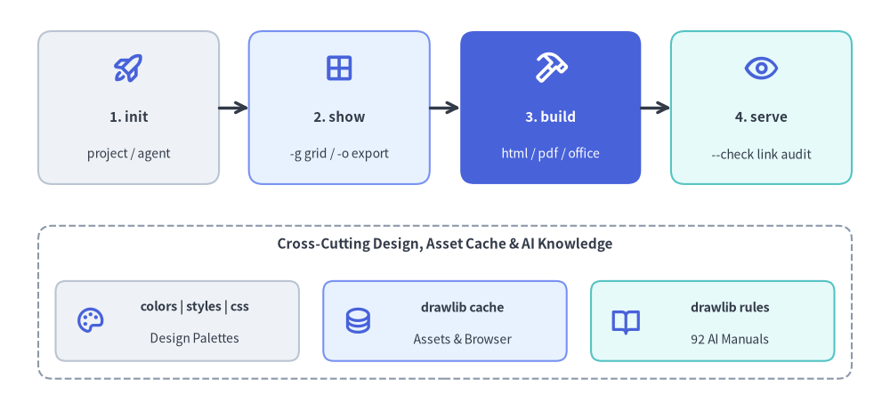
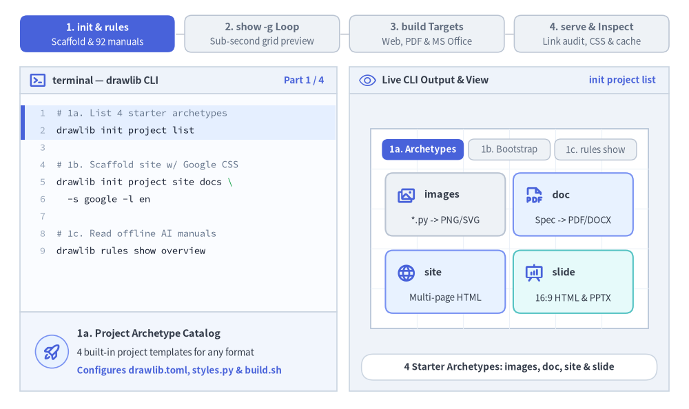
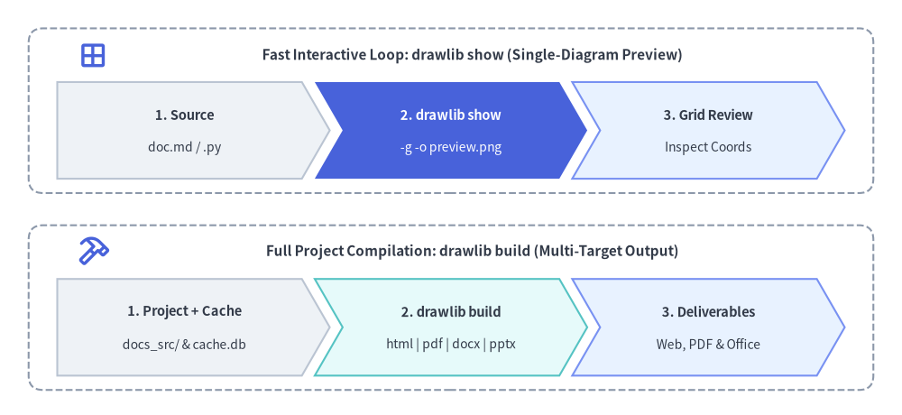

# CLI リファレンス

Drawlib は、ドキュメントのコンパイル、単体の図解画像の抽出、キャッシュアセットの管理、リンク検証、および組み込みデザインシステムの確認を行うための統合コマンドラインインターフェース（`drawlib`）を提供します。


<figure class="drawlib-image" style="text-align: center;">
  
  <figcaption class="drawlib-caption">ワークフローステージ別に整理された Drawlib CLI の 9 つのサブコマンド</figcaption>
</figure>

<details class="drawlib-code-details">
<summary>Source Code</summary>

```python
from drawlib.canvas import save, setup
from drawlib.icons import phosphor
from drawlib.lines import line
from drawlib.shapes import rectangle
from drawlib.styles import Styles
from drawlib.text import text

setup(width=128, height=58)

# Top Row: Primary 4-Stage Authoring & Publishing Pipeline
stages = [
    (18.5, "1. init", "doc / site / slide", Styles.Neutral, Styles.DarkBold, Styles.Dark, phosphor.rocket_launch, Styles.PrimaryBold),
    (48.8, "2. show", "-g grid / -o export", Styles.PrimaryNeutral, Styles.DarkBold, Styles.Dark, phosphor.grid_four, Styles.PrimaryBold),
    (79.2, "3. build", "html / pdf / office", Styles.PrimaryFlat, Styles.WhiteBold, Styles.White, phosphor.hammer, Styles.WhiteBold),
    (109.5, "4. serve", "--check link audit", Styles.SecondaryNeutral, Styles.DarkBold, Styles.Dark, phosphor.eye, Styles.PrimaryBold),
]
for sx, title, sub, st, tst, sub_st, icon_fn, icon_st in stages:
    rectangle((sx, 42.5), width=26, height=22, style=st.patch(shape_r=2.0))
    icon_fn((sx, 48.2), width=4.8, style=icon_st)
    text((sx, 41.2), title, style=tst.patch(text_size=11.0))
    text((sx, 35.8), sub, style=sub_st.patch(text_size=10.0))

line((31.5, 42.5), (35.8, 42.5), arrow_head="->", style=Styles.DarkBold)
line((61.8, 42.5), (66.2, 42.5), arrow_head="->", style=Styles.DarkBold)
line((92.2, 42.5), (96.5, 42.5), arrow_head="->", style=Styles.DarkBold)

# Bottom Row: Supporting Design Systems, Cache & AI Rules Subcommands
rectangle((64, 14.5), width=117, height=22, style=Styles.MutedDashed.patch(shape_r=2.0))
text((64, 22.8), "Cross-Cutting Design, Asset Cache & AI Knowledge", style=Styles.DarkBold.patch(text_size=11.0))

bottom_cards = [
    (25.5, "colors | styles | css", "Design Palettes", Styles.Neutral, phosphor.palette),
    (64.0, "drawlib cache", "Assets & Browser", Styles.PrimaryNeutral, phosphor.database),
    (102.5, "drawlib rules", "92 AI Manuals", Styles.SecondaryNeutral, phosphor.book_open),
]
for bx, btitle, bsub, bst, bicon in bottom_cards:
    rectangle((bx, 11.8), width=35, height=11.5, style=bst.patch(shape_r=1.5))
    bicon((bx - 12.5, 11.8), width=4.4, style=Styles.PrimaryBold)
    text((bx + 2.5, 13.8), btitle, style=Styles.DarkBold.patch(text_size=10.2))
    text((bx + 2.5, 9.2), bsub, style=Styles.Dark.patch(text_size=10.0))

save()
```

</details>


---

## 1. インタラクティブ CLI ワークフローツアー

プロジェクトの初期構築（`init` および `rules`）から、1 秒未満の座標グリッドプレビュー（`show -g`）、マルチフォーマットへのコンパイル（`build`）、さらに公開前のリンク・アセット検証（`serve --check` および `cache`）まで、9 つの `drawlib` サブコマンドすべてが一貫したループの中で連携します。


<figure class="drawlib-image" style="text-align: center;">
  
  <figcaption class="drawlib-caption">Drawlib CLI 日常ワークフローツアー: スキャフォールディングと AI ルール、単一図解のグリッドプレビュー、7 種類のビルドターゲット、リンク監査とデザインインスペクタ (APNG アニメーション)</figcaption>
</figure>


<div class="drawlib-source-link">
  <a href="https://github.com/yuichi110/drawlib/blob/main/docs/docs_src/ja/09_doc_builder_and_cli/cli_reference.md" target="_blank" rel="noopener noreferrer">GitHub でアニメーションのソースコードを見る &rarr;</a>
</div>

---

## 2. クイックコマンド一覧

```bash
# Compilation
drawlib build html docs_src/ -o docs_html/                  # Responsive static HTML website
drawlib build markdown docs_src/ -o docs/                  # GitHub-ready Markdown
drawlib build pdf doc_src/ -o manual.pdf --toc              # High-fidelity vector PDF
drawlib build docx doc_src/ -o manual.docx --generate-index # Editable MS Word (.docx) document
drawlib build slide slide_src/ -o slide_html/               # Interactive 16:9 HTML slide deck
drawlib build pptx slide_src/ -o deck.pptx                  # Editable 16:9 MS PowerPoint (.pptx) deck
drawlib build image scripts/ -o assets/ -g                  # Batch Python image rendering

# Scaffolding
drawlib init list                                          # List starter project templates (site, doc, slide, images)
drawlib init doc my_doc                                    # Scaffold linear document project (HTML, PDF, DOCX, MD, images)
drawlib init site my_site                                  # Scaffold documentation site
drawlib init slide my_deck -s google                       # Scaffold 16:9 presentation slide deck
drawlib init images my_images                              # Scaffold standalone images project (alias: image)

# Inspection & Preview
drawlib show doc.md                                        # List all drawlib code blocks in doc.md
drawlib show doc.md arch.png -o .drawlib/scratch/arch.png          # Headless extraction by explicit filename (Recommended)
drawlib show doc.md arch.png -g -o .drawlib/scratch/arch_grid.png  # Export named block with coordinate grid
drawlib show script.py -o .drawlib/scratch/fig.png                 # Export standalone Python script

# Local Server & Verification
drawlib serve docs_html/                                   # Local preview on http://localhost:8000
drawlib serve docs_html/ --check                           # Pre-flight broken link/asset audit

# Design Systems, Cache & AI Rules
drawlib colors list                                        # List color catalogs (default, google, monochrome, css)
drawlib styles list                                        # List style catalogs (default, google, monochrome)
drawlib css list                                           # List CSS presets for HTML and PDF
drawlib cache list                                         # Inspect cached fonts, icons, and maps
drawlib cache download --all                               # Pre-download fonts, icons, maps, and headless Chromium
drawlib rules list                                         # List 92 AI rule instruction manuals
```

---

## 3. グローバル CLI オプション

グローバルフラグは、すべてのトップレベルコマンドの前に指定します（`drawlib [GLOBAL_OPTIONS] COMMAND ...`）。

| フラグ | 説明 |
|---|---|
| `-v`, `--version` | インストールされている `drawlib` のバージョンを表示し、ステータス `0` で終了します。 |
| `-h`, `--help` | コンテキストに応じたヘルプメッセージと利用可能なサブコマンドを表示します。 |
| `--quiet` | 重要でない標準出力を抑制します（警告とエラーのみを出力します）。 |
| `--verbose` / `--debug` | 診断ログ、実行時間メトリクス、キャッシュヒット／ミスの詳細出力を有効にします。 |
| `--developer` | 詳細ログを有効にし、ユーザー向けのエラーラッパーを無効化して Python の完全なスタックトレースをそのまま送出します。 |

*（注: `--quiet` は `--verbose`、`--debug`、`--developer` と同時に指定できません。併用した場合は終了コード `2` で終了します。）*

---

## 4. コンパイルサブシステム (`drawlib build`)


<figure class="drawlib-image" style="text-align: center;">
  
  <figcaption class="drawlib-caption">単一図解のインタラクティブプレビュー (drawlib show) とプロジェクト全体のコンパイル (drawlib build) の比較</figcaption>
</figure>

<details class="drawlib-code-details">
<summary>Source Code</summary>

```python
from drawlib.canvas import save, setup
from drawlib.icons import phosphor
from drawlib.shapes import rectangle
from drawlib.smartarts import ChevronProcess
from drawlib.styles import Styles
from drawlib.text import text

setup(width=126, height=58)

# Top Panel: Fast Interactive Loop (drawlib show)
rectangle((63, 42.5), width=118, height=23, style=Styles.MutedDashed.patch(shape_r=2.0))
phosphor.grid_four((13, 50.2), width=4.4, style=Styles.PrimaryBold)
text(
    (66, 50.2),
    "Fast Interactive Loop: drawlib show (Single-Diagram Preview)",
    style=Styles.DarkBold.patch(text_size=11.0),
)

show_flow = ChevronProcess(
    style=Styles.Neutral,
    text_style=Styles.DarkBold.patch(text_size=10.5),
    description_style=Styles.Dark.patch(text_size=10.0),
    corner_angle=60.0,
    spacing=1.8,
    flat_left_end=True,
)
show_flow.add("1. Source", description="doc.md / .py")
show_flow.add(
    "2. drawlib show",
    description="-g -o preview.png",
    style=Styles.PrimaryFlat,
    text_style=Styles.WhiteBold.patch(text_size=10.5),
    description_style=Styles.White.patch(text_size=10.0),
)
show_flow.add("3. Grid Review", description="Inspect Coords", style=Styles.PrimaryNeutral)
show_flow.draw(xy=(8, 33.0), width=110, height=13.5)

# Bottom Panel: Full Project Compilation (drawlib build)
rectangle((63, 15.0), width=118, height=23, style=Styles.MutedDashed.patch(shape_r=2.0))
phosphor.hammer((13, 22.8), width=4.4, style=Styles.PrimaryBold)
text(
    (66, 22.8),
    "Full Project Compilation: drawlib build (Multi-Target Output)",
    style=Styles.DarkBold.patch(text_size=11.0),
)

build_flow = ChevronProcess(
    style=Styles.Neutral,
    text_style=Styles.DarkBold.patch(text_size=10.5),
    description_style=Styles.Dark.patch(text_size=10.0),
    corner_angle=60.0,
    spacing=1.8,
    flat_left_end=True,
)
build_flow.add("1. Project + Cache", description="docs_src/ & cache.db")
build_flow.add(
    "2. drawlib build",
    description="html | pdf | docx | pptx",
    style=Styles.SecondaryNeutral,
)
build_flow.add("3. Deliverables", description="Web, PDF & Office", style=Styles.PrimaryNeutral)
build_flow.draw(xy=(8, 5.5), width=110, height=13.5)

save()
```

</details>


### 4.1 `drawlib build html`
Markdown ドキュメントまたはディレクトリをコンパイルし、レスポンシブな静的 HTML ドキュメントサイト（`navbar.md` が存在する場合は `site`）または結合された単一ページ HTML ドキュメント（`navbar.md` が存在しない場合は `doc`）を生成します。

```bash
drawlib build html <INPUT> [OPTIONS]
```

| オプション | 短縮形 | デフォルト値 | 説明 |
|---|---|---|---|
| `--output` | `-o` | `<input_dir>` または `<name>.html` | 出力先ディレクトリまたは HTML ファイルパス。 |
| `--format` | `-f` | `png` | 埋め込み図解の画像フォーマット（`png` または `webp`）。 |
| `--styles` | `-s` | 自動解決された `styles.py` | プロジェクトのスタイル定義スクリプトへのパス。 |
| `--utils` | `-u` | 自動解決された `utils.py` | 描画ヘルパースクリプトへのパス。 |
| `--no-cache` | | `False` | `.drawlib/cache.db` を無視し、すべての図解をクリーンに再レンダリングします。 |

### 4.2 `drawlib build markdown`
埋め込み ````drawlib```` ブロックを含むソース Markdown を、標準的な GitHub Flavored Markdown（GFM）へコンパイルします。レンダリングされた図解は、付属の画像フォルダ（`<doc>_images/`）に出力されます。

```bash
drawlib build markdown docs_src/ -o docs/ [OPTIONS]
```

- `-o/--output`、`-f/--format <png|webp>`、`-s/--styles`、`-u/--utils`、`--no-cache` をサポートします。
- **上書き保護**: ソースファイルのインプレース上書き（`src_abs == dest_abs`）は拒否されます。必ずソースとは別の出力ディレクトリ（例: `docs/` や `docs_markdown/`）を指定してください。

### 4.3 `drawlib build pdf`
Playwright 経由のヘッドレス Chromium を使用し、複数の Markdown 章ディレクトリ、単一の Markdown ファイル、または 16:9 スライドデッキを高精細なベクター PDF へ結合・出力します（`chromium-headless-shell` は初回実行時に自動インストールされるほか、`drawlib cache download --browser` で事前ダウンロード可能です）。

```bash
drawlib build pdf doc_src/ -o report.pdf --toc --page-break
```

| オプション | 短縮形 | デフォルト値 | 説明 |
|---|---|---|---|
| `--output` | `-o` | `<first_stem>.pdf` | 出力先 PDF ファイルパス。 |
| `--title` | | H1 見出しから自動抽出 | 表紙およびランニングヘッダーに表示されるドキュメント全体のタイトル。 |
| `--generate-index` | `--toc` | `False` | 1 番目の章（`00_cover.md`）と 2 番目の章の間に自動生成された目次（TOC）を挿入します。 |
| `--page-break` / `--no-page-break` | | `True` | 各章の間に CSS 改ページ（`page-break-before: always`）を挿入します。 |
| `--styles` / `--utils` | `-s` / `-u` | 自動解決 | `styles.py` および `utils.py` へのパス。 |
| `--no-cache` | | `False` | `.drawlib/cache.db` をバイパスし、すべての図解を再レンダリングします。 |
| `--timestamp` | | `False` | PDF メタデータに現在のビルド日時を記録します（決定論的ビルドのためデフォルトでは省略されます）。 |

### 4.4 `drawlib build docx`
Markdown の章ディレクトリ（`doc` プロジェクト）または単一の `.md` ファイルを、ネイティブに編集可能な MS Word（`.docx`）ドキュメント（見出し、本文、箇条書き・番号付きリスト、テーブル、引用ブロック、シンタックスハイライト付きコードブロック、任意の表紙ページ、目次）へコンパイルします。````drawlib```` ブロック（SVG、WebP、アニメーションブロックを含む）は鮮明な高 DPI 静止画 PNG としてレンダリングされます。

```bash
drawlib build docx doc_src/ -o report.docx --generate-index --page-break
```

| オプション | 短縮形 | デフォルト値 | 説明 |
|---|---|---|---|
| `--output` | `-o` | `<first_stem>.docx` | 出力する MS Word（`.docx`）ファイルパス。 |
| `--page-break` / `--no-page-break` | | `True` | 結合された各章の間に改ページを挿入します。 |
| `--generate-index` / `--no-generate-index` | | `False` | 目次（インデックス）を生成し、1 番目の文書（`00_cover.md`）と 2 番目の文書の間に挿入します。 |
| `--title` | | H1 見出しから自動抽出 | 結合される Word ドキュメントのタイトルを上書き指定します。 |
| `--dpi` | | `200` | 埋め込み `drawlib` 図解のラスタライズ DPI。 |
| `--styles` / `--utils` | `-s` / `-u` | 自動解決 | `styles.py` および `utils.py` へのパス。 |
| `--no-cache` | | `False` | `.drawlib/cache.db` の読み書きを無効化します。 |
| `--timestamp` | | `False` | 正規化する代わりに、Word メタデータへ現在のビルド日時を記録します。 |

### 4.5 `drawlib build slide`
Markdown スライドファイルのディレクトリ（`slide_src/`）を、デュアルウィンドウ対応の発表者ビュー（`?presenter=1`）を備えたスタンドアロン 16:9 HTML プレゼンテーションデッキ（`index.html`）へコンパイルします。

```bash
drawlib build slide slide_src/ -o slide_html/ [OPTIONS]
```

| オプション | 短縮形 | デフォルト値 | 説明 |
|---|---|---|---|
| `--output` | `-o` | `<dir>_html/` | プレゼンテーションデッキの出力先ディレクトリパス。 |
| `--theme` | `-t` | 自動 / `default` | CSS テーマプリセット（`google`、`default`、`google-dark`、`default-dark`）。 |
| `--format` | `-f` | `svg` | 埋め込み図解のデフォルト画像フォーマット（`svg`、`webp`、`png`）。 |
| `--styles` / `--utils` | `-s` / `-u` | 自動解決 | `styles.py` および `utils.py` へのパス。 |
| `--no-cache` | | `False` | `.drawlib/cache.db` の読み書きを無効化します。 |

### 4.6 `drawlib build pptx`
ヘッドレス Chromium で `1920×1080` スライドレイアウトと計算済み CSS スタイルを計測し、Markdown スライドファイルのディレクトリ（`slide_src/`）をネイティブに編集可能な 16:9（`960×540 pt`）MS PowerPoint（`.pptx`）デッキへコンパイルします（`rgba` アルファ対応の `::: block` カード、テキストボックス、箇条書き・番号付きリスト、テーブル、インラインコード、`::: note` スピーカーノートを変換し、````drawlib```` 図解は高 DPI 静止画 PNG として埋め込みます）。

```bash
drawlib build pptx slide_src/ -o deck.pptx --dpi 240 --anim-frame last
```

| オプション | 短縮形 | デフォルト値 | 説明 |
|---|---|---|---|
| `--output` | `-o` | `<dir_name>.pptx` | 出力する MS PowerPoint（`.pptx`）ファイルパス。 |
| `--theme` | `-t` | 自動 / `default` | CSS テーマプリセット（`google`、`default`、`google-dark`、`default-dark`）。 |
| `--title` | | デッキから自動抽出 | PowerPoint メタデータのプレゼンテーションタイトルを上書き指定します。 |
| `--dpi` | | `240` | 埋め込み `drawlib` 図解のラスタライズ DPI。 |
| `--anim-frame` | | `last` | アニメーション図解から抽出するフレーム（`first` または `last`）。 |
| `--styles` / `--utils` | `-s` / `-u` | 自動解決 | `styles.py` および `utils.py` へのパス。 |
| `--no-cache` | | `False` | `.drawlib/cache.db` の読み書きを無効化します。 |
| `--timestamp` | | `False` | 正規化する代わりに、PowerPoint メタデータへ現在のビルド日時を記録します。 |

### 4.7 `drawlib build image`
スタンドアロンの Python 図解スクリプト（`.py`）を一括実行するか、Markdown ファイル（`.md`）内の埋め込み描画ブロックを抽出して、画像アセットを生成します。

```bash
drawlib build image images_src/ -o images/ --grid
```

| オプション | 短縮形 | デフォルト値 | 説明 |
|---|---|---|---|
| `--output`, `--output-dir` | `-o` | `None` | 出力ファイルパス（単一スクリプト時）または出力先ディレクトリ。 |
| `--format` | `-f` | スクリプト設定（`png`） | 出力画像フォーマットの一括上書き指定（`png`、`webp`、`jpg`、`pdf`）。 |
| `--styles` / `--utils` | `-s` / `-u` | 自動解決 | `styles.py` および `utils.py` へのパス。 |
| `--grid` | `-g` | `False` | 座標グリッドを重ね合わせた補助画像 `*_grid.<ext>` を同時に保存します。 |
| `--disable-auto-clear` | | `False` | 実行される `.py` ファイル間の自動 `canvas.clear()` を無効化します。 |
| `--enable-auto-initialize` | | `False` | 実行される `.py` ファイル間でキャンバスの完全な再初期化を有効化します。 |
| `--no-cache` | | `False` | `.drawlib/cache.db` をバイパスします。 |

- **Python スクリプト**: ネストされたサブディレクトリ構造を自動的にミラーリングしながら、`save()` の出力先を `-o` 配下へリダイレクトします。実行前に全スクリプトへ静的 AST 解析を行い、複数のスクリプトが同一の出力ファイルへ書き込もうとしている場合は即座に中断します。
- **Markdown ファイル**: 埋め込み ````drawlib```` ブロックを `<markdown_name>_images/<image_file>` サブディレクトリへ抽出します。

---

## 5. スキャフォールディングサブシステム（`drawlib init`）

標準化されたフォルダ構成、設定スクリプト、ビルド自動化スクリプトを備えた新規プロジェクトを初期生成します。

```bash
drawlib init <TYPE> [target] [OPTIONS]
drawlib init list
```

- `<TYPE>`: プロジェクト種別を選択するサブコマンド: `doc`、`site`、`slide`、`images`（エイリアス: `image`）、または `list`。
- `[target]`: プロジェクトおよびソースフォルダのベース名（`<target>_src/` を作成します）。デフォルト値: `doc` は `doc`、`site` は `docs`、`slide` は `slide`、`images` は `images`。
- `-s`, `--style <theme>`: スタイルプリセットテーマ（`default`、`google`、`monochrome` など）。`style.css` と `styles.py` の両方を同期して設定します。
- `-l`, `--lang <code>`: スターターコンテンツおよびフォント設定の言語（`en`、`ja`、`zh-cn`、`ko`、`th`、`hi` など）。デフォルト: `en`。
- `-f`, `--force`: 出力先ディレクトリが既に存在する場合に既存ファイルを上書きします。

---

## 6. 単一図解の抽出とプレビュー（`drawlib show`）

ドキュメント内の埋め込みブロック一覧を表示したり、デスクトップ GUI ウィンドウで図解をプレビューしたり、`-o` 指定時にヘッドレスでディスクへ書き出したりします。

```bash
# 1. List all drawlib blocks in a Markdown document (when [TARGET] is omitted):
drawlib show docs_src/overview.md

# 2. Export block by explicit filename with coordinate grid (Recommended):
drawlib show docs_src/overview.md arch.png -g -o .drawlib/scratch/arch_grid.png

# 3. Export block by 1-based index (or -1 for the last block in the file):
drawlib show docs_src/overview.md 1 -g -o .drawlib/scratch/fig1.png
drawlib show docs_src/overview.md -1 -o .drawlib/scratch/last_fig.png

# 4. Preview standalone Python script in interactive GUI window:
drawlib show my_drawing.py
```

`-o/--output`、`-g/--grid`、`-s/--styles`、`-u/--utils`、`--no-cache` をサポートします。

---

## 7. ローカルサーバーと事前リンク検証（`drawlib serve`）

ビルド済みの HTML ドキュメントをプレビューするため、外部依存ゼロのローカル HTTP 開発サーバー（`Cache-Control: no-store`）を起動します。

```bash
# Start server on default port 8000 (runs link check first and opens browser):
drawlib serve docs_html/

# Custom port without opening browser:
drawlib serve docs_html/ -p 8080 --no-browser

# Pre-flight broken link and missing asset check only (exits 0 if clean, 1 if broken):
drawlib serve docs_html/ --check

# Start server immediately without running pre-flight link scan:
drawlib serve docs_html/ --skip-check
```

---

## 8. デザインシステム・スタイルシート・アセットキャッシュ（`css`, `colors`, `styles`, `cache`）

### 8.1 CSS スタイルシートプリセット（`drawlib css`）
```bash
drawlib css list [html|pdf]                            # List built-in CSS themes and target support
drawlib css show html google                           # Print synthesized Google HTML CSS to terminal
drawlib css show html google -o docs_src/style.css --force  # Export preset to file
```

### 8.2 カラー・スタイルのビジュアルカタログ（`drawlib colors` & `drawlib styles`）
```bash
# Color palettes (default, google, monochrome, css):
drawlib colors list
drawlib colors show google --sort hsv -g -o .drawlib/scratch/colors_google.png

# Style matrices (default, google, monochrome):
drawlib styles list
drawlib styles show google 1 -o .drawlib/scratch/styles_google_p1.png
drawlib styles show default --all -o .drawlib/scratch/styles_default.png
drawlib styles show default -c blue -o .drawlib/scratch/styles_blue.png
```

### 8.3 キャッシュ管理（`drawlib cache`）
```bash
drawlib cache list                  # Inspect font, icon, and map packages and local cache size
drawlib cache download --all        # Pre-download all font, icon, map, and headless Chromium assets
drawlib cache download --fonts      # Pre-download font packages only
drawlib cache download --icons      # Pre-download icon packages only
drawlib cache download --maps       # Pre-download GeoMap packages only
drawlib cache download --browser    # Pre-download headless Chromium browser only
drawlib cache clear --images        # Clear SQLite build & CLI image cache (.drawlib/cache.db)
drawlib cache clear --all           # Clear all caches (fonts, icons, maps, and .drawlib/cache.db)
```

---

## 9. AI ルールカタログ（`drawlib rules`）

組み込みのアーキテクチャ・ライブラリマニュアル（オンデマンドで `_cached_assets/rules/` に付属の図解も自動生成）をターミナルから直接参照できます。

```bash
drawlib rules list                            # List all 92 rule topics and cache status
drawlib rules show agent-instruction          # View AI agent bootstrap manual
drawlib rules show overview                   # View Cartesian geometry principles
drawlib rules show style-guide                # View 50%+ neutral baseline & semantic color rules
drawlib rules show review-guide               # View 3-stage multimodal review loop & 720pt font math
drawlib rules show anim-guide                 # View animation idioms across all modules
drawlib rules show project-overview           # View 4 project archetypes & shared architecture
drawlib rules show project-site               # View multi-page website authoring & navbar.md rules
drawlib rules show project-slide              # View 1920x1080 slide authoring & stage rules
drawlib rules show lib-graph-overview         # View declarative graph layout solvers overview
drawlib rules show lib-diagrams-overview --raw # Output raw Markdown without building/checking cache
drawlib rules show lib-shapes-overview --rebuild # Force regenerate companion rule illustrations
drawlib rules build --all                     # Pre-build illustrations for all 92 rule topics
drawlib rules clear                           # Delete cached rule documents and generated images
```

---

## 10. CLI 終了コード

| 終了コード | 意味 | 主な原因 |
| :---: | :--- | :--- |
| **`0`** | 正常終了 | コマンドが正常に完了した場合（`--check` がリンク切れ 0 件で通過した場合を含む）。 |
| **`1`** | ビルド / 実行エラー | 必須ファイル（`index.md`、`navbar.md`）の欠落、````drawlib```` ブロック内の Python 例外、出力ファイル名の衝突、または `drawlib serve --check` によるリンク切れ検出。 |
| **`2`** | パラメータ不正 / 使用法エラー | 競合する CLI フラグの同時指定（例: `--quiet` と `--verbose` の併用）、不明なサブコマンド、または必須引数の不足。 |
