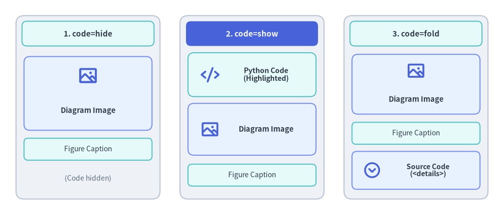
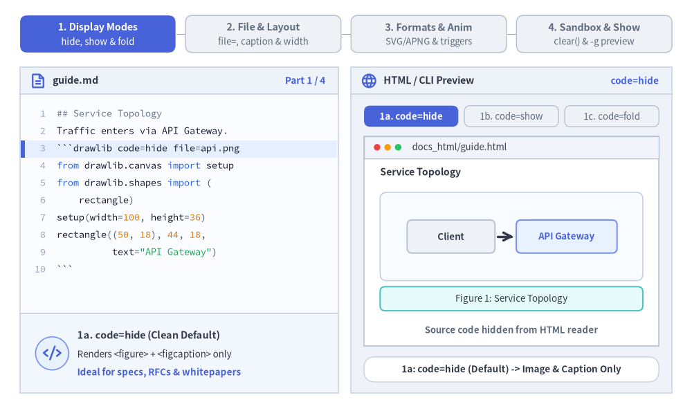
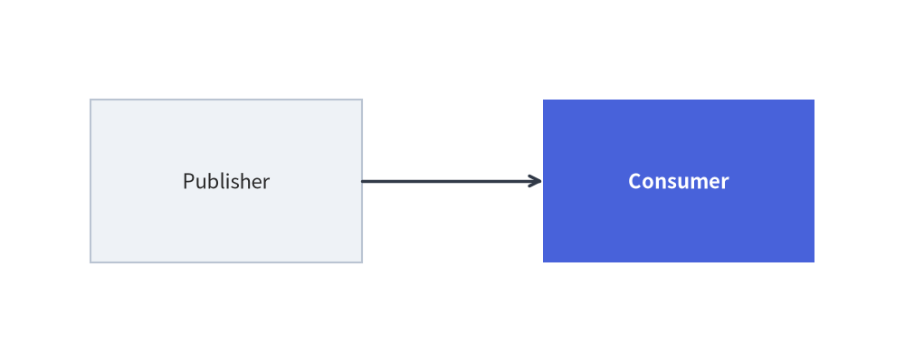

# Markdown コードブロック構文 (````drawlib````)

Drawlib では、````drawlib```` コードフェンスを使用して Markdown ドキュメント内に Python の描画スクリプトを直接埋め込むことができます。ビルダはサイトやドキュメントのビルド時にこれらのブロックをベクター画像へコンパイルし、HTML 要素、付随する画像ファイル、およびシンタックスハイライト付きのコードブロックを自動生成します。

レンダリングされた図解とあわせてソースコードをどのように表示するかは、3 種類の表示モード（`code=hide`、`code=show`、`code=fold`）から選択して制御できます。


<figure class="drawlib-image" style="text-align: center;">
  
  <figcaption class="drawlib-caption">code=hide・code=show・code=fold の 3 つの表示モードの視覚比較</figcaption>
</figure>

<details class="drawlib-code-details">
<summary>Source Code</summary>

```python
from drawlib.canvas import save, setup
from drawlib.icons import phosphor
from drawlib.shapes import rectangle
from drawlib.styles import Styles
from drawlib.text import text

setup(width=126, height=54)

# 1. Left Card: code=hide (Default)
rectangle((22, 27), width=36, height=46, style=Styles.Neutral.patch(shape_r=2.0))
rectangle(
    (22, 45.5),
    width=33,
    height=6.2,
    style=Styles.SecondaryNeutral.patch(shape_r=1.2),
    text="1. code=hide",
    text_style=Styles.DarkBold.patch(text_size=11.0),
)
rectangle((22, 30.5), width=32, height=18.5, style=Styles.PrimaryNeutral.patch(shape_r=1.5))
phosphor.image((22, 35.0), width=5.2, style=Styles.PrimaryBold)
text((22, 26.2), "Diagram Image", style=Styles.DarkBold.patch(text_size=10.5))
rectangle(
    (22, 16.5),
    width=32,
    height=5.5,
    style=Styles.SecondaryNeutral.patch(shape_r=1.0),
    text="Figure Caption",
    text_style=Styles.Dark.patch(text_size=10.0),
)
text((22, 9.2), "(Code hidden)", style=Styles.Muted.patch(text_size=10.0))

# 2. Center Card: code=show (PrimaryFlat header banner)
rectangle((63, 27), width=36, height=46, style=Styles.Neutral.patch(shape_r=2.0))
rectangle(
    (63, 45.5),
    width=33,
    height=6.2,
    style=Styles.PrimaryFlat.patch(shape_r=1.2),
    text="2. code=show",
    text_style=Styles.WhiteBold.patch(text_size=11.0),
)
rectangle((63, 35.2), width=32, height=11.0, style=Styles.SecondaryNeutral.patch(shape_r=1.5))
phosphor.code((52.5, 35.2), width=4.8, style=Styles.PrimaryBold)
text((66.5, 35.2), "Python Code\n(Highlighted)", style=Styles.DarkBold.patch(text_size=10.2))
rectangle((63, 21.5), width=32, height=13.0, style=Styles.PrimaryNeutral.patch(shape_r=1.5))
phosphor.image((52.5, 21.5), width=4.8, style=Styles.PrimaryBold)
text((66.5, 21.5), "Diagram Image", style=Styles.DarkBold.patch(text_size=10.5))
rectangle(
    (63, 10.0),
    width=32,
    height=5.5,
    style=Styles.SecondaryNeutral.patch(shape_r=1.0),
    text="Figure Caption",
    text_style=Styles.Dark.patch(text_size=10.0),
)

# 3. Right Card: code=fold
rectangle((104, 27), width=36, height=46, style=Styles.Neutral.patch(shape_r=2.0))
rectangle(
    (104, 45.5),
    width=33,
    height=6.2,
    style=Styles.SecondaryNeutral.patch(shape_r=1.2),
    text="3. code=fold",
    text_style=Styles.DarkBold.patch(text_size=11.0),
)
rectangle((104, 32.8), width=32, height=15.0, style=Styles.PrimaryNeutral.patch(shape_r=1.5))
phosphor.image((104, 36.2), width=4.8, style=Styles.PrimaryBold)
text((104, 29.0), "Diagram Image", style=Styles.DarkBold.patch(text_size=10.5))
rectangle(
    (104, 20.5),
    width=32,
    height=5.5,
    style=Styles.SecondaryNeutral.patch(shape_r=1.0),
    text="Figure Caption",
    text_style=Styles.Dark.patch(text_size=10.0),
)
rectangle((104, 11.2), width=32, height=9.5, style=Styles.PrimaryNeutral.patch(shape_r=1.2))
phosphor.caret_circle_down((93.0, 11.2), width=4.6, style=Styles.PrimaryBold)
text((107.0, 11.2), "Source Code\n(<details>)", style=Styles.DarkBold.patch(text_size=10.0))

save()
```

</details>


---

## 1. インタラクティブなフェンス属性と表示モードのツアー

各 ````drawlib```` ブロックは、宣言的なフェンスヘッダーオプション（`code=`、`file=`、`caption=`、`align=`、`width=`、`anim_trigger=`、`anim_pause=`）と、分離された Python 実行サンドボックス（`canvas.clear()`）を組み合わせて動作します。フェンス属性が HTML 図表の出力、ベクター／アニメーション形式、および 1 秒未満で動作する `drawlib show -g` 座標プレビューをどのように制御するかを確認してみましょう。


<figure class="drawlib-image" style="text-align: center;">
  
  <figcaption class="drawlib-caption">埋め込み Drawlib フェンスツアー: コード表示モード、ファイル出力とレイアウトサイズ、出力フォーマットとアニメーション制御、サンドボックスプレビュー (APNG アニメーション)</figcaption>
</figure>


<div class="drawlib-source-link">
  <a href="https://github.com/yuichi110/drawlib/blob/main/docs/docs_src/ja/09_doc_builder_and_cli/code_blocks.md" target="_blank" rel="noopener noreferrer">GitHub でアニメーションのソースコードを見る &rarr;</a>
</div>

---

## 2. 基本的なコードフェンス構文

埋め込み描画ブロックでは、言語識別子 `drawlib` に続けて Python のキーワード引数形式（`key=value`）で属性を指定します。


```python
from drawlib.canvas import save, setup
from drawlib.shapes import rectangle
from drawlib.lines import line
from drawlib.styles import Styles

setup(width=100, height=40)
rectangle((25, 20), width=30, height=18, style=Styles.Neutral, text="Publisher")
rectangle((75, 20), width=30, height=18, style=Styles.PrimaryFlat, text="Consumer", text_style=Styles.WhiteBold)
line((40, 20), (60, 20), arrow_head="->", style=Styles.DarkBold)
save()
```

<figure class="drawlib-image" style="text-align: center;">
  
  <figcaption class="drawlib-caption">サービスアーキテクチャの描画例</figcaption>
</figure>


---

## 3. ヘッダー属性リファレンス

各種オプションは、開始コードフェンス行にスペース区切りの `key=value` ペアとして指定します（`caption="Service Architecture"` のように値にスペースが含まれる場合のみ引用符が必要です）。

```text
``` drawlib file=<name.png> [code=hide|show|fold] [align=left|center|right] [caption="TEXT"] [OPTIONS...]
```

*（注: 実際に記述する際は、バッククォート直後のスペースを入れず、角括弧の部分を任意のオプションに置き換えてください。）*

### 3.1 コード表示モード

| オプション (`key=value`) | HTML レンダリング時の挙動 | Markdown レンダリング時の挙動 |
|---|---|---|
| `code=hide` *（デフォルト）* | 画像のみを表示します（`<figure></figure>`）。 | コードブロックを標準の Markdown 画像リンクに置き換えます。 |
| `code=show` | シンタックスハイライト付きのコードブロックを表示し、その直後に画像を配置します。 | コードブロックの直後に画像リンクを出力します。 |
| `code=fold` | 画像を表示し、その下に折りたたみ可能なドロワー（`<details><summary>Source Code</summary>...</details>`）を配置します。 | 画像の直後に折りたたまれた `<details>` ドロワーを出力します。 |

### 3.2 フェンス属性一覧リファレンス

| カテゴリ | 属性構文 | デフォルト値 | 説明 |
|---|---|---|---|
| **ファイル名** | `file=<name.png>` | *（ドキュメントでは推奨・事実上必須）* | `<doc_stem>_images/<name.png>`（スライドでは `images/<slide_stem>/<name>`）に出力される明示的な画像ファイル名。 |
| **画像フォーマット** | `format=<fmt>` | `png`（スライドでは `svg`） | `file=` の拡張子から自動判定しない場合の出力フォーマット（`png`、`webp`、`svg`、`apng`）。 |
| **表示幅** | `width=650px`, `width=80%` | `None`（本来のサイズ） | CSS 表示幅（`px`、`%`、`rem`、`vw`、または単位なし数値 → `px` 扱い）。 |
| **表示高さ** | `height=400px` | `None` | 任意の CSS 表示高さの上書き指定。 |
| **水平配置** | `align=center`, `align=left`, `align=right` | `center` | ページ上での図の水平配置（`left`、`center`、`right`）。 |
| **キャプション** | `caption="Text"` または `caption='Text'` | `None` | 図をセマンティックな `<figure>` および `<figcaption>` 要素でラップしてキャプションを表示します。 |
| **CSS クラス** | `class=hero-fig`, `class="card shadow"` | `None` | 図のラッパー要素にカスタム CSS クラスを追加します。 |
| **キャッシュ制御** | `no_cache=true` | `False` | `.drawlib/cache.db` をバイパスし、ビルドのたびに該当ブロックを強制的に再実行します。 |
| **スライドアニメーション制御** | `anim_trigger=auto\|click`, `anim_loop=once\|infinite`, `anim_pause=(2, 4)` | `auto`, `infinite`, `()` | HTML スライドデッキにおけるインタラクティブな `<canvas>` アニメーション再生を制御します（詳細は[スライドデッキプロジェクト (`slide`)](./project_slide.md)を参照）。 |

> [!TIP]
> **AI エージェントおよび自動化におけるベストプラクティス**:
> すべての埋め込みブロックには、必ず明示的な `file=<name.png>` 属性を指定してください。名前付きブロックにしておくことで、図の挿入や削除に伴う連番ずれを防ぎ、アセットディレクトリを整理された状態に保てるほか、`drawlib show <file.md> <image_name.png>` によって特定の図を決定論的に検証できます。

> [!NOTE]
> **コードブロック内のアニメーション（APNG & WebP）**:
> 埋め込み `drawlib` ブロックでは、`from drawlib.anim import Animation` を使用したマルチフレームのアニメーション図解生成を完全にサポートしています。ドキュメントコンパイラは `file=` の拡張子（`.png`、`.apng`、`.webp`）に応じて、アニメーション PNG（APNG）またはアニメーション WebP ファイルを自動的に出力します。詳細は[アニメーション概要](../08_animations/overview.md)を参照してください。

### 3.3 HTML `<script type="text/drawlib">` による代替構文
`.md` ファイルではなく生の `.html` ドキュメントを直接執筆する場合は、標準の HTML 属性（`width="600px"`、`align="center"`、`file="arch.png"`、`caption="Architecture"`、`code="fold"`）を備えた `<script type="text/drawlib">` タグを使って Drawlib ブロックを埋め込むことができます。

---

## 4. カレントディレクトリとパス解決

埋め込みコードブロックのコンパイル時には、以下のルールでパスが解決されます。
1. **作業ディレクトリ（`os.chdir`）**: Drawlib はカレントワーキングディレクトリを、対象の Markdown ドキュメントが存在するディレクトリ（またはプロジェクトルート直下に `_assets/` がある場合はプロジェクトルート）へ自動的に設定します。
2. **相対ファイルパス**: ローカルアセットへの相対パス（例: `image("../_assets/logo.png")`）は、`drawlib build` 実行時でも `drawlib show` による単体テスト時でもまったく同じように解決されます。
3. **モジュール解決（`sys.path`）**: ドキュメントのディレクトリとプロジェクトルートが `sys.path` に追加されるため、`import styles` や `import utils` といったローカルヘルパーモジュールをそのままインポートできます。

---

## 5. キャンバスの分離とサンドボックス

- **自動クリア**: Drawlib は各埋め込みコードブロックを実行する直前に `canvas.clear()` を自動的に呼び出します。直前の図解の状態、図形、スタイル設定が後続のブロックに干渉することは一切ありません。
- **明示的なインポート**: 埋め込み描画ブロックでは明示的なインポート（例: `from drawlib.shapes import circle`、`from drawlib.styles import Styles`）を使用します。これにより名前空間の境界が明確になり、IDE のコード補完が完全に機能し、ブロック単体での高い再現性が保証されます。
- **自動キャプチャと `save()` の扱い**: ドキュメントビルダは、ブロックの実行完了時にキャンバスを自動キャプチャし、対応する画像ファイルをディスクへ出力します。ブロック内での `save()` 呼び出しは省略可能ですが、記述されている場合もエンジンが安全にインターセプトし、重複書き込みやファイル衝突を防ぎます。完全なサンプルコードでは、スタンドアロンの Python スクリプトへそのままコピー＆ペーストして動かせる互換性を保つため、引数なしの `save()` を記述しておくことを推奨します。

---

## 6. 高速検証ワークフロー（`drawlib show`）

1 つの図解の座標調整を確認するために、サイト全体のフルビルドを実行する必要はありません。`drawlib show` を使えば、個別のコードブロックを即座にプレビュー・検証できます。

```bash
# 1. List all available drawlib blocks in a Markdown document (index, line number, target filename):
uv run drawlib show docs_src/my_doc.md

# 2. Render a specific block by its explicit file: name with coordinate grid (-g) (Recommended):
uv run drawlib show docs_src/my_doc.md code_blocks_service_arch.png -g -o .drawlib/scratch/preview.png

# 3. Or target a block by 1-based index (1, 2, or -1 for the last block):
uv run drawlib show docs_src/my_doc.md 1 -g -o .drawlib/scratch/preview.png
```
