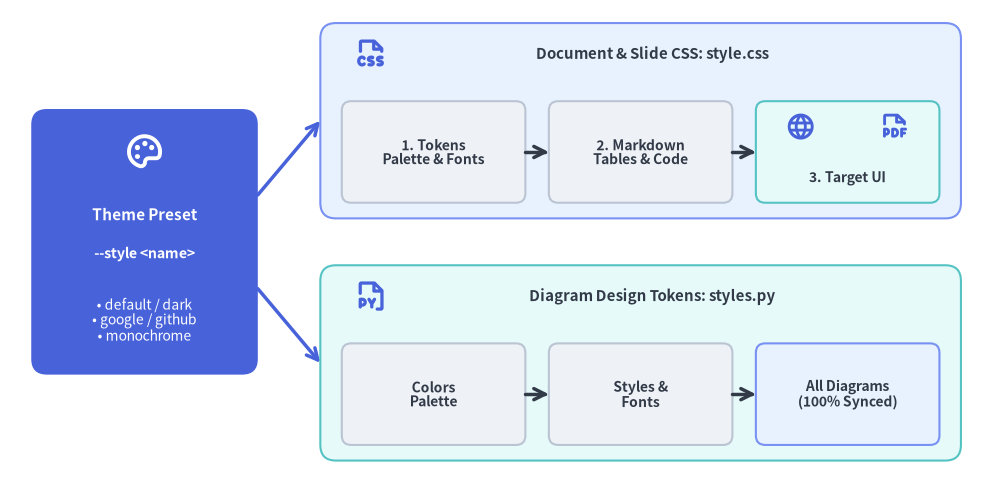
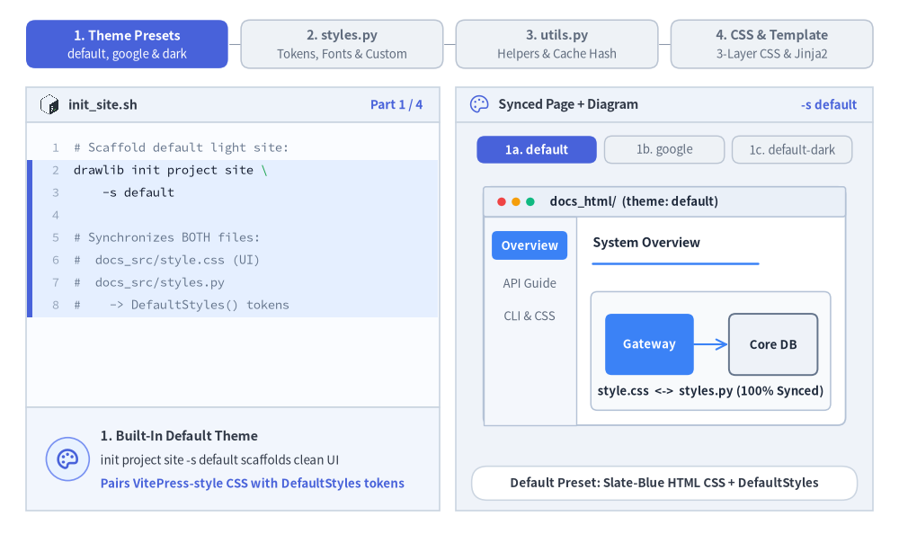
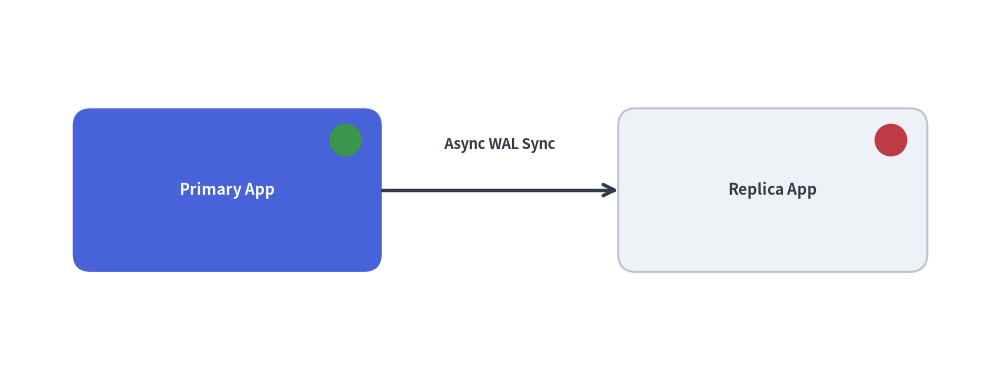

# テンプレートと CSS カスタマイズ: テーマとコード注入

Drawlib は、企業のデザインシステムや独自の開発ワークフローへシームレスに統合できるよう設計されています。HTML レイアウト構造のカスタマイズ、スタイルシートの調整、およびプロジェクト全体で共有する Python 描画ヘルパーやスタイル定義の注入が可能です。

単一のテーマプリセット（`--style <preset>`）を指定するだけで、ドキュメント用 CSS（`style.css`）と図解用デザイントークン（`styles.py`）の両方が同期されます。


<figure class="drawlib-image" style="text-align: center;">
  
  <figcaption class="drawlib-caption">統合テーマアーキテクチャ: ドキュメント CSS (style.css) と図解デザイントークン (styles.py) の同期</figcaption>
</figure>

<details class="drawlib-code-details">
<summary>Source Code</summary>

```python
from drawlib.canvas import save, setup
from drawlib.icons import phosphor
from drawlib.lines import line
from drawlib.shapes import rectangle
from drawlib.styles import Styles
from drawlib.text import text

setup(width=128, height=62)

# Left Focal Card: Single Theme Preset
rectangle((18.5, 31), width=29, height=34, style=Styles.PrimaryFlat.patch(shape_r=2.0))
phosphor.palette((18.5, 42.5), width=5.2, style=Styles.WhiteBold)
text((18.5, 34.5), "Theme Preset", style=Styles.WhiteBold.patch(text_size=11.0))
text((18.5, 29.5), "--style <name>", style=Styles.WhiteBold.patch(text_size=10.2))
text((18.5, 21.0), "• default / dark\n• google / github\n• monochrome", style=Styles.White.patch(text_size=10.0))

# Branching connectors
line((33, 37), (41, 46.5), arrow_head="->", style=Styles.PrimaryBold)
line((33, 25), (41, 15.5), arrow_head="->", style=Styles.PrimaryBold)

# Top Branch: Document & Slide Styling (style.css)
rectangle((82, 46.5), width=82, height=25, style=Styles.PrimaryNeutral.patch(shape_r=2.0))
phosphor.file_css((47.5, 55.0), width=4.4, style=Styles.PrimaryBold)
text((83.5, 55.0), "Document & Slide CSS: style.css", style=Styles.DarkBold.patch(text_size=10.8))

rectangle(
    (55.5, 42.5),
    width=23.5,
    height=13,
    style=Styles.Neutral.patch(shape_r=1.2),
    text="1. Tokens\nPalette & Fonts",
    text_style=Styles.DarkBold.patch(text_size=10.0),
)
rectangle(
    (82.0, 42.5),
    width=23.5,
    height=13,
    style=Styles.Neutral.patch(shape_r=1.2),
    text="2. Markdown\nTables & Code",
    text_style=Styles.DarkBold.patch(text_size=10.0),
)
rectangle((108.5, 42.5), width=23.5, height=13, style=Styles.SecondaryNeutral.patch(shape_r=1.2))
phosphor.globe((102.5, 45.8), width=3.8, style=Styles.PrimaryBold)
phosphor.file_pdf((114.5, 45.8), width=3.8, style=Styles.PrimaryBold)
text((108.5, 39.2), "3. Target UI", style=Styles.DarkBold.patch(text_size=10.0))

line((67.25, 42.5), (70.25, 42.5), arrow_head="->", style=Styles.DarkBold)
line((93.75, 42.5), (96.75, 42.5), arrow_head="->", style=Styles.DarkBold)

# Bottom Branch: Diagram Canvas Styling (styles.py)
rectangle((82, 15.5), width=82, height=25, style=Styles.SecondaryNeutral.patch(shape_r=2.0))
phosphor.file_py((47.5, 24.0), width=4.4, style=Styles.PrimaryBold)
text((83.5, 24.0), "Diagram Design Tokens: styles.py", style=Styles.DarkBold.patch(text_size=10.8))

rectangle(
    (55.5, 11.5),
    width=23.5,
    height=13,
    style=Styles.Neutral.patch(shape_r=1.2),
    text="Colors\nPalette",
    text_style=Styles.DarkBold.patch(text_size=10.0),
)
rectangle(
    (82.0, 11.5),
    width=23.5,
    height=13,
    style=Styles.Neutral.patch(shape_r=1.2),
    text="Styles &\nFonts",
    text_style=Styles.DarkBold.patch(text_size=10.0),
)
rectangle(
    (108.5, 11.5),
    width=23.5,
    height=13,
    style=Styles.PrimaryNeutral.patch(shape_r=1.2),
    text="All Diagrams\n(100% Synced)",
    text_style=Styles.DarkBold.patch(text_size=10.0),
)
line((67.25, 11.5), (70.25, 11.5), arrow_head="->", style=Styles.DarkBold)
line((93.75, 11.5), (96.75, 11.5), arrow_head="->", style=Styles.DarkBold)

save()
```

</details>


---

## 1. インタラクティブなテーマ設定＆注入コードツアー

`-s <preset>`（`default`、`google`、`default-dark`、`monochrome`）を指定してプロジェクトをスキャフォールディングすると、HTML／PDF／スライド用スタイルシート（`style.css`）、注入される Python デザイントークン（`styles.py`）、再利用可能な複合ヘルパー（`.drawlib/cache.db` の SHA-256 ハッシュで自動追跡される `utils.py`）、および Jinja2 の `template.html` レイアウトスロットが一貫して同期されます。


<figure class="drawlib-image" style="text-align: center;">
  
  <figcaption class="drawlib-caption">統合カスタマイズツアー: 組み込みスタイルプリセット、共有 styles.py トークン、再利用可能な utils.py ヘルパー、3 層構造 CSS と Jinja2 テンプレート (APNG アニメーション)</figcaption>
</figure>


<div class="drawlib-source-link">
  <a href="https://github.com/yuichi110/drawlib/blob/main/docs/docs_src/ja/09_doc_builder_and_cli/customization.md" target="_blank" rel="noopener noreferrer">GitHub でアニメーションのソースコードを見る &rarr;</a>
</div>

---

## 2. HTML テンプレートのカスタマイズ (`template.html`)

すべての Drawlib のサイトおよび PDF プロジェクトには、ソースディレクトリ内に Jinja2 テンプレート（`template.html`）が含まれています。このファイルを編集することで、以下のカスタマイズが可能です。
- コーポレートブランディング、ヘッダーナビゲーションバー、企業ロゴの組み込み。
- 外部 Web アクセス解析（Google Analytics、Plausible など）やテレメトリスクリプトの追加。
- カスタム Google Fonts や外部 CSS フレームワークの読み込み。

### Drawlib が提供するテンプレート変数:
- `{{ title }}`: 現在のドキュメントのタイトルまたはサイトブランド名。
- `{{ body }}`: Markdown と埋め込み図解からコンパイルされた HTML 本文コンテンツ。
- `{{ nav_sections }}` / `{{ nav_items }}`: サイドバー用の構造化ナビゲーションツリー（`site` プロジェクト用）。
- `{{ toc_items }}`: 右側目次用の構造化された見出しアウトライン（`site` プロジェクト用）。
- `{{ css_href }}`: `style.css` への相対パス。
- `{{ custom_css }}`: 注入されるインライン CSS オーバーライド（CJK / RTL 向け自動組版ルールを含む）。
- `{{ html_lang }}` & `{{ html_dir }}`: `drawlib.toml` から解決された現在のロケールコード（`en`, `ja`, `ar` 等）と書字方向（`ltr` または `rtl`）。
- `{{ lang_switcher }}` & `{{ alternate_links }}`: `[i18n]` で `len(langs) > 1` の場合に自動生成される言語スイッチャー HTML と `<link rel="alternate" hreflang="...">` メタデータ。

---

## 3. CSS スタイルシートのカスタマイズ (`style.css`)

Drawlib プロジェクトのソースフォルダには、3 層アーキテクチャ（レイヤー 1: テーマトークン、レイヤー 2: コード＆Markdown コンポーネント、レイヤー 3: `site`・`doc`・`pdf`・`slide` 向けのターゲットレイアウト）で構築されたローカルの `style.css` が含まれています。このスタイルシートを直接編集して、配色、タイポグラフィ、余白を自由に変更できます。

### 組み込み CSS テーマプリセット一覧:

| テーマプリセット | HTML / Site | PDF / Doc | Slide | 説明 |
| :--- | :---: | :---: | :---: | :--- |
| **`default`** | 対応 | 対応 | 対応 | VitePress と Tailwind CSS に着想を得たモダンな開発者向けライトテーマ。 |
| **`default-dark`** | 対応 | 対応 | 対応 | 深いスレート＆インディゴ配色のモダンな開発者向けダークテーマ。 |
| **`default-auto`** | 対応 | 非対応 | 非対応 | `@media (prefers-color-scheme)` によりライト／ダークを自動切替するレスポンシブテーマ。 |
| **`google`** | 対応 | 対応 | 対応 | Google Blog および Material Design 風のクリーンなエディトリアルライトスタイル。 |
| **`google-dark`** | 対応 | 対応 | 対応 | Material Dark パレットを採用した Google エディトリアルダークテーマ。 |
| **`google-auto`** | 対応 | 非対応 | 非対応 | ライトとダークを自動切替する Google エディトリアルレスポンシブテーマ。 |
| **`github`** | 対応 | 対応 | 非対応 | おなじみのコードブロックや表デザインを備えた GitHub Flavored Markdown スタイル。 |
| **`minimal`** | 対応 | 対応 | 非対応 | 装飾を抑えて読書に集中できる軽量ミニマルタイポグラフィ。 |
| **`monochrome`** | 対応 | 対応 | 対応 | 公式出版物や印刷に適した高コントラストなモノクロスタイル。 |

### 組み込み CSS テーマの確認とエクスポート (`drawlib css`):
`drawlib css list` および `drawlib css show` を使用すると、組み込みのテーマプリセットを確認したり、ローカルの `style.css` を上書きエクスポートしたりできます。

```bash
# List all available CSS presets for HTML and PDF targets:
drawlib css list

# Export the Google HTML theme to your project's style.css:
drawlib css show html google -o docs_src/style.css --force

# Export the GitHub HTML theme:
drawlib css show html github -o docs_src/style.css --force

# Export the Monochrome PDF theme:
drawlib css show pdf monochrome -o doc_src/style.css --force
```

---

## 4. プロジェクト共通スタイルの注入 (`styles.py`)

個々の図解ごとにカスタムカラーやフォントスタイルを再宣言したり、場当たり的なスタイル変数を散在させたりする代わりに、ソースディレクトリ内に `styles.py` ファイルを定義できます。

プロジェクトのソースディレクトリに配置する（または `-s docs_src/styles.py` で渡す）と、Drawlib は `styles.py` を読み込んでプロジェクト全体の `Colors` および `Styles` デザイントークンを構成します。

```python
# docs_src/styles.py
from drawlib.fonts import FontRoboto
from drawlib.preset_colors import GoogleColors
from drawlib.preset_styles import GoogleStyles

# 1. Initialize project-wide color palette and style catalog
Colors = GoogleColors()
Styles = GoogleStyles().patch_font(
    regular=FontRoboto.ROBOTO_REGULAR,
    bold=FontRoboto.ROBOTO_BOLD,
    thin=FontRoboto.ROBOTO_THIN,
)

# 2. Derive reusable custom component tokens
CustomCard = Styles.PrimaryNeutral.patch(
    shape_line_width=1.5,
    text_size=10.0,
)
```

### 利用可能なプリセット `Styles` および `Colors` クラス:
- **`drawlib.preset_styles`**: `DefaultStyles`, `DefaultDarkStyles`, `GoogleStyles`, `GoogleDarkStyles`, `MonochromeStyles`, `MonochromeDarkStyles`
- **`drawlib.preset_colors`**: `DefaultColors`, `GoogleColors`, `MonochromeColors`, `CssColors`

### `from drawlib.styles import Styles, Colors` によるシームレスなテーマ適用
`styles.py` が存在する場合、標準トークンをインポートするすべての埋め込み ````drawlib```` ブロックは、自動的にこれらの設定を継承します。

```python
# Inside your Markdown drawing code:
from drawlib.canvas import setup
from drawlib.shapes import rectangle
from drawlib.styles import Styles

setup(width=80, height=40)
# Automatically rendered using the GoogleStyles theme and Roboto fonts configured in styles.py
rectangle((40, 20), width=50, height=25, style=Styles.PrimaryFlat, text="Unified Themed Card", text_style=Styles.WhiteBold)
```

### `style.css` および `drawlib.toml` との一貫したデザイン統合
`drawlib init <type> --style google`（または `monochrome`、`default`、`default-dark`、`google-dark`）を使用してプロジェクトをスキャフォールディングすると、Drawlib は選択された `style` と `[i18n]` ロケール設定を `drawlib.toml` に記録しつつ、Python 図解用の `styles.py` と HTML／PDF／スライド用の `style.css` の両方を自動的に同期させます。これにより、**ドキュメントの本文と埋め込まれたアーキテクチャ図解が 100% 統一されたビジュアルアイデンティティを共有します**。

### ロケール別の `styles.py` / `utils.py` オーバーライド (`<src_dir>/<lang>/`)
多言語構成の `doc`・`site`・`slide` プロジェクト（`drawlib.toml` で `langs = ["en", "ja"]` 等を指定）では、既定でルート直下の `styles.py` と `utils.py` が全ロケールに適用されます。特定のロケールで CJK フォント（`ja/` における `FontJapanese` など）や言語固有のヘルパー関数を使用したい場合は、`<src_dir>/<lang>/styles.py` や `<src_dir>/<lang>/utils.py` を配置してください。該当ロケールの図解ビルド時にロケール別ファイルが優先解決され、未配置時はルートの `styles.py` / `utils.py` へ自動フォールバックします。

---

## 5. 共通ヘルパー関数の注入 (`utils.py`)

専用のサーバーラック、ステータスバッジ、複合アイコンといった再利用可能な複合描画要素については、`utils.py` 内にカスタム関数を作成します。


```python
from drawlib.canvas import save, setup
from drawlib.lines import line
from drawlib.shapes import circle, rectangle
from drawlib.styles import Styles
from drawlib.text import text


# Defined in docs_src/utils.py (imported as `import utils` in Markdown blocks):
def draw_server_node(xy: tuple[float, float], name: str, *, is_active: bool = True) -> None:
    x, y = xy
    style = Styles.PrimaryFlat.patch(shape_r=2.0) if is_active else Styles.Neutral.patch(shape_r=2.0)
    t_style = Styles.WhiteBold.patch(text_size=11.0) if is_active else Styles.DarkBold.patch(text_size=11.0)
    rectangle((x, y), width=34, height=18, style=style, text=name, text_style=t_style)

    # Status indicator LED (Green = Active, Red = Standby/Offline)
    indicator_style = Styles.SuccessFlat if is_active else Styles.DangerFlat
    circle((x + 13, y + 5.5), radius=1.8, style=indicator_style)


# Inside your Markdown drawing code (`drawlib build ... -u docs_src/utils.py`):
setup(width=110, height=42)

draw_server_node((25, 21), "Primary App", is_active=True)
draw_server_node((85, 21), "Replica App", is_active=False)

line((42, 21), (68, 21), arrow_head="->", style=Styles.DarkBold)
text((55, 26.0), "Async WAL Sync", style=Styles.DarkBold.patch(text_size=10.5))

save()
```

<figure class="drawlib-image" style="text-align: center;">
  
  <figcaption class="drawlib-caption">utils.py で定義された再利用可能な複合サーバーノードヘルパーの描画例</figcaption>
</figure>


