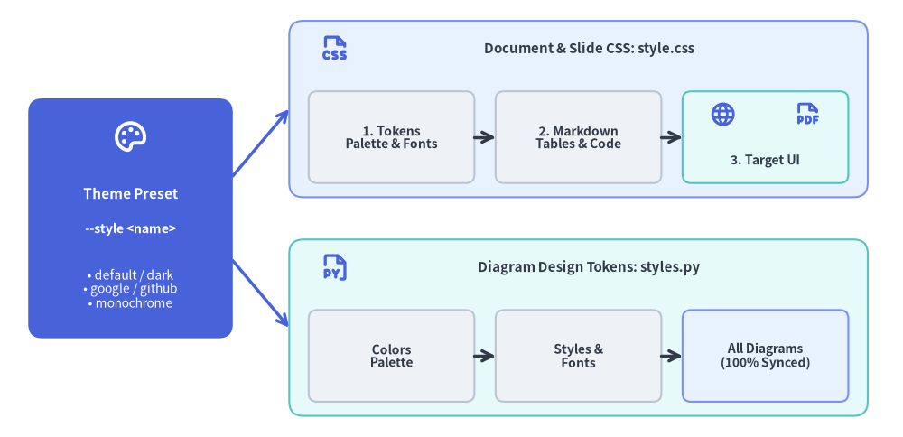
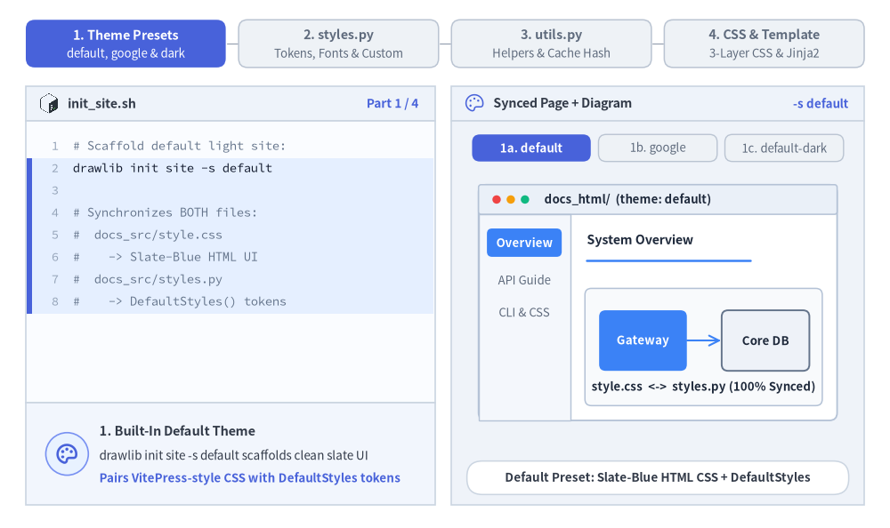
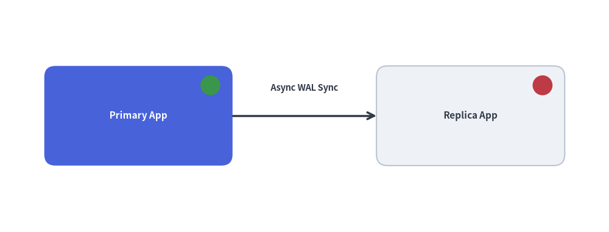

# テンプレートと CSS カスタマイズ: テーマとコード注入

Drawlib は、企業のデザインシステムや独自の開発ワークフローへシームレスに統合できるよう設計されています。HTML レイアウト構造のカスタマイズ、スタイルシートの調整、およびプロジェクト全体で共有する Python 描画ヘルパーやスタイル定義の注入が可能です。

単一のテーマプリセット（`--style <preset>`）を指定するだけで、ドキュメント用 CSS（`style.css`）と図解用デザイントークン（`styles.py`）の両方が同期されます。


<figure class="drawlib-image" style="text-align: center;">
  
  <figcaption class="drawlib-caption">統合テーマアーキテクチャ: ドキュメント CSS (style.css) と図解デザイントークン (styles.py) の同期</figcaption>
</figure>

<details class="drawlib-code-details">
<summary>Source Code</summary>

```python
from drawlib.canvas import save, setup
from drawlib.icons import phosphor
from drawlib.lines import line
from drawlib.shapes import rectangle
from drawlib.styles import Styles
from drawlib.text import text

setup(width=128, height=62)

# Left Focal Card: Single Theme Preset
rectangle((18.5, 31), width=29, height=34, style=Styles.PrimaryFlat.patch(shape_r=2.0))
phosphor.palette((18.5, 42.5), width=5.2, style=Styles.WhiteBold)
text((18.5, 34.5), "Theme Preset", style=Styles.WhiteBold.patch(text_size=11.0))
text((18.5, 29.5), "--style <name>", style=Styles.WhiteBold.patch(text_size=10.2))
text((18.5, 21.0), "• default / dark\n• google / github\n• monochrome", style=Styles.White.patch(text_size=10.0))

# Branching connectors
line((33, 37), (41, 46.5), arrow_head="->", style=Styles.PrimaryBold)
line((33, 25), (41, 15.5), arrow_head="->", style=Styles.PrimaryBold)

# Top Branch: Document & Slide Styling (style.css)
rectangle((82, 46.5), width=82, height=25, style=Styles.PrimaryNeutral.patch(shape_r=2.0))
phosphor.file_css((47.5, 55.0), width=4.4, style=Styles.PrimaryBold)
text((83.5, 55.0), "Document & Slide CSS: style.css", style=Styles.DarkBold.patch(text_size=10.8))

rectangle(
    (55.5, 42.5),
    width=23.5,
    height=13,
    style=Styles.Neutral.patch(shape_r=1.2),
    text="1. Tokens\nPalette & Fonts",
    text_style=Styles.DarkBold.patch(text_size=10.0),
)
rectangle(
    (82.0, 42.5),
    width=23.5,
    height=13,
    style=Styles.Neutral.patch(shape_r=1.2),
    text="2. Markdown\nTables & Code",
    text_style=Styles.DarkBold.patch(text_size=10.0),
)
rectangle((108.5, 42.5), width=23.5, height=13, style=Styles.SecondaryNeutral.patch(shape_r=1.2))
phosphor.globe((102.5, 45.8), width=3.8, style=Styles.PrimaryBold)
phosphor.file_pdf((114.5, 45.8), width=3.8, style=Styles.PrimaryBold)
text((108.5, 39.2), "3. Target UI", style=Styles.DarkBold.patch(text_size=10.0))

line((67.25, 42.5), (70.25, 42.5), arrow_head="->", style=Styles.DarkBold)
line((93.75, 42.5), (96.75, 42.5), arrow_head="->", style=Styles.DarkBold)

# Bottom Branch: Diagram Canvas Styling (styles.py)
rectangle((82, 15.5), width=82, height=25, style=Styles.SecondaryNeutral.patch(shape_r=2.0))
phosphor.file_py((47.5, 24.0), width=4.4, style=Styles.PrimaryBold)
text((83.5, 24.0), "Diagram Design Tokens: styles.py", style=Styles.DarkBold.patch(text_size=10.8))

rectangle(
    (55.5, 11.5),
    width=23.5,
    height=13,
    style=Styles.Neutral.patch(shape_r=1.2),
    text="Colors\nPalette",
    text_style=Styles.DarkBold.patch(text_size=10.0),
)
rectangle(
    (82.0, 11.5),
    width=23.5,
    height=13,
    style=Styles.Neutral.patch(shape_r=1.2),
    text="Styles &\nFonts",
    text_style=Styles.DarkBold.patch(text_size=10.0),
)
rectangle(
    (108.5, 11.5),
    width=23.5,
    height=13,
    style=Styles.PrimaryNeutral.patch(shape_r=1.2),
    text="All Diagrams\n(100% Synced)",
    text_style=Styles.DarkBold.patch(text_size=10.0),
)
line((67.25, 11.5), (70.25, 11.5), arrow_head="->", style=Styles.DarkBold)
line((93.75, 11.5), (96.75, 11.5), arrow_head="->", style=Styles.DarkBold)

save()
```

</details>


---

## 1. インタラクティブなテーマ設定＆注入コードツアー

`-s <preset>`（`default`、`google`、`default-dark`、`monochrome`）を指定してプロジェクトをスキャフォールディングすると、HTML／PDF／スライド用スタイルシート（`style.css`）、注入される Python デザイントークン（`styles.py`）、再利用可能な複合ヘルパー（`.drawlib/cache.db` の SHA-256 ハッシュで自動追跡される `utils.py`）、および Jinja2 の `template.html` レイアウトスロットが一貫して同期されます。


<figure class="drawlib-image" style="text-align: center;">
  
  <figcaption class="drawlib-caption">統合カスタマイズツアー: 組み込みスタイルプリセット、共有 styles.py トークン、再利用可能な utils.py ヘルパー、3 層構造 CSS と Jinja2 テンプレート (APNG アニメーション)</figcaption>
</figure>

<details class="drawlib-code-details">
<summary>Source Code</summary>

```python
from __future__ import annotations

from drawlib.anim import Animation
from drawlib.canvas import save, setup
from drawlib.icons import code as code_icons
from drawlib.icons import phosphor
from drawlib.lines import line
from drawlib.shapes import circle, rectangle
from drawlib.smartarts import SourceCode, SourceCodeStyles
from drawlib.styles import Styles
from drawlib.text import text

W, H = 138.0, 82.0
setup(width=W, height=H)
anim = Animation(fps=10.0, loop=0)

CODE_TEXT_SIZE = 10.0
PT_TO_CANVAS = W / 720.0
FONT_CANVAS = CODE_TEXT_SIZE * PT_TO_CANVAS
LINE_H = FONT_CANVAS * 1.8
PAD_Y = FONT_CANVAS * 1.2

CODE_STYLES = SourceCodeStyles.get("default", font_lang="en", text_size=CODE_TEXT_SIZE).patch(
    box_style=Styles.Neutral.patch(shape_fill_color=(0, 0, 0, 0), shape_line_width=0),
)

PANE_HEADER = Styles.Neutral.patch(
    shape_fill_color=(238, 243, 250),
    shape_line_color=(203, 213, 225),
    shape_line_width=1.2,
    shape_r=0.0,
)
EDITOR_BODY = Styles.Neutral.patch(
    shape_fill_color=(250, 252, 255),
    shape_line_color=(203, 213, 225),
    shape_line_width=1.2,
    shape_r=0.0,
)
TAKEAWAY_BODY = Styles.Neutral.patch(
    shape_fill_color=(242, 246, 253),
    shape_line_color=(203, 213, 225),
    shape_line_width=1.2,
    shape_r=0.0,
)
STUDIO_BODY = Styles.Neutral.patch(
    shape_fill_color=(239, 243, 249),
    shape_line_color=(203, 213, 225),
    shape_line_width=1.2,
    shape_r=0.0,
)
BROWSER_CARD = Styles.Neutral.patch(
    shape_fill_color=(255, 255, 255),
    shape_line_color=(180, 194, 214),
    shape_line_width=1.3,
    shape_r=1.2,
)

PART_ITEMS = [
    ("1. Theme Presets", "default, google & dark"),
    ("2. styles.py", "Tokens, Fonts & Custom"),
    ("3. utils.py", "Helpers & Cache Hash"),
    ("4. CSS & Template", "3-Layer CSS & Jinja2"),
]


def draw_step_bar(active_part: int) -> None:
    """Draw top 4-part progress bar (active_part is 1..4)."""
    pill_w = 31.0
    pill_h = 7.4
    gap = 2.0
    start_x = 4.0 + pill_w / 2.0
    cy = 75.2

    for idx, (label, sublabel) in enumerate(PART_ITEMS, start=1):
        cx = start_x + (idx - 1) * (pill_w + gap)
        if idx > 1:
            prev_cx = cx - (pill_w + gap)
            line(
                (prev_cx + pill_w / 2.0 + 0.2, cy),
                (cx - pill_w / 2.0 - 0.2, cy),
                style=Styles.PrimaryBold if idx <= active_part else Styles.MutedThin,
            )

        if idx == active_part:
            st = Styles.PrimaryFlat.patch(shape_r=1.4)
            tst = Styles.WhiteBold.patch(text_size=10.3)
            sub_tst = Styles.White.patch(text_size=9.5)
        elif idx < active_part:
            st = Styles.PrimaryNeutral.patch(shape_r=1.4, shape_line_width=1.1)
            tst = Styles.PrimaryBold.patch(text_size=10.3)
            sub_tst = Styles.Primary.patch(text_size=9.5)
        else:
            st = Styles.Neutral.patch(shape_r=1.4, shape_line_width=1.1)
            tst = Styles.MutedBold.patch(text_size=10.3)
            sub_tst = Styles.Muted.patch(text_size=9.5)

        rectangle((cx, cy), width=pill_w, height=pill_h, style=st)
        text((cx, cy + 1.35), label, style=tst)
        text((cx, cy - 1.55), sublabel, style=sub_tst)


def draw_left_pane(
    active_part: int,
    file_label: str,
    code_lang: str,
    code_lines: list[str],
    hl_range: tuple[int, int],
    icon_fn: object,
    summary_title: str,
    summary_line1: str,
    summary_line2: str,
) -> None:
    """Draw left source editor + bottom concept takeaway card."""
    x0, w = 4.0, 63.5
    cx = x0 + w / 2.0
    top_y = 63.2
    header_h = 5.4
    editor_h = 43.8
    takeaway_h = 15.8

    rectangle((cx, top_y + header_h / 2.0), width=w, height=header_h, style=PANE_HEADER)
    if code_lang == "python":
        code_icons.python((x0 + 3.6, top_y + header_h / 2.0), width=3.4, style=Styles.Neutral)
    elif code_lang == "css":
        code_icons.css3((x0 + 3.6, top_y + header_h / 2.0), width=3.4, style=Styles.Neutral)
    elif code_lang == "html":
        code_icons.html5((x0 + 3.6, top_y + header_h / 2.0), width=3.4, style=Styles.Neutral)
    else:
        code_icons.bash((x0 + 3.6, top_y + header_h / 2.0), width=3.4, style=Styles.Neutral)

    text(
        (x0 + 6.5, top_y + header_h / 2.0),
        file_label,
        style=Styles.DarkBold.patch(text_size=10.2, halign="left"),
    )
    text(
        (x0 + w - 2.6, top_y + header_h / 2.0),
        f"Part {active_part} / 4",
        style=Styles.PrimaryBold.patch(text_size=9.8, halign="right"),
    )

    rectangle((cx, top_y - editor_h / 2.0), width=w, height=editor_h, style=EDITOR_BODY)

    hl_start, hl_end = hl_range
    hl_top = top_y - PAD_Y - hl_start * LINE_H
    hl_bot = top_y - PAD_Y - (hl_end + 1) * LINE_H
    hl_cy = (hl_top + hl_bot) / 2.0
    hl_h = hl_top - hl_bot
    rectangle(
        (cx, hl_cy),
        width=w - 0.6,
        height=hl_h,
        style=Styles.Neutral.patch(shape_fill_color=(229, 239, 255), shape_line_width=0),
    )
    rectangle(
        (x0 + 0.55, hl_cy),
        width=0.9,
        height=hl_h,
        style=Styles.PrimaryFlat.patch(shape_line_width=0),
    )

    SourceCode.draw(
        xy=(x0, top_y),
        width=w,
        code="\n".join(code_lines),
        styles=CODE_STYLES,
        code_lang=code_lang,
        show_linenum=True,
        align="top_left",
    )

    take_cy = 3.6 + takeaway_h / 2.0
    rectangle((cx, take_cy), width=w, height=takeaway_h, style=TAKEAWAY_BODY)
    circle(
        (x0 + 6.4, take_cy),
        radius=3.3,
        style=Styles.PrimaryNeutral.patch(shape_line_width=1.2),
    )
    icon_fn((x0 + 6.4, take_cy), width=3.8, style=Styles.PrimaryBold)  # type: ignore[operator]
    text(
        (x0 + 11.4, take_cy + 3.6),
        summary_title,
        style=Styles.DarkBold.patch(text_size=10.4, halign="left"),
    )
    text(
        (x0 + 11.4, take_cy - 0.2),
        summary_line1,
        style=Styles.Dark.patch(text_size=9.7, halign="left"),
    )
    text(
        (x0 + 11.4, take_cy - 3.8),
        summary_line2,
        style=Styles.PrimaryBold.patch(text_size=9.6, halign="left"),
    )


def draw_theme_studio(param_badge: str, footer_caption: str) -> float:
    """Draw right synchronized page + diagram preview shell and footer."""
    x0, w = 70.0, 64.0
    cx = x0 + w / 2.0
    top_y = 63.2
    header_h = 5.4
    body_h = 59.6

    rectangle((cx, top_y + header_h / 2.0), width=w, height=header_h, style=PANE_HEADER)
    phosphor.palette((x0 + 3.6, top_y + header_h / 2.0), width=3.4, style=Styles.Primary)
    text(
        (x0 + 6.5, top_y + header_h / 2.0),
        "Synced Page + Diagram",
        style=Styles.DarkBold.patch(text_size=10.2, halign="left"),
    )
    text(
        (x0 + w - 2.4, top_y + header_h / 2.0),
        param_badge,
        style=Styles.PrimaryBold.patch(text_size=9.6, halign="right"),
    )

    rectangle((cx, 3.6 + body_h / 2.0), width=w, height=body_h, style=STUDIO_BODY)

    rectangle(
        (cx, 7.8),
        width=59.2,
        height=5.2,
        style=Styles.Neutral.patch(
            shape_fill_color=(255, 255, 255),
            shape_line_color=(203, 213, 225),
            shape_line_width=1.1,
            shape_r=2.4,
        ),
        text=footer_caption,
        text_style=Styles.DarkBold.patch(text_size=9.7),
    )
    return cx


def draw_sub_pills(scx: float, labels: list[str], active_idx: int) -> None:
    """Draw 3-step tracker pills near the top of the right studio pane."""
    pw, ph, pgap = 18.4, 4.2, 1.2
    p_start = scx - (3 * pw + 2 * pgap) / 2.0 + pw / 2.0
    for idx, lbl in enumerate(labels):
        px = p_start + idx * (pw + pgap)
        if idx == active_idx:
            pst = Styles.PrimaryFlat.patch(shape_r=1.2)
            ptst = Styles.WhiteBold.patch(text_size=9.5)
        elif idx < active_idx:
            pst = Styles.PrimaryNeutral.patch(shape_r=1.2, shape_line_width=1.0)
            ptst = Styles.PrimaryBold.patch(text_size=9.5)
        else:
            pst = Styles.Neutral.patch(shape_r=1.2, shape_line_width=1.0)
            ptst = Styles.Muted.patch(text_size=9.5)
        rectangle((px, 59.0), width=pw, height=ph, style=pst, text=lbl, text_style=ptst)


def draw_browser_preview(
    scx: float,
    url_label: str,
    *,
    page_bg: tuple[int, int, int] = (255, 255, 255),
    sidebar_bg: tuple[int, int, int] = (244, 247, 252),
    chrome_bg: tuple[int, int, int] = (234, 240, 248),
    border_col: tuple[int, int, int] = (180, 194, 214),
    accent_col: tuple[int, int, int] = (59, 130, 246),
    second_col: tuple[int, int, int] = (16, 185, 129),
    ink_col: tuple[int, int, int] = (30, 41, 59),
    card_bg: tuple[int, int, int] = (248, 250, 252),
    node2_bg: tuple[int, int, int] = (232, 244, 253),
    heading_txt: str = "System Overview",
    node1_txt: str = "Gateway",
    node2_txt: str = "Core DB",
    hero_r: float = 1.0,
) -> None:
    """Draw mini browser card with synced HTML sidebar/heading + embedded diagram."""
    bw, bh, bcy = 55.6, 36.6, 35.0
    bx0, by0 = scx - bw / 2.0, bcy - bh / 2.0
    by1 = by0 + bh

    rectangle(
        (scx, bcy),
        width=bw,
        height=bh,
        style=Styles.Neutral.patch(
            shape_fill_color=page_bg,
            shape_line_color=border_col,
            shape_line_width=1.3,
            shape_r=1.2,
        ),
    )
    # Top browser bar
    ch_h = 4.6
    rectangle(
        (scx, by1 - ch_h / 2.0),
        width=bw,
        height=ch_h,
        style=Styles.Neutral.patch(
            shape_fill_color=chrome_bg,
            shape_line_color=border_col,
            shape_line_width=1.1,
            shape_r=0.4,
        ),
    )
    for d_i, d_c in enumerate([(239, 68, 68), (245, 158, 11), (16, 185, 129)]):
        circle((bx0 + 2.8 + d_i * 2.2, by1 - ch_h / 2.0), radius=0.65, style=Styles.Neutral.patch(shape_fill_color=d_c, shape_line_width=0))
    text((bx0 + 10.2, by1 - ch_h / 2.0), url_label, style=Styles.DarkBold.patch(text_color=ink_col, text_size=9.5, halign="left"))

    # Left HTML sidebar
    sb_w = 14.2
    sb_h = bh - ch_h
    rectangle(
        (bx0 + sb_w / 2.0, by0 + sb_h / 2.0),
        width=sb_w,
        height=sb_h,
        style=Styles.Neutral.patch(
            shape_fill_color=sidebar_bg,
            shape_line_color=border_col,
            shape_line_width=1.0,
            shape_r=0.0,
        ),
    )
    rectangle(
        (bx0 + sb_w / 2.0, by1 - ch_h - 4.4),
        width=11.6,
        height=4.4,
        style=Styles.Neutral.patch(shape_fill_color=accent_col, shape_line_width=0, shape_r=0.8),
        text="Overview",
        text_style=Styles.WhiteBold.patch(text_size=9.5),
    )
    text((bx0 + sb_w / 2.0, by1 - ch_h - 10.2), "API Guide", style=Styles.Muted.patch(text_size=9.5))
    text((bx0 + sb_w / 2.0, by1 - ch_h - 15.2), "CLI & CSS", style=Styles.Muted.patch(text_size=9.5))

    # Right HTML article + Embedded Drawlib Diagram Card
    art_x0 = bx0 + sb_w
    art_cx = art_x0 + (bw - sb_w) / 2.0
    text(
        (art_x0 + 2.6, by1 - ch_h - 4.0),
        heading_txt,
        style=Styles.DarkBold.patch(text_color=ink_col, text_size=10.2, halign="left"),
    )
    line(
        (art_x0 + 2.6, by1 - ch_h - 7.2),
        (art_x0 + 28.0, by1 - ch_h - 7.2),
        style=Styles.Neutral.patch(line_color=accent_col, line_width=1.8),
    )

    # Embedded Drawlib figure card inside HTML page
    fig_cy = by0 + 11.4
    rectangle(
        (art_cx, fig_cy),
        width=36.8,
        height=18.2,
        style=Styles.Neutral.patch(
            shape_fill_color=card_bg,
            shape_line_color=border_col,
            shape_line_width=1.1,
            shape_r=1.0,
        ),
    )
    n1_cx, n2_cx = art_cx - 9.4, art_cx + 9.6
    rectangle(
        (n1_cx, fig_cy + 1.0),
        width=13.6,
        height=9.4,
        style=Styles.Neutral.patch(shape_fill_color=accent_col, shape_line_width=0, shape_r=hero_r),
        text=node1_txt,
        text_style=Styles.WhiteBold.patch(text_size=9.6),
    )
    rectangle(
        (n2_cx, fig_cy + 1.0),
        width=13.6,
        height=9.4,
        style=Styles.Neutral.patch(
            shape_fill_color=node2_bg,
            shape_line_color=second_col,
            shape_line_width=1.4,
            shape_r=1.0,
        ),
        text=node2_txt,
        text_style=Styles.DarkBold.patch(text_color=ink_col, text_size=9.6),
    )
    line(
        (n1_cx + 6.9, fig_cy + 1.0),
        (n2_cx - 6.9, fig_cy + 1.0),
        arrow_head="->",
        style=Styles.PrimaryBold.patch(line_color=accent_col, line_width=1.5),
    )
    text(
        (art_cx, fig_cy - 6.2),
        "style.css  <->  styles.py (100% Synced)",
        style=Styles.DarkBold.patch(text_color=ink_col, text_size=9.5),
    )


# =========================================================================
# Part 1: Theme Presets — default, google & default-dark
# =========================================================================
PART1_STATES = [
    (
        "1a",
        3.3,
        "init_site.sh",
        "bash",
        [
            "# Scaffold default light site:",
            "drawlib init site -s default",
            "",
            "# Synchronizes BOTH files:",
            "#  docs_src/style.css",
            "#    -> Slate-Blue HTML UI",
            "#  docs_src/styles.py",
            "#    -> DefaultStyles() tokens",
        ],
        (1, 7),
        "-s default",
        "Default Preset: Slate-Blue HTML CSS + DefaultStyles",
        "1. Built-In Default Theme",
        "drawlib init site -s default scaffolds clean slate UI",
        "Pairs VitePress-style CSS with DefaultStyles tokens",
    ),
    (
        "1b",
        3.3,
        "init_site.sh",
        "bash",
        [
            "# Scaffold Google Material UI:",
            "drawlib init site -s google",
            "",
            "# Synchronizes BOTH files:",
            "#  docs_src/style.css",
            "#    -> #1A73E8 & #34A853 CSS",
            "#  docs_src/styles.py",
            "#    -> GoogleColors/Styles()",
        ],
        (1, 7),
        "-s google",
        "Google Preset: #1A73E8 & #34A853 Synced in HTML & SVG",
        "2. Google Material Theme",
        "Applies #1A73E8 Google Blue & #34A853 Green palette",
        "Both HTML prose and Python nodes update in lockstep",
    ),
    (
        "1c",
        3.5,
        "init_site.sh",
        "bash",
        [
            "# Scaffold Dark Mode Site:",
            "drawlib init site \\",
            "    -s default-dark",
            "",
            "# High-contrast dark palette:",
            "#  docs_src/style.css (Dark UI)",
            "#  docs_src/styles.py",
            "#    -> DefaultDark tokens!",
        ],
        (1, 7),
        "-s default-dark",
        "Default-Dark: Coordinated Dark Surface CSS & Diagram",
        "3. High-Contrast Dark Mode",
        "Scaffolds dark slate HTML surface + luminous nodes",
        "Zero manual hex tweaking across prose & diagrams",
    ),
]

for p1_idx, (m1, dur, flbl, clang, code_1, hl_rng, badge, foot, st_t, s_1, s_2) in enumerate(PART1_STATES):
    with anim.frame(duration=dur):
        draw_step_bar(1)
        draw_left_pane(1, flbl, clang, code_1, hl_rng, phosphor.palette, st_t, s_1, s_2)
        scx = draw_theme_studio(badge, foot)
        draw_sub_pills(scx, ["1a. default", "1b. google", "1c. default-dark"], p1_idx)

        if m1 == "1a":
            draw_browser_preview(
                scx,
                "docs_html/  (theme: default)",
                accent_col=(59, 130, 246),
                second_col=(100, 116, 139),
                node2_bg=(238, 242, 248),
            )
        elif m1 == "1b":
            draw_browser_preview(
                scx,
                "docs_html/  (theme: google)",
                sidebar_bg=(241, 246, 254),
                chrome_bg=(232, 240, 254),
                accent_col=(26, 115, 232),
                second_col=(52, 168, 83),
                node2_bg=(230, 244, 234),
            )
        else:
            # Dark preview strictly scoped inside right browser card (>70% canvas stays light neutral)
            draw_browser_preview(
                scx,
                "docs_html/  (default-dark)",
                page_bg=(23, 29, 43),
                sidebar_bg=(17, 22, 34),
                chrome_bg=(32, 41, 59),
                border_col=(71, 85, 105),
                accent_col=(99, 102, 241),
                second_col=(56, 189, 248),
                ink_col=(241, 245, 249),
                card_bg=(30, 41, 59),
                node2_bg=(22, 54, 78),
            )

# =========================================================================
# Part 2: styles.py — Global Tokens, CJK Fonts & Custom BrandHero Token
# =========================================================================
PART2_STATES = [
    (
        "2a",
        3.3,
        "docs_src/styles.py",
        "python",
        [
            "# docs_src/styles.py",
            "from drawlib import (",
            "    preset_colors as pc,",
            "    preset_styles as ps,",
            ")",
            "# Injected before every block:",
            "Colors = pc.GoogleColors()",
            "Styles = ps.GoogleStyles()",
            "# Auto-applies to Styles.*!",
        ],
        (5, 8),
        "Global Tokens",
        "styles.py Overrides Colors & Styles Before Every Block",
        "1. Project-Wide Token Injection",
        "Colors & Styles in styles.py load automatically",
        "Every diagram inherits tokens via drawlib.styles",
    ),
    (
        "2b",
        3.3,
        "docs_src/styles.py",
        "python",
        [
            "from drawlib.fonts import (",
            "    FontJapanese, FontRoboto,",
            ")",
            "REG = FontRoboto.ROBOTO_REGULAR",
            "BLD = FontRoboto.ROBOTO_BOLD",
            "Styles = GoogleStyles(",
            ").patch_font(",
            "    regular=REG, bold=BLD,",
            ")",
            "# -l ja -> FontJapanese Noto",
        ],
        (3, 9),
        "patch_font()",
        "patch_font() & --lang ja Unify Latin & CJK Typography",
        "2. Unified Multilingual Fonts",
        ".patch_font() sets regular, bold & thin weights",
        "--lang ja auto-configures CJK-safe Noto Sans JP",
    ),
    (
        "2c",
        3.5,
        "docs_src/styles.py",
        "python",
        [
            "# Define custom semantic token:",
            "Styles.BrandHero = (",
            "    Styles.PrimaryFlat.patch(",
            "        shape_r=2.5,",
            "        shape_line_width=1.8,",
            "        text_size=11.5,",
            "    )",
            ")",
            "# Reuse in any Markdown block:",
            "# style=Styles.BrandHero",
        ],
        (1, 7),
        "Styles.BrandHero",
        "Custom Semantic Tokens Reuse Across Every Page & Block",
        "3. Custom Semantic Design Tokens",
        "Extend Styles with domain tokens like BrandHero",
        "Update 1 style in styles.py -> updates whole site",
    ),
]

for p2_idx, (m2, dur, flbl, clang, code_2, hl_rng, badge, foot, st_t, s_1, s_2) in enumerate(PART2_STATES):
    with anim.frame(duration=dur):
        draw_step_bar(2)
        draw_left_pane(2, flbl, clang, code_2, hl_rng, phosphor.file_py, st_t, s_1, s_2)
        scx = draw_theme_studio(badge, foot)
        draw_sub_pills(scx, ["2a. Global Tokens", "2b. Font & CJK", "2c. BrandHero"], p2_idx)

        if m2 == "2a":
            draw_browser_preview(
                scx,
                "styles.py -> GoogleStyles()",
                sidebar_bg=(241, 246, 254),
                chrome_bg=(232, 240, 254),
                accent_col=(26, 115, 232),
                second_col=(52, 168, 83),
                node2_bg=(230, 244, 234),
                heading_txt="Global Token Override",
            )
        elif m2 == "2b":
            rectangle((scx, 35.0), width=55.6, height=36.6, style=BROWSER_CARD)
            rectangle((scx, 50.8), width=55.6, height=5.0, style=Styles.PrimaryNeutral.patch(shape_r=0.6), text="Unified Typography (.patch_font & --lang ja)", text_style=Styles.PrimaryBold.patch(text_size=9.6))

            rectangle((88.5, 36.2), width=24.0, height=18.5, style=Styles.Neutral.patch(shape_r=1.0))
            text((88.5, 42.0), "FontRoboto", style=Styles.PrimaryBold.patch(text_size=10.0))
            text((88.5, 36.4), "ROBOTO_BOLD", style=Styles.DarkBold.patch(text_size=9.5))
            text((88.5, 31.2), "Latin / Western", style=Styles.MutedBold.patch(text_size=9.5))

            rectangle((115.5, 36.2), width=24.0, height=18.5, style=Styles.PrimaryNeutral.patch(shape_r=1.0, shape_line_width=1.4))
            text((115.5, 42.0), "FontJapanese", style=Styles.PrimaryBold.patch(text_size=10.0))
            text((115.5, 36.4), "Noto Sans CJK", style=Styles.DarkBold.patch(text_size=9.5))
            text((115.5, 31.2), "--lang ja Ready", style=Styles.PrimaryBold.patch(text_size=9.5))

            text((scx, 20.8), "Zero Tofu Boxes Across Latin + CJK Labels", style=Styles.DarkBold.patch(text_size=9.6))
        else:
            draw_browser_preview(
                scx,
                "style=Styles.BrandHero",
                sidebar_bg=(241, 246, 254),
                chrome_bg=(232, 240, 254),
                accent_col=(26, 115, 232),
                second_col=(52, 168, 83),
                node2_bg=(238, 242, 248),
                heading_txt="Custom Semantic Token",
                node1_txt="BrandHero",
                node2_txt="Neutral",
                hero_r=2.8,
            )

# =========================================================================
# Part 3: utils.py — Reusable Composite Helpers & Cache Invalidation
# =========================================================================
PART3_STATES = [
    (
        "3a",
        3.3,
        "docs_src/utils.py",
        "python",
        [
            "# docs_src/utils.py",
            "def draw_server_node(",
            "    xy: tuple[float, float],",
            "    title: str, role: str,",
            ") -> None:",
            "    rectangle(xy, 30, 16, ...)",
            "    led = (xy[0]+11, xy[1]+5)",
            "    st = Styles.SuccessFlat",
            "    circle(led, 1.6, style=st)",
        ],
        (1, 8),
        "def helper()",
        "Author Composite Shapes Once in docs_src/utils.py",
        "1. Reusable Composite Helpers",
        "Encapsulate multi-shape nodes + status LEDs once",
        "Eliminates copy-pasted drawing code across pages",
    ),
    (
        "3b",
        3.3,
        "02_cluster.md",
        "python",
        [
            "# Auto-imported as utils:",
            "import utils",
            "setup(width=110, height=42)",
            "utils.draw_server_node(",
            '    (26, 21), "API-01", "Main"',
            ")",
            "utils.draw_server_node(",
            '    (84, 21), "API-02", "Warm"',
            ")",
            "save()",
        ],
        (3, 8),
        "import utils",
        "import utils Works Out-of-the-Box Across All Pages",
        "2. Zero-Boilerplate Auto-Import",
        "Drawlib binds docs_src/utils.py as `utils` module",
        "Call utils.draw_server_node(...) in any .md block",
    ),
    (
        "3c",
        3.5,
        "build_cache.sh",
        "bash",
        [
            "# Edit docs_src/utils.py:",
            "#   + Add mTLS shield badge",
            "",
            "drawlib build html docs_src",
            "# .drawlib/cache.db SHA-256:",
            "#  hash(code + styles + utils)",
            "#  -> Cache miss! Re-renders",
            "#  -> Every page updated 100%",
        ],
        (3, 7),
        "SHA-256 Cache",
        "Editing utils.py Auto-Invalidates .drawlib/cache.db",
        "3. Smart SHA-256 Cache Sync",
        ".drawlib/cache.db hashes block + styles.py + utils.py",
        "Editing 1 helper updates every page deterministically",
    ),
]

for p3_idx, (m3, dur, flbl, clang, code_3, hl_rng, badge, foot, st_t, s_1, s_2) in enumerate(PART3_STATES):
    with anim.frame(duration=dur):
        draw_step_bar(3)
        draw_left_pane(3, flbl, clang, code_3, hl_rng, phosphor.wrench, st_t, s_1, s_2)
        scx = draw_theme_studio(badge, foot)
        draw_sub_pills(scx, ["3a. Define Helper", "3b. Auto-Import", "3c. SHA-256 Sync"], p3_idx)

        rectangle((scx, 35.0), width=55.6, height=36.6, style=BROWSER_CARD)
        if m3 == "3a":
            text((scx, 49.6), "Composite Widget Blueprint (utils.py)", style=Styles.DarkBold.patch(text_size=9.8))
            rectangle(
                (scx, 36.2),
                width=30.0,
                height=15.6,
                style=Styles.PrimaryFlat.patch(shape_r=1.8),
            )
            text((scx, 38.4), "API-01", style=Styles.WhiteBold.patch(text_size=10.6))
            text((scx, 33.4), "Role: Primary", style=Styles.White.patch(text_size=9.6))
            circle((scx + 11.4, 41.2), radius=1.7, style=Styles.SuccessFlat)
            text((scx, 21.8), "1 Call = Card + Typography + Live Status LED", style=Styles.PrimaryBold.patch(text_size=9.5))
        elif m3 == "3b":
            rectangle((scx, 50.8), width=55.6, height=4.8, style=Styles.SecondaryNeutral.patch(shape_r=0.6), text="02_cluster.md — import utils", text_style=Styles.DarkBold.patch(text_size=9.6))
            # Two server nodes connected
            rectangle((88.2, 35.2), width=20.0, height=13.4, style=Styles.PrimaryFlat.patch(shape_r=1.5))
            text((88.2, 37.0), "API-01", style=Styles.WhiteBold.patch(text_size=9.8))
            text((88.2, 32.6), "Main", style=Styles.White.patch(text_size=9.5))
            circle((95.6, 39.6), radius=1.4, style=Styles.SuccessFlat)

            rectangle((115.8, 35.2), width=20.0, height=13.4, style=Styles.Neutral.patch(shape_r=1.5))
            text((115.8, 37.0), "API-02", style=Styles.DarkBold.patch(text_size=9.8))
            text((115.8, 32.6), "Warm", style=Styles.Dark.patch(text_size=9.5))
            circle((123.2, 39.6), radius=1.4, style=Styles.SuccessFlat)

            line((98.2, 35.2), (105.8, 35.2), arrow_head="->", style=Styles.DarkBold)
            text((scx, 21.2), "Reused cleanly across 01_intro.md & 02_cluster.md", style=Styles.DarkBold.patch(text_size=9.5))
        else:
            rectangle((scx, 50.6), width=55.6, height=5.0, style=Styles.PrimaryNeutral.patch(shape_r=0.6), text=".drawlib/cache.db  SHA-256 Invalidated!", text_style=Styles.PrimaryBold.patch(text_size=9.6))
            for idx_p, (px_c, pg_lbl) in enumerate([(88.5, "01_intro.md"), (115.5, "02_cluster.md")]):
                rectangle((px_c, 34.8), width=23.6, height=18.8, style=Styles.Neutral.patch(shape_r=1.0))
                text((px_c, 41.2), pg_lbl, style=Styles.MutedBold.patch(text_size=9.5))
                rectangle(
                    (px_c, 32.6),
                    width=19.2,
                    height=10.2,
                    style=Styles.PrimaryFlat.patch(shape_r=1.2) if idx_p == 0 else Styles.SecondaryNeutral.patch(shape_r=1.2),
                )
                phosphor.shield_check(
                    (px_c - 5.6, 32.6),
                    width=3.4,
                    style=Styles.WhiteBold if idx_p == 0 else Styles.PrimaryBold,
                )
                text(
                    (px_c + 2.0, 32.6),
                    "mTLS",
                    style=Styles.WhiteBold.patch(text_size=9.6) if idx_p == 0 else Styles.DarkBold.patch(text_size=9.6),
                )
            text((scx, 20.6), "All Dependent Diagrams Re-Rendered in 1 Build", style=Styles.PrimaryBold.patch(text_size=9.5))

# =========================================================================
# Part 4: CSS & Template — 3-Layer style.css, drawlib css & template.html
# =========================================================================
PART4_STATES = [
    (
        "4a",
        3.3,
        "docs_src/style.css",
        "css",
        [
            "/* Layer 1: :root tokens */",
            ":root {",
            "  --accent: #1a73e8;",
            "  --bg-soft: #f8fafc;",
            "}",
            "/* Layer 2: Markdown & code */",
            "/* Layer 3: Target + custom */",
            ".drawlib-image {",
            "  border-radius: 12px;",
            "}",
        ],
        (0, 9),
        "3-Layer CSS",
        "3-Layer style.css Separates Tokens, Prose & Target UI",
        "1. 3-Layer Stylesheet Design",
        "Layer 1 :root vars -> Layer 2 Markdown components",
        "Layer 3 target layout (site/doc/slide) + overrides",
    ),
    (
        "4b",
        3.3,
        "swap_css.sh",
        "bash",
        [
            "# List built-in CSS presets:",
            "drawlib css list",
            "",
            "# Export theme stylesheet:",
            "drawlib css show html \\",
            "    google-dark \\",
            "    > docs_src/style.css",
        ],
        (3, 6),
        "drawlib css",
        "drawlib css list & css show Swap Theme Presets Fast",
        "2. Instant CLI Stylesheet Swap",
        "drawlib css list previews all 9 built-in CSS themes",
        "drawlib css show exports google-dark / github / etc.",
    ),
    (
        "4c",
        3.5,
        "template.html",
        "html",
        [
            "<header>{{ title }}</header>",
            '<div class="layout">',
            "  <aside>",
            "    {{ nav_sections }}",
            "  </aside>",
            "  <main>{{ body }}</main>",
            '  <nav class="toc">',
            "    {{ toc_items }}",
            "  </nav>",
            "</div>",
        ],
        (0, 9),
        "Jinja2 Slots",
        "Jinja2 template.html Controls Header, Nav, Body & TOC",
        "3. Custom Jinja2 HTML Shell",
        "Edit template.html for brand headers & analytics",
        "Injects {{ title }}, {{ nav_sections }}, {{ body }}",
    ),
]

for p4_idx, (m4, dur, flbl, clang, code_4, hl_rng, badge, foot, st_t, s_1, s_2) in enumerate(PART4_STATES):
    with anim.frame(duration=dur):
        draw_step_bar(4)
        draw_left_pane(4, flbl, clang, code_4, hl_rng, phosphor.file_css, st_t, s_1, s_2)
        scx = draw_theme_studio(badge, foot)
        draw_sub_pills(scx, ["4a. 3-Layer CSS", "4b. drawlib css", "4c. template.html"], p4_idx)

        if m4 == "4a":
            rectangle((scx, 35.0), width=55.6, height=36.6, style=BROWSER_CARD)
            layers = [
                (46.2, Styles.PrimaryFlat, Styles.WhiteBold, "Layer 1: :root CSS Variables (--accent)"),
                (35.2, Styles.PrimaryNeutral, Styles.DarkBold, "Layer 2: Markdown Tables, Alerts & Code"),
                (24.2, Styles.SecondaryNeutral, Styles.DarkBold, "Layer 3: Site / Doc / Slide + Custom Rules"),
            ]
            for ly, lst, ltst, llbl in layers:
                rectangle(
                    (scx, ly),
                    width=50.4,
                    height=8.0,
                    style=lst.patch(shape_r=1.2),
                    text=llbl,
                    text_style=ltst.patch(text_size=9.5),
                )
            line((scx, 42.2), (scx, 39.2), arrow_head="->", style=Styles.PrimaryBold)
            line((scx, 31.2), (scx, 28.2), arrow_head="->", style=Styles.DarkBold)
        elif m4 == "4b":
            # Scoped Material Dark card inside Right Preview (>70% canvas remains light neutral)
            draw_browser_preview(
                scx,
                "style.css  (google-dark)",
                page_bg=(32, 33, 36),
                sidebar_bg=(23, 24, 27),
                chrome_bg=(41, 42, 45),
                border_col=(95, 99, 104),
                accent_col=(138, 180, 248),
                second_col=(129, 201, 149),
                ink_col=(232, 234, 237),
                card_bg=(41, 42, 45),
                node2_bg=(30, 58, 42),
                heading_txt="Google Dark Preset",
            )
        else:
            # 4c: Jinja2 template.html wireframe showing all 4 template slots
            rectangle((scx, 35.0), width=55.6, height=36.6, style=BROWSER_CARD)
            # Header: {{ title }}
            rectangle(
                (scx, 49.4),
                width=51.8,
                height=5.6,
                style=Styles.PrimaryFlat.patch(shape_r=0.8),
                text="<header>  {{ title }}  </header>",
                text_style=Styles.WhiteBold.patch(text_size=9.6),
            )
            # Left aside: {{ nav_sections }}
            rectangle(
                (82.8, 31.2),
                width=13.4,
                height=26.8,
                style=Styles.Neutral.patch(shape_r=0.8),
                text="aside\n\n{{ nav_\nsections }}",
                text_style=Styles.DarkBold.patch(text_size=9.5),
            )
            # Center main: {{ body }}
            rectangle(
                (102.2, 31.2),
                width=22.6,
                height=26.8,
                style=Styles.PrimaryNeutral.patch(shape_r=0.8, shape_line_width=1.4),
                text="<main>\n\n{{ body }}\n\nProse + SVG",
                text_style=Styles.PrimaryBold.patch(text_size=9.6),
            )
            # Right toc: {{ toc_items }}
            rectangle(
                (121.4, 31.2),
                width=13.0,
                height=26.8,
                style=Styles.SecondaryNeutral.patch(shape_r=0.8),
                text="nav.toc\n\n{{ toc_\nitems }}",
                text_style=Styles.DarkBold.patch(text_size=9.5),
            )

save()
```

</details>


---

## 2. HTML テンプレートのカスタマイズ (`template.html`)

すべての Drawlib のサイトおよび PDF プロジェクトには、ソースディレクトリ内に Jinja2 テンプレート（`template.html`）が含まれています。このファイルを編集することで、以下のカスタマイズが可能です。
- コーポレートブランディング、ヘッダーナビゲーションバー、企業ロゴの組み込み。
- 外部 Web アクセス解析（Google Analytics、Plausible など）やテレメトリスクリプトの追加。
- カスタム Google Fonts や外部 CSS フレームワークの読み込み。

### Drawlib が提供するテンプレート変数:
- `{{ title }}`: 現在のドキュメントのタイトルまたはサイトブランド名。
- `{{ body }}`: Markdown と埋め込み図解からコンパイルされた HTML 本文コンテンツ。
- `{{ nav_sections }}` / `{{ nav_items }}`: サイドバー用の構造化ナビゲーションツリー（`site` プロジェクト用）。
- `{{ toc_items }}`: 右側目次用の構造化された見出しアウトライン（`site` プロジェクト用）。
- `{{ css_href }}`: `style.css` への相対パス。
- `{{ custom_css }}`: 注入されるインライン CSS オーバーライド。

---

## 3. CSS スタイルシートのカスタマイズ (`style.css`)

Drawlib プロジェクトのソースフォルダには、3 層アーキテクチャ（レイヤー 1: テーマトークン、レイヤー 2: コード＆Markdown コンポーネント、レイヤー 3: `site`・`doc`・`pdf`・`slide` 向けのターゲットレイアウト）で構築されたローカルの `style.css` が含まれています。このスタイルシートを直接編集して、配色、タイポグラフィ、余白を自由に変更できます。

### 組み込み CSS テーマプリセット一覧:

| テーマプリセット | HTML / Site | PDF / Doc | Slide | 説明 |
| :--- | :---: | :---: | :---: | :--- |
| **`default`** | 対応 | 対応 | 対応 | VitePress と Tailwind CSS に着想を得たモダンな開発者向けライトテーマ。 |
| **`default-dark`** | 対応 | 対応 | 対応 | 深いスレート＆インディゴ配色のモダンな開発者向けダークテーマ。 |
| **`default-auto`** | 対応 | 非対応 | 非対応 | `@media (prefers-color-scheme)` によりライト／ダークを自動切替するレスポンシブテーマ。 |
| **`google`** | 対応 | 対応 | 対応 | Google Blog および Material Design 風のクリーンなエディトリアルライトスタイル。 |
| **`google-dark`** | 対応 | 対応 | 対応 | Material Dark パレットを採用した Google エディトリアルダークテーマ。 |
| **`google-auto`** | 対応 | 非対応 | 非対応 | ライトとダークを自動切替する Google エディトリアルレスポンシブテーマ。 |
| **`github`** | 対応 | 対応 | 非対応 | おなじみのコードブロックや表デザインを備えた GitHub Flavored Markdown スタイル。 |
| **`minimal`** | 対応 | 対応 | 非対応 | 装飾を抑えて読書に集中できる軽量ミニマルタイポグラフィ。 |
| **`monochrome`** | 対応 | 対応 | 対応 | 公式出版物や印刷に適した高コントラストなモノクロスタイル。 |

### 組み込み CSS テーマの確認とエクスポート (`drawlib css`):
`drawlib css list` および `drawlib css show` を使用すると、組み込みのテーマプリセットを確認したり、ローカルの `style.css` を上書きエクスポートしたりできます。

```bash
# List all available CSS presets for HTML and PDF targets:
drawlib css list

# Export the Google HTML theme to your project's style.css:
drawlib css show html google -o docs_src/style.css --force

# Export the GitHub HTML theme:
drawlib css show html github -o docs_src/style.css --force

# Export the Monochrome PDF theme:
drawlib css show pdf monochrome -o doc_src/style.css --force
```

---

## 4. プロジェクト共通スタイルの注入 (`styles.py`)

個々の図解ごとにカスタムカラーやフォントスタイルを再宣言したり、場当たり的なスタイル変数を散在させたりする代わりに、ソースディレクトリ内に `styles.py` ファイルを定義できます。

プロジェクトのソースディレクトリに配置する（または `-s docs_src/styles.py` で渡す）と、Drawlib は `styles.py` を読み込んでプロジェクト全体の `Colors` および `Styles` デザイントークンを構成します。

```python
# docs_src/styles.py
from drawlib.fonts import FontRoboto
from drawlib.preset_colors import GoogleColors
from drawlib.preset_styles import GoogleStyles

# 1. Initialize project-wide color palette and style catalog
Colors = GoogleColors()
Styles = GoogleStyles().patch_font(
    regular=FontRoboto.ROBOTO_REGULAR,
    bold=FontRoboto.ROBOTO_BOLD,
    thin=FontRoboto.ROBOTO_THIN,
)

# 2. Derive reusable custom component tokens
CustomCard = Styles.PrimaryNeutral.patch(
    shape_line_width=1.5,
    text_size=10.0,
)
```

### 利用可能なプリセット `Styles` および `Colors` クラス:
- **`drawlib.preset_styles`**: `DefaultStyles`, `DefaultDarkStyles`, `GoogleStyles`, `GoogleDarkStyles`, `MonochromeStyles`, `MonochromeDarkStyles`
- **`drawlib.preset_colors`**: `DefaultColors`, `GoogleColors`, `MonochromeColors`, `CssColors`

### `from drawlib.styles import Styles, Colors` によるシームレスなテーマ適用
`styles.py` が存在する場合、標準トークンをインポートするすべての埋め込み ````drawlib```` ブロックは、自動的にこれらの設定を継承します。

```python
# Inside your Markdown drawing code:
from drawlib.canvas import setup
from drawlib.shapes import rectangle
from drawlib.styles import Styles

setup(width=80, height=40)
# Automatically rendered using the GoogleStyles theme and Roboto fonts configured in styles.py
rectangle((40, 20), width=50, height=25, style=Styles.PrimaryFlat, text="Unified Themed Card", text_style=Styles.WhiteBold)
```

### `style.css` との一貫したデザイン統合
`drawlib init <type> --style google`（または `monochrome`、`default`、`default-dark`、`google-dark`）を使用してプロジェクトをスキャフォールディングすると、Drawlib は Python 図解用の `styles.py` と HTML／PDF／スライドのタイポグラフィ・カード背景用の `style.css` の両方を自動的に同期させます。これにより、**ドキュメントの本文と埋め込まれたアーキテクチャ図解が 100% 統一されたビジュアルアイデンティティを共有します**。

---

## 5. 共通ヘルパー関数の注入 (`utils.py`)

専用のサーバーラック、ステータスバッジ、複合アイコンといった再利用可能な複合描画要素については、`utils.py` 内にカスタム関数を作成します。


```python
from drawlib.canvas import save, setup
from drawlib.lines import line
from drawlib.shapes import circle, rectangle
from drawlib.styles import Styles
from drawlib.text import text


# Defined in docs_src/utils.py (imported as `import utils` in Markdown blocks):
def draw_server_node(xy: tuple[float, float], name: str, *, is_active: bool = True) -> None:
    x, y = xy
    style = Styles.PrimaryFlat.patch(shape_r=2.0) if is_active else Styles.Neutral.patch(shape_r=2.0)
    t_style = Styles.WhiteBold.patch(text_size=11.0) if is_active else Styles.DarkBold.patch(text_size=11.0)
    rectangle((x, y), width=34, height=18, style=style, text=name, text_style=t_style)

    # Status indicator LED (Green = Active, Red = Standby/Offline)
    indicator_style = Styles.SuccessFlat if is_active else Styles.DangerFlat
    circle((x + 13, y + 5.5), radius=1.8, style=indicator_style)


# Inside your Markdown drawing code (`drawlib build ... -u docs_src/utils.py`):
setup(width=110, height=42)

draw_server_node((25, 21), "Primary App", is_active=True)
draw_server_node((85, 21), "Replica App", is_active=False)

line((42, 21), (68, 21), arrow_head="->", style=Styles.DarkBold)
text((55, 26.0), "Async WAL Sync", style=Styles.DarkBold.patch(text_size=10.5))

save()
```

<figure class="drawlib-image" style="text-align: center;">
  
  <figcaption class="drawlib-caption">utils.py で定義された再利用可能な複合サーバーノードヘルパーの描画例</figcaption>
</figure>


