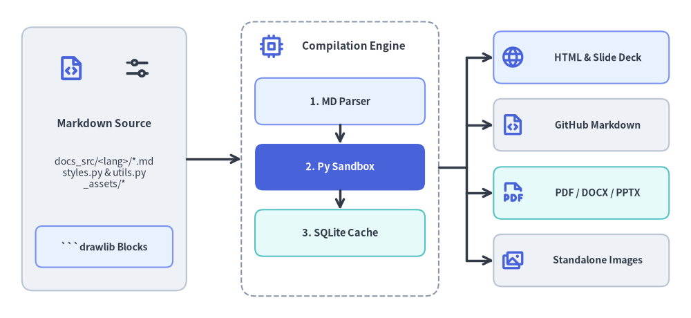
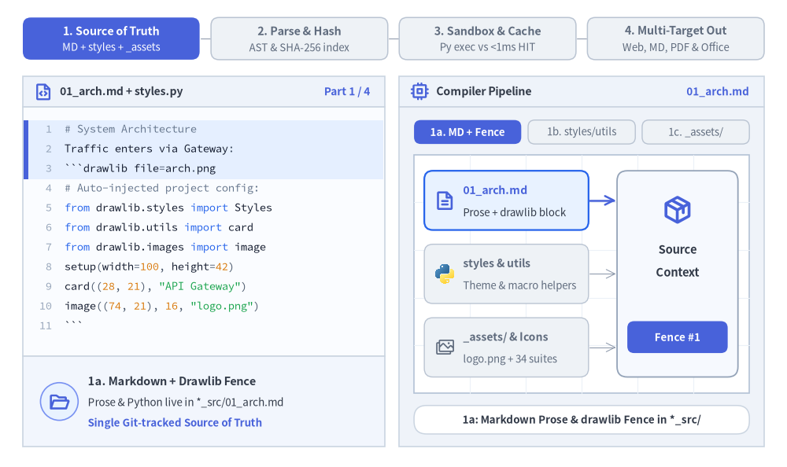
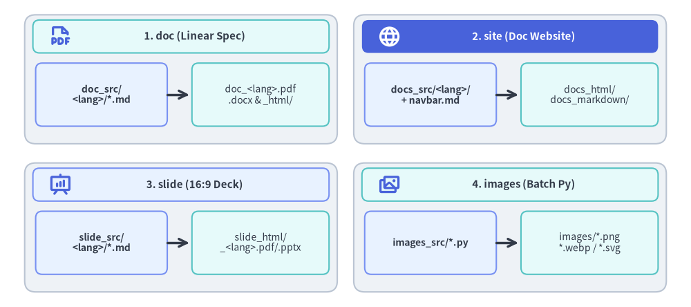

# コードとしての図解ドキュメント: Drawlib ビルドエンジン

Drawlib は、技術ドキュメントとアーキテクチャ図解を単一の **「コードとしての図解ドキュメント（Illustrated Documentation as Code）」** パイプラインに統合します。同期ずれを起こしやすいベクターファイルの管理や、外部ツールからの手動エクスポート、不透明なバイナリアセットの Git 管理を行う代わりに、標準の Markdown ドキュメント内に宣言的な Python 描画ブロックを直接記述できます。


<figure class="drawlib-image" style="text-align: center;">
  
  <figcaption class="drawlib-caption">Drawlib ドキュメントコンパイルパイプラインと出力ターゲット一覧</figcaption>
</figure>

<details class="drawlib-code-details">
<summary>Source Code</summary>

```python
from drawlib.canvas import save, setup
from drawlib.icons import phosphor
from drawlib.lines import line
from drawlib.shapes import rectangle
from drawlib.styles import Styles
from drawlib.text import text

setup(width=126, height=58)

# Left: Markdown Source
rectangle((19, 29), width=30, height=48, style=Styles.Neutral.patch(shape_r=2.0))
phosphor.file_code((13, 45.5), width=5.2, style=Styles.PrimaryBold)
phosphor.sliders_horizontal((25, 45.5), width=5.2, style=Styles.DarkBold)
text((19, 35.5), "Markdown Source", style=Styles.DarkBold.patch(text_size=11.0))
text((19, 26.5), "docs_src/<lang>/*.md\nstyles.py & utils.py\n_assets/*", style=Styles.Dark.patch(text_size=10.0))
rectangle(
    (19, 13.0),
    width=25,
    height=7.5,
    style=Styles.PrimaryNeutral.patch(shape_r=1.2),
    text="```drawlib Blocks",
    text_style=Styles.DarkBold.patch(text_size=10.0),
)

# Center: Drawlib Compilation Pipeline Container
rectangle((62, 29), width=36, height=50, style=Styles.MutedDashed.patch(shape_r=2.5))
phosphor.cpu((49.5, 49.5), width=4.6, style=Styles.PrimaryBold)
text((64.5, 49.5), "Compilation Engine", style=Styles.DarkBold.patch(text_size=11.0))

rectangle(
    (62, 39.5),
    width=31,
    height=8.5,
    style=Styles.PrimaryNeutral.patch(shape_r=1.5),
    text="1. MD Parser",
    text_style=Styles.DarkBold.patch(text_size=10.5),
)
line((62, 35.25), (62, 31.75), arrow_head="->", style=Styles.DarkBold)

rectangle(
    (62, 27.5),
    width=31,
    height=8.5,
    style=Styles.PrimaryFlat.patch(shape_r=1.5),
    text="2. Py Sandbox",
    text_style=Styles.WhiteBold.patch(text_size=10.5),
)
line((62, 23.25), (62, 19.75), arrow_head="->", style=Styles.DarkBold)

rectangle(
    (62, 15.5),
    width=31,
    height=8.5,
    style=Styles.SecondaryNeutral.patch(shape_r=1.5),
    text="3. SQLite Cache",
    text_style=Styles.DarkBold.patch(text_size=10.5),
)

# Right: Publishing Targets
targets = [
    (47.5, "HTML & Slide Deck", Styles.PrimaryNeutral, phosphor.globe),
    (35.2, "GitHub Markdown", Styles.Neutral, phosphor.file_code),
    (22.8, "PDF / DOCX / PPTX", Styles.SecondaryNeutral, phosphor.file_pdf),
    (10.5, "Standalone Images", Styles.Neutral, phosphor.images),
]
for ty, label, st, icon_fn in targets:
    rectangle((106, ty), width=32, height=9.5, style=st.patch(shape_r=1.5))
    icon_fn((93.5, ty), width=4.4, style=Styles.PrimaryBold)
    text((109.0, ty), label, style=Styles.DarkBold.patch(text_size=10.0))

# Connectors: Source -> Pipeline -> 4 Publishing Targets
line((34, 29), (44, 29), arrow_head="->", style=Styles.DarkBold)
line((80, 27.5), (85, 27.5), style=Styles.DarkBold)
line((85, 10.5), (85, 47.5), style=Styles.DarkBold)
for ty, _, _, _ in targets:
    line((85, ty), (90, ty), arrow_head="->", style=Styles.DarkBold)

save()
```

</details>


---

## 1. エンドツーエンドのコンパイルライフサイクル

すべてのビルドコマンドは決定論的な 4 ステージのパイプラインを実行します。すなわち、`*_src/` から Markdown 本文・共有ヘルパー（`styles.py` / `utils.py`）・メディア資産（`_assets/`）を解決し、`.drawlib/cache.db` に対してコンテンツアドレス指定の SHA-256 ダイジェストを照合し、キャッシュミス時のみ分離された `canvas.clear()` Python サンドボックス内で描画を実行し（キャッシュヒット時は 1 ミリ秒未満で復元）、単一のソースから Web、GitHub Markdown、ベクター PDF、編集可能な MS Office ドキュメントを一括出力します。


<figure class="drawlib-image" style="text-align: center;">
  
  <figcaption class="drawlib-caption">コードとしての図解ドキュメントのライフサイクル: ソース抽出、SHA-256 キャッシュ照合、Python サンドボックス実行、マルチターゲット出力 (APNG アニメーション)</figcaption>
</figure>


<div class="drawlib-source-link">
  <a href="https://github.com/yuichi110/drawlib/blob/main/docs/docs_src/ja/09_doc_builder_and_cli/overview.md" target="_blank" rel="noopener noreferrer">GitHub でアニメーションのソースコードを見る &rarr;</a>
</div>

---

## 2. 基本原則

1. **信頼できる唯一の情報源 (`<name>_src/`)**: コンテンツの執筆は常にソースディレクトリ（`docs_src/`、`doc_src/`、`slide_src/`、`images_src/` など）内のみで行います。出力先フォルダ（`docs_html/`、`docs_markdown/`、`docs_images/`、`images/` など）はビルド成果物であり、手動で直接編集してはなりません。
2. **決定論的ビルドキャッシュ**: Drawlib は埋め込まれた各コードブロック（`styles.py`、`utils.py`、および参照されているローカルアセットを含む）の SHA-256 ハッシュを計算します。変更のない図は `.drawlib/cache.db` から瞬時に復元されるため、大規模なマルチページサイトでも 1 秒未満の差分ビルドが可能です。
3. **実行サンドボックスと分離**: コードブロックごとにキャンバスのライフサイクルが自動的にクリアされるため、隣接する図同士で視覚的な副作用が発生することはありません。
4. **マルチターゲットへのポータビリティ**: 同一の Markdown ソースドキュメントから、以下の複数の出力形式へ同時にコンパイルできます。
   - レスポンシブな静的 HTML ドキュメントサイト（`drawlib build html`）またはインタラクティブな 16:9 Web スライドデッキ（`drawlib build slide`）
   - 画像ファイル付きの GitHub Flavored Markdown（`drawlib build markdown`）
   - 目次と表紙を備えた出版品質のベクター PDF（`drawlib build pdf`）
   - ネイティブ編集可能な MS Word ドキュメント（`drawlib build docx`）および 16:9 MS PowerPoint スライドデッキ（`drawlib build pptx`）
   - 単体で抽出された図解画像ファイル（`drawlib build image`）

---

## 3. プロジェクトスターターテンプレート

ドキュメント用ディレクトリを手動で一から構築しないでください。`drawlib init project` でスキャフォールディングすることで、適切なディレクトリ構成と設定スクリプトが確実にセットアップされます。

| テンプレート | ソースディレクトリ | 主な出力先 | 主な用途 |
|---|---|---|---|
| **`doc`** | `doc_src/<lang>/` | `doc_html/`, `doc_<lang>.pdf`, `doc_<lang>.docx`, `doc_markdown/`, `doc_images/` | リニアな技術文書、RFC、仕様書、ホワイトペーパー、公式レポート |
| **`site`** | `docs_src/<lang>/` | `docs_html/`, `docs_markdown/`（または `docs/`）, `docs_images/` | サイドバーナビゲーション（`<lang>/navbar.md`）を備えたマルチページ構成のドキュメントサイト |
| **`slide`** | `slide_src/<lang>/` | `slide_html/`, `slide_<lang>.pdf`, `slide_<lang>.pptx`, `slide_images/` | 16:9 プレゼンテーションスライドデッキ（インタラクティブ Web スライド、印刷対応ベクター PDF、編集可能な PowerPoint） |
| **`images`** *（別名: `image`）* | `images_src/` | `images/*.png`（または `.webp`） | スタンドアロンの Python 描画スクリプトから画像アセットを一括レンダリング |


<figure class="drawlib-image" style="text-align: center;">
  
  <figcaption class="drawlib-caption">Drawlib の 4 種類のプロジェクトスターターテンプレートと出力形式の概要</figcaption>
</figure>

<details class="drawlib-code-details">
<summary>Source Code</summary>

```python
from drawlib.canvas import save, setup
from drawlib.icons import phosphor
from drawlib.lines import line
from drawlib.shapes import rectangle
from drawlib.styles import Styles
from drawlib.text import text

setup(width=126, height=56)

cards = [
    (
        33,
        41.5,
        "1. doc (Linear Spec)",
        Styles.SecondaryNeutral,
        Styles.DarkBold,
        phosphor.file_pdf,
        Styles.PrimaryBold,
        "doc_src/\n<lang>/*.md",
        "doc_<lang>.pdf\n.docx & _html/",
    ),
    (
        93,
        41.5,
        "2. site (Doc Website)",
        Styles.PrimaryFlat,
        Styles.WhiteBold,
        phosphor.globe,
        Styles.WhiteBold,
        "docs_src/<lang>/\n+ navbar.md",
        "docs_html/\ndocs_markdown/",
    ),
    (
        33,
        14.5,
        "3. slide (16:9 Deck)",
        Styles.PrimaryNeutral,
        Styles.DarkBold,
        phosphor.presentation_chart,
        Styles.PrimaryBold,
        "slide_src/\n<lang>/*.md",
        "slide_html/\n_<lang>.pdf/.pptx",
    ),
    (
        93,
        14.5,
        "4. images (Batch Py)",
        Styles.SecondaryNeutral,
        Styles.DarkBold,
        phosphor.images,
        Styles.PrimaryBold,
        "images_src/*.py",
        "images/*.png\n*.webp / *.svg",
    ),
]

for cx, cy, title, hdr_style, hdr_text_style, icon_fn, icon_st, src_text, out_text in cards:
    rectangle((cx, cy), width=57, height=23.5, style=Styles.Neutral.patch(shape_r=2.0))
    rectangle((cx, cy + 7.8), width=54, height=6.0, style=hdr_style.patch(shape_r=1.2))
    icon_fn((cx - 22.0, cy + 7.8), width=4.2, style=icon_st)
    text((cx + 2.5, cy + 7.8), title, style=hdr_text_style.patch(text_size=10.8))

    rectangle(
        (cx - 14.5, cy - 2.8),
        width=24,
        height=11.5,
        style=Styles.PrimaryNeutral.patch(shape_r=1.2),
        text=src_text,
        text_style=Styles.DarkBold.patch(text_size=10.0),
    )
    line((cx - 2.5, cy - 2.8), (cx + 1.5, cy - 2.8), arrow_head="->", style=Styles.DarkBold)
    rectangle(
        (cx + 14.5, cy - 2.8),
        width=25,
        height=11.5,
        style=Styles.SecondaryNeutral.patch(shape_r=1.2),
        text=out_text,
        text_style=Styles.Dark.patch(text_size=10.0),
    )

save()
```

</details>


---

## 4. プロジェクトテンプレート横断の並列マルチエージェント執筆

すべての Drawlib プロジェクトは、**共有設定**（`drawlib.toml`、`styles.py`、`utils.py`、`_assets/`、`<lang>/navbar.md`）と**モジュール化されたコンテンツファイル**（`*.py` や `<lang>/*.md`）を明確に分離しています。そのため、AI コーディングエージェントは大規模なドキュメント作成や図解生成タスクを**並列サブエージェント**へ分散し、高速に進めることができます。

| プロジェクトテンプレート | 並列サブエージェントの担当単位 | フェーズ 1: 親オーケストレータの初期構築 | フェーズ 2: 並列サブエージェントの実行 | フェーズ 3: 親エージェントの統合完了処理 |
| :--- | :--- | :--- | :--- | :--- |
| **`doc`** | 連番付きの章ファイル（`doc_src/<lang>/01_*.md`、`02_*.md` など） | `drawlib init project doc`、`styles.py`、`utils.py`、`<lang>/00_cover.md`、章構成の作成 | 担当章の執筆と `drawlib show ... -g -o .drawlib/scratch/0N_<fig>_grid.png` の実行 | `./doc_src/build.sh`（または `build docx`）を実行し、`doc_<lang>.pdf` / `doc_html/` を確認 |
| **`site`** | トピックページまたはセクションフォルダ（`docs_src/<lang>/01_arch/*.md` など） | `drawlib init project site`、`styles.py`、`utils.py`、`<lang>/navbar.md`、`<lang>/index.md` の設定 | 担当ページの執筆と、一意のスクラッチファイル名を用いた Stage 1 + Stage 2 グリッド検証 | `./docs_src/build.sh`、`serve --check`、およびブラウザ確認を実行 |
| **`slide`** | スライドファイル（`slide_src/<lang>/02_*.md` など）またはセクションディレクトリ | `drawlib init project slide`、`styles.py`、`utils.py`、ストーリー構成とスライド連番の設計 | 担当スライド（`::: block` + `::: note`）の執筆と Stage 1 + Stage 2 グリッド検証 | `./slide_src/build.sh`（または `build pptx`）を実行し、`slide_<lang>.pdf` / `1920x1080` ステージを確認 |
| **`images`** | スタンドアロン Python スクリプト（`images_src/<name>.py`） | `drawlib init project images`、`styles.py`、`utils.py`、`_assets/` の準備 | 担当 `.py` スクリプトの作成と `drawlib show ... -g -o .drawlib/scratch/<script>_grid.png` の実行 | `./images_src/build.sh` を実行し、`images/*.png` を確認 |

### サブエージェント並列実行時のガードレール:
1. **共有ファイルは読み取り専用として扱う**: サブエージェントは `drawlib.toml`、`styles.py`、`utils.py`、`<lang>/navbar.md` を読み取り専用として扱い、自身に割り当てられた `.md` または `.py` ファイルのみを編集します。
2. **一意のスクラッチプレビューパスを使用する**: 各サブエージェントは `-g` グリッドプレビューを一意のパス（共有の `preview.png` ではなく `-o .drawlib/scratch/<unique_name>_grid.png`）へ出力し、並列実行中のマルチモーダル検証の衝突を防ぎます。
3. **統合ビルドは最後に 1 回だけ実行する**: サブエージェントは担当図解に対する `drawlib show ... -g` のみを実行し、`.drawlib/cache.db` への同時 SQLite 書き込み競合を避けるため、全サブエージェント完了後に親エージェントが `./build.sh` を 1 回だけ実行します。

---

## 5. 本章の構成

各ビルダサブシステムの詳細は、以下のページを参照してください。
- [Markdown コードブロック構文](./code_blocks.md): コードフェンス構文、表示モード（`code=show`、`code=fold`）、配置、キャプション指定。
- [CLI リファレンス](./cli_reference.md): `build`（`html`、`markdown`、`pdf`、`docx`、`slide`、`pptx`、`image`）、`serve`、`show`、`init`（`project`、`agent`）、`cache`、`css`、`colors`、`styles`、`rules` の完全リファレンス。
- [リニアドキュメントプロジェクト (`doc`)](./project_doc.md): RFC、仕様書、ホワイトペーパーなどのリニアドキュメント作成と、HTML / PDF / Word（`.docx`）出力。
- [ドキュメントサイトプロジェクト (`site`)](./project_site.md): マルチページ構成のドキュメントサイト執筆、サイドバーカテゴリ設計、リンク検証。
- [スライドデッキプロジェクト (`slide`)](./project_slide.md): インタラクティブ Web スライド、ベクター PDF、PowerPoint（`.pptx`）出力に対応した 16:9 プレゼンテーションスライドの作成。
- [スライドステージレイアウトと API](./slide_layout_and_api.md): `1920x1080` 仮想ステージ座標系、`::: block` / `::: note` 構文、レイアウトテンプレート、`drawlib.slide` Python API。
- [画像プロジェクト (`images`)](./project_image.md): スタンドアロンスクリプトによる一括画像生成（`images_src/` ➔ `images/`）。
- [テンプレートと CSS カスタマイズ](./customization.md): `template.html` や `style.css` のカスタマイズ、プロジェクト共通の `styles.py`・`utils.py` の注入。
- [キャッシュ機構と CI/CD](./caching_and_cicd.md): 2 層キャッシュ構造（`.drawlib/cache.db` と `drawlib cache`）およびヘッドレス CI/CD パイプライン構築。
