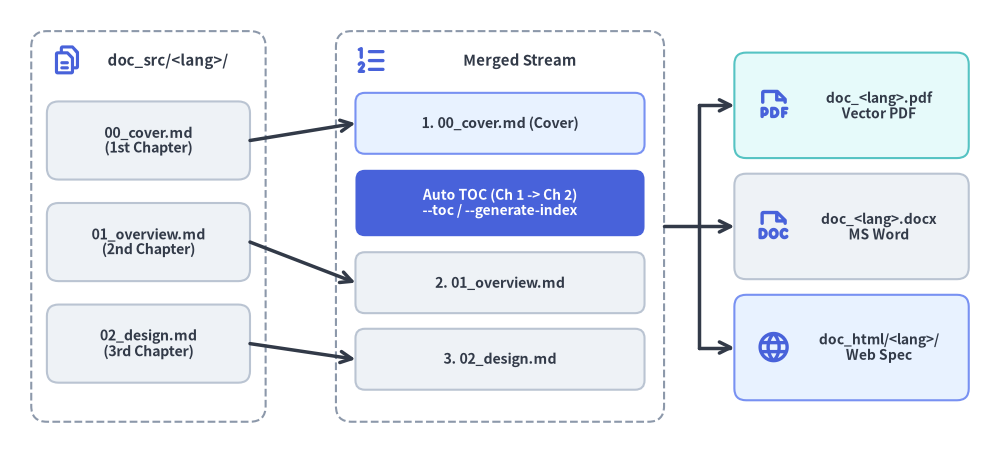
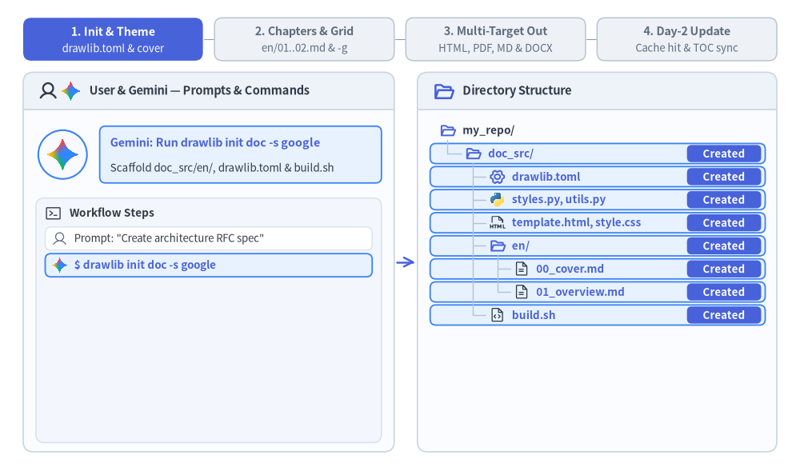

# リニアドキュメントプロジェクトガイド (`drawlib init doc`)

`doc` スターターテンプレートは、仕様書、RFC（Request for Comments）、システムアーキテクチャ提案書、ホワイトペーパー、学位論文、公式エンジニアリングレポートといったリニアな技術文書の執筆向けに設計されています。

単一ページの仕様書と複数章からなるレポートを単一のアーキタイプに統合することで、同一の Markdown ソースファイル群から **HTML、ベクター PDF、編集可能な MS Word（`.docx`）、Markdown、および単体の図解画像** を一括コンパイルできます。


<figure class="drawlib-image" style="text-align: center;">
  
  <figcaption class="drawlib-caption">辞書順による章ファイルの結合と自動目次 (--toc / --generate-index) の挿入フロー</figcaption>
</figure>

<details class="drawlib-code-details">
<summary>Source Code</summary>

```python
from drawlib.canvas import save, setup
from drawlib.icons import phosphor
from drawlib.lines import line
from drawlib.shapes import rectangle
from drawlib.styles import Styles
from drawlib.text import text

setup(width=128, height=58)

# Left Container: doc_src/ Lexicographical Source Chapters
rectangle((19, 29), width=30, height=50, style=Styles.MutedDashed.patch(shape_r=2.0))
phosphor.files((8.5, 50.2), width=4.2, style=Styles.PrimaryBold)
text((21.5, 50.2), "doc_src/ (Sorted)", style=Styles.DarkBold.patch(text_size=10.8))

src_chapters = [
    (40.0, "00_cover.md\n(1st Chapter)"),
    (27.0, "01_overview.md\n(2nd Chapter)"),
    (14.0, "02_design.md\n(3rd Chapter)"),
]
for sy, label in src_chapters:
    rectangle(
        (19, sy),
        width=26,
        height=10.0,
        style=Styles.Neutral.patch(shape_r=1.5),
        text=label,
        text_style=Styles.DarkBold.patch(text_size=10.2),
    )

# Center Container: Merged Linear Document Stream (--page-break)
rectangle((64, 29), width=42, height=50, style=Styles.MutedDashed.patch(shape_r=2.0))
phosphor.list_numbers((47.5, 50.2), width=4.4, style=Styles.PrimaryBold)
text((66.5, 50.2), "Merged Stream", style=Styles.DarkBold.patch(text_size=10.8))

rectangle(
    (64, 42.2),
    width=37,
    height=7.8,
    style=Styles.PrimaryNeutral.patch(shape_r=1.2),
    text="1. 00_cover.md (Cover)",
    text_style=Styles.DarkBold.patch(text_size=10.2),
)
rectangle(
    (64, 32.0),
    width=37,
    height=8.5,
    style=Styles.PrimaryFlat.patch(shape_r=1.2),
    text="Auto TOC (Ch 1 -> Ch 2)\n--toc / --generate-index",
    text_style=Styles.WhiteBold.patch(text_size=10.0),
)
rectangle(
    (64, 21.8),
    width=37,
    height=7.8,
    style=Styles.Neutral.patch(shape_r=1.2),
    text="2. 01_overview.md",
    text_style=Styles.DarkBold.patch(text_size=10.2),
)
rectangle(
    (64, 12.0),
    width=37,
    height=7.8,
    style=Styles.Neutral.patch(shape_r=1.2),
    text="3. 02_design.md",
    text_style=Styles.DarkBold.patch(text_size=10.2),
)

# Arrows: Source -> Merged Stream
line((32, 40.0), (45.5, 42.2), arrow_head="->", style=Styles.DarkBold)
line((32, 27.0), (45.5, 21.8), arrow_head="->", style=Styles.DarkBold)
line((32, 14.0), (45.5, 12.0), arrow_head="->", style=Styles.DarkBold)

# Right: Exported Linear Deliverables
rectangle((109, 44.5), width=30, height=13.5, style=Styles.SecondaryNeutral.patch(shape_r=1.5))
phosphor.file_pdf((99.0, 44.5), width=4.6, style=Styles.PrimaryBold)
text((112.5, 44.5), "doc.pdf\nVector PDF", style=Styles.DarkBold.patch(text_size=10.0))

rectangle((109, 29.0), width=30, height=13.5, style=Styles.Neutral.patch(shape_r=1.5))
phosphor.file_doc((99.0, 29.0), width=4.6, style=Styles.PrimaryBold)
text((112.5, 29.0), "doc.docx\nMS Word", style=Styles.DarkBold.patch(text_size=10.0))

rectangle((109, 13.5), width=30, height=13.5, style=Styles.PrimaryNeutral.patch(shape_r=1.5))
phosphor.globe((99.0, 13.5), width=4.6, style=Styles.PrimaryBold)
text((112.5, 13.5), "doc_html/\nWeb Spec", style=Styles.DarkBold.patch(text_size=10.0))

# Connectors: Merged Stream -> Deliverables
line((85, 29.0), (89.5, 29.0), style=Styles.DarkBold)
line((89.5, 13.5), (89.5, 44.5), style=Styles.DarkBold)
line((89.5, 44.5), (94.0, 44.5), arrow_head="->", style=Styles.DarkBold)
line((89.5, 29.0), (94.0, 29.0), arrow_head="->", style=Styles.DarkBold)
line((89.5, 13.5), (94.0, 13.5), arrow_head="->", style=Styles.DarkBold)

save()
```

</details>


---

## 1. エンドツーエンドのプロジェクトワークフロー

`doc` プロジェクトは以下の 4 つのフェーズで進行します。すなわち、`doc_src/` のスキャフォールディングと共有テーマ／表紙メタデータの設定、`-g` グリッドプレビューで検証しながら進める番号付き Markdown 章ファイルの執筆、マルチターゲット成果物（HTML、ベクター PDF、Markdown、および必要に応じたオンデマンドの MS Word `.docx`）へのコンパイル、そして `.drawlib/cache.db` に支えられた Day-2 の高速な差分更新です。


<figure class="drawlib-image" style="text-align: center;">
  
  <figcaption class="drawlib-caption">リニアドキュメントプロジェクトのライフサイクル: スキャフォールディング、複数章の執筆、5 ターゲット出力、Day-2 差分ビルド (APNG アニメーション)</figcaption>
</figure>


<div class="drawlib-source-link">
  <a href="https://github.com/yuichi110/drawlib/blob/main/docs/docs_src/ja/09_doc_builder_and_cli/project_doc.md" target="_blank" rel="noopener noreferrer">GitHub でアニメーションのソースコードを見る &rarr;</a>
</div>

---

## 2. プロジェクトの初期化

`drawlib init` を使用してリニアドキュメントプロジェクトをスキャフォールディングします。

```bash
# Scaffold standard doc project in current directory (creates 'doc_src/'):
drawlib init doc

# With custom target name, theme, and language (creates 'my_report_src/'):
drawlib init doc my_report -s google -l en
```

---

## 3. ディレクトリ構成と構造

### 編集対象のソースディレクトリ (`doc_src/`)
- **`drawlib.toml`**: `type = "doc"`、言語（`lang`、自動目次の見出しローカライズに使用）、テーマメタデータ、および任意の `[i18n]` 多言語設定を宣言するプロジェクトマニフェストです。
- **`00_cover.md`, `01_overview.md`, `02_design.md`, ...**: 本文と埋め込み ````drawlib```` ブロックを含む番号付きの Markdown 章ファイルです。ファイル名の辞書順でソートされて結合されます。
- **`styles.py` & `utils.py`**: 共有の Python スタイル設定（`Colors`、`Styles`、言語フォント）および再利用可能な図解ヘルパー関数です。
- **`template.html` & `style.css`**: ブラウザプレビューおよびベクター PDF 生成に使用される Jinja2 シングルページ HTML レイアウトと印刷対応 CSS（`@media print` / `@page A4`）です。
- **`_assets/`**: 相対パスで参照される静的なロゴ画像、ラスタースクリーンショット、またはカスタム `.ttf` フォントを格納します。
- **`build.sh` & 各種ターゲットスクリプト**: マスターオーケストレーター（`build.sh`）と、モジュール分割された個別スクリプト（`build_html.sh`、`build_pdf.sh`、`build_markdown.sh`、`build_image.sh`、`serve.sh`）です。

### 生成される出力成果物
- **`doc_html/`**: 高速なブラウザプレビューや社内 Web ホスティング向けの結合済みシングルページ HTML ドキュメント（`doc_html/index.html`）です。
- **`doc.pdf`**: ヘッドレス Chromium によってレンダリングされる印刷対応の A4 ベクター PDF です。表紙、自動目次（`--toc`）、章ごとの改ページ（`--page-break`）を備えています。
- **`doc.docx`** *（オンデマンド生成）*: `drawlib build docx` でエクスポートされるネイティブ編集可能な Microsoft Word ドキュメントです。表紙、目次（`--generate-index`）、高 DPI の PNG 図解を含みます。
- **`doc_markdown/`**: ````drawlib```` フェンスがレンダリング済み画像へのリンクに置換された、GitHub 表示対応の Markdown 章ファイル群です。
- **`doc_images/`**: 章ごとに整理して抽出されたスタンドアロンの図解画像（`doc_images/<chapter>_images/`）です。

> **注記（`doc` プロジェクトでは `navbar.md` を作成しないこと）:** `doc_src/` 内に `navbar.md` ファイルを作成しないでください。Drawlib は `navbar.md` が存在しないことを判定条件として、`doc_src/` をマルチページのサイドバー付きサイトではなく、結合されたリニアドキュメントとしてコンパイルします。先頭が `_` で始まるファイル（`_outline.md` など）および `README.md` は自動的にコンパイル対象から除外されます。

---

## 4. 単一ソースから得られる 5 種類の出力ターゲット

`doc` プロジェクトは、1 つのソースから 5 つの異なる成果物へコンパイルできます。

| 出力ターゲット | 想定読者・環境 | 主な用途 | ビルドスクリプト / コマンド |
| :--- | :--- | :--- | :--- |
| **`doc_html/`** | Web ブラウザ | 高速なローカルプレビュー、Web 公開、社内ドキュメント Wiki | `build_html.sh` |
| **`doc.pdf`** | 印刷・配布 | 公式ホワイトペーパー、顧客向け納品資料、目次付きの印刷用レポート | `build_pdf.sh` |
| **`doc.docx`** | 共同編集・レビュー | ネイティブ編集可能な MS Word ドキュメント（見出し、リスト、表、シンタックスハイライト付きコードブロック、表紙＋目次、高 DPI PNG 図解） | `drawlib build docx` |
| **`doc_markdown/`** | GitHub・バージョン管理 | レンダリング済み画像リンク付きでの GitHub / GitLab リポジトリ上での直接閲覧 | `build_markdown.sh` |
| **`doc_images/`** | プレゼン・チャット共有 | Google スライド、Keynote、PowerPoint、Slack、PR へのドラッグ＆ドロップ貼り付け | `build_image.sh` |

---

## 5. 章の並び順・表紙・自動目次の仕組み

`doc` プロジェクトではサイドバー用の `navbar.md` ファイルを使用しないため、Drawlib は `doc_src/` 内のすべての `.md` ファイル（`README.md` と `_` 始まりのファイルを除く）を単一のリニアドキュメントに結合して `doc_html/index.html`、`doc.pdf`、`doc.docx` を生成します。
1. **辞書順による章のソート**: 章ファイルには数値プレフィックス（`00_cover.md`、`01_overview.md`、`02_design.md`、`03_benchmarks.md`）を付与し、常に決定論的な読書順で結合されるようにします。
2. **表紙の規約 (`00_cover.md`)**: ソート順で先頭となるファイルがドキュメントの表紙として機能します。`drawlib build pdf` に `--toc`（または `--generate-index`）、あるいは `drawlib build docx` に `--generate-index` を指定すると、自動生成された目次が **1 番目のドキュメント（`00_cover.md`）と 2 番目のドキュメント（`01_overview.md`）の間** に美しく挿入されます。
3. **章ごとの改ページ (`--page-break`)**: PDF と Word（`.docx`）の両方のコンパイルにおいて、デフォルト（`--page-break`）では結合された各 `.md` ファイルが新しいページから始まります。ファイル間で強制改ページを行わず連続配置したい場合は `--no-page-break` を指定してください。

---

## 6. モジュール化されたビルドスクリプト構成

各プロジェクトには、マスターオーケストレーターとともに用途別の専用スクリプトが用意されています。

1. **`build_html.sh`**:
   Markdown の各章をコンパイル・結合し、単体の HTML ドキュメント（`doc_html/index.html`）を生成します。ローカルでの素早い確認に最適です。
2. **`build_pdf.sh`**:
   結合されたドキュメントをヘッドレス Chromium（`page.pdf()`）経由で A4 ベクター PDF にレンダリングします。自動目次（`--toc`）と章ごとの改ページ（`--page-break`）をサポートしています。
3. **`build_markdown.sh`**:
   インラインの ````drawlib```` ブロックを、`doc_markdown/<chapter>_images/` 内のレンダリング済み図解を参照する標準の Markdown 画像タグに変換します。
4. **`build_image.sh`**:
   すべての Markdown ファイルを走査して埋め込み ````drawlib```` ブロックを抽出し、ファイル名の衝突を防ぎながら `doc_images/<chapter>_images/` に出力します。
5. **`build.sh`（マスタースクリプト）**:
   上記のすべてのターゲットビルドを順番に実行し、リリース成果物一式を生成します。

---

## 7. 直接実行する CLI コマンド（MS Word `.docx` を含む）

ネイティブ MS Word（`.docx`）エクスポートを含む任意のビルドターゲットを、ターミナルから直接実行できます。

```bash
# 1. Compile to HTML:
drawlib build html doc_src/ -o doc_html/

# 2. Compile to PDF with Cover and Table of Contents:
drawlib build pdf doc_src/ -o doc.pdf --toc --page-break

# 3. Compile to editable MS Word (.docx) with Cover, TOC, and 200 DPI diagram PNGs:
drawlib build docx doc_src/ -o doc.docx --generate-index --page-break --dpi 200

# 4. Compile to GitHub-ready Markdown:
drawlib build markdown doc_src/ -o doc_markdown/

# 5. Extract diagram images from Markdown:
drawlib build image doc_src/ -o doc_images/
```

---

## 8. マルチエージェントによる章単位の並列執筆

`doc` プロジェクトでは章が番号付きの Markdown ファイル（`00_cover.md`、`01_overview.md`、`02_architecture.md`、`03_security.md` など）に分割されているため、AI コーディングエージェントは複数章からなるホワイトペーパーや仕様書を並列に執筆できます。
1. **フェーズ 1（親エージェントによる初期設定）**: `doc_src/` をスキャフォールディング（`drawlib init doc`）し、`styles.py`、`utils.py`、`00_cover.md` を確定させたうえで、番号付きの章ファイル名一覧を決定します。
2. **フェーズ 2（サブエージェントによる並列執筆）**: 個別の章（`doc_src/0N_<topic>.md`）を並列サブエージェントに割り当てます。各サブエージェントは担当の章（各章 2 つ以上の図解、5〜15 行目に章のヒーロー図解を配置）を執筆し、一意なグリッドプレビューパス（`-o .drawlib/scratch/0N_<diagram>_grid.png`）で図解を検証します。
3. **フェーズ 3（統合コンパイル）**: すべてのサブエージェントが章の執筆を完了した後、親エージェントが `./doc_src/build.sh`（および必要に応じて `drawlib build docx`）を 1 回実行し、全章を `doc_html/index.html`、`doc.pdf`、`doc.docx` に統合します。

---

## 9. 多言語（`i18n`）リニアドキュメント (`drawlib.toml`)

`drawlib init doc` にカンマ区切りのロケールを指定するか、`doc_src/drawlib.toml` に `[i18n]` セクションを設定することで、単一の `doc_src/` プロジェクト内で複数言語版（英語と日本語のホワイトペーパーなど）を並べて管理・一括コンパイルできます。

```bash
uv run drawlib init doc whitepaper -l en,ja -s google
```

```toml
[project]
name = "whitepaper"
type = "doc"
style = "google"

[i18n]
default_lang = "en"
langs = ["en", "ja"]

[i18n.labels]
en = "English"
ja = "日本語"
```

- **対称なロケール別章ディレクトリ (`doc_src/<lang>/`)**: 番号付きの章ファイル（`00_cover.md`、`01_overview.md` など）を各ロケールディレクトリ（`doc_src/en/`、`doc_src/ja/`）内に配置します。ビルド前の事前検証により、全ロケール間で章ファイルセットの一致、Markdown の構造スケルトン一致、および相対リンクの整合性が自動的にチェックされます。
- **ロケール別 `styles.py` と共有図解の重複排除**: 言語に依存しない共通図解（`file=fig_pipeline.png`）はルートの `doc_src/styles.py` を用いて共有の `images/` に 1 回だけレンダリングされます。日本語フォントや翻訳ラベルが必要な図解には、`doc_src/<lang>/styles.py`（例: `FontJapanese` を設定した `ja/styles.py`）を配置し、ロケール固有のファイル名（`file=fig_pipeline_ja.png`）を割り当てます。
- **ロケール別の PDF・MS Word 成果物 (`<base>_<lang>.pdf` / `.docx`)**: `drawlib build pdf doc_src/ -o whitepaper.pdf --toc` や `drawlib build docx doc_src/ -o whitepaper.docx --generate-index` を実行すると、各言語にローカライズされた目次見出し（`"Table of Contents"`、`"目次"` など）を備えた `whitepaper_en.pdf` / `whitepaper_ja.pdf`（および `.docx`）が自動生成されます。
- **印刷セーフな HTML 言語スイッチャー**: 結合 HTML プレビュー（`whitepaper_html/<lang>/index.html`）にはブラウザ上で即座に言語を切り替えられる右上ドロップダウンが表示され、ベクター PDF 生成時には `@media print` によって自動的に非表示になります。
- **同期された GitHub Markdown (`whitepaper_markdown/<lang>/`)**: `build_markdown.sh` は、画像ファイルを重複させることなく共有の `../images/` アセットを参照するロケール別の Markdown 章ファイルを出力します。

