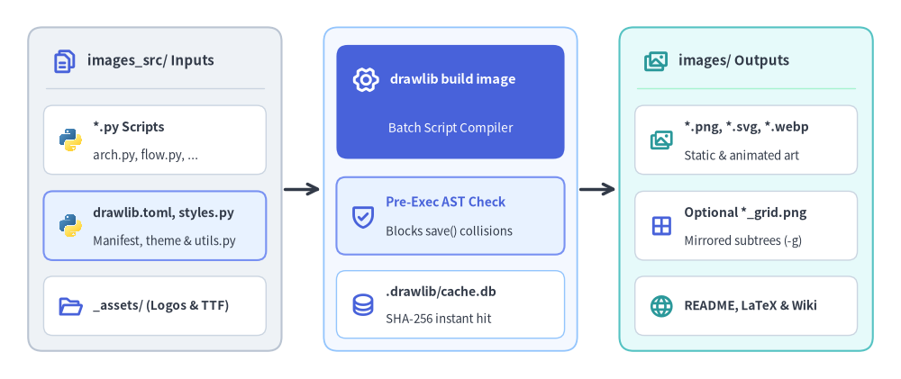
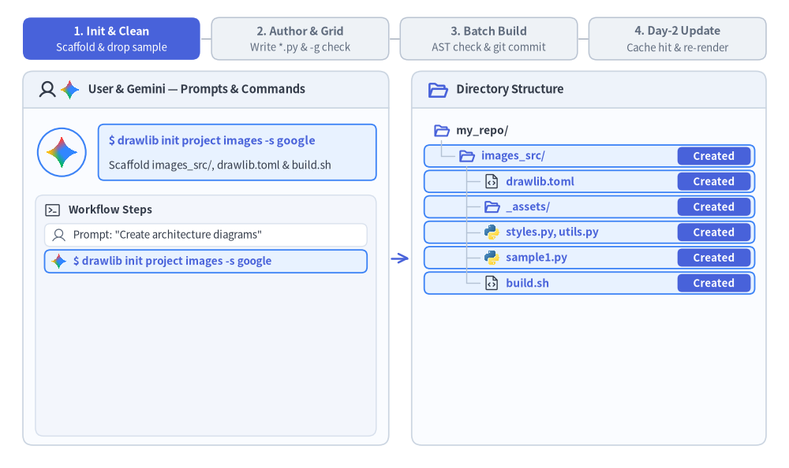
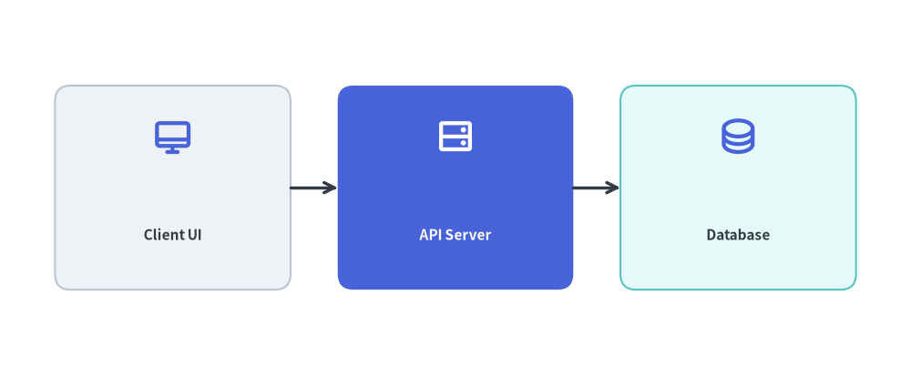

# 画像プロジェクトガイド (`drawlib init images`)

`images` スターターテンプレート（CLI 別名: `image`）は、バッチ Python スクリプトから単体のイラストアセット、プレゼンテーション用図解、記事のヒーローバナー、ソーシャルプレビューカードを直接一括生成するために設計されています。

各プロジェクトでは、編集対象の Python ソーススクリプト（`images_src/`）と生成される画像成果物（`images/`）を明確に分離し、実行前の AST 重複衝突チェックと SHA-256 差分キャッシュによって保護します。


<figure class="drawlib-image" style="text-align: center;">
  
  <figcaption class="drawlib-caption">単体画像バッチプロジェクトのアーキテクチャ: 共有設定、AST 衝突ガード、並列出力</figcaption>
</figure>

<details class="drawlib-code-details">
<summary>Source Code</summary>

```python
from drawlib.canvas import save, setup
from drawlib.icons import code, phosphor
from drawlib.lines import line
from drawlib.shapes import rectangle
from drawlib.styles import Styles
from drawlib.text import text

setup(width=128, height=54)

CARD_WHITE = Styles.Neutral.patch(
    shape_fill_color=(255, 255, 255),
    shape_line_color=(203, 213, 225),
    shape_line_width=1.0,
    shape_r=1.3,
)

# =========================================================
# 1. Left Card: images_src/ Inputs
# =========================================================
rectangle((22.0, 27.0), width=36.0, height=46.0, style=Styles.Neutral.patch(shape_r=2.0))
phosphor.files((9.2, 45.2), width=3.8, style=Styles.PrimaryBold)
text((12.4, 45.2), "images_src/ Inputs", style=Styles.DarkBold.patch(text_size=10.8, halign="left"))
line(
    (6.5, 41.4),
    (37.5, 41.4),
    style=Styles.Neutral.patch(line_color=(203, 213, 225), line_width=1.0),
)

rectangle((22.0, 34.0), width=31.6, height=9.8, style=CARD_WHITE)
code.python((10.0, 34.0), width=3.6, style=Styles.Neutral)
text((13.2, 35.8), "*.py Scripts", style=Styles.DarkBold.patch(text_size=10.2, halign="left"))
text((13.2, 31.8), "arch.py, flow.py, ...", style=Styles.Dark.patch(text_size=9.6, halign="left"))

rectangle((22.0, 21.8), width=31.6, height=9.8, style=Styles.PrimaryNeutral.patch(shape_r=1.3))
code.python((10.0, 21.8), width=3.6, style=Styles.Neutral)
text((13.2, 23.6), "drawlib.toml, styles.py", style=Styles.DarkBold.patch(text_size=10.0, halign="left"))
text((13.2, 19.6), "Manifest, theme & utils.py", style=Styles.Dark.patch(text_size=9.5, halign="left"))

rectangle((22.0, 10.4), width=31.6, height=8.4, style=CARD_WHITE)
phosphor.folder_open((10.0, 10.4), width=3.6, style=Styles.PrimaryBold)
text((13.2, 10.4), "_assets/ (Logos & TTF)", style=Styles.DarkBold.patch(text_size=9.8, halign="left"))

# Connector: Inputs -> Compiler
line((40.4, 27.0), (45.6, 27.0), arrow_head="->", style=Styles.DarkBold)

# =========================================================
# 2. Center Focal Stage: drawlib build image Compiler
# =========================================================
rectangle(
    (64.0, 27.0),
    width=36.0,
    height=46.0,
    style=Styles.Neutral.patch(
        shape_fill_color=(244, 248, 255),
        shape_line_color=(147, 197, 253),
        shape_line_width=1.3,
        shape_r=2.0,
    ),
)

rectangle((64.0, 39.4), width=32.4, height=16.2, style=Styles.PrimaryFlat.patch(shape_r=1.6))
phosphor.gear_six((52.0, 42.6), width=4.0, style=Styles.WhiteBold)
text((55.4, 42.6), "drawlib build image", style=Styles.WhiteBold.patch(text_size=10.4, halign="left"))
text((64.0, 35.6), "Batch Script Compiler", style=Styles.White.patch(text_size=9.8))

rectangle((64.0, 23.2), width=32.4, height=11.0, style=Styles.PrimaryNeutral.patch(shape_r=1.3))
phosphor.shield_check((51.6, 23.2), width=3.9, style=Styles.PrimaryBold)
text((54.8, 25.2), "Pre-Exec AST Check", style=Styles.PrimaryBold.patch(text_size=10.0, halign="left"))
text((54.8, 21.0), "Blocks save() collisions", style=Styles.Dark.patch(text_size=9.5, halign="left"))

rectangle(
    (64.0, 10.6),
    width=32.4,
    height=9.6,
    style=CARD_WHITE.patch(shape_line_color=(147, 197, 253)),
)
phosphor.database((51.6, 10.6), width=3.7, style=Styles.PrimaryBold)
text((54.8, 12.4), ".drawlib/cache.db", style=Styles.DarkBold.patch(text_size=10.0, halign="left"))
text((54.8, 8.6), "SHA-256 instant hit", style=Styles.Dark.patch(text_size=9.5, halign="left"))

# Connector: Compiler -> Outputs
line((82.4, 27.0), (87.6, 27.0), arrow_head="->", style=Styles.DarkBold)

# =========================================================
# 3. Right Card: images/ Batch Outputs
# =========================================================
rectangle(
    (106.0, 27.0),
    width=36.0,
    height=46.0,
    style=Styles.SecondaryNeutral.patch(shape_r=2.0),
)
phosphor.images((93.2, 45.2), width=3.8, style=Styles.SecondaryBold)
text((96.4, 45.2), "images/ Outputs", style=Styles.DarkBold.patch(text_size=10.8, halign="left"))
line(
    (90.5, 41.4),
    (121.5, 41.4),
    style=Styles.Neutral.patch(line_color=(167, 243, 208), line_width=1.0),
)

rectangle((106.0, 34.0), width=31.6, height=9.8, style=CARD_WHITE)
phosphor.images((94.0, 34.0), width=3.6, style=Styles.SecondaryBold)
text((97.2, 35.8), "*.png, *.svg, *.webp", style=Styles.DarkBold.patch(text_size=10.0, halign="left"))
text((97.2, 31.8), "Static & animated art", style=Styles.Dark.patch(text_size=9.5, halign="left"))

rectangle((106.0, 21.8), width=31.6, height=9.8, style=CARD_WHITE)
phosphor.grid_four((94.0, 21.8), width=3.6, style=Styles.PrimaryBold)
text((97.2, 23.6), "Optional *_grid.png", style=Styles.DarkBold.patch(text_size=10.0, halign="left"))
text((97.2, 19.6), "Mirrored subtrees (-g)", style=Styles.Dark.patch(text_size=9.5, halign="left"))

rectangle((106.0, 10.4), width=31.6, height=8.4, style=CARD_WHITE)
phosphor.globe((94.0, 10.4), width=3.6, style=Styles.SecondaryBold)
text((97.2, 10.4), "README, LaTeX & Wiki", style=Styles.DarkBold.patch(text_size=9.8, halign="left"))

save()
```

</details>


---

## 1. エンドツーエンドのプロジェクトワークフロー

`images` プロジェクトは無駄のない 4 フェーズのライフサイクルで進行します。すなわち、プロジェクトのスキャフォールディングとスターターサンプルの整理、`-g` 座標グリッドによるジオメトリ検証、AST 衝突保護を備えたバッチコンパイラの実行、そして Day-2 更新時における 1 ミリ秒未満の SQLite キャッシュヒットです。


<figure class="drawlib-image" style="text-align: center;">
  
  <figcaption class="drawlib-caption">単体画像プロジェクトのライフサイクル: スキャフォールディング、グリッドプレビュー、バッチビルド、差分キャッシュヒット (APNG アニメーション)</figcaption>
</figure>


<div class="drawlib-source-link">
  <a href="https://github.com/yuichi110/drawlib/blob/main/docs/docs_src/ja/09_doc_builder_and_cli/project_image.md" target="_blank" rel="noopener noreferrer">GitHub でアニメーションのソースコードを見る &rarr;</a>
</div>

---

## 2. プロジェクトの初期化

`drawlib init` を使用して新しい画像プロジェクトをスキャフォールディングします。

```bash
# Scaffold standard images project in current directory (creates 'images_src/'):
drawlib init images

# Or with custom target name, theme, and language (creates 'my_assets_src/'):
drawlib init images my_assets -s google -l en
```

---

## 3. ディレクトリ構成と構造

### 編集対象のソースディレクトリ (`images_src/`)
- **`drawlib.toml`**: `[project]` メタデータ（`type = "images"`、`style`、および `"en"` や `"ja"` などのフォント構成用 `lang`。`images` プロジェクトでは `[i18n]` は使用しません）を宣言するプロジェクトマニフェストです。
- **`styles.py` & `utils.py`**: `drawlib show` および `drawlib build image` の実行時に自動的に読み込まれる、プロジェクト全体のスタイル設定（`Colors`、`Styles`、CJK フォント）と再利用可能なコンポーネントヘルパーです。
- **`_assets/`**: 相対パス（例: `"_assets/logo.png"`）で参照される静的なラスターロゴ、背景画像、またはカスタム `.ttf` フォントです。
- **`*.py` 描画スクリプト**: `save()` を呼び出して画像を出力するスタンドアロンの Python スクリプト群です（`network/vpc_peering.py` のようなネストされたサブディレクトリ構成にも対応しています）。
- **`build.sh` & `build_image.sh`**: `drawlib build image images_src/ -o images/` を呼び出すバッチ用シェルラッパーです。

### 生成される出力ディレクトリ (`images/`)
- **`*.png`, `*.svg`, `*.webp`**: `images_src/` のディレクトリ階層をそのままミラーリングして出力される、静的およびアニメーション図解成果物です。
- **オプションの `*_grid.png`**: `--grid`（`-g`）指定時にオンデマンド生成される座標グリッドオーバーレイ画像です。

### 重要なルール
- **信頼できる唯一の情報源**: 描画スクリプトは常に `images_src/` 内で作成・編集してください。スキャフォールディング直後は、必要な図解のみがビルドされるようスターター用の `sample1.py` と `sample2.py` を置き換えるか削除してください。
- **`images/` を直接編集しないこと**: `images/` フォルダはビルド時に上書きされる出力成果物用ディレクトリです。

---

## 4. 描画スクリプトの記述

`images` プロジェクトでは、`images_src/` 内の各 `.py` ファイルが独立した描画スクリプトとなります。スクリプトの末尾で `save()` を呼び出して画像を出力します。


```python
# images_src/architecture_overview.py
from drawlib.canvas import save, setup
from drawlib.icons import phosphor
from drawlib.lines import line
from drawlib.shapes import rectangle
from drawlib.styles import Styles
from drawlib.text import text

setup(width=116, height=48)

# Draw components (50%+ neutral baseline + 1 primary focal point)
rectangle((22, 24), width=30, height=26, style=Styles.Neutral.patch(shape_r=2.0))
phosphor.desktop((22, 30.5), width=5.2, style=Styles.PrimaryBold)
text((22, 18.0), "Client UI", style=Styles.DarkBold.patch(text_size=11.0))

rectangle((58, 24), width=30, height=26, style=Styles.PrimaryFlat.patch(shape_r=2.0))
phosphor.hard_drives((58, 30.5), width=5.2, style=Styles.WhiteBold)
text((58, 18.0), "API Server", style=Styles.WhiteBold.patch(text_size=11.0))

rectangle((94, 24), width=30, height=26, style=Styles.SecondaryNeutral.patch(shape_r=2.0))
phosphor.database((94, 30.5), width=5.2, style=Styles.PrimaryBold)
text((94, 18.0), "Database", style=Styles.DarkBold.patch(text_size=11.0))

line((37, 24), (43, 24), arrow_head="->", style=Styles.DarkBold)
line((73, 24), (79, 24), arrow_head="->", style=Styles.DarkBold)

# Save image (defaults to <script_stem>.png or save("architecture_overview.png") in scripts)
save()
```

<figure class="drawlib-image" style="text-align: center;">
  
  <figcaption class="drawlib-caption">images_src/architecture_overview.py のレンダリング出力結果</figcaption>
</figure>


### `save()` と `drawlib build image -o images/` の連携動作:
- **出力先の自動リダイレクト**: `drawlib build image images_src/ -o images/` 経由で実行した場合、`save("architecture_overview.png")` に渡された相対パス（またはファイル名省略時の `save()` によるデフォルト `<script_stem>.png`）は、`images_src/` 配下のサブディレクトリ階層を維持したまま、自動的に `-o images/` ディレクトリ内へ書き出されます。
- **実行前の AST 重複衝突チェック**: バッチ内のスクリプトを実行する前に、Drawlib は対象となるすべての `.py` ファイルの Python AST を解析して `save(...)` の出力先を検査します。2 つのスクリプトがまったく同じ出力ファイルパスに書き込もうとしている場合、ディスクの状態を変更する前に即座にビルドを中断します。

---

## 5. 画像のビルド

### 自動ビルドスクリプト (`./build_image.sh` または `./build.sh`)
付属のビルドスクリプトを実行します。

```bash
./images_src/build.sh
```

### 直接実行する CLI コマンド
または、ビルダを直接呼び出すこともできます。

```bash
drawlib build image images_src/ -o images/ -s images_src/styles.py -u images_src/utils.py
```

### 便利なビルドフラグ:
- `--grid` (`-g`): 視覚デバッグ用に座標グリッド線を重ねた `*_grid.png` 画像を同時に自動生成します。
- `-f webp`: すべてのスクリプトの出力フォーマットをモダンな WebP 形式に一括上書きします。
- `--no-cache`: SQLite ハッシュキャッシュ（`.drawlib/cache.db`）をバイパスし、すべての画像を強制的にクリーン再レンダリングします。

---

## 6. マルチエージェントによる並列スクリプト執筆

`images_src/` 内の各 `.py` スクリプトは互いに独立しているため、AI コーディングエージェントはサブエージェント間でスクリプトを分担して複数の図解を並列に生成できます。
1. **フェーズ 1（親エージェントによる初期設定）**: 最初に `drawlib init images` を実行し、共有の `images_src/styles.py`、`images_src/utils.py`、および `_assets/` を設定します。
2. **フェーズ 2（サブエージェントによる並列執筆）**: 各サブエージェントに重複しないスクリプト（`images_src/<name>.py`）を割り当てます。各サブエージェントは担当スクリプトを執筆し、他のサブエージェントと衝突しない **一意なスクラッチファイル名**（`uv run drawlib show images_src/<name>.py -s images_src/styles.py -u images_src/utils.py -g -o .drawlib/scratch/<name>_grid.png`）でグリッドプレビューを実行してレイアウトを検証します。
3. **フェーズ 3（統合バッチビルド）**: すべてのサブエージェントが完了したら、親エージェントが `./images_src/build.sh` を 1 回実行し、全スクリプトを `images/` へ一括コンパイルします。
