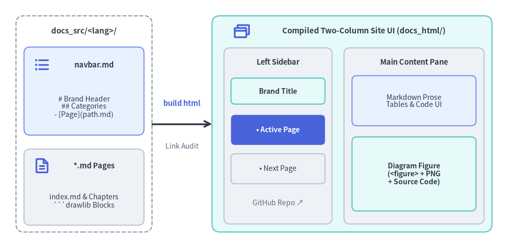
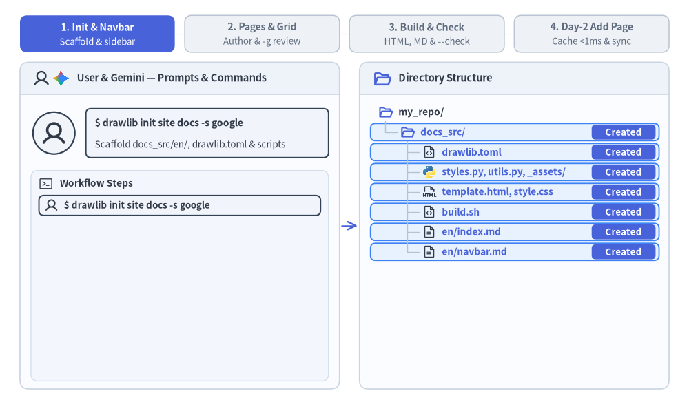

# ドキュメントサイトプロジェクトガイド (`drawlib init site`)

`site` スターターテンプレートは、階層型のサイドバーナビゲーション、モバイル対応のレスポンシブレイアウト、シンタックスハイライト、および静的 HTML と GitHub 対応 Markdown へのデュアル出力を備えた、マルチページ構成の技術ドキュメントサイトを構築します。

Drawlib は `docs_src/<lang>/navbar.md` と各 Markdown ページを、ビルド時の厳格なリンク検証を備えた 2 カラム構成のドキュメントポータルへコンパイルします。


<figure class="drawlib-image" style="text-align: center;">
  
  <figcaption class="drawlib-caption">navbar.md と Markdown ページから 2 カラム構成のドキュメントサイト UI が生成される仕組み</figcaption>
</figure>

<details class="drawlib-code-details">
<summary>Source Code</summary>

```python
from drawlib.canvas import save, setup
from drawlib.icons import phosphor
from drawlib.lines import line
from drawlib.shapes import rectangle
from drawlib.styles import Styles
from drawlib.text import text

setup(width=128, height=62)

# Left: Source directory container
rectangle((21, 31), width=34, height=54, style=Styles.MutedDashed.patch(shape_r=2.0))
text((21, 54.2), "docs_src/<lang>/", style=Styles.DarkBold.patch(text_size=10.8))

rectangle((21, 39.2), width=30, height=22, style=Styles.PrimaryNeutral.patch(shape_r=1.5))
phosphor.list_bullets((10.5, 45.8), width=4.4, style=Styles.PrimaryBold)
text((23.5, 45.8), "navbar.md", style=Styles.DarkBold.patch(text_size=10.5))
text((21, 35.2), "# Brand Header\n## Categories\n- [Page](path.md)", style=Styles.Dark.patch(text_size=10.0))

rectangle((21, 15.2), width=30, height=19, style=Styles.Neutral.patch(shape_r=1.5))
phosphor.file_text((10.5, 20.5), width=4.4, style=Styles.PrimaryBold)
text((23.5, 20.5), "*.md Pages", style=Styles.DarkBold.patch(text_size=10.5))
text((21, 11.8), "index.md & Chapters\n```drawlib Blocks", style=Styles.Dark.patch(text_size=10.0))

# Middle: Compiler step
line((38, 31), (53, 31), arrow_head="->", style=Styles.DarkBold)
text((45.5, 36.2), "build html", style=Styles.PrimaryBold.patch(text_size=10.5))
text((45.5, 25.5), "Link Audit", style=Styles.Muted.patch(text_size=10.0))

# Right: Compiled Two-Column Site UI (docs_html/)
rectangle((88, 31), width=70, height=54, style=Styles.SecondaryNeutral.patch(shape_r=2.0))
phosphor.browsers((60.5, 54.2), width=4.6, style=Styles.PrimaryBold)
text((91.0, 54.2), "Compiled Two-Column Site UI (docs_html/)", style=Styles.DarkBold.patch(text_size=10.8))

# Left Sticky Sidebar
rectangle((69.5, 28.0), width=27, height=44, style=Styles.Neutral.patch(shape_r=1.5))
text((69.5, 46.5), "Left Sidebar", style=Styles.DarkBold.patch(text_size=10.5))
rectangle(
    (69.5, 39.2),
    width=23.5,
    height=6.5,
    style=Styles.SecondaryNeutral.patch(shape_r=1.0),
    text="Brand Title",
    text_style=Styles.DarkBold.patch(text_size=10.0),
)
rectangle(
    (69.5, 29.5),
    width=23.5,
    height=7.5,
    style=Styles.PrimaryFlat.patch(shape_r=1.0),
    text="• Active Page",
    text_style=Styles.WhiteBold.patch(text_size=10.0),
)
rectangle(
    (69.5, 19.8),
    width=23.5,
    height=7.5,
    style=Styles.Neutral.patch(shape_r=1.0),
    text="• Next Page",
    text_style=Styles.Dark.patch(text_size=10.0),
)
text((69.5, 11.2), "GitHub Repo ↗", style=Styles.Muted.patch(text_size=10.0))

# Right Main Content Pane
rectangle((103.5, 28.0), width=35, height=44, style=Styles.Neutral.patch(shape_r=1.5))
text((103.5, 46.5), "Main Content Pane", style=Styles.DarkBold.patch(text_size=10.5))
rectangle(
    (103.5, 36.8),
    width=31,
    height=12.5,
    style=Styles.PrimaryNeutral.patch(shape_r=1.2),
    text="Markdown Prose\nTables & Code UI",
    text_style=Styles.Dark.patch(text_size=10.0),
)
rectangle(
    (103.5, 18.5),
    width=31,
    height=18.5,
    style=Styles.SecondaryNeutral.patch(shape_r=1.2),
    text="Diagram Figure\n(<figure> + PNG\n+ Source Code)",
    text_style=Styles.DarkBold.patch(text_size=10.0),
)

save()
```

</details>


---

## 1. エンドツーエンドのプロジェクトワークフロー

`drawlib init site` による初期スキャフォールディングと `navbar.md` サイドバーの構築から、`-g` グリッド検証、ヘッドレスのリンク検証（`drawlib serve --check`）、そして `.drawlib/cache.db` を活用した Day-2 の差分ページ追加までの流れを確認しましょう。


<figure class="drawlib-image" style="text-align: center;">
  
  <figcaption class="drawlib-caption">マルチページ Web サイトプロジェクトのライフサイクル: スキャフォールディング、ナビゲーションとページ作成、リンク監査、Day-2 ページ追加 (APNG アニメーション)</figcaption>
</figure>


<div class="drawlib-source-link">
  <a href="https://github.com/yuichi110/drawlib/blob/main/docs/docs_src/ja/09_doc_builder_and_cli/project_site.md" target="_blank" rel="noopener noreferrer">GitHub でアニメーションのソースコードを見る &rarr;</a>
</div>

---

## 2. プロジェクトの初期化

`drawlib init` を使用してドキュメントサイトをスキャフォールディングします（すべての `site` プロジェクトは、単一言語であっても統一された `<src_dir>/<lang>/` ロケール構成を使用します）。

```bash
# Scaffold default 'docs_src/en/' in the current directory:
drawlib init site

# Or specify a custom target prefix and single or multiple locales (creates 'my_docs_src/<lang>/'):
drawlib init site my_docs --style google --lang en
drawlib init site my_docs --style google --lang en,ja
```

---

## 3. ディレクトリ構成とアーキテクチャ

`site` プロジェクトでは、編集対象のソースファイル（`docs_src/`）と生成される公開用成果物を厳密に分離します。

- **`docs_src/`（信頼できる唯一の情報源）**:
  - **`drawlib.toml`**: `type = "site"`、`style`、および必須の `[i18n]` セクション（`default_lang`、`len >= 1` の `langs`、および任意の `[i18n.labels]`。`[project]` 直下の `lang` は使用不可）を宣言するプロジェクトマニフェストです。
  - **`<lang>/index.md`**: `<lang>/index.html` としてレンダリングされるロケール別のランディングページです（`docs_html/index.html` は `default_lang` へ自動リダイレクトします）。
  - **`<lang>/navbar.md`**: ブランドタイトル、折りたたみ可能なセクション、およびページリンクを宣言的に定義するロケール別のサイドバーナビゲーションマニフェストです。
  - **ネストされたセクションサブフォルダ (`<lang>/guide/`, `<lang>/api/`, `<lang>/01_architecture/` など)**: ```` ```drawlib ```` 図解ブロックを埋め込んだ階層構造の Markdown ページ群です。
  - **`_assets/`**: 出力ポータルへ再帰的にミラーリングされる静的メディアファイル（ロゴ、スクリーンショット、データファイルなど）です（`<lang>/` 内の Markdown 本文からは `../_assets/...` で参照します）。
  - **`styles.py` & `utils.py`**: プロジェクト全体のテーマパレット、言語ごとのタイポグラフィ既定値（任意のロケール別 `<lang>/styles.py` による上書きも可能）、および共有の Python 描画ヘルパーです。
  - **`template.html` & `style.css`**: レスポンシブな 2 カラム HTML レイアウトシェルと 3 層構造の CSS スタイルシートです。
  - **`build.sh`, `build_html.sh`, `build_markdown.sh`, `build_image.sh`, `serve.sh`**: モジュール化されたビルドスクリプトおよびローカルプレビュー用スクリプトです。
- **生成される出力先（直接編集しないでください）**:
  - **`docs_html/`**: Web ホスティングや `drawlib serve` にそのまま利用できるレスポンシブな静的 HTML ドキュメントポータル（`docs_html/<lang>/`、ルートの `docs_html/index.html` リダイレクト、および共有の `docs_html/images/`）です。
  - **`docs_markdown/`**: コンパイル済みの PNG / WebP 図表リンクを備えた GitHub 向けの Markdown ポータル（`docs_markdown/<lang>/` および共有の `docs_markdown/images/`）です。
  - **`docs_images/`**: `build_image.sh` 実行時に単体ファイルとして抽出される図解画像群です。

---

## 4. サイドバーナビゲーション (`<lang>/navbar.md`)

各ロケールのサイドバーナビゲーション構造は、すべて `docs_src/<lang>/navbar.md` によって制御されます。

```markdown
# Drawlib Documentation

- [Home](index.md)

## Core Infrastructure
- [VPC Architecture](01_architecture/vpc.md)
- [Storage Tier](01_architecture/storage.md)

## Microservices
- [Authentication Gateway](02_services/auth.md)
- [Payment Service](02_services/payments.md)

## External Resources
- [GitHub Repository](https://github.com/example/repo)
```

### 記述ルール:
1. **ブランドヘッダー (`# Title`)**: トップレベルの `# 見出し 1` がサイドバーヘッダーのブランドタイトルを設定します。
2. **カテゴリグループ (`## Category`)**: 各 `## 見出し 2` が折りたたみ可能なナビゲーションカテゴリセクションを定義します。
3. **内部ドキュメントリンク**: 相対パスは各ロケールディレクトリ（`docs_src/<lang>/`）内で解決され、実在する Markdown ファイルを指している必要があります。
4. **外部リンク**: `http://` または `https://` で始まる URL は、外部リンクアイコン付きで自動的に新しいタブ（`target="_blank"`）で開きます。
5. **ビルド時の厳格な検証**: リンク先のドキュメントが存在しない場合、ビルドは即座に中断され、該当ファイルと行番号を示すエラーが出力されます。
6. **アクティブページの自動追跡**: 現在閲覧中のページは動的な相対パス解決によって自動的にハイライト表示（`.nav-item.active`）されます。

---

## 5. 静的アセットの同期

`docs_src/` 内に配置された静的アセット（カスタムロゴ、サンプルデータファイル、`_assets/` 内の画像など）は、フォルダ階層を維持したまま `docs_html/` および `docs/`（`docs_markdown/`）へ再帰的にミラーリングされます。

---

## 6. ビルドとローカルプレビュー

### サイトのコンパイル
```bash
./docs_src/build_html.sh       # Compile HTML site (docs_html/)
./docs_src/build_markdown.sh   # Compile Markdown site (docs_markdown/ or docs/)
./docs_src/build_image.sh      # Extract standalone images (docs_images/)
./docs_src/build.sh            # Run all builds sequentially
```

### ローカルプレビューサーバーとリンク監査
ローカル開発サーバーを起動してページをプレビューします。

```bash
uv run drawlib serve docs_html/
```

本番環境へデプロイする前に、ヘッドレスの事前リンク監査を実行します。

```bash
uv run drawlib serve docs_html/ --check
```

---

## 7. マルチエージェントによる並列サイト執筆

マルチページ構成の `site` プロジェクト（`docs_src/<lang>/**/*.md`）は、並列 AI サブエージェントによる分担作業に自然にスケールします。
1. **フェーズ 1（親エージェントによる初期設定）**: サブエージェントを起動する前に、`docs_src/` をスキャフォールディング（`drawlib init site`）し、共有ファイル（`drawlib.toml`、`styles.py`、`utils.py`、`_assets/`、`<lang>/index.md`、および完全な `<lang>/navbar.md` サイドバーツリー）を確定させます。
2. **フェーズ 2（サブエージェントによる並列執筆）**: 各サブエージェントに重複しないページまたはセクションディレクトリ（例: `<lang>/01_architecture/*.md` と `<lang>/02_services/*.md`）を割り当てます。各サブエージェントは `drawlib.toml`、`styles.py`、`utils.py`、`<lang>/navbar.md` を読み取り専用として扱い、担当ページを執筆して一意なスクラッチファイル名（`-o .drawlib/scratch/<page>_<block>_grid.png`）で `-g` グリッドプレビューを実行します。
3. **フェーズ 3（統合ビルドとリンク監査）**: すべてのサブエージェントが完了したら、親エージェントが `./docs_src/build.sh` を 1 回実行し、`uv run drawlib serve docs_html/ --check` でサイト全体のリンク整合性を検証します。

---

## 8. 統一 `i18n` アーキテクチャと多言語ドキュメントサイト (`drawlib.toml`)

すべての `docs_src/` プロジェクトは標準で `i18n` ネイティブ構成（既定は `langs = ["en"]`）を採用しています。単一言語のポータルを後から多言語サイトへ拡張する際も、`git mv` によるファイル移動は不要です。`drawlib init site` にカンマ区切りの言語コードを指定するか、ロケールディレクトリ（`docs_src/ja/`）を追加して `docs_src/drawlib.toml` の `[i18n]` を更新するだけで完了します。

```bash
uv run drawlib init site docs -l en,ja -s default
```

```toml
[project]
name = "docs"
type = "site"
style = "default"

[i18n]
default_lang = "en"
langs = ["en", "ja"]

[i18n.labels]
en = "English"
ja = "日本語"
```

- **対称なロケールサブツリー (`docs_src/<lang>/`)**: 設定された各ロケール（`en/`、`ja/` など）は、それぞれ固有の `navbar.md`、`index.md`、および同一構成のセクションサブディレクトリを保持します。
- **共有図解の重複排除とロケール別 `styles.py`**: 言語間で共通の図解（`file=vpc_arch.png`）はルートの `docs_html/images/` ディレクトリに 1 回だけコンパイルされ、全ロケールで共有されます。日本語フォントや翻訳ラベルを含む図解が必要な場合は、`docs_src/<lang>/styles.py` を配置してロケール接尾辞付きのファイル名（`file=vpc_arch_ja.png`）を指定します。
- **自動言語スイッチャーとルートリダイレクト**: `len(langs) > 1` の場合、コンパイルされた各 HTML ページのヘッダーには他言語の同一ページへ直接遷移する言語切り替えドロップダウンが生成され、ルートの `docs_html/index.html` は訪問者を優先ロケール（既定は `default_lang`）へリダイレクトします。
- **ビルド前の厳格なパリティ検証**: ビルド実行時には、全ロケール間でファイルセットの一致、`navbar.md` の構造一致、Markdown の構造スケルトン一致、および内部リンク先の存在がレンダリング前に自動検証されます。
- **統合リンク監査**: `uv run drawlib serve docs_html/ --check` を実行すると、すべてのロケールにわたる内部ナビゲーション、共有画像参照、および言語切り替えリンクを 1 パスで一括検証できます。

