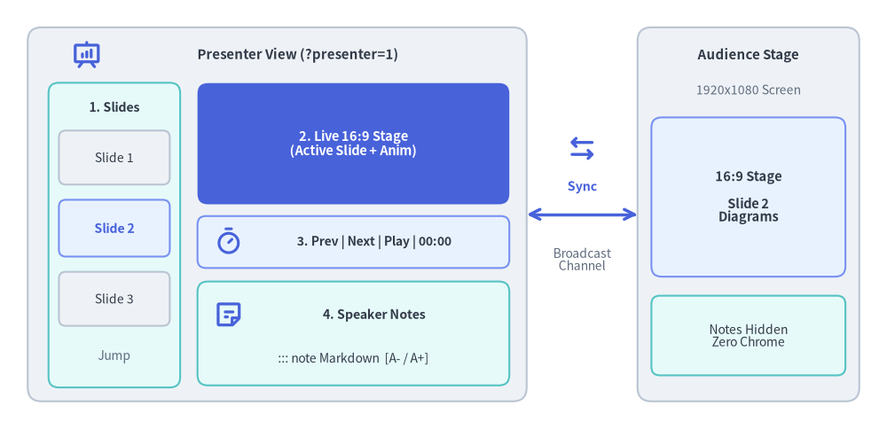
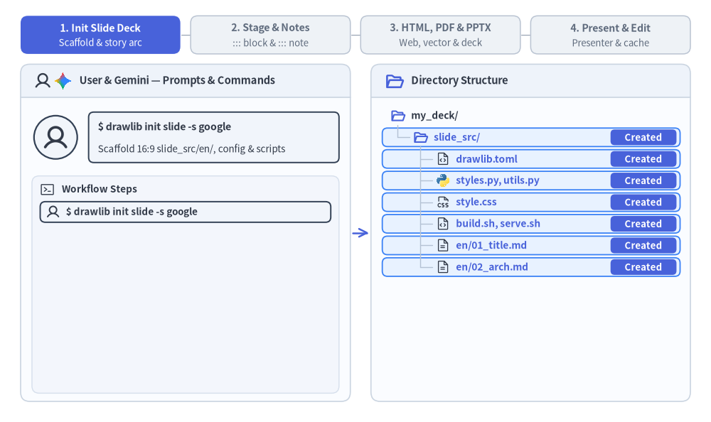

# スライドデッキプロジェクトガイド (`drawlib init slide`)

`slide` スターターテンプレートは、リッチなアーキテクチャ図解、メトリクスカード、バッジ、および構造化レイアウトを備えた 16:9 プレゼンテーションスライドデッキを作成します。

Drawlib はスライドデッキを **インタラクティブな HTML Web プレゼンテーション**、**1 ページ 1 スライドのベクター PDF**、および **ネイティブ編集可能な 16:9 MS PowerPoint（`.pptx`）デッキ** へコンパイルし、カンファレンス登壇、顧客向けブリーフィング、チーム内レビューに最適なサイズで出力します。


<figure class="drawlib-image" style="text-align: center;">
  
  <figcaption class="drawlib-caption">発表者ツール (?presenter=1) の 4 ペインワークスペースと BroadcastChannel 同期アーキテクチャ</figcaption>
</figure>

<details class="drawlib-code-details">
<summary>Source Code</summary>

```python
from drawlib.canvas import save, setup
from drawlib.icons import phosphor
from drawlib.lines import line
from drawlib.shapes import rectangle
from drawlib.styles import Styles
from drawlib.text import text

setup(width=128, height=62)

# Left Container: Presenter View Window (?presenter=1)
rectangle((40, 31), width=72, height=54, style=Styles.Neutral.patch(shape_r=2.0))
phosphor.presentation_chart((12.5, 54.0), width=4.4, style=Styles.PrimaryBold)
text((43.0, 54.0), "Presenter View (?presenter=1)", style=Styles.DarkBold.patch(text_size=10.8))

# Pane 1: Left Column (Slide Thumbnails Strip)
rectangle((16.5, 28.0), width=19, height=44, style=Styles.SecondaryNeutral.patch(shape_r=1.5))
text((16.5, 46.5), "1. Slides", style=Styles.DarkBold.patch(text_size=10.2))
rectangle((16.5, 39.2), width=16, height=7.8, style=Styles.Neutral.patch(shape_r=1.0), text="Slide 1", text_style=Styles.Dark.patch(text_size=10.0))
rectangle(
    (16.5, 29.0),
    width=16,
    height=8.2,
    style=Styles.PrimaryNeutral.patch(shape_r=1.0),
    text="Slide 2",
    text_style=Styles.PrimaryBold.patch(text_size=10.2),
)
rectangle((16.5, 18.8), width=16, height=7.8, style=Styles.Neutral.patch(shape_r=1.0), text="Slide 3", text_style=Styles.Dark.patch(text_size=10.0))
text((16.5, 10.5), "Jump", style=Styles.Muted.patch(text_size=10.0))

# Pane 2: Top-Right (Live 16:9 Current Slide Preview)
rectangle(
    (51.0, 41.2),
    width=45,
    height=17.5,
    style=Styles.PrimaryFlat.patch(shape_r=1.5),
    text="2. Live 16:9 Stage\n(Active Slide + Anim)",
    text_style=Styles.WhiteBold.patch(text_size=10.5),
)

# Pane 3: Middle-Right (Control & Timer Bar)
rectangle((51.0, 27.0), width=45, height=7.5, style=Styles.PrimaryNeutral.patch(shape_r=1.2))
phosphor.timer((33.0, 27.0), width=4.2, style=Styles.PrimaryBold)
text((54.0, 27.0), "3. Prev | Next | Play | 00:00", style=Styles.DarkBold.patch(text_size=10.0))

# Pane 4: Bottom-Right (Speaker Notes Pane)
rectangle((51.0, 13.8), width=45, height=15.0, style=Styles.SecondaryNeutral.patch(shape_r=1.5))
phosphor.note((33.0, 16.5), width=4.4, style=Styles.PrimaryBold)
text((54.0, 16.5), "4. Speaker Notes", style=Styles.DarkBold.patch(text_size=10.2))
text((51.0, 10.2), "::: note Markdown  [A- / A+]", style=Styles.Dark.patch(text_size=10.0))

# Bidirectional BroadcastChannel Sync Connector
phosphor.arrows_left_right((84.0, 40.5), width=4.6, style=Styles.PrimaryBold)
line((76, 31), (92, 31), arrow_head="<->", style=Styles.PrimaryBold)
text((84.0, 35.0), "Sync", style=Styles.PrimaryBold.patch(text_size=10.2))
text((84.0, 24.5), "Broadcast\nChannel", style=Styles.Muted.patch(text_size=10.0))

# Right Container: Audience Main Stage Window
rectangle((108, 31), width=32, height=54, style=Styles.Neutral.patch(shape_r=2.0))
text((108, 54.0), "Audience Stage", style=Styles.DarkBold.patch(text_size=10.8))
text((108, 49.0), "1920x1080 Screen", style=Styles.Muted.patch(text_size=10.0))

rectangle(
    (108, 33.5),
    width=28,
    height=23,
    style=Styles.PrimaryNeutral.patch(shape_r=1.5),
    text="16:9 Stage\n\nSlide 2\nDiagrams",
    text_style=Styles.DarkBold.patch(text_size=10.5),
)
rectangle(
    (108, 13.5),
    width=28,
    height=11.5,
    style=Styles.SecondaryNeutral.patch(shape_r=1.2),
    text="Notes Hidden\nZero Chrome",
    text_style=Styles.Dark.patch(text_size=10.0),
)

save()
```

</details>


---

## 1. エンドツーエンドのプロジェクトワークフロー

`drawlib init slide` による初期スキャフォールディングとストーリー構成の設計から、2 層構造の執筆（`::: block` ステージ＋`::: note` スピーカー台本）、HTML／PDF／`.pptx` へのコンパイル、ライブ発表者ツール（`?presenter=1`）、そしてキャッシュを活用した Day-2 の高速編集までの流れを確認しましょう。


<figure class="drawlib-image" style="text-align: center;">
  
  <figcaption class="drawlib-caption">16:9 スライドデッキのライフサイクル: スキャフォールディング、2 層構造の執筆、HTML/PDF/PPTX エクスポート、発表者ツール (APNG アニメーション)</figcaption>
</figure>


<div class="drawlib-source-link">
  <a href="https://github.com/yuichi110/drawlib/blob/main/docs/docs_src/ja/09_doc_builder_and_cli/project_slide.md" target="_blank" rel="noopener noreferrer">GitHub でアニメーションのソースコードを見る &rarr;</a>
</div>

---

## 2. プロジェクトの初期化

`drawlib init` を使用してプレゼンテーションプロジェクトをスキャフォールディングします。

```bash
# Scaffold standard slide project in current directory (creates 'slide_src/'):
drawlib init slide

# With custom target name, theme, and language (creates 'my_deck_src/'):
drawlib init slide my_deck -s google -l en
```

---

## 3. ディレクトリ構成と構造

`slide` プロジェクトでは、すべての執筆用ソースファイルを `slide_src/` 内に集約し、それと並列に出力成果物をコンパイルします。

- **`slide_src/`（信頼できる唯一の情報源）**:
  - **`01_title.md`, `02_agenda.md`, `03_arch.md`（およびセクションサブフォルダ）**: ソートされたパス順にコンパイルされる `1920x1080`（16:9）の個別スライドファイルです。`::: block` ステージコンテナ、```` ```drawlib ```` 図解（`.svg`、`.png`、`.webp`）、および `::: note` スピーカーノートを組み合わせて記述します。
  - **`_` 始まりのファイルと `README.md`**: 構成案や下書きスライド（`_planning.md`、`_drafts/`）および `README.md` は、スライドデッキのコンパイル対象から自動的に除外されます。
  - **`_assets/`**: 出力先フォルダへ同期される静的なロゴ、フォント、参照メディアです。
  - **`styles.py` & `utils.py`**: プレゼンテーション全体で共有されるカラートークン、タイポグラフィ既定値、スライドヘッダー／フッターヘルパー、KPI／カードユーティリティです。
  - **`style.css` & `slide.js`**: 16:9 ビューポート自動スケーリング用スタイルシート、キーボードナビゲーションコントローラー、および `BroadcastChannel` による発表者ツール（Presenter View）ランタイムです。
  - **`build.sh`, `build_html.sh`, `build_pdf.sh`, `build_image.sh`, `serve.sh`**: モジュール化されたビルドスクリプトおよびローカルプレゼンテーションプレビューランチャーです。
- **生成される出力先（直接編集しないでください）**:
  - **`slide_html/`**: フルスクリーン表示、一覧グリッド表示、および `?presenter=1` 発表者ツールをサポートするインタラクティブなブラウザ用スライドデッキ（`index.html`）です。
  - **`slide.pdf`**: ヘッドレス Chromium によってレンダリングされる、1 ページあたり `1920px × 1080px` のマルチページベクター PDF です。
  - **`slide.pptx`**: `drawlib build pptx` でオンデマンド出力されるネイティブ編集可能な 16:9（`960×540 pt`）MS PowerPoint デッキです。ステージカード、テキストラン、図解、スピーカーノートがそのまま保持されます。
  - **`slide_images/`**: `build_image.sh` 実行時に単体ファイルとして抽出される図解画像群です。

---

## 4. 用途に応じた複数のプレゼンテーション出力

`slide` プロジェクトは、あらゆる発表・共有シナリオに合わせた成果物を生成します。

| 出力先 | 想定シーン・環境 | 主な特徴 | ビルドスクリプト / コマンド |
| :--- | :--- | :--- | :--- |
| **`slide_html/index.html`** | インタラクティブな発表 | 1920x1080 固定ステージ、ビューポート自動スケーリング、キーボード操作（`Space`, `矢印キー`, `F`）、発表者ツール（`?presenter=1`）、スライド一覧グリッド | `build_html.sh` (`drawlib build slide`) |
| **`slide.pdf`** | 印刷・閲覧専用配布 | 1 ページ 1 スライド、鮮明なベクターグラフィックス、正確な 16:9 アスペクト比（`@page { size: 1920px 1080px; margin: 0; }`） | `build_pdf.sh` (`drawlib build pdf`) |
| **`slide.pptx`** | 共同編集・エグゼクティブ向け資料 | ネイティブ編集可能な 16:9（`960×540 pt`）MS PowerPoint デッキ（`rgba` 透過対応の `::: block` カード、テキストボックス、リスト、表、`::: note` スピーカーノート、高 DPI 図解 PNG） | `drawlib build pptx` |
| **`slide_images/`** | 外部スライド・SNS 共有 | 外部資料やチャット共有に使える単体抽出されたスライド図解画像 | `build_image.sh` (`drawlib build image`) |

---

## 5. スライドとステージブロックの執筆

`slide_src/` 内（および `01_intro/01_cover.md` のようなネストされた章サブディレクトリ内）の各 Markdown ファイルは、1 枚の 16:9 スライド（`1920x1080` ステージ）を表し、相対パスのソート順にコンパイルされます。
- **非スライドファイルの除外（`_` プレフィックス）**: 企画メモ、構成案、下書きファイルやフォルダの先頭にアンダースコア `_`（例: `_planning.md`、`_drafts/`）を付けると、スライドのコンパイル対象から除外されます。
- **特別に除外されるファイル**: `README.md` および `navbar.md` もスライドデッキから自動的に除外されます。

標準の Markdown や `utils.py` のヘルパーコンポーネントとあわせて `::: block xy=(x, y) width=W height=H` コンテナを使用します（ステージ座標系の詳細リファレンス、レイアウトテンプレート、`drawlib.slide` API については [スライドステージレイアウトと API](./slide_layout_and_api.md) を参照してください）。

````markdown
::: block xy=(80, 40) width=1760 height=60
# Architecture Overview
:::

::: block xy=(80, 140) width=1760 height=840
```drawlib file=arch_flow.svg
from drawlib.canvas import clear, save, setup
from drawlib.shapes import rectangle
from drawlib.lines import line
from drawlib.styles import Styles

clear()
setup(width=176, height=84)
rectangle((35, 42), width=38, height=22, style=Styles.Neutral, text="Producer")
rectangle((88, 42), width=38, height=22, style=Styles.PrimaryFlat, text="Kafka", text_style=Styles.WhiteBold)
rectangle((141, 42), width=38, height=22, style=Styles.SecondaryNeutral, text="Consumer")
line((54, 42), (69, 42), arrow_head="->", style=Styles.DarkBold)
line((107, 42), (122, 42), arrow_head="->", style=Styles.DarkBold)
save()
```
:::
````

---

## 6. モジュール化されたビルドスクリプトと MS PowerPoint (`.pptx`) エクスポート

- **`build_html.sh`**:
  各スライドを `slide_html/index.html` の Web プレゼンテーションデッキへコンパイルします（`drawlib build slide`）。
- **`build_pdf.sh`**:
  ヘッドレス Chromium を使用して各スライドをキャプチャし、マルチページのベクター PDF（`slide.pdf`）を生成します。
- **`build_image.sh`**:
  埋め込まれた ````drawlib```` ブロックを抽出し、`slide_images/` に単体の図解画像として出力します。
- **`build.sh`（マスタースクリプト）**:
  HTML、PDF、画像のビルドを順番に実行します。
- **編集可能な MS PowerPoint エクスポート (`drawlib build pptx`)**:
  ヘッドレス Chromium で `1920x1080` スライド DOM と計算済み CSS スタイルを計測し、ネイティブ編集可能な 16:9（`960x540 pt`）の `.pptx` ファイルをエクスポートします。
  ```bash
  uv run drawlib build pptx slide_src/ -o slide.pptx --dpi 240 --anim-frame last
  ```

---

## 7. ローカルプレビューとプレゼンテーション実行

ローカル開発プレビューサーバーを起動します。

```bash
./slide_src/serve.sh
```

または直接コマンドを実行します。

```bash
uv run drawlib serve slide_html/
```

### キーボードショートカットと URL ディープリンク:
- **`→` / `Space` / `PageDown`**: 次のスライドへ進む
- **`←` / `PageUp`**: 前のスライドへ戻る
- **`F`**: フルスクリーン表示の切り替え
- **`O` / `Esc`**: スライド一覧グリッド表示の切り替え
- **`P` / `S`**: 同期された別ウィンドウで **発表者ツール（Presenter View）** を開く
- **`A`**: 現在のスライド上のアニメーションを再生／一時停止／再開
- **URL ハッシュによるディープリンク (`#1`, `#2`, ...)**: `index.html#4` にアクセスするとスライド 4 に直接ジャンプし、スライドを送ると URL ハッシュもリアルタイムに更新されるため、ブックマークやリンク共有が容易です。
- **発表者ツールの直接 URL (`?presenter=1`)**: `?presenter=1#1` を付与すると発表者ツールモードで直接起動し、`BroadcastChannel` / `localStorage` を介してウィンドウ間でスライド遷移やアニメーション再生を同期します。

### スピーカーノート (`::: note`) と発表者ツール:
`::: note` ブロックを使用して任意のスライドにスピーカーノートを追加できます。1 つのスライド内に複数の `::: note` ブロックがある場合は空行（`\n\n`）で自動結合され、**発表者ツール（Presenter View）** 上で Markdown としてレンダリングされるほか、`drawlib build pptx` 実行時には **PowerPoint ネイティブのスピーカーノート** としてエクスポートされます（メインの発表画面および PDF エクスポートでは完全に非表示になります）。

```markdown
::: note
**Key Talking Points**:
- Emphasize single source of truth in Git.
- Click **Play Animation** (or press `A`) to step through the pipeline.
:::
```

**`P`** または **`S`** キーを押す（あるいは右下のコントロールバーにある `🗒` ボタンをクリックする）と、以下の機能を備えた **発表者ツール（Presenter View）**（`?presenter=1`）が開きます。
- **左カラム**: 任意のスライドへ瞬時にジャンプできる縦スクロール式のライブサムネイル一覧。
- **右上ペイン**: 現在のスライドのライブ 16:9 プレビュー。
- **右中央（コントロールバー）**: `◀ Prev` / `Next ▶` ナビゲーション、メインウィンドウと同期する **`▶ Play Animation` ボタン**（アニメーションのないスライドでは自動的に無効化／グレーアウトされます）、およびプレゼンテーション経過タイマー（`00:00`）。
- **右下ペイン（スピーカーノート）**: `A-` / `A+` フォントサイズ調整機能付きのコンパイル済みスピーカーノート。

### インタラクティブなアニメーション再生制御 (`anim_trigger`, `anim_loop`, `anim_pause`):
スライド内に APNG（`.png` / `.apng`）またはアニメーション WebP（`.webp`）の図解を埋め込む際、````drawlib```` コードフェンスに再生制御属性を指定できます。

````markdown
```drawlib file=workflow.webp anim_trigger=click anim_loop=once anim_pause=(2, 4)
```
````

- **`anim_trigger=click`** (`auto` | `click`): 発表者がクリックするまでフレーム 0 で待機します。
- **`anim_loop=once`** (`once` | `infinite`): 最終フレームで停止（`ENDED`）し、再度クリックするとフレーム 0 から再生し直します。
- **`anim_pause=(2, 4)`**: 0 始まりのフレームインデックス `2` と `4` で一時停止（`PAUSED`）し、クリックすると次のステップへ再開します。
- **ベクター PDF エクスポート (`build_pdf.sh`)**: インタラクティブな再生バッジを表示せず、自動的にフレーム 0 をスライド上にレンダリングします。
- **MS PowerPoint エクスポート (`drawlib build pptx`)**: デフォルトでは最終フレーム（`--anim-frame last`）、`--anim-frame first` 指定時は先頭フレームを使用して、`--dpi 240` の鮮明な静的 PNG を抽出・埋め込みます。

---

## 8. マルチエージェントによる並列スライドデッキ執筆

`slide_src/` 内の各スライドは独立した Markdown ファイル（`01_title.md`、`02_agenda.md`、`03_arch.md`、またはセクションフォルダ単位）であるため、AI コーディングエージェントは複数枚のプレゼンテーションを並列に構築・刷新できます。
1. **フェーズ 1（親エージェントによる初期設定）**: 最初に `slide_src/` をスキャフォールディング（`drawlib init slide`）し、`styles.py` と `utils.py` を設定したうえで、スライドデッキ全体のストーリー構成と番号付きファイル名を定義します。
2. **フェーズ 2（サブエージェントによる並列執筆）**: 重複しないスライドファイル（またはセクションディレクトリ）を並列サブエージェントに割り当てます。各サブエージェントは担当スライド（`::: block` ステージレイアウト＋`::: note` スピーカー台本）を執筆し、一意なスクラッチパス（`-o .drawlib/scratch/<slide>_<block>_grid.png`）で `-g` グリッドプレビューを実行します。
3. **フェーズ 3（統合デッキビルドとレビュー）**: すべてのサブエージェントがスライドを完了した後、親エージェントが `./slide_src/build.sh`（および必要に応じて `drawlib build pptx`）を 1 回実行し、コンパイルされた `slide.pdf` と `slide_html/index.html` を検証します。

