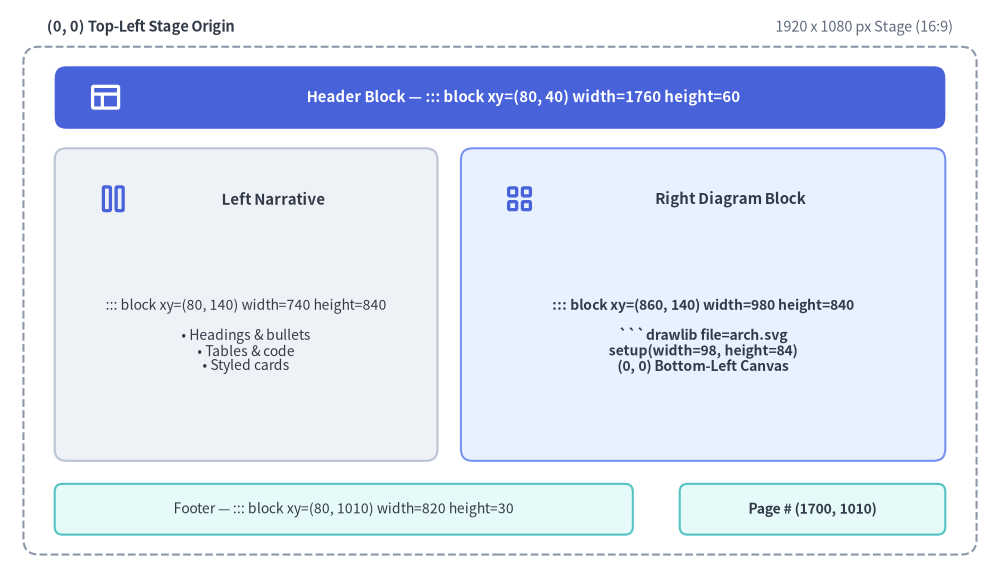
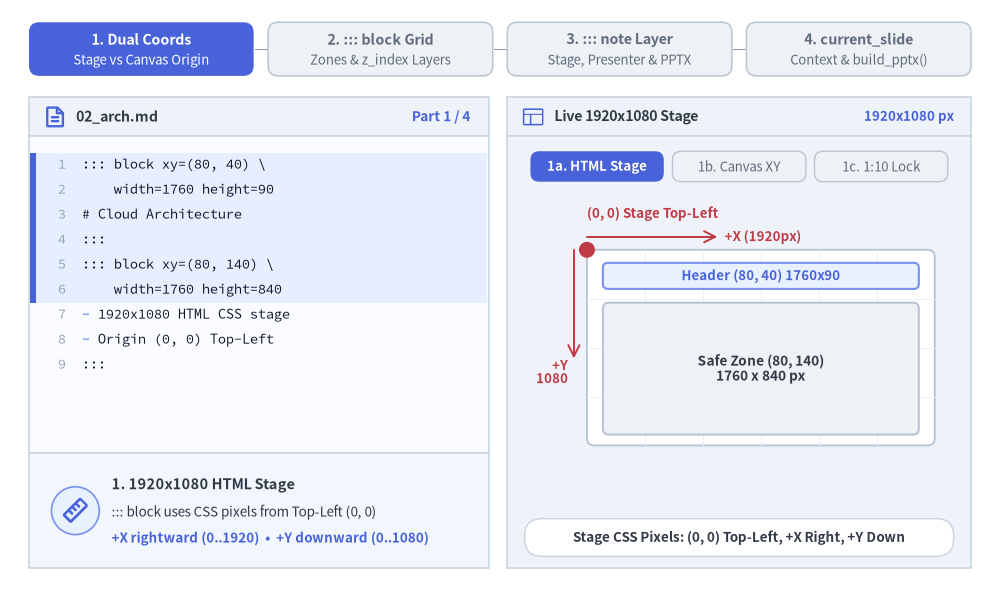
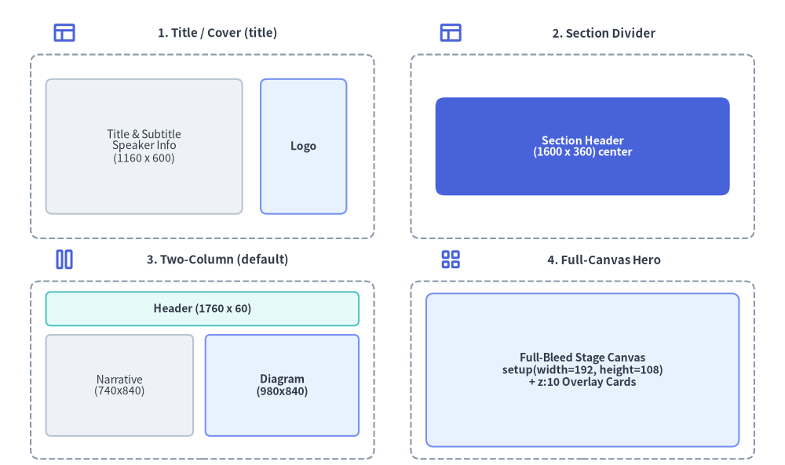

# スライドステージレイアウトと API

16:9 ワイドスクリーンのプレゼンテーションデッキ（`drawlib init slide`）を執筆する際、Drawlib は高精度な **1920 × 1080 ピクセルの仮想ステージ**（`::: block`、`::: note`）、組み込みレイアウトパターン、インラインベクター SVG へのフォントバンドル、およびプログラマティックな [`drawlib.slide`](../10_ai_agents_and_advanced/programmatic_api.md) Python ランタイム API（`current_slide`、`SlideContext`、`BoundingBox`、`build_slide`、`build_pptx`）を提供します。*（スライドデッキプロジェクトの初期化やビルド手順については、[スライドデッキプロジェクトガイド](./project_slide.md) を参照してください。）*


<figure class="drawlib-image" style="text-align: center;">
  
  <figcaption class="drawlib-caption">1920x1080 仮想スライドステージの各領域と ::: block xy=(x, y) width=W height=H レイアウトグリッド</figcaption>
</figure>

<details class="drawlib-code-details">
<summary>Source Code</summary>

```python
from drawlib.canvas import save, setup
from drawlib.icons import phosphor
from drawlib.shapes import rectangle
from drawlib.styles import Styles
from drawlib.text import text

setup(width=128, height=74)

# Outer 1920x1080 Stage Frame
rectangle((64, 35.5), width=122, height=65, style=Styles.MutedDashed.patch(shape_r=2.0))
text((6, 70.5), "(0, 0) Top-Left Stage Origin", style=Styles.DarkBold.patch(text_size=10.5, halign="left"))
text((122, 70.5), "1920 x 1080 px Stage (16:9)", style=Styles.Muted.patch(text_size=10.5, halign="right"))

# Header Zone: ::: block xy=(80, 40) width=1760 height=60
rectangle((64, 61.5), width=114, height=8.0, style=Styles.PrimaryFlat.patch(shape_r=1.5))
phosphor.layout((13.5, 61.5), width=4.4, style=Styles.WhiteBold)
text((67.0, 61.5), "Header Block — ::: block xy=(80, 40) width=1760 height=60", style=Styles.WhiteBold.patch(text_size=10.8))

# Left Narrative Column: ::: block xy=(80, 140) width=740 height=840
rectangle((31.5, 35.0), width=49, height=40, style=Styles.Neutral.patch(shape_r=1.5))
phosphor.columns((14.5, 48.5), width=4.4, style=Styles.PrimaryBold)
text((35.0, 48.5), "Left Narrative", style=Styles.DarkBold.patch(text_size=10.8))
text(
    (31.5, 31.0),
    "::: block xy=(80, 140) width=740 height=840\n\n• Headings & bullets\n• Tables & code\n• Styled cards",
    style=Styles.Dark.patch(text_size=10.0),
)

# Right Diagram Column: ::: block xy=(860, 140) width=980 height=840
rectangle((90.0, 35.0), width=62, height=40, style=Styles.PrimaryNeutral.patch(shape_r=1.5))
phosphor.squares_four((66.5, 48.5), width=4.4, style=Styles.PrimaryBold)
text((93.5, 48.5), "Right Diagram Block", style=Styles.DarkBold.patch(text_size=10.8))
text(
    (90.0, 31.0),
    "::: block xy=(860, 140) width=980 height=840\n\n```drawlib file=arch.svg\nsetup(width=98, height=84)\n(0, 0) Bottom-Left Canvas",
    style=Styles.DarkBold.patch(text_size=10.0),
)

# Footer & Page Counter Blocks
rectangle(
    (44, 8.8),
    width=74,
    height=6.5,
    style=Styles.SecondaryNeutral.patch(shape_r=1.0),
    text="Footer — ::: block xy=(80, 1010) width=820 height=30",
    text_style=Styles.Dark.patch(text_size=10.0),
)
rectangle(
    (104, 8.8),
    width=34,
    height=6.5,
    style=Styles.SecondaryNeutral.patch(shape_r=1.0),
    text="Page # (1700, 1010)",
    text_style=Styles.DarkBold.patch(text_size=10.0),
)

save()
```

</details>


---

## 1. インタラクティブなステージジオメトリ＆API ツアー

各スライドは、**左上原点の `1920 × 1080` HTML ステージ**（`::: block xy=(x, y) width=W height=H` および `z_index` レイヤー）と、**左下原点のデカルト座標 ````drawlib```` キャンバス**、非表示の **`::: note` 発表者台本**（`?presenter=1` およびネイティブ PowerPoint `.pptx` スピーカーノートに出力）、さらに **`drawlib.slide` Python ランタイム**（`current_slide`、`BoundingBox`、`build_slide`、`build_pptx`）を組み合わせて構成されます。


<figure class="drawlib-image" style="text-align: center;">
  
  <figcaption class="drawlib-caption">16:9 スライドステージ＆API ツアー: 2 つの座標空間、::: block グリッド配置、::: note 発表者レイヤー、current_slide コンテキスト (APNG アニメーション)</figcaption>
</figure>


<div class="drawlib-source-link">
  <a href="https://github.com/yuichi110/drawlib/blob/main/docs/docs_src/ja/09_doc_builder_and_cli/slide_layout_and_api.md" target="_blank" rel="noopener noreferrer">GitHub でアニメーションのソースコードを見る &rarr;</a>
</div>

---

## 2. 2 つの座標系: 1920×1080 ステージと Drawlib キャンバス

すべてのスライドでは、以下の 2 つの座標系が連携して機能します。

1. **スライドステージ (`::: block xy=(x, y) width=W height=H`) — 左上原点 `(0, 0)`**:
   - すべてのスライドは固定サイズの **1920 × 1080 ピクセル** ワイドスクリーンステージ（16:9 アスペクト比）上にレンダリングされ、ブラウザのビューポートや PDF ページに合わせて自動的にスケーリングされます。
   - コンテナブロック（`::: block`）は、**`(0, 0)` を左上隅** とする CSS ステージピクセル単位で配置します。
     - `x` は右方向へ増加します（`0` → `1920`）。
     - `y` は下方向へ増加します（`0` → `1080`）。
   - **標準セーフコンテンツ領域**: 主要なテキストや図解は `x: 80..1840`（`width=1760`）かつ `y: 140..980`（`height=840`）の内側に収め、`y: 40..100` をスライドヘッダー用、`y: 1010..1040` をフッターおよびページ番号用に確保します。
2. **Drawlib キャンバス (````drawlib```` Python ブロック) — 左下原点 `(0, 0)`**:
   - ````drawlib```` コードブロックの内部では、`setup(width=W, height=H)` が **`(0, 0)` を左下隅** とする数学的なデカルト座標キャンバスを定義します。
     - `x` は右方向へ増加します（`0` → `W`）。
     - `y` は上方向へ増加します（`0` → `H`）。

### 2.1. 鉄則: `setup(width, height)` のアスペクト比をブロックの `width`・`height` に一致させる
`setup(width=W, height=H)` には、必ず外側の `::: block xy=(x, y) width=W height=H` のピクセル寸法に比例した値（通常はピクセルの幅・高さを `10` または `20` で割った値）を設定してください。

| 外側の `::: block` の寸法 | 推奨される `setup(width, height)` | アスペクト比 |
| :--- | :--- | :--- |
| `width=980 height=840` *（右側の図解カラム）* | `setup(width=98, height=84)` | `98 : 84` |
| `width=1020 height=840` *（ワイドな右側カラム）* | `setup(width=102, height=84)` | `102 : 84` |
| `width=1760 height=840` *（全幅コンテンツ領域）* | `setup(width=176, height=84)` | `176 : 84` |
| `width=980 height=1080` *（右半分フルブリード）* | `setup(width=98, height=108)` | `98 : 108` |
| `width=1920 height=1080` *（全面キャンバス・ヒーロースライド）* | `setup(width=192, height=108)` | `16 : 9` |

---

## 3. ステージコンテナブロック構文 (`::: block` & `::: note`)

スライドの Markdown ファイルは YAML フロントマター（`---`）を持たない純粋な Markdown で記述します。スライド上のすべての視覚要素は、Python のキーワード引数形式（`key=value`）を用いた 1 つ以上の `::: block` コンテナ内に配置します。

````markdown
::: block xy=(x, y) width=W height=H [options...]
<Markdown content or ```drawlib code fence>
:::
````

スライドファイル内に `::: block` タグが 1 つも含まれていない場合、Drawlib はスライドコンテンツ全体をデフォルトのコンテンツ領域 `::: block xy=(80, 140) width=1760 height=840` で自動的にラップします。同様に、`::: block` ヘッダーで `xy`、`width`、または `height` が省略された場合も、それぞれ `xy=(80, 140)`、`width=1760`、`height=840` がデフォルト適用されます。

### 3.1. `::: block` オプション完全リファレンス

| オプションキー | 指定例 | コンパイル後の CSS / 動作 |
| :--- | :--- | :--- |
| **配置座標 (`xy`)** | `xy=(80, 140)`, `xy=(0, 0)` | `position: absolute; left: 80px; top: 140px;` |
| **サイズ (`width`, `height`)** | `width=740 height=840`, `width=1920 height=1080` | `width: 740px; height: 840px;` |
| **フォントサイズ (`font_size`)** | `font_size=22px`, `font_size=1.2rem`, `font_size=18` | `font-size: 22px;`（単位なしの数値には自動的に `px` が付与されます）。 |
| **コンパクト密度 (`compact`)** | `compact=true` | `<div class="slide-block slide-text-box compact">` に `.compact` クラスを追加し、行間とリスト間隔を引き締めます。 |
| **テキスト揃え (`align`)** | `align=left`, `align=center`, `align=right` | `text-align: center;` |
| **重なり順 (`z_index`)** | `z_index=5`, `z_index=10` | `z-index: 5;` — ブロック同士が重なる際の前面／背面の重なり順を制御します。 |
| **カスタム CSS クラス (`class`)** | `class="card panel accent border shadow"`, `class=card` | コンテナの `<div>` にカスタムユーティリティ／テーマクラス（`card`、`panel`、`accent`、`transparent`、`border`、`shadow`、`middle` など）を追加します。 |
| **インライン CSS スタイル (`style`)** | `style="padding: 24px; background: #f8fafc; border-radius: 12px"` | コンテナの `<div>` にカスタムのインライン CSS ルール（`padding`、`background`、`border` など）を追加します。 |

### 3.2. スピーカーノート (`::: note`)

スライド Markdown ファイル内の任意の位置に `::: note` を記述して発表者用メモを追加できます。スピーカーノートは表示用のスライドステージからは取り除かれ、2 ウィンドウ同期式の **発表者ツール（Presenter View）**（`P` または `S` キー）向けに `<aside class="slide-notes" hidden>` へコンパイルされるとともに、`drawlib build pptx` / `build_pptx()` 実行時には **PowerPoint ネイティブのスピーカーノート** としてエクスポートされます。

````markdown
::: note
- Emphasize that **SQLite hash caching** restores unchanged diagrams in **< 1ms**.
- Press `A` or click **Play Animation** to step through the pipeline animation.
:::
````

---

## 4. 組み込みスライドレイアウトパターンとテンプレート


<figure class="drawlib-image" style="text-align: center;">
  
  <figcaption class="drawlib-caption">組み込み 16:9 スライドレイアウトテンプレート 4 種の視覚比較</figcaption>
</figure>

<details class="drawlib-code-details">
<summary>Source Code</summary>

```python
from drawlib.canvas import save, setup
from drawlib.icons import phosphor
from drawlib.shapes import rectangle
from drawlib.styles import Styles
from drawlib.text import text

setup(width=128, height=76)

# 1. Top-Left: Title / Cover Slide (title)
phosphor.layout((10.5, 70.5), width=4.0, style=Styles.PrimaryBold)
text((35.5, 70.5), "1. Title / Cover (title)", style=Styles.DarkBold.patch(text_size=10.8))
rectangle((33, 52), width=56, height=30, style=Styles.MutedDashed.patch(shape_r=1.5))
rectangle(
    (23.5, 52),
    width=32,
    height=22,
    style=Styles.Neutral.patch(shape_r=1.0),
    text="Title & Subtitle\nSpeaker Info\n(1160 x 600)",
    text_style=Styles.Dark.patch(text_size=10.0),
)
rectangle(
    (49.5, 52),
    width=14,
    height=22,
    style=Styles.PrimaryNeutral.patch(shape_r=1.0),
    text="Logo",
    text_style=Styles.DarkBold.patch(text_size=10.0),
)

# 2. Top-Right: Section Divider / Closing (section)
phosphor.layout((73.5, 70.5), width=4.0, style=Styles.PrimaryBold)
text((98.5, 70.5), "2. Section Divider", style=Styles.DarkBold.patch(text_size=10.8))
rectangle((95, 52), width=56, height=30, style=Styles.MutedDashed.patch(shape_r=1.5))
rectangle(
    (95, 52),
    width=48,
    height=16,
    style=Styles.PrimaryFlat.patch(shape_r=1.5),
    text="Section Header\n(1600 x 360) center",
    text_style=Styles.WhiteBold.patch(text_size=10.2),
)

# 3. Bottom-Left: Two-Column Split (default)
phosphor.columns((10.5, 33.5), width=4.0, style=Styles.PrimaryBold)
text((35.5, 33.5), "3. Two-Column (default)", style=Styles.DarkBold.patch(text_size=10.8))
rectangle((33, 15.5), width=56, height=29, style=Styles.MutedDashed.patch(shape_r=1.5))
rectangle(
    (33, 25.5),
    width=51,
    height=5.5,
    style=Styles.SecondaryNeutral.patch(shape_r=0.8),
    text="Header (1760 x 60)",
    text_style=Styles.DarkBold.patch(text_size=10.0),
)
rectangle(
    (19.5, 13.0),
    width=24,
    height=16.5,
    style=Styles.Neutral.patch(shape_r=0.8),
    text="Narrative\n(740x840)",
    text_style=Styles.Dark.patch(text_size=10.0),
)
rectangle(
    (46.0, 13.0),
    width=25,
    height=16.5,
    style=Styles.PrimaryNeutral.patch(shape_r=0.8),
    text="Diagram\n(980x840)",
    text_style=Styles.DarkBold.patch(text_size=10.0),
)

# 4. Bottom-Right: Full-Canvas Hero ((0,0)-(1920,1080))
phosphor.squares_four((73.5, 33.5), width=4.0, style=Styles.PrimaryBold)
text((98.5, 33.5), "4. Full-Canvas Hero", style=Styles.DarkBold.patch(text_size=10.8))
rectangle((95, 15.5), width=56, height=29, style=Styles.MutedDashed.patch(shape_r=1.5))
rectangle(
    (95, 15.5),
    width=51,
    height=25,
    style=Styles.PrimaryNeutral.patch(shape_r=1.2),
    text="Full-Bleed Stage Canvas\nsetup(width=192, height=108)\n+ z:10 Overlay Cards",
    text_style=Styles.DarkBold.patch(text_size=10.0),
)

save()
```

</details>


### 4.1. タイトル／表紙スライド (`title`)
左側にメインタイトル・サブタイトル・登壇者メタデータを配置し、右側にヒーローイラストやロゴを配置します。

````markdown
::: block xy=(160, 240) width=1160 height=600
# Presentation Title
## Subtitle or Core Value Proposition

Brief one-line summary of the presentation topic

---

**Speaker Name** | Role / Organization  
*October 2026*
:::

::: block xy=(1360, 260) width=400 height=480

:::
````

### 4.2. セクションヘッダー／章扉スライド (`draw_section_header`)
フルブリードの `::: block xy=(0, 0) width=1920 height=1080` ブロック（`01_section.md` など）内で `from drawlib.slide import draw_section_header` を呼び出し、4 種類のレイアウトパターン（`variant="split"`、`"centered"`、`"banner"`、`"minimal"`）から選択して描画します。

````markdown
::: block xy=(0, 0) width=1920 height=1080
```drawlib file=section_cover.svg
from drawlib.slide import draw_section_header

draw_section_header(
    2,
    "Distributed Storage Engine",
    "Consensus, Replication & Recovery Workflows",
    [
        "Raft Consensus & Leader Election",
        "Quorum Write Path & WAL Durability",
        "Automated Shard Rebalancing",
    ],
    total_sections=4,
    variant="split",
)
```
:::
````

### 4.3. 標準コンテンツ＆2 カラム分割 (`default`)
標準のヘッダー（`(80, 40) (1760, 60)`）、フッター（`(80, 1010) (820, 30)`）、ページカウンター（`(1700, 1010) (140, 30)`）、左側のテキスト解説カラム（`(80, 140) (740, 840)`）、および右側の図解カラム（`(860, 140) (980, 840)`）を組み合わせます。

````markdown
::: block xy=(1700, 1010) width=140 height=30
```drawlib file=page.svg
from drawlib.slide import draw_page_number

draw_page_number()
```
:::

::: block xy=(80, 40) width=1760 height=60
# Cloud Microservices Topology
:::

::: block xy=(80, 140) width=740 height=840
## Key Architectural Decisions

- **API Gateway**: Centralized TLS termination and rate limiting
- **Service Mesh**: mTLS zero-trust east-west communication
- **Event Streaming**: Asynchronous decoupling via Pub/Sub
:::

::: block xy=(860, 140) width=980 height=840
```drawlib file=arch_topology.svg
from drawlib.canvas import clear, save, setup
from drawlib.shapes import rectangle
from drawlib.styles import Styles

clear()
setup(width=98, height=84)
rectangle((49, 42), width=80, height=60, style=Styles.Neutral, text="Architecture Diagram")
save()
```
:::

::: block xy=(80, 1010) width=820 height=30 font_size=14px
*Deck Footer / Presentation Title*
:::
````

### 4.4. フルキャンバス・ヒーロースライド (`xy=(0, 0) width=1920 height=1080`)
16:9 スライド全体を単一の統合ベクターキャンバスとして描画したい場合は、`setup(width=192, height=108)` を設定した `xy=(0, 0) width=1920 height=1080` ブロックと `z_index=10` のオーバーレイを組み合わせて使用します。

---

## 5. スライドにおけるインラインベクター `.svg` とアニメーション `.png` / `.webp` の使い分け

| 出力フォーマット | フェンス構文 | `slide_html/`・`slide.pdf`・`slide.pptx` でのレンダリング動作 |
| :--- | :--- | :--- |
| **インラインベクター SVG** *（静的図解のデフォルト）* | ```` ```drawlib file=diagram.svg ```` | HTML および PDF では `<div class="slide-svg-container"><svg>...</svg></div>` として直接インライン展開されます（`.ttf`/`.otf` の `@font-face` ルールがバンドルされるため拡大しても劣化せず、`Ctrl+F` でのテキスト検索も可能です）。`drawlib build pptx` では高解像度の鮮明な静的 PNG（デフォルト `--dpi 240`）としてレンダリングされます。 |
| **インタラクティブ `<canvas>` アニメーション** *（`Animation()` 使用時のデフォルト）* | ```` ```drawlib file=flow.png anim_trigger=click anim_loop=once anim_pause=(2, 4) ```` | APNG（`.png`）またはアニメーション WebP（`.webp`）のペイロードを Base64 エンコードし、`http://` サーバー経由でもローカル HTML ファイル直接閲覧でも動作するインタラクティブな `<canvas class="drawlib-anim-canvas">` プレイヤー内に埋め込みます。PDF エクスポート（`build_pdf.sh`）ではフレーム 0 が静的ポスター画像として描画され、PowerPoint エクスポート（`drawlib build pptx`）では `--anim-frame last`（デフォルト）または `first` が `--dpi 240` で埋め込まれます。 |

---

## 6. プログラマティックな `drawlib.slide` Python API

すべてのスライドランタイムヘルパー、ステージ／ページ描画ヘルパー、ジオメトリモデル、およびコンパイル関数は `drawlib.slide` からエクスポートされています。

```python
from drawlib.slide import (
    BoundingBox,
    SlideContext,
    build_pptx,
    build_slide,
    current_slide,
    draw_page_number,
    draw_section_header,
)
```

| シンボル | カテゴリ | 説明 |
| :--- | :--- | :--- |
| **`current_slide`** | ランタイムプロキシ | デッキのコンパイル中、処理対象スライドの 1 始まりの `index`、総スライド数 `total`、`.text`（`"{index} / {total}"`）、および `.format(template)` を公開する `contextvars` ベースの動的プロキシです。 |
| **`draw_page_number`** | ステージヘルパー | `current_slide.text` またはカスタム `template` を使用して、標準化されたスライドページ番号バッジ（`14×3`、`alpha=0.0`）を描画します。 |
| **`draw_section_header`** | ステージヘルパー | 4 種類のレイアウトバリアント（`"split"`、`"centered"`、`"banner"`、`"minimal"`）から選択可能な、フルブリード 16:9 セクションヘッダースライド（`192×108`）を描画します。 |
| **`SlideContext`** | 不変データクラス | スライド番号の状態を保持するイミュータブルなコンテキストモデル（`index: int = 1`、`total: int = 1`、`.text`、`.format()`）です。 |
| **`BoundingBox`** | 不変データクラス | 1920×1080 ステージピクセル単位のイミュータブルなステージジオメトリモデル（`x: float`、`y: float`、`width: float`、`height: float`）です。 |
| **`build_slide`** | コンパイラ関数 | `slide_src/` の Markdown ディレクトリをスタンドアロンの HTML プレゼンテーションデッキ（`index.html`）へプログラムからコンパイルします。 |
| **`build_pptx`** | コンパイラ関数 | ヘッドレス Chromium による CSS レイアウト計測を介して、`slide_src/` の Markdown ディレクトリをネイティブ編集可能な 16:9（`960×540 pt`）MS PowerPoint（`.pptx`）デッキへプログラムからコンパイルします。 |

### 6.1. `current_slide`・`SlideContext`・`BoundingBox` リファレンス

| オブジェクト | 属性 / メソッド | 型 | 説明 |
| :--- | :--- | :--- | :--- |
| **`current_slide`** / **`SlideContext`** | `.index` | `int` | ソート済みデッキ順における現在のスライドの 1 始まりインデックス（スライドビルド外ではデフォルト `1`）。 |
| **`current_slide`** / **`SlideContext`** | `.total` | `int` | プレゼンテーションデッキ全体の総スライド枚数（スライドビルド外ではデフォルト `1`）。 |
| **`current_slide`** / **`SlideContext`** | `.text` | `str` | 標準フォーマットのスライド番号文字列 `f"{index} / {total}"`（例: `"4 / 9"`）。 |
| **`current_slide`** / **`SlideContext`** | `.format(template="{index} / {total}")` | `str` | `{index}` と `{total}` プレースホルダーを使用したカスタムフォーマット文字列（例: `current_slide.format("Slide {index} of {total}")`）。 |
| **`BoundingBox`** | `.x`, `.y`, `.width`, `.height` | `float` | 1920×1080 ステージピクセル単位での左上ステージ座標（`x`, `y`）およびサイズ（`width`, `height`）。 |

`build_slide()` および `build_pptx()` の実行中、Drawlib は各スライドの ````drawlib```` ブロックを実行する前に `SlideContext(index=idx, total=N)` をバインドします（単体実行時は安全に `1 / 1` がデフォルトとなります）。

```python
from drawlib.slide import draw_page_number, draw_section_header

# 1. Bottom-right page counter badge (::: block xy=(1700, 1010) width=140 height=30)
draw_page_number()

# 2. Full-bleed 16:9 section header slide (::: block xy=(0, 0) width=1920 height=1080)
draw_section_header(
    1,
    "Architecture Overview",
    "Core Engine, SmartArts & Auto-Layout Graphs",
    ["Coordinate Geometry", "Semantic Design Tokens", "High-Level Components"],
    total_sections=4,
    variant="split",  # "split" | "centered" | "banner" | "minimal"
)
```

### 6.2. プログラムからのスライドコンパイル (`build_slide` & `build_pptx`)

```python
from drawlib.slide import build_pptx, build_slide

index_html_path = build_slide(
    input_dir="slide_src",
    output_dir="slide_html",
    title="System Architecture Deck",
    theme="google",
    image_format="svg",
    styles_path="slide_src/styles.py",
    utils_path="slide_src/utils.py",
    no_cache=False,
)

pptx_path = build_pptx(
    input_dir="slide_src",
    output_file="slide.pptx",
    title="System Architecture Deck",
    theme="google",
    dpi=240,
    anim_frame="last",
    styles_path="slide_src/styles.py",
    utils_path="slide_src/utils.py",
    no_cache=False,
)
```

