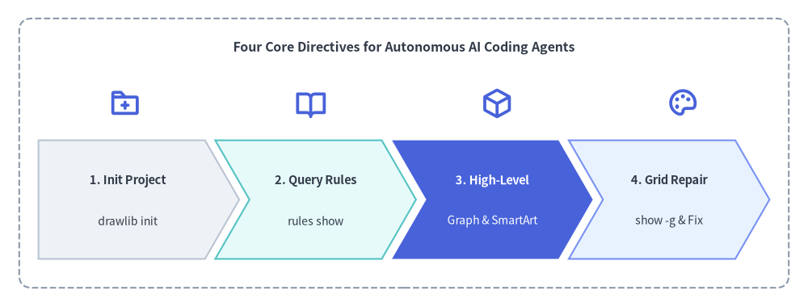
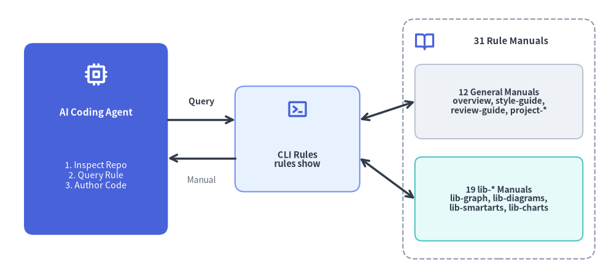

# AI エージェント指示とルール体系

Drawlib は、AI 支援エンジニアリング時代のためにゼロから設計されました。大規模言語モデル（LLM）に何千行もの壊れやすい生 SVG パス文字列や複雑な Matplotlib のボイラープレートを生成させる代わりに、ゼロショットで高品質なアーキテクチャ図を描画できる、明快で高水準な宣言的 Python API を AI エージェントに提供します。


<figure class="drawlib-image" style="text-align: center;">
  
  <figcaption class="drawlib-caption">Drawlib を使用する自律型 AI コーディングエージェントの4つの基本原則</figcaption>
</figure>

<details class="drawlib-code-details">
<summary>Source Code</summary>

```python
from drawlib.canvas import save, setup
from drawlib.icons import phosphor
from drawlib.shapes import rectangle
from drawlib.smartarts import ChevronProcess
from drawlib.styles import Styles
from drawlib.text import text

setup(width=126, height=48)

rectangle((63, 24), width=120, height=42, style=Styles.MutedDashed.patch(shape_r=2.0))
text((63, 40.5), "Four Core Directives for Autonomous AI Coding Agents", style=Styles.DarkBold.patch(text_size=11.5))

# Stage Icons above ChevronProcess
icons = [
    (19.5, phosphor.folder_plus),
    (48.5, phosphor.book_open),
    (77.5, phosphor.cube),
    (106.5, phosphor.palette),
]
for ix, icon_fn in icons:
    icon_fn((ix, 31.8), width=5.0, style=Styles.PrimaryBold)

workflow = ChevronProcess(
    style=Styles.Neutral,
    text_style=Styles.DarkBold.patch(text_size=10.5),
    description_style=Styles.Dark.patch(text_size=10.0),
    corner_angle=60.0,
    spacing=1.6,
    flat_left_end=True,
)
workflow.add("1. Init Project", description="drawlib init")
workflow.add("2. Query Rules", description="rules show", style=Styles.SecondaryNeutral)
workflow.add(
    "3. High-Level",
    description="Graph & SmartArt",
    style=Styles.PrimaryFlat,
    text_style=Styles.WhiteBold.patch(text_size=10.5),
    description_style=Styles.White.patch(text_size=10.0),
)
workflow.add("4. Grid Repair", description="show -g & Fix", style=Styles.PrimaryNeutral)
workflow.draw(xy=(6, 7.5), width=114, height=18.5)

save()
```

</details>


---

## 1. AI エージェントに Drawlib が最適である理由

1. **決定論的な幾何座標系**: ラベルを少し変えただけで図全体の配置が予測不能に崩れるヒューリスティックな自動レイアウトエンジン（Graphviz や PlantUML など）とは異なり、Drawlib は左下を原点 `(0, 0)` とする予測可能なデカルト座標系を採用しています。
2. **高水準なドメイン抽象コンポーネント**: エンタープライズアーキテクチャ構成図、UML クラスモデル、定量データチャートを20行未満の Python コードで簡潔に構築できます。
3. **オンデマンドの知識取得機構**: Drawlib にはターミナルから参照できるルールカタログ（`drawlib rules show <topic>`）が組み込まれています。巨大なマニュアルを最初からプロンプトに詰め込んで貴重なコンテキストウィンドウを消費することなく、必要な API 仕様だけをオンデマンドで取得できます。

---

## 2. 推奨エージェント指示テンプレート

以下のスニペットをリポジトリ内の AI 指示ファイル（`.cursorrules`、`.agents/rules/drawlib.md`、または Claude / Gemini のシステムプロンプトなど）にコピー＆ペーストして活用してください。

````markdown
# Drawlib Agent Directives

Drawlib is a pure-Python library for "Illustration as Code" and "Illustrated Documentation as Code".
When tasked with creating diagrams, architectures, flowcharts, or charts, follow these rules:

1. Project-First Rule (`drawlib init` — No Bare `.py` Files):
   Never create standalone `.py` drawing files in an uninitialized directory. If a `*_src/` project does not exist, scaffold one first so `styles.py`, `utils.py`, `_assets/`, and `build.sh` are configured:
   - Diagram image(s) only: `uv run drawlib init images [-l <lang>] [-s <style>]` (author in `images_src/*.py`)
   - Linear spec / RFC / PDF: `uv run drawlib init doc [-l <lang>] [-s <style>]` (author in `doc_src/*.md`)
   - Multi-page website: `uv run drawlib init site [-l <lang>] [-s <style>]` (author in `docs_src/**/*.md`)
   - 16:9 slide deck: `uv run drawlib init slide [-l <lang>] [-s <style>]` (author in `slide_src/*.md`)
   - Pass `--lang ja` (or target language code) for non-English labels, and delete starter `sample*.py` files.

2. High-Level Over Low-Level:
   Always favor high-level components over assembling raw rectangles and lines:
   - Auto-Layout Graphs: `drawlib.graph` (ArchitectureGraph, LayerGraph, TreeGraph, RadialGraph, GridGraph)
   - Cloud Topologies: `drawlib.diagrams.architecture.ArchitectureDiagram`
   - Flowcharts & Swimlanes: `drawlib.diagrams.flow.FlowDiagram`
   - API Sequences: `drawlib.diagrams.sequence.SequenceDiagram`
   - UML Class Hierarchies: `drawlib.diagrams.class_diagram.ClassDiagram`
   - Relational Database Schemas: `drawlib.diagrams.er.ERDiagram`
   - State Machines: `drawlib.diagrams.state.StateDiagram`
   - Pipelines, Trees & Tables: `drawlib.smartarts` (ChevronProcess, TreeNode, MindMapNode, Table)
   - Quantitative Charts: `drawlib.charts` (BarChart, LineChart, AreaChart, PieChart, RadarChart, ScatterChart, GanttChart, HeatmapChart, HeatmapOverlay)

3. Coordinate System & Style Discipline:
   - `(0, 0)` is the BOTTOM-LEFT corner of the canvas (X increases rightward, Y increases upward).
   - Always import PascalCase tokens: `from drawlib.styles import Colors, Styles`.
   - Ground at least 50% of nodes in calm neutral styles (`Styles.Neutral`, `Styles.PrimaryNeutral`, `Styles.SecondaryNeutral`) and reserve saturated fills (`Styles.PrimaryFlat`, `Styles.AccentFlat`) for 1–2 focal points.

4. The 3-Stage Multimodal Self-Correction Loop:
   - Always include an explicit `file:<name>.png` and `caption:"..."` on every embedded ```drawlib block, place a Top Hero at Lines 5–15 with `fold-code`, omit narrow `px` width caps, and keep `text_size >= 10.0`.
   - Render headlessly with the coordinate grid (`-g`):
     `uv run drawlib show docs_src/page.md <name>.png -g -o .drawlib/scratch/<unique_name>_grid.png`
   - Visually inspect `.drawlib/scratch/<unique_name>_grid.png` for text clipping, overlapping labels, or cramped margins, and verify the built HTML page in a `1280×920` headless browser viewport.

5. Parallel Multi-Agent Delegation (Distribute Work Across Subagents):
   - When creating or updating multiple scripts (`images_src/*.py`), chapters (`doc_src/*.md`), pages (`docs_src/**/*.md`), or slides (`slide_src/*.md`), actively distribute work across parallel subagents:
     * Phase 1 (Parent): Run `drawlib init` and finalize shared `styles.py`, `utils.py`, `_assets/`, and `navbar.md` first.
     * Phase 2 (Subagents): Assign disjoint `.py` or `.md` files to each subagent. Each subagent authors its files and runs Stage 1 & Stage 2 grid review using a unique scratch filename (`-o .drawlib/scratch/<file_or_block>_grid.png`).
     * Phase 3 (Parent): Run `./build.sh` once after all subagents finish, run `drawlib serve --check`, and perform Stage 3 HTML/PDF verification.

6. Fetch Rules on Demand:
   Run `uv run drawlib rules show <topic>` (e.g. `overview`, `style-guide`, `review-guide`, `project-overview`, `project-site`, `lib-graph`, `lib-diagrams`, `lib-charts`, `lib-smartarts`, `anim-guide`).
````

---

## 3. 動的な知識取得 (`drawlib rules`)

ドキュメントマニュアル全体をプロンプトへ貼り付ける代わりに、必要に応じて `drawlib rules` を実行して仕様を取得するようエージェントを訓練しましょう。Drawlib には**全31種類のモジュール別ルールマニュアル**（全般ガイドライン12項目 ＋ ライブラリモジュール仕様19項目）が内蔵されています。


<figure class="drawlib-image" style="text-align: center;">
  
  <figcaption class="drawlib-caption">AI コーディングエージェントによるオンデマンドのルール取得ワークフロー</figcaption>
</figure>

<details class="drawlib-code-details">
<summary>Source Code</summary>

```python
from drawlib.canvas import save, setup
from drawlib.icons import phosphor
from drawlib.lines import line
from drawlib.shapes import rectangle
from drawlib.styles import Styles
from drawlib.text import text

setup(width=128, height=58)

# Left: AI Coding Agent
rectangle((20, 29), width=30, height=40, style=Styles.PrimaryFlat.patch(shape_r=2.0))
phosphor.cpu((20, 42.5), width=5.0, style=Styles.WhiteBold)
text((20, 34.5), "AI Coding Agent", style=Styles.WhiteBold.patch(text_size=11.0))
text((20, 21.5), "1. Inspect Repo\n2. Query Rule\n3. Author Code", style=Styles.White.patch(text_size=10.2))

# Center: On-Demand CLI Dispatcher
rectangle((62, 29), width=26, height=22, style=Styles.PrimaryNeutral.patch(shape_r=2.0))
phosphor.terminal_window((62, 35.2), width=4.6, style=Styles.PrimaryBold)
text((62, 24.8), "CLI Rules\nrules show", style=Styles.DarkBold.patch(text_size=10.5))

# Right: 31 Modular Manuals Container
rectangle((104, 29), width=40, height=50, style=Styles.MutedDashed.patch(shape_r=2.5))
phosphor.book_open((88.5, 49.5), width=4.4, style=Styles.PrimaryBold)
text((106.5, 49.5), "31 Rule Manuals", style=Styles.DarkBold.patch(text_size=10.8))

rectangle(
    (104, 36.8),
    width=35,
    height=15.5,
    style=Styles.Neutral.patch(shape_r=1.5),
    text="12 General Manuals\noverview, style-guide,\nreview-guide, project-*",
    text_style=Styles.DarkBold.patch(text_size=10.0),
)
rectangle(
    (104, 16.5),
    width=35,
    height=17.5,
    style=Styles.SecondaryNeutral.patch(shape_r=1.5),
    text="19 lib-* Manuals\nlib-graph, lib-diagrams,\nlib-smartarts, lib-charts",
    text_style=Styles.DarkBold.patch(text_size=10.0),
)

# Connectors
line((35, 33), (49, 33), arrow_head="->", style=Styles.DarkBold)
text((42, 36.8), "Query", style=Styles.DarkBold.patch(text_size=10.0))

line((49, 25), (35, 25), arrow_head="->", style=Styles.DarkBold)
text((42, 20.5), "Manual", style=Styles.Muted.patch(text_size=10.0))

line((75, 33), (86.5, 36.8), arrow_head="<->", style=Styles.DarkBold)
line((75, 25), (86.5, 16.5), arrow_head="<->", style=Styles.DarkBold)

save()
```

</details>


```bash
# List all 31 modular rule topics and cache status:
uv run drawlib rules list

# Retrieve targeted manuals:
uv run drawlib rules show agent-instruction    # Workflow loop & bootstrap rules
uv run drawlib rules show overview             # Cartesian geometry & canvas lifecycle
uv run drawlib rules show style-guide          # 6-color semantic system & 50%+ neutral baseline
uv run drawlib rules show review-guide         # 3-stage multimodal review loop & 720pt font math
uv run drawlib rules show anim-guide           # Animation loop idioms & component patterns
uv run drawlib rules show project-overview     # 4 project archetypes & decision matrix
uv run drawlib rules show project-images       # Standalone images project (images_src/*.py)
uv run drawlib rules show project-doc          # Linear document & PDF project (doc_src/*.md)
uv run drawlib rules show project-site         # Multi-page documentation website (docs_src/**/*.md)
uv run drawlib rules show project-slide        # 1920x1080 slide stage authoring & templates (slide_src/*.md)
uv run drawlib rules show api                  # Complete API index & symbol cheat sheet
```

### 3.1 `drawlib rules` トピックカタログ一覧

#### 全般ガイドライン（12トピック）:

| トピック名 | 主な内容 |
| :--- | :--- |
| **`agent-instruction`** | AI エージェントの初期指示、プロジェクトファースト原則、マルチモーダル検証ワークフローループ。 |
| **`overview`** | キャンバスライフサイクル（`setup`、`clear`、`save`）、左下 `(0, 0)` 原点の座標系、基本インポート。 |
| **`style-guide`** | 視覚的階層、50%以上をニュートラルスタイルにする原則、6つのセマンティックカラー、文字サイズ設計。 |
| **`review-guide`** | 自律3段階マルチモーダル検証ループ、`720pt` 基準の文字スケーリング、座標アンカー対応表。 |
| **`anim-guide`** | プリミティブ・SmartArts・Charts・Diagrams・Graphs にわたるアニメーションループの実装イディオム（再描画 vs 状態更新）。 |
| **`project-overview`** | 4つのプロジェクトアーキタイプ（`images`、`doc`、`site`、`slide`）の構成、共通ファイル、キャッシュ機構。 |
| **`project-images`** | スタンドアロン画像プロジェクト（`images_src/*.py` -> `images/*.png`）、`save()` の出力先自動制御、グリッド検証。 |
| **`project-doc`** | リニア技術文書・PDF プロジェクト（`doc_src/*.md`）、`00_cover.md`、`--toc`、改ページを考慮した図のサイズ設計。 |
| **`project-site`** | マルチページ Web サイト（`docs_src/**/*.md`）、`navbar.md` 構文、トップヒーロー原則、`drawlib serve --check`。 |
| **`project-slide`** | 16:9 スライドステージ（`1920x1080`）、`::: block` / `::: note` 構文、レイアウトテンプレート、発表者ビュー。 |
| **`cli`** | 全 CLI コマンド・フラグ・終了コードのリファレンスマニュアル。 |
| **`api`** | 全 `drawlib.*` モジュールを網羅した API インデックスとシンボルシグネチャ早見表。 |

#### ライブラリモジュール仕様（19個の `lib-*` トピック）:

| トピック名 | 対象モジュール | 主な内容 |
| :--- | :--- | :--- |
| **`lib-canvas`** | `drawlib.canvas` | `setup()`、`clear()`、`save()`、`show()`、`get_dimage()`、グリッドおよび背景スタイル設定。 |
| **`lib-anim`** | `drawlib.anim` | `Animation(fps)`、`add()`、`save()`（APNG・アニメーション WebP）、`fps` / `frame_rate`。 |
| **`lib-shapes`** | `drawlib.shapes` | 30種類の幾何プリミティブ（`rectangle`、`circle`、`cylinder`、`cube`、`document`、`cloud`、`brace`、`gear`、`math_symbol`、`arrow` など）。 |
| **`lib-lines`** | `drawlib.lines` | `line()`、`lines()`、`line_curved()`、`lines_curved()`、`line_arc()`、ベジェ曲線、矢尻スタイル。 |
| **`lib-text`** | `drawlib.text` | `text()`、`text_vertical()`、配置揃え（`halign`、`valign`）、回転、フォントサイズ補助関数。 |
| **`lib-preset-colors`** | `drawlib.preset_colors` | `DefaultColors`、`GoogleColors`、`MonochromeColors`、`CssColors`、RGB / RGBA タプル。 |
| **`lib-styles`** | `drawlib.styles` | `Styles`・`Colors` の動的ファサード、および `styles.py` / `utils.py` 注入アーキテクチャ。 |
| **`lib-preset-styles`** | `drawlib.preset_styles` | 6つのテーマにわたる10種類の直交スタイル修飾子（`Flat`、`Neutral`、`Outline`、`Dashed` など）。 |
| **`lib-fonts`** | `drawlib.fonts` | `Font`、`FontRoboto`、`FontMonoSpace`、`FontSourceCode`、CJK・多言語フォントファミリー、`FontFile`。 |
| **`lib-images`** | `drawlib.images` | `image()`、`Dimage` 画像変換（`trim`、`fill`、`alpha`、`resize`）、`get_dimage_from_code()`。 |
| **`lib-icons`** | `drawlib.icons` | `phosphor`（1,512種のベクターアイコン）、`fontawesome`（5ブランド）、`gcp`（212種の公式クラウドアイコン）。 |
| **`lib-math`** | `drawlib.math` | 距離、角度、バウンディングボックス、直線・折れ線経路の補間、回転、直交ウェイポイントルーティング。 |
| **`lib-types`** | `drawlib.types` | `Style`、`Color`、`FontBase`、配置・線種のリテラル型、`.patch()` によるイミュータブル更新。 |
| **`lib-smartarts`** | `drawlib.smartarts` | `ChevronProcess`、`Cycle`、`GridLayout`、`Pyramid`、`BoxList`、`BulletPoints`、`TreeNode`、`MindMapNode`、`Table`、`SourceCode`、`MonthCalendar`、`WeekCalendar`、`DayCalendar`。 |
| **`lib-charts`** | `drawlib.charts` | `BarChart`、`LineChart`、`AreaChart`、`PieChart`、`RadarChart`、`ScatterChart`、`GanttChart`、`HeatmapChart`、`HeatmapOverlay`。 |
| **`lib-diagrams`** | `drawlib.diagrams` | `ArchitectureDiagram`、`FlowDiagram`、`SequenceDiagram`、`ClassDiagram`、`ERDiagram`、`StateDiagram`。 |
| **`lib-graph`** | `drawlib.graph` | `ArchitectureGraph`、`LayerGraph`、`TreeGraph`、`RadialGraph`、`GridGraph`、`get_layout()`、`GraphLayout`。 |
| **`lib-tools`** | `drawlib.tools` | `build_*`、`export_code_block`、`init_project`、`serve_docs`、`list_cache` などのプログラマティック Python API。 |
| **`lib-slide`** | `drawlib.slide` | `current_slide`、`SlideContext`、`BoundingBox`、および `build_slide()`。 |

---

## 4. プロンプト設計とマルチエージェント並列化のベストプラクティス

AI エージェントにダイアグラムや複数ページのドキュメント生成を依頼する際は、以下のポイントを押さえると効果的です。
- **実際のコードコンテキストを渡す**: 実在するソースファイルを具体的に指定します（例：「`src/services/order.py` を調査し、上流・下流の依存関係を示す `ArchitectureDiagram` を描いてください」）。
- **対象のプロジェクトやドキュメントを明示する**: 既存の Markdown ページ（`docs_src/architecture.md`）に埋め込むのか、スタンドアロンの `images_src/` スクリプトとして作成するのかを伝えます。
- **マルチモーダル検証を指示する**: 完了前に `-g` 付きで `.drawlib/scratch/` へ出力し、生成画像を目視検証するようエージェントに促します。
- **複数ファイルの作業は並列サブエージェントへ分散する**: マルチモーダルな `drawlib show -g` と画像検査のサイクルはコンテキストウィンドウのトークンを消費するため、複数章のドキュメント（`doc_src/*.md`）、マルチページサイト（`docs_src/**/*.md`）、スライドデッキ（`slide_src/*.md`）、一括画像スクリプト（`images_src/*.py`）の作成では、**3フェーズのオーケストレータ・サブエージェント協調プロトコル**を実行します。
  1. **フェーズ 1（親オーケストレータ）**: `drawlib init` を実行し、共通の `styles.py`、`utils.py`、`_assets/`、および `navbar.md`（または章・スライド構成案）を確定します。
  2. **フェーズ 2（並列サブエージェント）**: 重複しない `.py` または `.md` ファイル群を各サブエージェントへ割り当てます。各サブエージェントは担当ファイルを執筆し、**一意なスクラッチファイル名**（`-o .drawlib/scratch/<file_or_block>_grid.png`）を使ってステージ 1・ステージ 2 のグリッド検証を完了させます。
  3. **フェーズ 3（親オーケストレータ）**: 全サブエージェントの完了後に `./build.sh` を1回だけ実行し、リンク検証（`drawlib serve --check`）およびステージ 3 の HTML / PDF 外観検証を行います。
