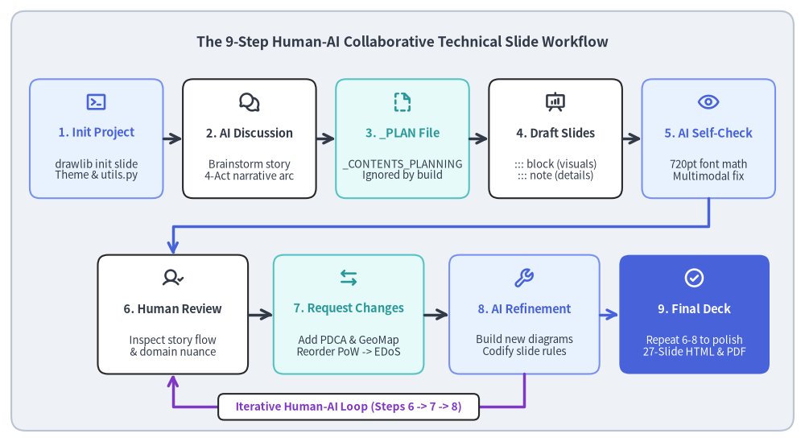
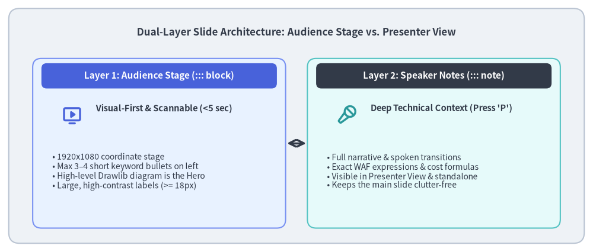
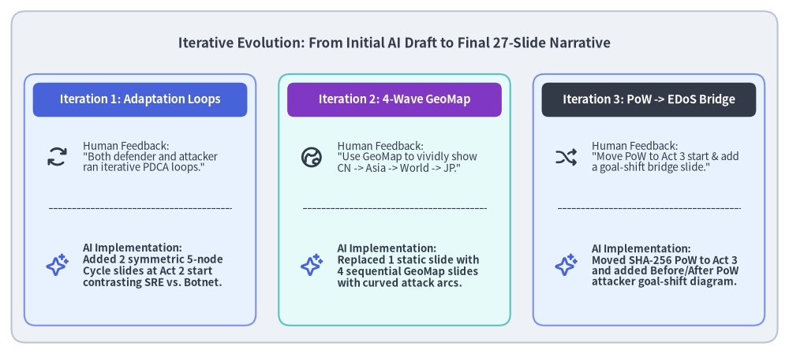

# 事例紹介: 技術プレゼンテーションスライドの作成

障害ポストモーテム、アーキテクチャレビュー、技術カンファレンスでの登壇には、明快なビジュアルストーリーテリングが求められます。しかし、従来の GUI プレゼンテーションツール（PowerPoint、Keynote、Google スライド）での技術スライド作成には大きな摩擦が伴います。エンジニアは矩形のドラッグや矢印の整列、スクリーンショットの貼り付けに何時間も費やし、ストーリー構成を見直すたびにバージョン管理もリファクタリングも困難な手作業のやり直しを強いられます。

Drawlib の**スライドデッキプロジェクト（`slide`）**は、プレゼンテーション制作を Git 管理された宣言的ワークフローへと変革し、**16:9 の HTML/PDF スライドデッキ、スピーカーノート、純粋な Python による技術ダイアグラム**を人間と AI コーディングエージェントが協働で開発できるようにします。

本事例では、クラウドアーキテクチャ図、シーケンスプロトコル、定量データチャート、5段階の適応サイクル図、そして複数ウェーブにわたる地理的攻撃マップ（`GeoMap`）を備えた全27枚のサーバーレスセキュリティ障害ポストモーテムスライド**「1日3億リクエスト超の DDoS・EDoS 攻撃を生き延びた記録」**（`docs/slide_ddos_incident_response_src/`）を制作した、実践的な**9ステップの反復ワークフロー**を紹介します。


<figure class="drawlib-image" style="text-align: center;">
  
  <figcaption class="drawlib-caption">人間と AI の協働による9ステップの技術スライド制作ライフサイクル</figcaption>
</figure>

<details class="drawlib-code-details">
<summary>Source Code</summary>

```python
from drawlib.canvas import save, setup
from drawlib.icons import phosphor
from drawlib.lines import line, lines
from drawlib.shapes import rectangle
from drawlib.styles import Styles
from drawlib.text import text

setup(width=142, height=78)

rectangle((71.0, 39.0), width=138.0, height=74.0, style=Styles.Neutral.patch(shape_r=2.5))
text(
    (71.0, 70.5),
    "The 9-Step Human-AI Collaborative Technical Slide Workflow",
    style=Styles.DarkBold.patch(text_size=12.5),
)

# Row 1: Steps 1 to 5 (Scaffolding -> Planning -> Generation -> AI Self-Review)
row1 = [
    (17.0, "1. Init Project", "drawlib init slide\nTheme & utils.py", phosphor.terminal_window, Styles.PrimaryNeutral, Styles.PrimaryBold),
    (44.0, "2. AI Discussion", "Brainstorm story\n4-Act narrative arc", phosphor.chats_circle, Styles.White, Styles.DarkBold),
    (71.0, "3. _PLAN File", "_CONTENTS_PLANNING\nIgnored by build", phosphor.file_dashed, Styles.SecondaryNeutral, Styles.SecondaryBold),
    (98.0, "4. Draft Slides", "::: block (visuals)\n::: note (details)", phosphor.presentation_chart, Styles.White, Styles.DarkBold),
    (125.0, "5. AI Self-Check", "720pt font math\nMultimodal fix", phosphor.eye, Styles.PrimaryNeutral, Styles.PrimaryBold),
]

for cx, title, desc, icon_fn, cstyle, tstyle in row1:
    rectangle((cx, 53.5), width=23.5, height=21.0, style=cstyle.patch(shape_r=1.8))
    icon_fn((cx, 60.0), width=3.8, style=tstyle)
    text((cx, 54.5), title, style=tstyle.patch(text_size=10.5))
    text((cx, 48.0), desc, style=Styles.Dark.patch(text_size=9.5))

for x0, x1 in [(28.8, 32.2), (55.8, 59.2), (82.8, 86.2), (109.8, 113.2)]:
    line((x0, 53.5), (x1, 53.5), arrow_head="->", style=Styles.DarkBold)

# Orthogonal connector from Step 5 down to Row 2 (Step 6)
lines(
    [(125.0, 43.0), (125.0, 38.0), (30.5, 38.0), (30.5, 33.0)],
    arrow_head="->",
    style=Styles.PrimaryBold,
)

# Row 2: Steps 6 to 9 (Human Review <-> AI Iteration Loop -> Final Deck)
row2 = [
    (30.5, "6. Human Review", "Inspect story flow\n& domain nuance", phosphor.user_check, Styles.White, Styles.DarkBold),
    (61.5, "7. Request Changes", "Add PDCA & GeoMap\nReorder PoW -> EDoS", phosphor.arrows_left_right, Styles.SecondaryNeutral, Styles.SecondaryBold),
    (92.5, "8. AI Refinement", "Build new diagrams\nCodify slide rules", phosphor.wrench, Styles.PrimaryNeutral, Styles.PrimaryBold),
    (122.5, "9. Final Deck", "Repeat 6-8 to polish\n27-Slide HTML & PDF", phosphor.check_circle, Styles.PrimaryFlat, Styles.WhiteBold),
]

for cx, title, desc, icon_fn, cstyle, tstyle in row2:
    is_final = (cstyle == Styles.PrimaryFlat)
    rectangle((cx, 22.5), width=26.5, height=21.0, style=cstyle.patch(shape_r=1.8))
    icon_fn((cx, 29.0), width=3.8, style=tstyle)
    text((cx, 23.5), title, style=tstyle.patch(text_size=10.5))
    d_st = Styles.White.patch(text_size=9.5) if is_final else Styles.Dark.patch(text_size=9.5)
    text((cx, 17.0), desc, style=d_st)

line((43.8, 22.5), (48.2, 22.5), arrow_head="->", style=Styles.DarkBold)
line((74.8, 22.5), (79.2, 22.5), arrow_head="->", style=Styles.DarkBold)
line((105.8, 22.5), (109.2, 22.5), arrow_head="->", style=Styles.PrimaryBold)

# Iterative feedback loop U-connector between Step 8 and Step 6
lines(
    [(92.5, 12.0), (92.5, 6.2), (30.5, 6.2), (30.5, 12.0)],
    arrow_head="->",
    style=Styles.AccentBold,
)
rectangle((61.5, 6.2), width=46.0, height=4.6, style=Styles.White.patch(shape_r=1.0))
text((61.5, 6.2), "Iterative Human-AI Loop (Steps 6 -> 7 -> 8)", style=Styles.AccentBold.patch(text_size=9.8))

save()
```

</details>


---

## 1. 9ステップの協働ワークフロー概要

1回の「ワンショット」プロンプトで27枚の完成された技術プレゼンテーションが一気に出来上がることを期待するのではなく、**レイアウト構築や図解生成における AI の圧倒的なスピード**と、**ドメイン知識に基づく人間の洞察およびストーリー構成力**を掛け合わせることが最も効果的なワークフローです。

| ステップ | 担当 | フェーズ | 主なアクションと成果物 |
| :---: | :---: | :--- | :--- |
| **1** | 人間 / AI | **プロジェクト作成** | テーマ、`styles.py`、`utils.py` ヘルパーを備えた `slide` プロジェクトを `drawlib init slide` で初期化します。 |
| **2** | 人間 + AI | **構成ディスカッション** | インシデントの事実関係、技術的ボトルネック、聴衆に持ち帰ってほしい学びを議論して整理します。 |
| **3** | AI エージェント | **`_PLAN` 構成案の作成** | `_CONTENTS_PLANNING.md` を作成します（先頭に `_` を付けることでスライドコンパイラの対象外にします）。 |
| **4** | AI エージェント | **初回スライド一式の生成** | 2層分離構造（視覚ステージ `::: block` と発表者ノート `::: note`）を用いて全章の `.md` スライドを執筆します。 |
| **5** | AI エージェント | **自律セルフレビュー** | 画像・PDF をレンダリングし、`720pt` 基準のフォントスケーリング検証や文字見切れ・矢印衝突の修正を行います。 |
| **6** | 人間 | **人間によるレビュー** | コンパイルされた HTML/PDF デッキを通読し、ストーリーの緩急、視覚的インパクト、ドメイン上の正確性を確認します。 |
| **7** | 人間 | **変更・追加リクエスト** | より深い視覚表現（`GeoMap` による攻撃波や PDCA サイクル図など）や章構成の並び替え（PoW $\rightarrow$ EDoS）を指示します。 |
| **8** | AI エージェント | **AI による改善とルール化** | 新規スライドの実装とマルチモーダル再検証を行い、得られたベストプラクティスを `_rules/` に体系化します。 |
| **9** | 人間 + AI | **反復による完成** | ステップ 6〜8 を2〜3回高速に回し、そのまま登壇・公開できる品質へと仕上げます。 |

---

## 2. ステップ 1〜3: プロジェクト初期化・構成議論・`_` プレフィックス計画ファイル

### 2.1. ステップ 1: スライドプロジェクトの初期化 (`drawlib init slide`)
すべてのスライドデッキ制作は、構造化された Drawlib の `slide` プロジェクトを初期化することから始まります。

```bash
uv run drawlib init slide docs/slide_ddos_incident_response_src --style google
```

これにより、プレゼンテーション制作に必要な基盤一式が自動生成されます。
- **`styles.py`**: カラーパレット（`GoogleStyles`）および言語に適したフォントを設定します。
- **`utils.py` と `drawlib.slide`**: 組み込みの `drawlib.slide` ステージヘルパー（`draw_page_number()`、`draw_section_header()`）や `drawlib.smartarts`（`Roadmap`、`KpiCards`、`CardList`、`Panel`）と組み合わせて使えるプロジェクト共通ユーティリティ（`service_card()`、`connect()` など）を提供します。
- **`build.sh` / `serve.sh`**: インタラクティブ HTML デッキ（`*_html/index.html`）、ベクター PDF（`*.pdf`）、単体 PNG アセット（`*_images/`）を一括コンパイル・プレビューするスクリプトです。

### 2.2. ステップ 2: AI との対話によるストーリーアークの構築
対話的なディスカッションを通じて、DDoS / EDoS インシデントの時系列ログを**4幕構成のストーリーアーク（4-Act Story Arc）**へと構造化しました。
1. **第1幕 — インシデントの発生**: 月額 `$10` の VPS での10年間の平穏な運用からサーバーレスな Google Cloud Run への移行、キャッシュを回避する大量の音声合成（TTS）リクエストによる週次請求額の4〜5倍急増、そして安易なオリジン制限（`max-instances=1`）が一般ユーザーの 504 障害を引き起こした経緯。
2. **第2幕 — 境界 WAF 防御と回避のいたちごっこ**: 防御側と攻撃側それぞれの5段階の適応ループ、GCLB + Cloud Armor の導入、4波にわたるプロキシ踏み台移行によって国別 IP ブロックが無力化された理由、そして静的 JS トークンがわずか3時間でリバースエンジニアリングされた過程。
3. **第3幕 — SHA-256 PoW と EDoS 課金の罠**: 非対称 SHA-256 Proof-of-Work チャレンジによって TTS の CPU タダ乗りを完全に阻止したものの、それを契機に攻撃者が1日3億リクエストの物量フラッドへと戦術を転換し、Cloud Armor のリクエスト評価課金だけで1日 `$225`（月換算 `$6,750`）という EDoS（経済的サービス拒否）危機に直面した経緯。
4. **第4幕 — 多層エッジ防御による完全収束**: 深夜の GCLB 緊急解体と定額制 Cloudflare Pro（月額 `$20`）への移行、クラウド VM と住宅用 HTTP/1.1 プロキシを切り分けたログフォレンジック、5層防御アーキテクチャの完成、そして AI ボットネットのプロファイリング。

### 2.3. ステップ 3: アンダースコア始まり（`_`）の設計図ファイル (`_CONTENTS_PLANNING.md`)
20枚以上のスライドファイルを一気に生成する前に、AI エージェントはまずプロジェクトルート直下の `_CONTENTS_PLANNING.md` にスライド1枚ごとの詳細な設計ブループリントを書き出します。

Drawlib のスライドコンパイラには、2つの自動ファイル除外ルールが組み込まれています。
- **アンダースコア除外ルール（`_*`）**: `_CONTENTS_PLANNING.md`、`_drafts/`、`_assets/` のように名前が `_` で始まるファイルやディレクトリは、スライドのコンパイル対象から**自動的に除外**されます。
- **リポジトリメタデータの自動除外**: 標準的なリポジトリ管理文書（`README.md`、`CLAUDE.md`、`AGENTS.md`、`GEMINI.md`）も自動的に除外されます。

この仕組みにより、コンパイル後のスライドデッキに余計なページを混入させることなく、詳細な構成案や README を `slide_ddos_incident_response_src/` 内で直接 Git バージョン管理できます。

---

## 3. ステップ 4〜5: 2層スライド設計と AI の自律セルフレビュー

### 3.1. ステップ 4: 2層スライドアーキテクチャ（`::: block` と `::: note`）
技術プレゼンテーションでありがちな失敗は、説明文の段落をそのままスライド画面上に詰め込み、小さな文字がびっしり並んだ「テキストの壁」を作ってしまうことです。

これを防ぐため、Drawlib では**2層プレゼンテーション原則（Dual-Layer Presentation Principle）**（`uv run drawlib rules show slide-guide`）を定めています。


<figure class="drawlib-image" style="text-align: center;">
  
  <figcaption class="drawlib-caption">2層スライドアーキテクチャ: 聴衆向けビジュアルステージ (::: block) と発表者ノート (::: note)</figcaption>
</figure>

<details class="drawlib-code-details">
<summary>Source Code</summary>

```python
from drawlib.canvas import save, setup
from drawlib.icons import phosphor
from drawlib.lines import line
from drawlib.shapes import rectangle
from drawlib.styles import Styles
from drawlib.text import text

setup(width=136, height=58)

rectangle((68.0, 29.0), width=132.0, height=54.0, style=Styles.Neutral.patch(shape_r=2.5))
text(
    (68.0, 50.5),
    "Dual-Layer Slide Architecture: Audience Stage vs. Presenter View",
    style=Styles.DarkBold.patch(text_size=12.2),
)

# Left Card: Visible Slide Stage (::: block)
rectangle((36.5, 25.0), width=58.0, height=39.0, style=Styles.PrimaryNeutral.patch(shape_r=2.0))
rectangle((36.5, 40.5), width=54.0, height=5.8, style=Styles.PrimaryFlat.patch(shape_r=1.2))
text((36.5, 40.5), "Layer 1: Audience Stage (::: block)", style=Styles.WhiteBold.patch(text_size=11.0))

phosphor.monitor_play((16.5, 31.5), width=4.8, style=Styles.PrimaryBold)
text((22.0, 33.0), "Visual-First & Scannable (<5 sec)", style=Styles.DarkBold.patch(text_size=10.5, halign="left"))
text(
    (12.0, 18.5),
    "• 1920x1080 coordinate stage\n"
    "• Max 3–4 short keyword bullets on left\n"
    "• High-level Drawlib diagram is the Hero\n"
    "• Large, high-contrast labels (>= 18px)",
    style=Styles.Dark.patch(text_size=10.0, halign="left"),
)

# Center Divider
line((65.8, 25.0), (70.2, 25.0), arrow_head="<->", style=Styles.DarkBold)

# Right Card: Presenter Console (::: note)
rectangle((99.5, 25.0), width=58.0, height=39.0, style=Styles.SecondaryNeutral.patch(shape_r=2.0))
rectangle((99.5, 40.5), width=54.0, height=5.8, style=Styles.DarkFlat.patch(shape_r=1.2))
text((99.5, 40.5), "Layer 2: Speaker Notes (::: note)", style=Styles.WhiteBold.patch(text_size=11.0))

phosphor.microphone_stage((79.5, 31.5), width=4.8, style=Styles.SecondaryBold)
text((85.0, 33.0), "Deep Technical Context (Press 'P')", style=Styles.DarkBold.patch(text_size=10.5, halign="left"))
text(
    (75.0, 18.5),
    "• Full narrative & spoken transitions\n"
    "• Exact WAF expressions & cost formulas\n"
    "• Visible in Presenter View & standalone\n"
    "• Keeps the main slide clutter-free",
    style=Styles.Dark.patch(text_size=10.0, halign="left"),
)

save()
```

</details>


### 3.2. ステップ 5: AI の自律セルフレビューとブロック幅連動タイポグラフィ計算
初回スライド一式を生成した後、AI エージェントは自律マルチモーダルレビュー（`uv run drawlib rules show review-guide`）を実行します。

本事例の制作過程で発見されルールとして体系化された重要な知見が、**ブロック幅を考慮したスライド用タイポグラフィ基準（Block-Width-Aware Slide Typography Standard）**です。Drawlib はすべての図を物理幅 `10インチ = 720pt` 基準で出力するため（`setup(width=W, height=H)` は論理座標グリッド単位を変えるのみ）、スライド上で最終的に描画される図内ラベルのピクセルサイズは、画像を配置する `::: block xy=(X, Y) width=Width height=Height` コンテナの横幅に比例します。

$$\text{Rendered Slide Font Size (px)} = \text{text\_size} \times \frac{\text{Block Width (px)}}{720}$$

`1920×1080` ステージ上の `26px` のスライド本文テキストと並べたときに図内ラベルが小さく潰れて見えないよう、AI エージェントはブロック幅に応じた最小 `text_size` 基準を適用します。

| スライドブロックの種別 | 代表的な `::: block` 幅 | 倍率 ($\text{Width}/720$) | 標準ラベル `text_size`（`約18〜22px`） | 見出し・指標値 `text_size`（`約21〜28px`） | 絶対下限（`>= 16px`） |
| :--- | :---: | :---: | :---: | :---: | :---: |
| **狭幅カラム**（KPI カード、ドーナツ図） | `650–800px` | `0.90× – 1.11×` | **`16.0 – 20.0`** | **`20.0 – 30.0`** | **`14.5`** |
| **2カラム図解領域**（右ペインのメイン図） | `900–1100px` | `1.25× – 1.53×` | **`12.5 – 15.0`** | **`14.5 – 16.5`** | **`11.5`** |
| **全幅キャンバス**（ワイド表・全体フロー図） | `1600–1760px` | `2.22× – 2.44×` | **`11.5 – 13.5`** | **`13.5 – 15.5`** | **`10.0`** |

コンパイルされた PDF の各ページを `view_file` で視覚検査することで、エージェントは L字折れ `FlowDiagram` のエッジラベル位置の補正（水平矢印セグメント上に綺麗に載るよう `xy_shift=(14.0, 3.0)` を指定）や、ドーナツグラフのスライス比率表示が中央の集計値と干渉しないような `PieChart(hole_ratio=0.44)` の調整など、微細な視覚的不具合を自律的に検出・修復します。

---

## 4. ステップ 6〜9: 人間によるレビューと反復的な進化

AI エージェントによる初回ビルドと自己修正が完了した後、人間の著者がスライドデッキを通読し、大局的な構成や視覚表現のブラッシュアップを指示します。DDoS ポストモーテムのプロジェクトでは、以下の3つの主要なイテレーションによって、単なる良質なドラフトから圧倒的な説得力を持つ技術ストーリーへと昇華されました。


<figure class="drawlib-image" style="text-align: center;">
  
  <figcaption class="drawlib-caption">人間のレビューフィードバックから生まれた3つの重要な改善（ステップ 6〜8）</figcaption>
</figure>

<details class="drawlib-code-details">
<summary>Source Code</summary>

```python
from drawlib.canvas import save, setup
from drawlib.icons import phosphor
from drawlib.lines import line
from drawlib.shapes import rectangle
from drawlib.styles import Styles
from drawlib.text import text

setup(width=138, height=62)

rectangle((69.0, 31.0), width=134.0, height=58.0, style=Styles.Neutral.patch(shape_r=2.5))
text(
    (69.0, 54.5),
    "Iterative Evolution: From Initial AI Draft to Final 27-Slide Narrative",
    style=Styles.DarkBold.patch(text_size=12.2),
)

cards = [
    (
        24.5,
        "Iteration 1: Adaptation Loops",
        "Human Feedback:\n\"Both defender and attacker\nran iterative PDCA loops.\"",
        "AI Implementation:\nAdded 2 symmetric 5-node\nCycle slides at Act 2 start\ncontrasting SRE vs. Botnet.",
        phosphor.arrows_clockwise,
        Styles.PrimaryNeutral,
        Styles.PrimaryFlat,
    ),
    (
        69.0,
        "Iteration 2: 4-Wave GeoMap",
        "Human Feedback:\n\"Use GeoMap to vividly show\nCN -> Asia -> World -> JP.\"",
        "AI Implementation:\nReplaced 1 static slide with\n4 sequential GeoMap slides\nwith curved attack arcs.",
        phosphor.globe_hemisphere_east,
        Styles.SecondaryNeutral,
        Styles.AccentFlat,
    ),
    (
        113.5,
        "Iteration 3: PoW -> EDoS Bridge",
        "Human Feedback:\n\"Move PoW to Act 3 start & add\na goal-shift bridge slide.\"",
        "AI Implementation:\nMoved SHA-256 PoW to Act 3\nand added Before/After PoW\nattacker goal-shift diagram.",
        phosphor.shuffle,
        Styles.PrimaryNeutral,
        Styles.DarkFlat,
    ),
]

for cx, title, fb_text, ai_text, icon_fn, cstyle, hstyle in cards:
    rectangle((cx, 27.0), width=40.5, height=44.0, style=cstyle.patch(shape_r=2.0))
    rectangle((cx, 44.5), width=37.5, height=6.0, style=hstyle.patch(shape_r=1.2))
    text((cx, 44.5), title, style=Styles.WhiteBold.patch(text_size=10.5))

    icon_fn((cx - 14.5, 34.5), width=4.2, style=Styles.DarkBold)
    text((cx - 10.0, 34.5), fb_text, style=Styles.Dark.patch(text_size=9.5, halign="left"))

    line((cx - 16.0, 25.5), (cx + 16.0, 25.5), style=Styles.Dark.patch(line_width=0.8, line_style="dashed"))

    phosphor.sparkle((cx - 14.5, 15.5), width=4.2, style=Styles.PrimaryBold)
    text((cx - 10.0, 15.5), ai_text, style=Styles.DarkBold.patch(text_size=9.5, halign="left"))

save()
```

</details>


### 4.1. イテレーション 1: 対称な5段階の適応ループ図（`Cycle`）の追加
- **人間のレビュー（ステップ 6〜7）**: 第2幕における攻防の推移を確認した著者は、防御側と攻撃側の双方が反復的なフィードバックループ（PDCA / OODA）を回している点に注目しました。
  - *防御側の5ステップ*: (1) オリジンへ到達した攻撃トラフィックを分析 $\rightarrow$ (2) ボット共通の特徴（Tell）を特定 $\rightarrow$ (3) 誤検知ゼロのフィルタ条件を設計 $\rightarrow$ (4) 設定を適用 $\rightarrow$ (5) 遮断効果を測定。
  - *攻撃側の5ステップ*: (1) 正規ユーザーのアクセスフローを解析 $\rightarrow$ (2) 低コスト・高負荷な攻撃対象を選定 $\rightarrow$ (3) 複数パターンのプローブを並列送信 $\rightarrow$ (4) `200` と `403`/`429` の応答差分から WAF ルールを推測 $\rightarrow$ (5) ブロックされていない死角へ全力フラッドを集中。
- **AI の実装（ステップ 8）**: エージェントは第2幕の冒頭に2枚連続のスライド（`02_defender_cycle.md` と `03_attacker_cycle.md`）を追加し、完全に同一な正五角形の5ノード `Cycle` レイアウトで描画しました。これにより、ページを送った瞬間に双方のループ構造の対称性が視覚的に際立ちます。さらに第4幕で `Cycle` 図形が重複して単調になるのを避けるため、スライド26（`05_threat_actor_profile.md`）を3段のフォレンジック比較カード構成へと同時にリファクタリングしました。

### 4.2. イテレーション 2: 4枚連続の `GeoMap` 攻撃シーケンスへの刷新
- **人間のレビュー（ステップ 6〜7）**: 当初、国別 IP ブロックが突破された経緯は4段階の `ChevronProcess` を使った1枚の要約スライドにまとめられていました。これに対し著者は、`drawlib.smartarts.GeoMap` を使った連続スライドへと発展させ、ボット群が**中国 $\rightarrow$ アジア近隣諸国 $\rightarrow$ 全世界（120か国以上） $\rightarrow$ 日本国内**へと踏み台を次々に乗り換えていく様子を臨場感たっぷりに描くよう指示しました。
- **AI の実装（ステップ 8）**: エージェントは1枚の要約スライドを4枚連続のビジュアルシーケンス（`05_geo_wave1_china.md` 〜 `08_geo_wave4_japan.md`）へ刷新しました。`GeoMap.World.Asia`、`GeoMap.World.All`、`GeoMap.Countries.Japan` に `lonlat_to_xy()` と東京（`139.69, 35.69`）へ収束する曲線軌道（`line_curved`）を組み合わせ、各マップ上部に現在地を示す4ステップの進行インジケータバーを配置しました。

### 4.3. イテレーション 3: ストーリー順序の再編と「攻撃目的の変容」ブリッジスライドの挿入
- **人間のレビュー（ステップ 6〜7）**: 初期アウトラインでは、**非対称 SHA-256 Proof-of-Work** が第2幕の末尾に置かれていました。レビューの中で著者は、SHA-256 PoW こそが攻撃者を EDoS（大量リクエスト課金攻撃）へと転換させた直接の引き金であることを指摘し、PoW を第3幕の冒頭へ移動したうえで、攻撃者の目的が*「TTS 音声合成 API を直接叩くこと」*から*「URL を問わず大量リクエストをオリジン側の課金評価へ到達させること」*へどう変化したかを解説するブリッジスライドを挿入するよう依頼しました。
- **AI の実装（ステップ 8）**: Drawlib の `slide` プロジェクトでは各スライドが独立した連番付き Markdown ファイル（`01_section.md`、`02_pow_challenge.md`、`03_attacker_goal_shift.md` ...）として管理されているため、章をまたぐ並び替えも `mv` コマンドによるリネームと章扉のトピック更新だけで完了しました。その後 `./docs/slide_ddos_incident_response_src/build.sh` を実行するだけで全27ページのスライド番号が自動採番され、PDF の再検証までスムーズに完了しました。

---

## 5. 技術スライド制作のベストプラクティスまとめ

1. **`_` プレフィックスファイルで設計とコンパイルを分離する**:
   いきなり描画コードを書くのではなく、まずアンダースコア始まりの構成ファイル（`_CONTENTS_PLANNING.md`）でストーリーアークをすり合わせましょう。Markdown アウトラインの修正は数秒で終わり、無駄なレンダリングの手戻りを防げます。
2. **2層設計（`::: block` と `::: note`）を徹底する**:
   聴衆に見せるスライドステージは最小限の情報（短い箇条書き＋大きな高水準ダイアグラム）に絞り、複雑な技術的背景や数式、口頭での補足説明はすべて発表者ビュー用の `::: note` に格納します。
3. **図内タイポグラフィを配置先ブロック幅に合わせてスケーリングする**:
   `720pt` 基準の Drawlib キャンバスは、`680px` の狭いカラムに配置した場合と `1760px` の全幅ブロックに配置した場合とで最終的な表示文字サイズが大きく異なります。ブロック幅連動タイポグラフィ表（狭幅ブロックでは `16.0–20.0pt`、2カラム図解では `12.5–15.0pt`）に従い、必ずコンパイル後の PDF を `view_file` で確認してください。
4. **劇的な展開は連続スライドで表現する**:
   4段階の地理的拡大やアーキテクチャの変遷を1枚の窮屈なスライドに詰め込むのではなく、共通の座標フレームと上部プログレスバーを備えた連続スライドに分割することで（4波の `GeoMap` シーケンスのように）、聴衆を惹き込むストーリー展開が生まれます。
