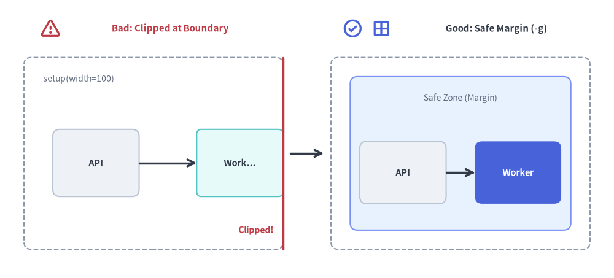
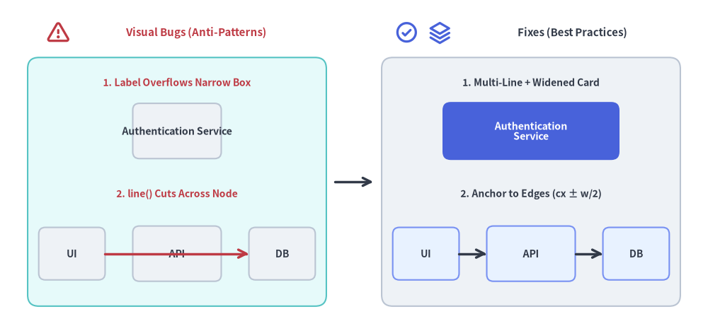

# トラブルシューティングとデバッグ

このガイドでは、Drawlib の使用時に発生しやすい描画エラー、キャンバス端での見切れ（クリッピング）、フォントの文字化け（豆腐文字）、リンク切れ、およびキャッシュ起因の不具合に対する解決策を解説します。

`drawlib show -g` を使用して座標境界を確認し、外周から 5〜10 ユニットの安全な余白（マージン）内に図形が収まっていることを検証しましょう。


<figure class="drawlib-image" style="text-align: center;">
  
  <figcaption class="drawlib-caption">境界クリッピングの不具合と座標グリッド (-g) による安全な 5%〜10% 外周マージンの確保</figcaption>
</figure>

<details class="drawlib-code-details">
<summary>Source Code</summary>

```python
from drawlib.canvas import save, setup
from drawlib.icons import phosphor
from drawlib.lines import line
from drawlib.shapes import rectangle
from drawlib.styles import Styles
from drawlib.text import text

setup(width=128, height=58)

# Left Panel: Bad (Boundary Clipping at x=100)
phosphor.warning((10.5, 52.0), width=4.4, style=Styles.DangerBold)
text((35.5, 52.0), "Bad: Clipped at Boundary", style=Styles.DangerBold.patch(text_size=10.8))
rectangle((32, 26), width=54, height=40, style=Styles.MutedDashed.patch(shape_r=1.5))
text((9, 41.5), "setup(width=100)", style=Styles.Muted.patch(text_size=10.0, halign="left"))

rectangle((20, 24), width=18, height=14, style=Styles.Neutral.patch(shape_r=1.5), text="API", text_style=Styles.DarkBold.patch(text_size=10.5))
# Simulated clipped box at right canvas edge (x=59)
rectangle((50, 24), width=18, height=14, style=Styles.SecondaryNeutral.patch(shape_r=1.0), text="Work...", text_style=Styles.DarkBold.patch(text_size=10.5))
line((59, 6), (59, 46), style=Styles.DangerBold)
text((57, 10), "Clipped!", style=Styles.DangerBold.patch(text_size=10.2, halign="right"))
line((29, 24), (41, 24), arrow_head="->", style=Styles.DarkBold)

# Center Transition Arrow
line((60.5, 26), (67.5, 26), arrow_head="->", style=Styles.DarkBold)

# Right Panel: Good (Safe Perimeter Margin Inspected with -g)
phosphor.check_circle((73.5, 52.0), width=4.4, style=Styles.PrimaryBold)
phosphor.grid_four((79.5, 52.0), width=4.4, style=Styles.PrimaryBold)
text((103.5, 52.0), "Good: Safe Margin (-g)", style=Styles.DarkBold.patch(text_size=10.8))
rectangle((96, 26), width=54, height=40, style=Styles.MutedDashed.patch(shape_r=1.5))
# Inner safe-zone guide
rectangle((96, 26), width=46, height=32, style=Styles.PrimaryNeutral.patch(shape_r=1.5))
text((96, 37.5), "Safe Zone (Margin)", style=Styles.Muted.patch(text_size=10.0))

rectangle((84, 22), width=18, height=13, style=Styles.Neutral.patch(shape_r=1.5), text="API", text_style=Styles.DarkBold.patch(text_size=10.5))
rectangle(
    (108, 22),
    width=18,
    height=13,
    style=Styles.PrimaryFlat.patch(shape_r=1.5),
    text="Worker",
    text_style=Styles.WhiteBold.patch(text_size=10.5),
)
line((93, 22), (99, 22), arrow_head="->", style=Styles.DarkBold)

save()
```

</details>


---

## 1. 図形の配置とキャンバス境界でのクリッピング（見切れ）

### 症状: 図形やテキストがキャンバスの端で見切れる
- **原因**: Drawlib のデカルト座標系では左下が `(0, 0)` です。図形の中心座標に半径・幅・高さを加えた範囲が `setup(width=..., height=...)` の外側に達すると、端が切り落とされます。
- **診断方法**: ドキュメント内のブロック一覧を確認するか、対象ブロックの `file:` 名を指定して `-g` / `--grid` フラグ付きで `drawlib show` を実行します。
  ```bash
  # List all drawlib blocks in the Markdown file:
  uv run drawlib show docs_src/doc.md

  # Render a specific block with the coordinate grid overlay:
  uv run drawlib show docs_src/doc.md arch.png -g -o .drawlib/scratch/debug_grid.png
  ```
  座標グリッドを重ねて表示すれば、要素が `setup(width=..., height=...)` の範囲を超えている箇所が一目で分かります。
- **解決策**:
  1. `setup(width=..., height=...)` のキャンバス寸法を大きくします。
  2. または、四辺すべてに最低 5〜10 ユニットの外周マージンが残るよう、図形を内側へ寄せます。

### 症状: ラベルがボックスからはみ出す、または接続線がノードの文字列を横切る
- **原因**:
  1. 1行の長いラベル文字列が、外枠となる矩形の `width` よりも広いため左右の境界からはみ出しています。
  2. Drawlib は**ペインターアルゴリズム（重ね塗り描画順）**を採用しており、関数を呼び出した順序どおりに要素が描画されます。`rectangle()` を描画した**後**にノードの中心座標同士を結ぶ `line()` を呼び出すと、中間にあるノードやラベルの真上に線が上書き描画されてしまいます。
- **解決策**:
  1. 明示的な改行 `\n`（例: `"Authentication\nService"`）を入れるとともに、カードの幅を広げます（例: `width=32`）。
  2. コネクタの始点・終点を図形の外周エッジ（`cx ± width/2`）に接続するか、背景に配置したい線を前面のノードよりも**前**に描画します。


<figure class="drawlib-image" style="text-align: center;">
  
  <figcaption class="drawlib-caption">代表的な視覚バグと修正例: テキストボックスのサイズ調整とペインターアルゴリズムの描画順（Zオーダー）</figcaption>
</figure>

<details class="drawlib-code-details">
<summary>Source Code</summary>

```python
from drawlib.canvas import save, setup
from drawlib.icons import phosphor
from drawlib.lines import line
from drawlib.shapes import rectangle
from drawlib.styles import Styles
from drawlib.text import text

setup(width=128, height=60)

# Left Panel: Common Visual Bugs (Anti-Patterns)
phosphor.warning((10.5, 54.0), width=4.4, style=Styles.DangerBold)
text((35.5, 54.0), "Visual Bugs (Anti-Patterns)", style=Styles.DangerBold.patch(text_size=10.8))
rectangle((32, 27.0), width=54, height=45, style=Styles.SecondaryNeutral.patch(shape_r=2.0))

# Bug 1: Narrow box where "Auth Service" overflows borders
text((32, 45.0), "1. Label Overflows Narrow Box", style=Styles.DangerBold.patch(text_size=10.0))
rectangle(
    (32, 36.2),
    width=16,
    height=10,
    style=Styles.Neutral.patch(shape_r=1.2),
    text="Authentication Service",
    text_style=Styles.DarkBold.patch(text_size=10.2),
)

# Bug 2: Connector line drawn after node cuts across text label
text((32, 24.8), "2. line() Cuts Across Node", style=Styles.DangerBold.patch(text_size=10.0))
rectangle((13, 14.0), width=12, height=9.5, style=Styles.Neutral.patch(shape_r=1.2), text="UI", text_style=Styles.DarkBold.patch(text_size=10.0))
rectangle((32, 14.0), width=16, height=10.0, style=Styles.Neutral.patch(shape_r=1.2), text="API", text_style=Styles.DarkBold.patch(text_size=10.2))
rectangle((51, 14.0), width=12, height=9.5, style=Styles.Neutral.patch(shape_r=1.2), text="DB", text_style=Styles.DarkBold.patch(text_size=10.0))
line((19, 14.0), (45, 14.0), arrow_head="->", style=Styles.DangerBold)

# Center Transition Arrow
line((60.5, 27.0), (67.5, 27.0), arrow_head="->", style=Styles.DarkBold)

# Right Panel: Recommended Fixes (Best Practices)
phosphor.check_circle((73.5, 54.0), width=4.4, style=Styles.PrimaryBold)
phosphor.stack((79.5, 54.0), width=4.4, style=Styles.PrimaryBold)
text((103.5, 54.0), "Fixes (Best Practices)", style=Styles.DarkBold.patch(text_size=10.8))
rectangle((96, 27.0), width=54, height=45, style=Styles.Neutral.patch(shape_r=2.0))

# Fix 1: Multi-line wrap + widened card (width=32)
text((96, 45.0), "1. Multi-Line + Widened Card", style=Styles.DarkBold.patch(text_size=10.0))
rectangle(
    (96, 36.2),
    width=32,
    height=10.5,
    style=Styles.PrimaryFlat.patch(shape_r=1.5),
    text="Authentication\nService",
    text_style=Styles.WhiteBold.patch(text_size=10.2),
)

# Fix 2: Perimeter-anchored connectors (cx ± w/2) & clean Z-order
text((96, 24.8), "2. Anchor to Edges (cx ± w/2)", style=Styles.DarkBold.patch(text_size=10.0))
rectangle((77, 14.0), width=12, height=9.5, style=Styles.PrimaryNeutral.patch(shape_r=1.2), text="UI", text_style=Styles.DarkBold.patch(text_size=10.0))
rectangle((96, 14.0), width=16, height=10.0, style=Styles.PrimaryNeutral.patch(shape_r=1.2), text="API", text_style=Styles.DarkBold.patch(text_size=10.2))
rectangle((115, 14.0), width=12, height=9.5, style=Styles.PrimaryNeutral.patch(shape_r=1.2), text="DB", text_style=Styles.DarkBold.patch(text_size=10.0))
line((83, 14.0), (88, 14.0), arrow_head="->", style=Styles.DarkBold)
line((104, 14.0), (109, 14.0), arrow_head="->", style=Styles.DarkBold)

save()
```

</details>


---

## 2. CLI 診断オプションと開発者モード

デフォルトでは、Drawlib は発生した例外を簡潔で分かりやすいエラーサマリーに整形して表示します。ライブラリの内部挙動や深い原因を調査したい場合は、以下の診断フラグを使用します。

### 完全な Python トレースバックの表示 (`--developer`)
```bash
uv run drawlib --developer build html docs_src/ -o docs_html/
```
エラーの省略整形を無効化し、正確なファイル名と行番号を含む完全な Python スタックトレースを出力します。

### 詳細な診断ログの出力 (`--verbose` / `--debug`)
```bash
uv run drawlib --verbose build html docs_src/ -o docs_html/
```
各処理の所要時間、画像キャッシュのヒット・ミス状況、ドキュメント解析フェーズの進行ログを出力します。

---

## 3. フォントフォールバックとグリフ欠落（文字化け）

### 症状: 日本語・中国語・韓国語（CJK）などのテキストが四角記号（「豆腐」`□`）になる
- **原因**: 現在適用されているフォントに、日本語・中国語・韓国語や特殊な Unicode 文字のグリフが含まれていません。
- **解決策**:
  1. CJK 対応のフォントファミリーを設定します（またはプロジェクト作成時に `drawlib init <type> --lang ja` を指定します）。
     ```python
     from drawlib.fonts import FontJapanese
     from drawlib.types import Style
     
     jp_style = Style(text_font=FontJapanese.SANSSERIF_REGULAR)
     ```
  2. フォントアセットが事前にローカルへキャッシュされていることを確認します。
     ```bash
     uv run drawlib cache download --fonts
     ```

---

## 4. キャッシュの不整合と古い画像の残存

### 症状: 外部の Python ヘルパーモジュールを編集しても出力画像に反映されない
- **原因**: SQLite ダイアグラムキャッシュ（`.drawlib/cache.db`）は、各ブロックの Python コード、`styles.py`、`utils.py`、および文字列リテラルで参照されたローカルアセットファイルのハッシュを計算します。しかし、`styles.py` や `utils.py` **以外**の独自外部 Python モジュールをインポートしている場合、その外部モジュールだけを編集してもブロックの SHA-256 キャッシュキーは自動更新されません。
- **解決策**:
  1. ビルドまたはプレビュー時に `--no-cache` を付けてクリーン再描画を強制します。
     ```bash
     uv run drawlib build html docs_src/ -o docs_html/ --no-cache
     uv run drawlib show docs_src/doc.md arch.png -g -o .drawlib/scratch/preview.png --no-cache
     ```
  2. または、CLI から SQLite 画像キャッシュを削除します（詳細は[キャッシュ機構と CI/CD](../09_doc_builder_and_cli/caching_and_cicd.md)を参照してください）。
     ```bash
     uv run drawlib cache clear --images
     ```

---

## 5. リンク切れと欠損アセットの監査

### 公開前の事前チェック
ドキュメントサイトを公開・デプロイする前に `drawlib serve --check` を実行します。

```bash
uv run drawlib serve docs_html/ --check
```

Drawlib はコンパイル済みのすべての HTML ページを走査し、以下を検証します。
- すべての `<a href="...">` 内部リンクが実在するファイルを指していること。
- すべての `` 参照先が実在する画像ファイルを指していること。
- リンク切れや欠損参照が見つかった場合は正確なファイル位置をレポートし、終了コード `1` で終了します。

---

## 6. よくあるビルドエラーメッセージと対処法

| エラーメッセージ | 原因 | 対処法 |
| :--- | :--- | :--- |
| **`Missing required 'file=...' option in drawlib code block`** | `doc`、`site`、`slide` の Markdown ファイル内に埋め込まれた ````drawlib```` ブロックに `file=<name>` 属性が指定されていません。 | 開始コードフェンスに明示的なファイル名を追加します（例: ```` ```drawlib code=fold align=center file=service_arch.png caption="..." ````）。 |
| **`Directory build requires "index.md" / "navbar.md"`** | 必須ルートファイル（`index.md` / `navbar.md`）や `template.html` / `style.css` が不足している `site` ディレクトリに対して `drawlib build html` を実行しています。 | `docs_src/` 内に `index.md`、`navbar.md`、`template.html`、`style.css` が揃っていることを確認するか、`drawlib init site` で雛形を生成します。 |
| **`Refusing to overwrite input source directory / file`** | `-o` の出力先パスが入力元のソースパスと完全に一致しています（`src_abs == dest_abs`）。 | 入力元とは別の出力ディレクトリを指定します（例: `drawlib build markdown docs_src/ -o docs_markdown/`）。 |
| **`Duplicate output image file detected`** | 同一 Markdown ファイル内の2つの埋め込みブロックが同じ `file=<name>` を共有しているか、`images_src/` 内の2つの `.py` スクリプトが同一パスで `save()` を呼んでいます。 | 各ブロックまたは各スクリプトに一意な `file=<name>.png` を割り当てます。 |
| **`Chromium launch failed / error while loading shared libraries`** | オフライン環境や、OS 共有ライブラリ（`libnss3`、`libgbm1`、`libasound2`）が不足した最小構成 Linux コンテナ（`python:3.12-slim` など）で `drawlib build pdf` または `drawlib build pptx` を実行しています。 | ヘッドレス Chromium（`chromium-headless-shell`）はネットワーク接続時の初回実行で自動取得されますが、オフライン環境向けには事前に `uv run drawlib cache download --browser` を実行し、最小構成 Linux コンテナでは `uv run playwright install-deps chromium` で OS 共有ライブラリを導入します。 |
