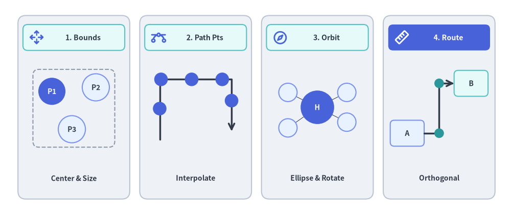
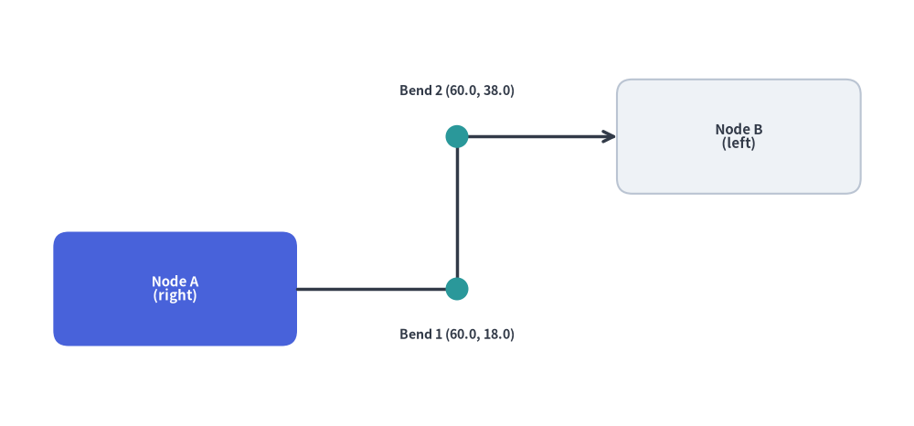
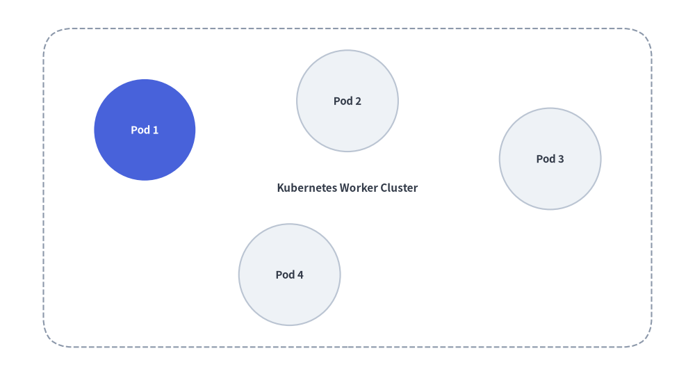
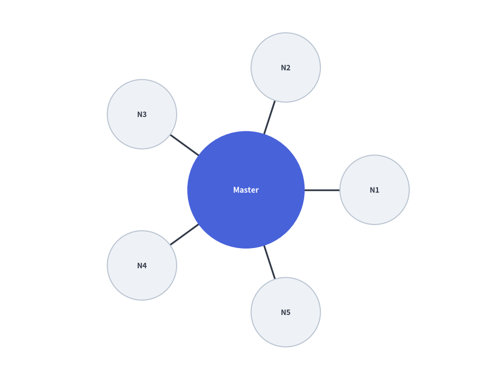
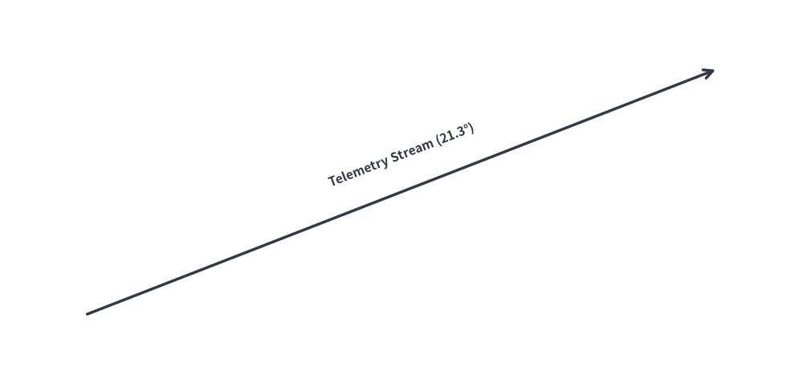

# アルゴリズムレイアウトと幾何計算 (`drawlib.math`)

Drawlib は、技術図解における座標配置、角度の算出、距離計測、動的バウンディングボックス計算を簡潔に行うための幾何・数学ユーティリティを提供しています。

`drawlib.math` モジュールは、アルゴリズムによるレイアウト構築やアニメーション制御を支える4つの主要な幾何計算機能を備えています。


<figure class="drawlib-image" style="text-align: center;">
  
  <figcaption class="drawlib-caption">drawlib.math の概要: 動的バウンディングボックス・経路補間・放射軌道・直交ルーティング</figcaption>
</figure>

<details class="drawlib-code-details">
<summary>Source Code</summary>

```python
from drawlib.canvas import save, setup
from drawlib.icons import phosphor
from drawlib.lines import line, lines
from drawlib.math import (
    compute_orthogonal_path,
    get_center_and_size,
    get_intermediate_path_points,
    get_point_on_ellipse,
    rotate_point,
)
from drawlib.shapes import circle, rectangle
from drawlib.styles import Styles
from drawlib.text import text

setup(width=128, height=54)

# Panel 1: Dynamic Bounding Box (get_center_and_size)
rectangle((18.5, 27), width=28, height=46, style=Styles.Neutral.patch(shape_r=2.0))
rectangle((18.5, 44.5), width=25.5, height=6.5, style=Styles.SecondaryNeutral.patch(shape_r=1.2))
phosphor.arrows_out_cardinal((9.2, 44.5), width=3.8, style=Styles.PrimaryBold)
text((20.8, 44.5), "1. Bounds", style=Styles.DarkBold.patch(text_size=10.2))

pts = [(13.0, 31.0), (24.0, 32.0), (18.0, 21.5)]
(bcx, bcy), (bw, bh) = get_center_and_size(pts)
rectangle((bcx, bcy), width=bw + 9.5, height=bh + 9.0, style=Styles.MutedDashed.patch(shape_r=1.5))
for idx, pt in enumerate(pts, start=1):
    st = Styles.PrimaryFlat if idx == 1 else Styles.PrimaryNeutral
    tst = Styles.WhiteBold.patch(text_size=10.0) if idx == 1 else Styles.DarkBold.patch(text_size=10.0)
    circle(pt, radius=3.4, style=st, text=f"P{idx}", text_style=tst)
text((18.5, 9.2), "Center & Size", style=Styles.DarkBold.patch(text_size=10.0))

# Panel 2: Polyline Path Interpolation (get_intermediate_path_points)
rectangle((49.0, 27), width=28, height=46, style=Styles.Neutral.patch(shape_r=2.0))
rectangle((49.0, 44.5), width=25.5, height=6.5, style=Styles.SecondaryNeutral.patch(shape_r=1.2))
phosphor.bezier_curve((39.7, 44.5), width=3.8, style=Styles.PrimaryBold)
text((51.3, 44.5), "2. Path Pts", style=Styles.DarkBold.patch(text_size=10.2))

poly = [(40.0, 19.0), (40.0, 34.0), (58.0, 34.0), (58.0, 21.0)]
lines(poly, style=Styles.DarkBold, arrow_head="->")
for px, py in get_intermediate_path_points(poly, num=5, include_ends=False):
    circle((px, py), radius=1.7, style=Styles.PrimaryFlat)
text((49.0, 9.2), "Interpolate", style=Styles.DarkBold.patch(text_size=10.0))

# Panel 3: Radial & Elliptical Orbit (get_point_on_ellipse / rotate_point)
rectangle((79.5, 27), width=28, height=46, style=Styles.Neutral.patch(shape_r=2.0))
rectangle((79.5, 44.5), width=25.5, height=6.5, style=Styles.SecondaryNeutral.patch(shape_r=1.2))
phosphor.compass((70.2, 44.5), width=3.8, style=Styles.PrimaryBold)
text((81.8, 44.5), "3. Orbit", style=Styles.DarkBold.patch(text_size=10.2))

hub_xy = (79.5, 27.0)
sat_pts = [
    get_point_on_ellipse(hub_xy, 18, 13, 35),
    get_point_on_ellipse(hub_xy, 18, 13, 145),
    rotate_point((88.5, 27.0), 215, center=hub_xy),
    get_point_on_ellipse(hub_xy, 18, 13, 325),
]
for s_pt in sat_pts:
    line(hub_xy, s_pt, style=Styles.DarkThin)
circle(hub_xy, radius=4.2, style=Styles.PrimaryFlat, text="H", text_style=Styles.WhiteBold.patch(text_size=10.0))
for s_pt in sat_pts:
    circle(s_pt, radius=2.3, style=Styles.PrimaryNeutral)
text((79.5, 9.2), "Ellipse & Rotate", style=Styles.DarkBold.patch(text_size=10.0))

# Panel 4: Orthogonal Port Routing (compute_orthogonal_path)
rectangle((110.0, 27), width=28, height=46, style=Styles.Neutral.patch(shape_r=2.0))
rectangle((110.0, 44.5), width=25.5, height=6.5, style=Styles.PrimaryFlat.patch(shape_r=1.2))
phosphor.ruler((100.7, 44.5), width=3.8, style=Styles.WhiteBold)
text((112.3, 44.5), "4. Route", style=Styles.WhiteBold.patch(text_size=10.2))

rectangle(
    (102.0, 20.5),
    width=8.5,
    height=6.5,
    style=Styles.PrimaryNeutral.patch(shape_r=1.0),
    text="A",
    text_style=Styles.DarkBold.patch(text_size=10.0),
)
rectangle(
    (118.0, 33.0),
    width=8.5,
    height=6.5,
    style=Styles.SecondaryNeutral.patch(shape_r=1.0),
    text="B",
    text_style=Styles.DarkBold.patch(text_size=10.0),
)
route = compute_orthogonal_path(
    start_pt=(106.25, 20.5),
    end_pt=(113.75, 33.0),
    start_side="right",
    end_side="left",
    routing="orthogonal",
    offset=2.0,
)
lines(route, style=Styles.DarkBold, arrow_head="->")
for wx, wy in route[1:-1]:
    circle((wx, wy), radius=1.2, style=Styles.SecondaryFlat)
text((110.0, 9.2), "Orthogonal", style=Styles.DarkBold.patch(text_size=10.0))

save()
```

</details>


---

## 1. インポートと主要関数一覧

距離・補間・座標変換・経路ルーティングに関するすべての公開ユーティリティは `drawlib.math` からインポートします。

```python
from drawlib.math import (
    # Distance, Angle & Bounding Box
    get_angle,                     # Calculate angle in degrees [0, 360) from point A to point B
    get_center_and_size,           # Compute center coordinates and bounding box dimensions
    get_distance,                  # Compute Euclidean distance between two points
    # Linear & Polyline Trajectory Interpolation
    get_intermediate_point,        # Compute the 50% midpoint between two points
    get_intermediate_points,       # Compute evenly spaced points along a straight segment
    get_intermediate_path_point,   # Compute 50% arc-length midpoint along a polyline path
    get_intermediate_path_points,  # Compute evenly spaced points along a polyline path
    get_intermediate_paths,        # Compute progressive partial sub-paths along a polyline
    # Vector Arithmetic, Rotation & Ellipse Geometry
    plus_2points,                  # Element-wise vector addition (x1 + x2, y1 + y2)
    minus_2points,                 # Element-wise vector subtraction (x1 - x2, y1 - y2)
    rotate_point,                  # Rotate a single point around a center by angle in degrees
    get_rotated_points,            # Rotate a list of points around a center by angle in degrees
    get_rotated_path_points,       # Rotate path points (including Bezier control tuples)
    get_point_on_ellipse,          # Calculate point on ellipse perimeter at a given angle
    # Orthogonal Waypoint Routing
    compute_orthogonal_path,       # Compute right-angled or direct waypoints between two anchors
    Side,                          # Literal["left", "right", "top", "bottom"]
    RoutingType,                   # Literal["direct", "orthogonal"]
)
```

---

## 2. 各関数の仕様

### 2.1 `get_angle(xy1, xy2) -> float`
点 `xy1` から点 `xy2` への反時計回りの角度（度数法）を算出します。
- **基準方向**: X軸の正の方向（右・東向き）を `0°` とします。
- **値域**: `[0.0, 360.0)`
  - 真右の点: `0.0°`
  - 真上の点: `90.0°`
  - 真左の点: `180.0°`
  - 真下の点: `270.0°`
- **主な用途**: 斜めの接続線に沿ってテキストラベルを平行に回転配置したり、方向性のあるアイコンの向きを合わせたりする際に使用します。

### 2.2 `get_distance(xy1, xy2) -> float`
2点間のユークリッド距離 $\sqrt{(x_2 - x_1)^2 + (y_2 - y_1)^2}$ を算出します。
- **主な用途**: 線分の長さの計算、衝突判定のしきい値評価、放射状レイアウトにおける間隔計算などに使用します。

### 2.3 `get_center_and_size(xys) -> tuple[tuple[float, float], tuple[float, float]]`
任意の座標群の外接バウンディングボックスの中心座標とサイズ（幅・高さ）を算出します。
- **戻り値**: `((center_x, center_y), (width, height))`
- **主な用途**: 複数のサービスノード群を均等な余白（パディング）付きの背景コンテナ矩形で動的に囲む際に使用します。

### 2.4 `get_intermediate_point(xy1, xy2)` と `get_intermediate_points(xy1, xy2, num=1, *, include_ends=False)`
2点 `xy1` と `xy2` の間を線形補間した座標を算出します。
- **`get_intermediate_point(xy1, xy2) -> tuple[float, float]`**: ちょうど 50% の中点座標 `(mx, my)` を返します。
- **`get_intermediate_points(xy1, xy2, num=1, *, include_ends=False) -> list[tuple[float, float]]`**: 等間隔に分割した `num` 個の中間点リストを返します（`include_ends=True` の場合は始点 `xy1` と終点 `xy2` を含む `num + 2` 個の点）。
- **主な用途**: パケットが移動するアニメーションや、フレームごとに段階的に伸びるブロック矢印（`arrow(xy1, pt, ...)`）・接続線の描画に使用します。

### 2.5 `get_intermediate_path_point(xys)`、`get_intermediate_path_points(xys, ...)` と `get_intermediate_paths(xys, ...)`
L字型やU字型ルートなどの複数頂点からなる折れ線経路（ポリライン）`xys` の総弧長に基づき、中間点や段階的な部分経路を算出します。
- **`get_intermediate_path_point(xys) -> tuple[float, float]`**: 折れ線 `xys` 全体の総延長のちょうど 50% に位置する座標を返します（例: U字型経路の底辺中央など）。
- **`get_intermediate_path_points(xys, num=1, *, include_ends=False) -> list[tuple[float, float]]`**: 折れ線 `xys` 上を等間隔に分割した `num` 個の `(x, y)` 座標リストを返します（`include_ends=True` の場合は両端を含む `num + 2` 個）。
- **`get_intermediate_paths(xys, num=1, *, include_ends=False) -> list[list[tuple[float, float]]]`**: 始点 `xys[0]` から出発し、途中の折れ曲がり頂点を正確に経由しながら各ステップの先端で終わる `num` 個の部分経路リスト `[(x0, y0), ..., (xt, yt)]` を返します（`include_ends=True` の場合は完全な `xys` も末尾に含みます）。L字・U字ルートに沿って `lines()`、`lines_curved()`、`arrow_polyline()` を伸ばすアニメーションに最適です。

### 2.6 ベクトル演算・回転・楕円ジオメトリ関数
- **`plus_2points(xy1, xy2)` / `minus_2points(xy1, xy2)`**: 2次元座標の要素ごとの加算 `(x1 + x2, y1 + y2)` および減算 `(x1 - x2, y1 - y2)` を行います。
- **`rotate_point(xy, angle, center=(0.0, 0.0))`**: 点 `center` を中心として座標 `xy` を反時計回りに `angle` 度回転させます。
- **`get_rotated_points(xys, center, angle)` / `get_rotated_path_points(path_points, center, angle)`**: 多角形の頂点リストやベジェ曲線の制御点を含むパス頂点群を `center` の周りに一括回転させます。
- **`get_point_on_ellipse(center, width, height, angle)`**: サイズ `(width, height)` の楕円周上における角度 `angle` 度（`0°` = 右、`90°` = 上）の境界点 `(x, y)` を算出します。

### 2.7 直交ウェイポイントルーティング (`compute_orthogonal_path`)
2つのアンカー座標とそれぞれの出発面・到着面（`"left"`、`"right"`、`"top"`、`"bottom"`）を指定して、直角に折れ曲がる経路（`"orthogonal"`）または直線経路（`"direct"`）のウェイポイント列を自動計算します。


```python
from drawlib.canvas import save, setup
from drawlib.lines import lines
from drawlib.math import compute_orthogonal_path
from drawlib.shapes import circle, rectangle
from drawlib.styles import Styles
from drawlib.text import text

setup(width=120, height=56)

# 1. Draw anchor nodes (Node A right edge = 39.0, Node B left edge = 81.0)
rectangle(
    (23, 18),
    width=32,
    height=15,
    style=Styles.PrimaryFlat.patch(shape_r=2.0),
    text="Node A\n(right)",
    text_style=Styles.WhiteBold.patch(text_size=10.8),
)
rectangle(
    (97, 38),
    width=32,
    height=15,
    style=Styles.Neutral.patch(shape_r=2.0),
    text="Node B\n(left)",
    text_style=Styles.DarkBold.patch(text_size=10.8),
)

# 2. Compute orthogonal Z-bend waypoints
waypoints = compute_orthogonal_path(
    start_pt=(39.0, 18.0),
    end_pt=(81.0, 38.0),
    start_side="right",
    end_side="left",
    routing="orthogonal",
    offset=3.0,
)

# 3. Render orthogonal connector and intermediate bend markers
lines(waypoints, style=Styles.DarkBold, arrow_head="->")
for wx, wy in waypoints[1:-1]:
    circle((wx, wy), radius=1.5, style=Styles.SecondaryFlat)

text((60.0, 12.0), "Bend 1 (60.0, 18.0)", style=Styles.DarkBold.patch(text_size=10.2))
text((60.0, 44.0), "Bend 2 (60.0, 38.0)", style=Styles.DarkBold.patch(text_size=10.2))

save()
```

<figure class="drawlib-image" style="text-align: center;">
  
  <figcaption class="drawlib-caption">compute_orthogonal_path() によって算出された直交クランク（Z字）経路</figcaption>
</figure>


---

## 3. 動的な自動グルーピング枠の描画

`get_center_and_size()` を使うと、複数のサービスノード群の外接領域を動的に計算し、それらを囲む背景コンテナカードを自動配置できます。


```python
from drawlib.canvas import save, setup
from drawlib.math import get_center_and_size
from drawlib.shapes import circle, rectangle
from drawlib.styles import Styles

setup(width=96, height=52)

# 1. Define service node positions
nodes = [(20, 34), (48, 38), (76, 30), (40, 14)]

# 2. Calculate dynamic bounding box
(cx, cy), (bw, bh) = get_center_and_size(nodes)

# 3. Draw background container with +28 width and +20 height padding
rectangle(
    (cx, cy),
    width=bw + 28,
    height=bh + 20,
    style=Styles.MutedDashed.patch(shape_r=4),
    text="Kubernetes Worker Cluster",
    text_style=Styles.DarkBold.patch(text_size=11.0),
)

# 4. Render nodes
for i, (x, y) in enumerate(nodes, start=1):
    st = Styles.PrimaryFlat if i == 1 else Styles.Neutral
    t_st = Styles.WhiteBold.patch(text_size=10.8) if i == 1 else Styles.DarkBold.patch(text_size=10.8)
    circle((x, y), radius=7.0, style=st, text=f"Pod {i}", text_style=t_st)
save()
```

<figure class="drawlib-image" style="text-align: center;">
  
  <figcaption class="drawlib-caption">get_center_and_size() を用いた動的グルーピング枠の自動描画</figcaption>
</figure>


---

## 4. 円周上の放射状ノード配置

中央のハブの周囲に $N$ 個のワーカーノードを対称に放射配置する例です。


```python
import math
from drawlib.canvas import save, setup
from drawlib.lines import line
from drawlib.math import get_angle, get_distance
from drawlib.shapes import circle
from drawlib.styles import Styles

setup(width=88, height=68)

hub = (44, 34)
radius = 23
num_clients = 5

# 1. Draw spoke lines and surrounding worker nodes first
for i in range(num_clients):
    angle_rad = 2 * math.pi * i / num_clients
    node_xy = (hub[0] + radius * math.cos(angle_rad), hub[1] + radius * math.sin(angle_rad))

    # Calculate connection angle and distance
    dist = get_distance(hub, node_xy)
    angle_deg = get_angle(hub, node_xy)

    line(hub, node_xy, style=Styles.DarkBold)
    circle(node_xy, radius=6.2, style=Styles.Neutral, text=f"N{i+1}", text_style=Styles.DarkBold.patch(text_size=10.8))

# 2. Draw Central Hub on top so spoke lines do not cross label text
circle(hub, radius=10.5, style=Styles.PrimaryFlat, text="Master", text_style=Styles.WhiteBold.patch(text_size=11.2))
save()
```

<figure class="drawlib-image" style="text-align: center;">
  
  <figcaption class="drawlib-caption">極座標計算による放射状トポロジ配置</figcaption>
</figure>


---

## 5. 斜めの接続線に沿ったテキストラベル回転

`get_angle()` を使用して、角度のついた接続線と平行になるようにテキストラベルを回転配置します。


```python
from drawlib.canvas import save, setup
from drawlib.lines import line
from drawlib.math import get_angle
from drawlib.styles import Styles
from drawlib.text import text

setup(width=92, height=44)

p1 = (10, 8)
p2 = (82, 36)

# Draw slanted wire
line(p1, p2, arrow_head="->", style=Styles.DarkBold)

# Calculate rotation angle and midpoint
angle = get_angle(p1, p2)
midpoint = ((p1[0] + p2[0]) / 2, (p1[1] + p2[1]) / 2 + 4.2)

# Render rotated text parallel to the connection
text(midpoint, f"Telemetry Stream ({angle:.1f}°)", style=Styles.DarkBold.patch(angle=angle, text_size=11.2))
save()
```

<figure class="drawlib-image" style="text-align: center;">
  
  <figcaption class="drawlib-caption">斜めの接続線に平行配置したテキストラベル</figcaption>
</figure>


