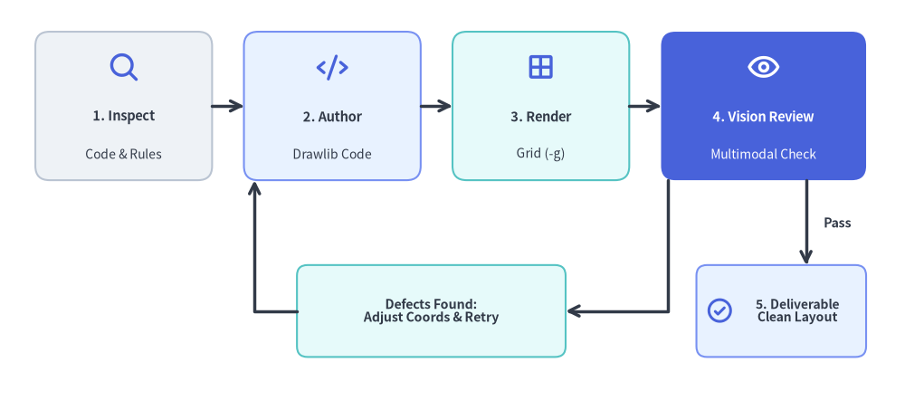
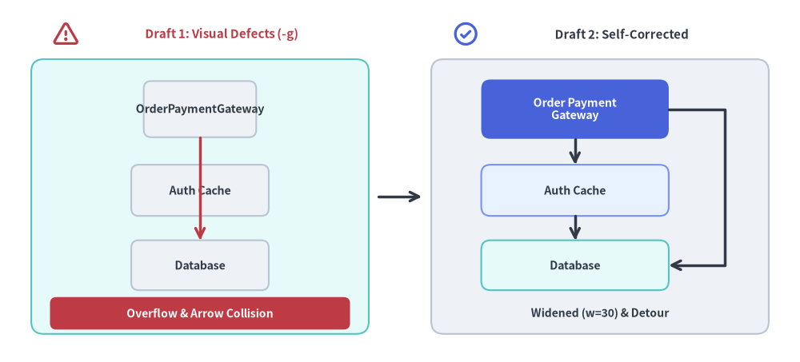

# 自律検証フィードバックループ

視覚認識ツールを備えた最新の AI コーディングアシスタント（Claude 3.5 Sonnet、Gemini 1.5 Pro、GPT-4o など）の大きな強みは、生成した図解をユーザーに提示する前に自ら視覚的に検査できる点にあります。

Drawlib は、この自律的な視覚フィードバック・自己修正ループを最大限に引き出すよう特別に設計されています。


<figure class="drawlib-image" style="text-align: center;">
  
  <figcaption class="drawlib-caption">自律的マルチモーダル AI 視覚自己修正ループ</figcaption>
</figure>

<details class="drawlib-code-details">
<summary>Source Code</summary>

```python
from drawlib.canvas import save, setup
from drawlib.icons import phosphor
from drawlib.lines import line, lines
from drawlib.shapes import rectangle
from drawlib.styles import Styles
from drawlib.text import text

setup(width=128, height=58)

# Top Row: Stages 1 to 4
stages = [
    (17.5, "1. Inspect", "Code & Rules", Styles.Neutral, Styles.DarkBold, Styles.Dark, phosphor.magnifying_glass, Styles.PrimaryBold),
    (47.0, "2. Author", "Drawlib Code", Styles.PrimaryNeutral, Styles.DarkBold, Styles.Dark, phosphor.code, Styles.PrimaryBold),
    (76.5, "3. Render", "Grid (-g)", Styles.SecondaryNeutral, Styles.DarkBold, Styles.Dark, phosphor.grid_four, Styles.PrimaryBold),
    (108.0, "4. Vision Review", "Multimodal Check", Styles.PrimaryFlat, Styles.WhiteBold, Styles.White, phosphor.eye, Styles.WhiteBold),
]
for sx, title, sub, st, tst, sub_st, icon_fn, icon_st in stages:
    w = 29 if sx > 100 else 25
    rectangle((sx, 43.0), width=w, height=21, style=st.patch(shape_r=2.0))
    icon_fn((sx, 48.5), width=4.6, style=icon_st)
    text((sx, 41.5), title, style=tst.patch(text_size=10.5))
    text((sx, 36.2), sub, style=sub_st.patch(text_size=10.0))

# Forward Connectors (1 -> 2 -> 3 -> 4)
line((30.0, 43.0), (34.5, 43.0), arrow_head="->", style=Styles.DarkBold)
line((59.5, 43.0), (64.0, 43.0), arrow_head="->", style=Styles.DarkBold)
line((89.0, 43.0), (93.5, 43.0), arrow_head="->", style=Styles.DarkBold)

# Decision Branch A: Defects Found -> Loop Back to Step 2
rectangle(
    (61.0, 14.0),
    width=38,
    height=13,
    style=Styles.SecondaryNeutral.patch(shape_r=1.5),
    text="Defects Found:\nAdjust Coords & Retry",
    text_style=Styles.DarkBold.patch(text_size=10.2),
)
lines([(94.5, 32.5), (94.5, 14.0), (80.0, 14.0)], arrow_head="->", style=Styles.DarkBold)
lines([(42.0, 14.0), (36.0, 14.0), (36.0, 32.5)], arrow_head="->", style=Styles.DarkBold)

# Decision Branch B: Pass -> Step 5 Final Deliverable
rectangle((110.5, 14.0), width=24, height=13, style=Styles.PrimaryNeutral.patch(shape_r=1.5))
phosphor.check_circle((101.8, 14.0), width=4.0, style=Styles.PrimaryBold)
text((112.8, 14.0), "5. Deliverable\nClean Layout", style=Styles.DarkBold.patch(text_size=10.0))
line((114.0, 32.5), (114.0, 20.5), arrow_head="->", style=Styles.DarkBold)
text((116.5, 26.5), "Pass", style=Styles.DarkBold.patch(text_size=10.2, halign="left"))

save()
```

</details>


---

## 1. 自律フィードバックサイクルの流れ

### ステージ 1: コンテキストの調査
エージェントは何もない状態から想像でアーキテクチャ図を描くのではなく、実際のリポジトリ内のソースコード（`models.py`、API ルート定義、マイクロサービス設定など）を直接調査します。

### ステージ 2: 隔離されたスクラッチ領域（`.drawlib/scratch/`）での試作
本番ドキュメントのアセットをいきなり書き換えるのではなく、隔離されたスクラッチファイル（`.drawlib/scratch/test_diagram.py`）で描画プロトタイプを作成するか、対象ブロック単体を検証します。プロジェクトルートを一時ファイルで汚さないようにし、`.drawlib/` が `.gitignore` に登録されていることを確認してください。

### ステージ 3: 座標グリッド（`-g`）付きヘッドレス描画
エージェントは `-g` フラグを付けて `drawlib show` を実行し、座標軸・目盛り・数値ラベルを重ね合わせた検証用画像を出力します（壊れやすい連番インデックスではなく、Markdown ブロックに明示した `file:` 名で指定します）。

```bash
# Render an embedded Markdown block by explicit filename with coordinate grid (Recommended):
uv run drawlib show docs_src/architecture.md service_mesh.png -g -o .drawlib/scratch/preview.png

# Or render a standalone Python script with coordinate grid:
uv run drawlib show .drawlib/scratch/test_diagram.py -g -o .drawlib/scratch/test_diagram.png
```

### ステージ 4: マルチモーダル視覚検査
視覚認識ツール（`view_file` や画像ビューアなど）を用いて出力画像を確認し、代表的な5つの視覚的不具合がないかを検査します。
1. **テキストのはみ出し・見切れ**: 長いサービス名やメソッド名がボックスの枠外にはみ出していないか。
2. **線や矢印の重なり・衝突**: 直交コネクタが不自然に交差したり、矢尻が図形に埋もれたりしていないか。
3. **キャンバス外周マージンの不足**: 最外周の要素がキャンバスの境界線ギリギリに張り付いて余白が失われていないか。
4. **配色のコントラスト不足**: 暗い塗りつぶしの上に黒文字を置いたり、淡い背景の上に白文字を置いたりしていないか。
5. **原色の使いすぎ（レインボー図解）**: すべてのノードに高彩度なベタ塗りを使っていないか。50%以上のノードを落ち着いたニュートラル系または淡色系スタイル（`Styles.Neutral`、`Styles.NeutralFlat`、`Styles.PrimaryNeutral`、`Styles.SecondaryNeutral`）で統一し、高彩度な強調塗り（`Styles.PrimaryFlat`）は1〜2個の最重要ノードのみに限定します。

### ステージ 5: 座標の反復的な微調整
座標グリッドを見れば視覚的な不具合が発生している正確な `(x, y)` 座標が一目で分かるため、エージェントは当て推量ではなく決定論的に座標を修正できます（例：「重なりを解消するため、ボックスの X 座標を 45.0 から 52.0 へ移動する」）。


<figure class="drawlib-image" style="text-align: center;">
  
  <figcaption class="drawlib-caption">座標グリッド (-g) を用いたマルチモーダル自己修正の前後比較</figcaption>
</figure>

<details class="drawlib-code-details">
<summary>Source Code</summary>

```python
from drawlib.canvas import save, setup
from drawlib.icons import phosphor
from drawlib.lines import line, lines
from drawlib.shapes import rectangle
from drawlib.styles import Styles
from drawlib.text import text

setup(width=128, height=58)

# Left Panel: Draft 1 with Visual Defects
phosphor.warning((10.5, 52.5), width=4.4, style=Styles.DangerBold)
text((35.5, 52.5), "Draft 1: Visual Defects (-g)", style=Styles.DangerBold.patch(text_size=10.8))
rectangle((32, 26.5), width=54, height=44, style=Styles.SecondaryNeutral.patch(shape_r=2.0))

# Narrow box (width=18) causing label overflow
rectangle(
    (32, 40.5),
    width=18,
    height=9.0,
    style=Styles.Neutral.patch(shape_r=1.2),
    text="OrderPaymentGateway",
    text_style=Styles.DarkBold.patch(text_size=10.2),
)
rectangle(
    (32, 27.5),
    width=22,
    height=8.2,
    style=Styles.Neutral.patch(shape_r=1.2),
    text="Auth Cache",
    text_style=Styles.DarkBold.patch(text_size=10.2),
)
rectangle(
    (32, 15.5),
    width=22,
    height=8.0,
    style=Styles.Neutral.patch(shape_r=1.2),
    text="Database",
    text_style=Styles.DarkBold.patch(text_size=10.2),
)
# Colliding arrow cutting straight through intermediate node
line((32, 36.0), (32, 19.5), arrow_head="->", style=Styles.DangerBold)

rectangle(
    (32, 7.8),
    width=48,
    height=5.2,
    style=Styles.DangerFlat.patch(shape_r=1.0),
    text="Overflow & Arrow Collision",
    text_style=Styles.WhiteBold.patch(text_size=10.0),
)

# Center Transition Arrow
line((60.5, 26.5), (67.5, 26.5), arrow_head="->", style=Styles.DarkBold)

# Right Panel: Draft 2 Self-Corrected
phosphor.check_circle((74.5, 52.5), width=4.4, style=Styles.PrimaryBold)
text((99.5, 52.5), "Draft 2: Self-Corrected", style=Styles.DarkBold.patch(text_size=10.8))
rectangle((96, 26.5), width=54, height=44, style=Styles.Neutral.patch(shape_r=2.0))

rectangle(
    (92, 40.5),
    width=30,
    height=9.5,
    style=Styles.PrimaryFlat.patch(shape_r=1.5),
    text="Order Payment\nGateway",
    text_style=Styles.WhiteBold.patch(text_size=10.2),
)
rectangle(
    (92, 27.5),
    width=30,
    height=8.2,
    style=Styles.PrimaryNeutral.patch(shape_r=1.5),
    text="Auth Cache",
    text_style=Styles.DarkBold.patch(text_size=10.2),
)
rectangle(
    (92, 15.5),
    width=30,
    height=8.0,
    style=Styles.SecondaryNeutral.patch(shape_r=1.5),
    text="Database",
    text_style=Styles.DarkBold.patch(text_size=10.2),
)

# Clean step connectors & orthogonal detour routing around intermediate node
line((92, 35.75), (92, 31.6), arrow_head="->", style=Styles.DarkBold)
line((92, 23.4), (92, 19.5), arrow_head="->", style=Styles.DarkBold)
lines([(107, 40.5), (116, 40.5), (116, 15.5), (107, 15.5)], arrow_head="->", style=Styles.DarkBold)

text((96, 7.8), "Widened (w=30) & Detour", style=Styles.DarkBold.patch(text_size=10.0))

save()
```

</details>


### ステージ 6: ブラウザ HTML でのページ全体確認（`1280×920` ビューポート）
図解入りドキュメント（`docs_src/` や `doc_src/`）では、出力された単体 PNG 画像だけを確認しても不十分です。たとえ単体画像が `1000px` で鮮明に描画されていても、コードフェンス側で狭いピクセル幅（`600px` など）に制限されていたり `text_size=8.0` で描かれていたりすると、実際の HTML ページ内では文字が潰れて読めなくなるためです。
成果物を提出する前に、エージェントは HTML サイトをビルド（`./docs_src/build.sh`）してリンク切れがないことを検証（`uv run drawlib serve docs_html/ --check`）したうえで、レンダリング後の HTML ページを `1280×920` のヘッドレス Chromium スクリーンショットで撮影し、次の2点を確認します。
1. **ファーストビューでのトップヒーロー図表示（`5〜15行目`、`fold-code`）**: スクロールしなくても `# タイトル`、導入段落、およびトップヒーロー図の全体が一画面内に収まって見えること。
2. **本文テキストと図内文字サイズの調和（`720pt` キャンバスの法則）**: Drawlib はすべてのキャンバス幅を `720pt` 基準にマッピングするため（$\text{CSS px} = \text{text\_size} \times \text{Width} / 720$）、フェンスでの狭い `px` 幅制限を省き `text_size >= 10.0` を維持することで、図内のラベルサイズが HTML 本文の `16px` テキストと自然に調和します。

> **ヒント**: `Center`（中心基準）と `Bottom-Left`（左下基準）の座標アンカー早見表を含む3段階の自律レビュー・自己修正手順の詳細は、`uv run drawlib rules show review-guide` で確認できます。

---

## 2. 視覚的自己修復チェックリスト

マルチモーダルなセルフレビューを行う際は、以下のチェックマトリクスを1項目ずつ確認してください。

| 検証項目 | よくある視覚的不具合 | 決定論的な修正方法 |
|---|---|---|
| **HTML タイポグラフィ（`720pt` の法則）** | `16px` の HTML 本文に比べて図内のラベルが極端に小さく見える | コードフェンスの狭いピクセル幅指定（`500px`/`600px`）を削除し、`text_size >= 10.0`（標準 `10.5`〜`12.0`）に設定したうえで、ボックス幅を `20%〜30%` 広げます。 |
| **ファーストビューのヒーロー図** | ページを開いた直後に文字の壁や50行のコードブロックしか見えない | 最初の図を `5〜15行目` に `fold-code` 付きで配置し、`phosphor` / `gcp` アイコンと `SmartArts` / `Diagrams` を組み合わせます。 |
| **座標アンカーの違い** | `Table`、`BarChart`、`FlowDiagram` が右上にずれて配置される | `shapes` / `text` / `icons` は**中心 `(cx, cy)`** 基準であるのに対し、`SmartArts` / `Charts` / `Diagrams` / `Graphs` は**左下 `(x0, y0)`** 基準（中央配置は `x0 = (W - width) / 2`）である点に注意します。 |
| **キャンバス外周の余白** | 最外周のノードやラベルがキャンバスの境界線に接触している | `setup(width=..., height=...)` のキャンバス寸法を広げるか、最外周の図形をすべての端から最低 `4〜8` ユニット内側へ配置します。 |
| **ノードの整列精度** | 水平・垂直の接続線が微妙に傾いてガタついて見える | 横並びのノードには完全に同一の `y` 座標を、縦並びのノードには完全に同一の `x` 座標を指定します。 |
| **ラベル周囲の余白** | 複数行テキストがカードの枠線に接触・はみ出している | ボックスの `width` / `height` を広げるか、明示的な改行 `\n` を挿入します。 |
| **矢尻とエッジラベル** | 矢尻が接続先ノードに埋もれる、または並行エッジのラベル同士が重なる | コネクタに `padding=1.5` または `2.0` を設定し、復路を別の辺（`from_side="bottom"`, `to_side="bottom"`）へ逃がすか、`label_offset=(dx, dy)` でラベル位置を調整します。 |
| **50%以上のニュートラル基準** | すべてのノードが原色で主張し合う「レインボー図解」になっている | 図形の50%以上を落ち着いたニュートラル系スタイル（`Styles.Neutral`、`Styles.PrimaryNeutral`、`Styles.SecondaryNeutral`）にし、境界枠には `Styles.MutedDashed` を使い、高彩度な強調塗り（`Styles.PrimaryFlat`）は1〜2個の主役要素のみに絞ります。 |
| **文字の輝度コントラスト** | 濃い `Flat` 塗りの上に黒文字、または淡い `Neutral` 塗りの上に白文字を置いている | 高彩度な `Flat` 塗り（`Styles.PrimaryFlat`、`Styles.DangerFlat`）には必ず `text_style=Styles.WhiteBold` を、淡い `Neutral` 塗りには `Styles.DarkBold` または `Styles.Dark` を組み合わせます。 |
