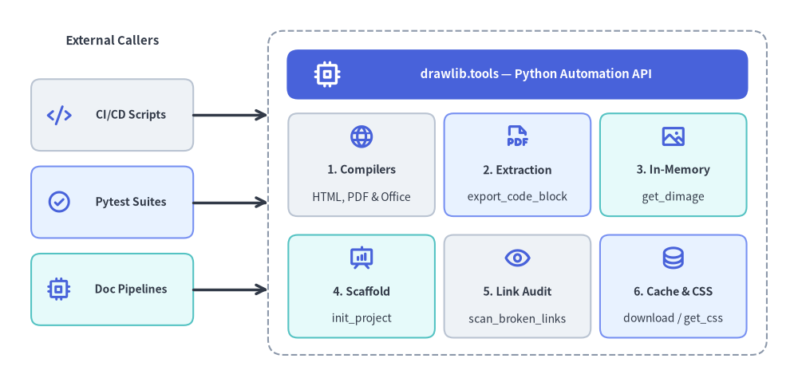
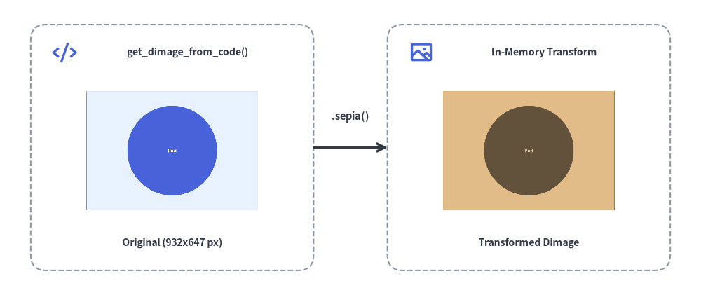

# プログラマティック API (`drawlib.tools`)

`drawlib` CLI は日常的なワークフロー向けのターミナルコマンドを提供しますが、Drawlib はさらに `drawlib.tools` モジュール配下に包括的な Python 開発者向け API を公開しています。この API を利用することで、ドキュメントのコンパイル、単一ダイアグラムの抽出・書き出し、画像スナップショットテスト、テンプレート生成などの自動化処理を CI/CD パイプラインや Web サーバー、カスタムビルドスクリプトへ直接組み込むことができます。

`drawlib.tools` ファサードは、プログラマティックな自動化機能を6つのコアサブシステムに整理しています。


<figure class="drawlib-image" style="text-align: center;">
  
  <figcaption class="drawlib-caption">drawlib.tools プログラマティック自動化 API のアーキテクチャ</figcaption>
</figure>

<details class="drawlib-code-details">
<summary>Source Code</summary>

```python
from drawlib.canvas import save, setup
from drawlib.icons import phosphor
from drawlib.lines import line
from drawlib.shapes import rectangle
from drawlib.styles import Styles
from drawlib.text import text

setup(width=128, height=62)

# Left Column: External Callers
text((18, 55.5), "External Callers", style=Styles.DarkBold.patch(text_size=10.8))

callers = [
    (43.5, "CI/CD Scripts", Styles.Neutral, phosphor.code),
    (29.5, "Pytest Suites", Styles.PrimaryNeutral, phosphor.check_circle),
    (15.5, "Doc Pipelines", Styles.SecondaryNeutral, phosphor.cpu),
]
for cy, clabel, cst, cicon in callers:
    rectangle((18, cy), width=26, height=11.5, style=cst.patch(shape_r=1.5))
    cicon((9.5, cy), width=4.0, style=Styles.PrimaryBold)
    text((21.0, cy), clabel, style=Styles.DarkBold.patch(text_size=10.0))

# Right Container: drawlib.tools Facade + 3x2 Subsystem Grid
rectangle((83, 31), width=80, height=52, style=Styles.MutedDashed.patch(shape_r=2.5))

rectangle((83, 50.0), width=74, height=8.0, style=Styles.PrimaryFlat.patch(shape_r=1.8))
phosphor.cpu((52.5, 50.0), width=4.6, style=Styles.WhiteBold)
text((86.0, 50.0), "drawlib.tools — Python Automation API", style=Styles.WhiteBold.patch(text_size=10.8))

# Row 1 of 3x2 Grid
grid_items = [
    (58.0, 35.5, "1. Compilers", "HTML, PDF & Office", Styles.Neutral, phosphor.globe),
    (83.0, 35.5, "2. Extraction", "export_code_block", Styles.PrimaryNeutral, phosphor.file_pdf),
    (108.0, 35.5, "3. In-Memory", "get_dimage", Styles.SecondaryNeutral, phosphor.image),
    (58.0, 16.0, "4. Scaffold", "init_project", Styles.SecondaryNeutral, phosphor.presentation_chart),
    (83.0, 16.0, "5. Link Audit", "scan_broken_links", Styles.Neutral, phosphor.eye),
    (108.0, 16.0, "6. Cache & CSS", "download / get_css", Styles.PrimaryNeutral, phosphor.database),
]
for gx, gy, gtitle, gsub, gst, gicon in grid_items:
    rectangle((gx, gy), width=23.5, height=16.5, style=gst.patch(shape_r=1.5))
    gicon((gx, gy + 4.5), width=4.2, style=Styles.PrimaryBold)
    text((gx, gy - 0.8), gtitle, style=Styles.DarkBold.patch(text_size=10.2))
    text((gx, gy - 5.2), gsub, style=Styles.Dark.patch(text_size=10.0))

# Connectors from External Callers to drawlib.tools Container
line((31, 43.5), (43, 43.5), arrow_head="->", style=Styles.DarkBold)
line((31, 29.5), (43, 29.5), arrow_head="->", style=Styles.DarkBold)
line((31, 15.5), (43, 15.5), arrow_head="->", style=Styles.DarkBold)

save()
```

</details>


---

## 1. モジュール概要と公開シンボル一覧 (`drawlib.tools`)

```python
from drawlib.tools import (
    # Document, Slide, Office & Image Compilation
    build_document,
    build_html,
    build_markdown,
    build_pdf,
    build_docx,
    build_slide,
    build_pptx,
    build_image,
    detect_document_type,
    # Single Diagram Extraction & Desktop Preview
    export_code_block,
    show_code_block,
    # Project Scaffolding
    init_project,
    list_project_types,
    # Local Preview Server & Broken Link Scanner
    serve_docs,
    scan_broken_links,
    # Cache Management
    list_cache,
    clear_cache,
    download_cache,
    # CSS Stylesheet Presets
    list_css,
    list_html_css,
    list_pdf_css,
    list_slide_css,
    get_css,
    export_css,
)
```

| カテゴリ | 関数 | 説明 |
| :--- | :--- | :--- |
| **コンパイル** | `build_html(input_dir, output_dir=None, *, image_format="png", styles_path=None, utils_path=None, no_cache=False, css_mode="external")` | Markdown ディレクトリ（`site` または `doc`）を静的 HTML サイトへコンパイルします。 |
| **コンパイル** | `build_markdown(input_dir, output_dir=None, *, image_format="png", styles_path=None, utils_path=None, no_cache=False)` | ソース Markdown を GitHub Flavored Markdown と付属画像群へコンパイルします。 |
| **コンパイル** | `build_pdf(input_path=None, output_file=None, *, title=None, page_break=True, generate_index=False, styles_path=None, utils_path=None, no_cache=False, timestamp=False)` | ヘッドレス Chromium を用いて、複数の Markdown 章ファイルやスライドデッキをベクター PDF へ統合出力します。 |
| **コンパイル** | `build_docx(input_path=None, output_file=None, *, input_dir=None, title=None, page_break=True, generate_index=False, dpi=200, styles_path=None, utils_path=None, no_cache=False, timestamp=False)` | Markdown 章ディレクトリまたは単一 `.md` ファイルを、高 DPI 静的 PNG ダイアグラム付きの編集可能な MS Word（`.docx`）文書へコンパイルします。 |
| **コンパイル** | `build_slide(input_dir, output_dir=None, *, title=None, theme=None, image_format="svg", styles_path=None, utils_path=None, no_cache=False)` | `slide_src/` ディレクトリをインタラクティブな 16:9 HTML スライドデッキ（`index.html`）へコンパイルします。 |
| **コンパイル** | `build_pptx(input_dir, output_file=None, *, title=None, theme=None, dpi=240, anim_frame="last", styles_path=None, utils_path=None, no_cache=False, timestamp=False)` | ヘッドレス Chromium によるレイアウト計測を用いて、`slide_src/` ディレクトリを編集可能な 16:9（`960×540 pt`）MS PowerPoint（`.pptx`）プレゼンテーションへコンパイルします。 |
| **コンパイル** | `build_image(input_path, output_path=None, *, format=None, styles_path=None, utils_path=None, grid=False, disable_auto_clear=False, enable_auto_initialize=False, no_cache=False)` | スタンドアロン `.py` スクリプトの一括実行、または `.md` 内の描画ブロックの画像ファイル抽出を行います。 |
| **コンパイル** | `build_document(input_dir, output_path=None, output_format=None, ...)` | `"html"`、`"markdown"`、`"pdf"`、`"docx"` のコンパイルを振り分ける統合ディスパッチャです。 |
| **種別判定** | `detect_document_type(file_path, content=None)` | 対象ファイルまたはディレクトリが Markdown か HTML かを自動判定します（`DocumentInputInfo`）。 |
| **単体抽出** | `export_code_block(file_path, target=None, output_path=None, styles_path=None, utils_path=None, grid=False, no_cache=False)` | 単一の ````drawlib```` ブロックまたは `.py` スクリプトをヘッドレスでディスクへ書き出します（`target=None` の場合はブロック一覧を取得）。 |
| **単体抽出** | `show_code_block(file_path, target=None, styles_path=None, utils_path=None, grid=False, no_cache=False)` | 単一の ````drawlib```` ブロックまたは `.py` スクリプトをデスクトップ GUI ウィンドウでプレビュー表示します。 |
| **雛形生成** | `init_project(project_type, destination=".", target=None, force=False, lang="en", style=None)` | `"doc"`、`"site"`、`"slide"`、`"images"` のスタータープロジェクトを生成します。 |
| **雛形生成** | `list_project_types()` | スターターテンプレート名（`doc`、`site`、`slide`、`images`）と説明文の対応辞書 `dict[str, str]` を返します。 |
| **サーバー・監査** | `serve_docs(directory, port=8000, open_browser=True, skip_check=False, check_only=False)` | 事前リンクチェック機能付きのローカル HTTP プレビューサーバー（`Cache-Control: no-store`）を起動します。 |
| **サーバー・監査** | `scan_broken_links(directory)` | コンパイル済み HTML ディレクトリを走査し、`(html_count, link_count, broken_links)` を返します。 |
| **キャッシュ** | `list_cache()`, `download_cache(all_assets=True, fonts=False, icons=False, maps=False, browser=False)`, `clear_cache()` | キャッシュ済みパッケージ（フォント・アイコン・地図・ヘッドレス Chromium ブラウザ）の一覧確認・事前ダウンロード・削除を行います。 |
| **CSS テーマ** | `list_css(target="html")`, `list_html_css()`, `list_pdf_css()`, `list_slide_css()`, `get_css(name, target="html", lang="en")`, `export_css(name, output_path=None, target="html", force=False, lang="en")` | 組み込みの3層構造 CSS テーマスタイルシートの一覧取得・合成取得・ファイル出力を行います。 |

---

## 2. ドキュメント・スライド・Office 文書・画像のコンパイル API

### 2.1 `build_html()` と `build_markdown()`
ドキュメントのソースディレクトリ（`docs_src/`）を静的 HTML サイトおよび GitHub Flavored Markdown へコンパイルします。

```python
from drawlib.tools import build_html, build_markdown

build_html(
    input_dir="docs_src/",
    output_dir="docs_html/",
    styles_path="docs_src/styles.py",  # Optional custom styles script
    utils_path="docs_src/utils.py",    # Optional drawing helper script
    no_cache=False,                    # Set True to bypass SQLite cache
    image_format="png",                # "png" or "webp"
)

build_markdown(
    input_dir="docs_src/",
    output_dir="docs_markdown/",
    styles_path="docs_src/styles.py",
)
```

### 2.2 `build_pdf()` と `build_slide()`
リニアドキュメントや 16:9 スライドデッキを、ベクター PDF やインタラクティブな HTML プレゼンテーションへコンパイルします。

```python
from drawlib.tools import build_pdf, build_slide

# Compile linear document with Table of Contents and chapter page breaks:
build_pdf(
    input_path="doc_src/",
    output_file="doc.pdf",
    generate_index=True,               # Generate Table of Contents (--toc)
    page_break=True,                   # Page break before each chapter
)

# Compile 16:9 interactive HTML presentation deck:
build_slide(
    input_dir="slide_src/",
    output_dir="slide_html/",
    image_format="svg",
)
```

### 2.3 `build_docx()` と `build_pptx()`
リニアな Markdown 仕様書をネイティブで編集可能な MS Word（`.docx`）文書へ、16:9 スライドデッキを編集可能な MS PowerPoint（`.pptx`）プレゼンテーションへコンパイルします。

```python
from drawlib.tools import build_docx, build_pptx

# Compile linear document chapters into an editable MS Word (.docx) document:
build_docx(
    input_path="doc_src/",
    output_file="doc.docx",
    generate_index=True,               # Insert Table of Contents between Ch 1 & Ch 2
    page_break=True,                   # Insert page breaks between merged chapters
    dpi=200,                           # High-DPI static PNG rasterization for diagrams
)

# Compile 16:9 slide deck into an editable MS PowerPoint (.pptx) presentation:
build_pptx(
    input_dir="slide_src/",
    output_file="slide.pptx",
    theme="google",
    dpi=240,                           # High-DPI static PNG rasterization for diagrams
    anim_frame="last",                 # Extract "first" or "last" frame from animations
)
```

### 2.4 `build_image()` と `download_cache()`
`images_src/` 内のスタンドアロン Python スクリプトを一括実行したり、フォント・アイコン・地図・ヘッドレス Chromium のキャッシュをプログラムから事前ダウンロードしたりします。

```python
from drawlib.tools import build_image, download_cache

# Pre-warm headless Chromium only (or pass all_assets=True for fonts + icons + maps + browser):
download_cache(all_assets=False, browser=True)

build_image(
    input_path="images_src/",
    output_path="images/",
    styles_path="images_src/styles.py",
    utils_path="images_src/utils.py",
    grid=False,
)
```

---

## 3. 単一ダイアグラムの抽出 (`export_code_block`)

GUI ウィンドウを開かずに、Markdown ファイル内の特定ブロックまたは単体 `.py` スクリプトから1枚のダイアグラムだけを抽出・レンダリングします。

```python
from drawlib.tools import export_code_block

# Extract a named block from Markdown with coordinate grid (Recommended):
export_code_block(
    file_path="docs_src/architecture.md",
    target="service_arch.png",         # Explicit file: name or 1-based index ("1")
    output_path=".drawlib/scratch/arch.png",
    grid=True,                         # Overlay coordinate grid
)

# Export from standalone Python script:
export_code_block(
    file_path="images_src/diagram.py",
    output_path="images/diagram.png",
    grid=False,
)
```

---

## 4. インメモリ画像 API (`get_dimage` と `get_dimage_from_code`)

Drawlib は一時ファイルをディスクに書き出すことなく、キャンバスを直接インメモリの `Dimage` オブジェクトとしてキャプチャできます（`from drawlib.canvas import get_dimage` または `from drawlib.images import get_dimage_from_code`）。

- **`get_dimage()` (`from drawlib.canvas import get_dimage`)**: 現在アクティブなキャンバスを `Dimage` インスタンスとして取得します（`dimage.get_image_size()`、`dimage.get_pil_image()`、`dimage.trim()`、`dimage.sepia()`、`dimage.save(...)` などが利用可能）。
- **`get_dimage_from_code(code)` (`from drawlib.images import get_dimage_from_code`)**: 自己完結した Python 描画コード文字列を隔離サンドボックス内で実行し、レンダリング結果の `Dimage` をメモリ上で返します。


```python
from drawlib.canvas import get_dimage, save, setup
from drawlib.icons import phosphor
from drawlib.images import get_dimage_from_code, image
from drawlib.lines import line
from drawlib.shapes import rectangle
from drawlib.styles import Colors, Styles
from drawlib.text import text

# 1. Execute a self-contained Python snippet in an isolated sandbox to get a Dimage
sub_dimage = get_dimage_from_code("""
from drawlib.canvas import setup
from drawlib.shapes import circle, rectangle
from drawlib.styles import Styles
setup(width=28, height=20)
rectangle((14, 10), width=26, height=18, style=Styles.PrimaryNeutral)
circle((14, 10), radius=6.8, style=Styles.PrimaryFlat, text="Pod", text_style=Styles.WhiteBold.patch(text_size=18))
""").trim()

# 2. Apply non-destructive Dimage transformations in memory
sepia_dimage = sub_dimage.sepia()
w_px, h_px = sub_dimage.get_image_size()

# 3. Composite both in-memory Dimage objects onto the main canvas
setup(width=114, height=48)

rectangle((28, 24), width=46, height=40, style=Styles.MutedDashed.patch(shape_r=2.5))
phosphor.code((10.5, 39.5), width=4.0, style=Styles.PrimaryBold)
text((30.5, 39.5), "get_dimage_from_code()", style=Styles.DarkBold.patch(text_size=10.2))
image((28, 23.5), width=28, image=sub_dimage, style=Styles.Primary.patch(shape_line_width=1.2, shape_line_color=Colors.Primary))
text((28, 8.5), f"Original ({w_px}x{h_px} px)", style=Styles.DarkBold.patch(text_size=10.2))

line((51, 24), (63, 24), arrow_head="->", style=Styles.DarkBold)
text((57, 29.0), ".sepia()", style=Styles.DarkBold.patch(text_size=10.5))

rectangle((86, 24), width=46, height=40, style=Styles.MutedDashed.patch(shape_r=2.5))
phosphor.image((68.5, 39.5), width=4.0, style=Styles.PrimaryBold)
text((88.5, 39.5), "In-Memory Transform", style=Styles.DarkBold.patch(text_size=10.2))
image((86, 23.5), width=28, image=sepia_dimage, style=Styles.Secondary.patch(shape_line_width=1.2))
text((86, 8.5), "Transformed Dimage", style=Styles.DarkBold.patch(text_size=10.2))

# Capture full composite canvas if needed via get_dimage()
_composite_snapshot = get_dimage()
save()
```

<figure class="drawlib-image" style="text-align: center;">
  
  <figcaption class="drawlib-caption">get_dimage_from_code() によるインメモリ Dimage の生成とメインキャンバスへの合成</figcaption>
</figure>


*（スライド実行時コンテキスト用のヘルパーである `current_slide`、`SlideContext`、`BoundingBox` については、[スライドステージレイアウトと API](../09_doc_builder_and_cli/slide_layout_and_api.md)を参照してください。）*

---

## 5. Pytest を用いた自動ビジュアル・リンクリグレッションテスト

ダイアグラムのレンダリング検証やリンク切れスキャンを `pytest` スイートに組み込むことで、コード変更によってドキュメントや図解が破損するのを自動的に防ぐことができます。

```python
from pathlib import Path
from drawlib.tools import export_code_block, scan_broken_links


def test_architecture_diagram_renders(tmp_path: Path) -> None:
    target_png = tmp_path / "test_diagram.png"

    export_code_block(
        file_path="docs_src/index.md",
        target="1",
        output_path=str(target_png),
        grid=False,
    )

    # Assert diagram was generated with valid file size
    assert target_png.exists()
    assert target_png.stat().st_size > 2048


def test_compiled_html_has_no_broken_links() -> None:
    html_count, link_count, broken = scan_broken_links("docs_html/")
    assert html_count > 0
    assert broken == [], f"Broken links detected: {broken}"
```
