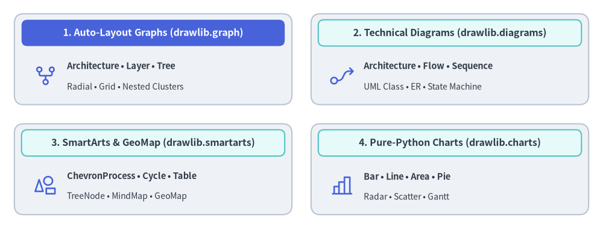

# Drawlib ドキュメント

Drawlib は、**「Illustration as Code（コードとしての図解）」** および **「Illustrated Documentation as Code（コードとしての図解ドキュメント）」** のために設計された、ピュア Python の描画ライブラリ兼ドキュメントコンパイラです。


<figure class="drawlib-image" style="text-align: center;">
  
  <figcaption class="drawlib-caption">Drawlib による自律型 AI ドキュメント作成ワークフロー（Drawlib で生成された APNG アニメーション）</figcaption>
</figure>


<div style="text-align: center; margin-top: -1.25rem; margin-bottom: 2rem; font-size: 0.88rem;">
  <a href="https://github.com/yuichi110/drawlib/blob/main/docs/docs_src/ja/index.md" target="_blank" rel="noopener noreferrer">GitHub でアニメーションのソースコードを見る &rarr;</a>
</div>

現代のソフトウェアエンジニアリングと **自律型 AI コーディングエージェント** のためにゼロから設計された Drawlib は、手作業の GUI 作図ツールや管理しづらいバイナリ画像ファイルを不要にします。開発者や LLM エージェントは、出版品質のアーキテクチャ図、フローチャート、データチャート、そして複数ページからなる本格的なドキュメントサイトまで、すべてを宣言的な Python コードのみで作成・バージョン管理・公開できます。

> **Note — Drawlib と Gemini による自律構築:**
> 本ドキュメントのすべての本文と図版は、**Drawlib** と **Gemini Coding Agent**（**Antigravity IDE** 上で稼働）を用いて、この Git リポジトリ内で直接作成されました。人間の関与はハイレベルな指示（プロンプト）のみにとどまり、ドキュメント構成の設計、技術解説の執筆、図版のデザイン、そして視覚的なレイアウト検証まですべて Gemini が自律的に実行しています。

---

## 主要な 3 つの柱

### 1. AI 駆動のドキュメント構築パイプライン
Drawlib は、AI コーディングエージェント（Claude Code、Cursor、Gemini など）が技術ドキュメントを自律的に執筆・保守できるよう設計されています。
- **ルールとコンテキストのオンデマンド参照**: `drawlib rules show <topic>` により、必要な構文ルールや設計ガイドラインをピンポイントで参照できます。
- **マルチモーダル視覚検証ループ**: エージェントは座標グリッド付き画像（`-g`）を出力し、ラベルの収まりやコネクタの経路を視覚的に確認して、レイアウトの崩れを自律的に自己修正します。

### 2. 豊富な高水準ビジュアライゼーション
何百もの基本図形を手作業で組み合わせる必要はありません。Drawlib は実務ですぐに使える宣言的な高水準コンポーネントを提供します。
- **自動レイアウトグラフ (`drawlib.graph`)**: 重なりのない座標（`get_layout()`）、ネストされたクラスタ境界、および `offset()` による微調整を計算する宣言的グラフレイアウトソルバー（`ArchitectureGraph`、`LayerGraph`、`TreeGraph`、`RadialGraph`、`GridGraph`）を提供し、`drawlib.diagrams` や `drawlib.shapes` と組み合わせて描画できます。
- **SmartArts（スマートアート）**: プロセスパイプライン（`ChevronProcess`）、サイクル図（`Cycle`）、データテーブル（`Table`）、階層ツリー（`Tree`）などを備えています。
- **データチャート**: 外部のグラフ描画ライブラリへの追加依存なしに、ピュア Python で棒グラフ・折れ線グラフ・面グラフ・円グラフ・レーダーチャート・散布図・ガントチャートを描画できます。
- **テクニカルダイアグラム**: クラウドアーキテクチャ図（`ArchitectureDiagram`）、フロー図（`FlowDiagram`）、API シーケンス図（`SequenceDiagram`）、UML クラス図（`ClassDiagram`）、ER 図（`ERDiagram`）、ステートマシン図（`StateDiagram`）をサポートします。


<figure class="drawlib-image" style="text-align: center;">
  
  <figcaption class="drawlib-caption">Drawlib の高水準ビジュアライゼーション・エコシステム</figcaption>
</figure>

<details class="drawlib-code-details">
<summary>Source Code</summary>

```python
from drawlib.canvas import save, setup
from drawlib.icons import phosphor
from drawlib.shapes import rectangle
from drawlib.styles import Styles
from drawlib.text import text

setup(width=126, height=48)

hdr_white = Styles.WhiteBold.patch(text_size=11.5)
hdr_dark = Styles.DarkBold.patch(text_size=11.5)
body_bold = Styles.DarkBold.patch(text_size=10.5, halign="left")
body_sub = Styles.Dark.patch(text_size=10.0, halign="left")

# 1. Top-Left: Auto-Layout Graphs (Hero primary header)
rectangle((32.0, 35.5), width=58.0, height=19.0, style=Styles.Neutral.patch(shape_r=2.0))
rectangle((32.0, 41.0), width=55.0, height=5.5, style=Styles.PrimaryFlat.patch(shape_r=1.2), text="1. Auto-Layout Graphs (drawlib.graph)", text_style=hdr_white)
phosphor.git_fork((9.5, 32.0), width=5.2, style=Styles.Primary)
text((14.0, 34.0), "Architecture • Layer • Tree", style=body_bold)
text((14.0, 29.8), "Radial • Grid • Nested Clusters", style=body_sub)

# 2. Top-Right: Technical Diagrams
rectangle((94.0, 35.5), width=58.0, height=19.0, style=Styles.Neutral.patch(shape_r=2.0))
rectangle((94.0, 41.0), width=55.0, height=5.5, style=Styles.SecondaryNeutral.patch(shape_r=1.2), text="2. Technical Diagrams (drawlib.diagrams)", text_style=hdr_dark)
phosphor.flow_arrow((71.5, 32.0), width=5.2, style=Styles.Primary)
text((76.0, 34.0), "Architecture • Flow • Sequence", style=body_bold)
text((76.0, 29.8), "UML Class • ER • State Machine", style=body_sub)

# 3. Bottom-Left: SmartArts & GeoMap
rectangle((32.0, 12.5), width=58.0, height=19.0, style=Styles.Neutral.patch(shape_r=2.0))
rectangle((32.0, 18.0), width=55.0, height=5.5, style=Styles.SecondaryNeutral.patch(shape_r=1.2), text="3. SmartArts & GeoMap (drawlib.smartarts)", text_style=hdr_dark)
phosphor.shapes((9.5, 9.0), width=5.2, style=Styles.Primary)
text((14.0, 11.0), "ChevronProcess • Cycle • Table", style=body_bold)
text((14.0, 6.8), "TreeNode • MindMap • GeoMap", style=body_sub)

# 4. Bottom-Right: Pure-Python Charts
rectangle((94.0, 12.5), width=58.0, height=19.0, style=Styles.Neutral.patch(shape_r=2.0))
rectangle((94.0, 18.0), width=55.0, height=5.5, style=Styles.SecondaryNeutral.patch(shape_r=1.2), text="4. Pure-Python Charts (drawlib.charts)", text_style=hdr_dark)
phosphor.chart_bar((71.5, 9.0), width=5.2, style=Styles.Primary)
text((76.0, 11.0), "Bar • Line • Area • Pie", style=body_bold)
text((76.0, 6.8), "Radar • Scatter • Gantt", style=body_sub)

save()
```

</details>


### 3. 統合ドキュメントコンパイラ
標準の Markdown ファイル内に ````drawlib```` ブロックを埋め込んで技術仕様書やシステムアーキテクチャを記述すれば、1 つのコマンド（`drawlib build`）ですべてを以下の形式へコンパイルできます。
- **レスポンシブ HTML サイト (`docs_html/`)**: サイドバーナビゲーションと即時検索を備えた完全な静的 Web サイト。
- **GitHub 用 Markdown (`docs/`)**: シンタックスハイライトされたコードと相対パスの埋め込み画像を含むクリーンな Markdown。
- **ヘッドレス PDF (`docs.pdf`)**: Chromium 経由で生成される出版品質のベクター PDF。

---

## ドキュメントロードマップ

以下の包括的なガイドから各機能の詳細を確認できます。

1. [**はじめに**](./01_getting_started/overview.md)
   - 基本設計思想、インストール、クイックスタート、座標系の原則、プロジェクト構成、および AI エージェント設定。
2. [**描画プリミティブとスタイル**](./02_drawing_primitives/canvas.md)
   - 低レベルのベクター図形、多角形、ドメインプリミティブ、ブロック矢印、線、タイポグラフィ、フォント、画像処理、プリセットテーマ、カラーパレット。
3. [**アイコンとブランドスイート**](./03_icons/overview.md)
   - 全 34 アイコンモジュール（合計 4,538 種の標準アイコン）: Phosphor ベクターアイコン、GCP・AWS・Azure クラウドアイコン、15 種の公式ドメインブランドスイート、および 15 種のベンダー中立な Original 2D パステルアイコンスイート。
4. [**SmartArts（スマートアート）**](./04_smartarts/overview.md)
   - 高水準インフォグラフィックス: プロセスパイプライン、サイクル図、データテーブル、階層ツリー、マインドマップ、グリッド、ピラミッド、リスト、ソースコードブロック、地理マップ。
5. [**Charts（定量チャート）**](./05_charts/overview.md)
   - 宣言的データプロット: 軸と凡例、棒グラフ、折れ線グラフ、面グラフ、円グラフ、レーダーチャート、散布図、プロジェクト用ガントチャート。
6. [**テクニカルダイアグラム**](./06_diagrams/overview.md)
   - 座標制御型のエンジニアリング図版: クラウドアーキテクチャ図、フロー図、シーケンス図、UML クラス図、ER 図、ステートマシン図。
7. [**自動レイアウトグラフ**](./07_graph/overview.md)
   - 宣言的グラフレイアウトソルバー（`ArchitectureGraph`、`LayerGraph`、`TreeGraph`、`RadialGraph`、`GridGraph`）、ネストされたクラスタ、`offset()` による微調整、コードエクスポート。
8. [**アニメーション（APNG & WebP）**](./08_animations/overview.md)
   - マルチフレームアニメーション、滑らかな色遷移、コンポーネントの段階的表示、矢印の伸長（`draw_ratio`）、および全 Drawlib モジュール横断のカメラパン・ズーム。
9. [**ドキュメントビルダと CLI**](./09_doc_builder_and_cli/overview.md)
   - コードとしての図解ドキュメント: Markdown コードブロック構文、CLI リファレンス、プロジェクトテンプレート（`doc`、`site`、`slide`、`images`）、1920×1080 スライドステージレイアウト、カスタマイズ、2 層キャッシュ機構と CI/CD。
10. [**AI エージェントと高度な統合**](./10_ai_agents_and_advanced/ai_agent_instructions.md)
    - 自律型エージェント向け指示ルール、視覚的自己修正フィードバックループ、プログラマティック Python API、幾何・数学ユーティリティ、トラブルシューティング。
