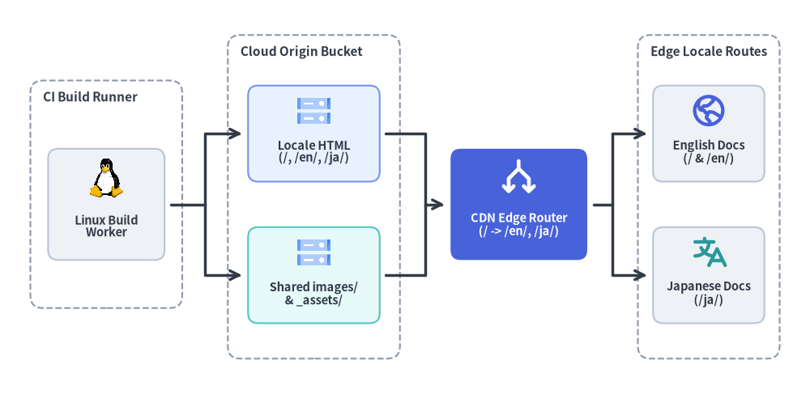
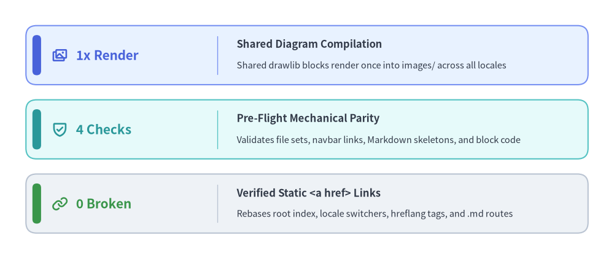

# System Architecture

Drawlib compiles multi-locale documentation sources (`i18n.toml`) into a unified static asset tree backed by single-render shared diagrams and zero-JS edge routing. Return to the [Overview](../index.md) or explore the [Localization Workflow](../workflow/index.md) for authoring conventions.


<figure class="drawlib-image" style="text-align: center;">
  
  <figcaption class="drawlib-caption">Cloud & Edge Multi-Locale Documentation Delivery Topology</figcaption>
</figure>

<details class="drawlib-code-details">
<summary>Source Code</summary>

```python
from drawlib.canvas import save, setup
from drawlib.diagrams.architecture import ArchitectureDiagram, GcpIcon, Node, NodeGroup, PhosphorIcon
from drawlib.images import image
from drawlib.styles import Style, Styles

setup(width=160, height=78)


def linux_worker_icon(xy: tuple[float, float], width: float, *, style: Style) -> None:
    image(xy, width=width * 0.80, image="_assets/linux.png")


d = ArchitectureDiagram(
    node_style=Styles.PrimaryBold,
    node_text_style=Styles.DarkBold.patch(text_size=10.5),
    edge_style=Styles.DarkBold,
    edge_text_style=Styles.DarkBold.patch(text_size=10.5),
    node_card_style=Styles.Neutral.patch(shape_r=2.0),
)

group_title_style = Styles.DarkBold.patch(text_size=11.0, halign="left", valign="top")

ci_group = d.add(
    NodeGroup(
        title="CI Build Runner",
        width=30.0,
        height=45.0,
        padding=3.0,
        style=Styles.MutedDashed.patch(shape_r=2.5),
        text_style=group_title_style,
    ),
    xy=(6.0, 17.0),
)
worker = ci_group.add(
    Node(
        "Linux Build\nWorker",
        width=23.0,
        height=22.0,
        icon=linux_worker_icon,
        icon_size=8.2,
        card_style=Styles.Neutral.patch(shape_r=2.0),
    ),
    xy=(15.0, 20.5),
)

origin_group = d.add(
    NodeGroup(
        title="Cloud Origin Bucket",
        width=34.0,
        height=64.0,
        padding=3.0,
        style=Styles.MutedDashed.patch(shape_r=2.5),
        text_style=group_title_style,
    ),
    xy=(45.0, 7.0),
)
origin_html = origin_group.add(
    Node(
        "Locale HTML\n(/, /en/, /ja/)",
        width=26.0,
        height=19.0,
        icon=GcpIcon.CLOUD_STORAGE,
        icon_size=7.2,
        card_style=Styles.PrimaryNeutral.patch(shape_r=2.0),
    ),
    xy=(17.0, 44.5),
)
origin_assets = origin_group.add(
    Node(
        "Shared images/\n& _assets/",
        width=26.0,
        height=19.0,
        icon=GcpIcon.CLOUD_STORAGE,
        icon_size=7.2,
        card_style=Styles.SecondaryNeutral.patch(shape_r=2.0),
    ),
    xy=(17.0, 16.5),
)

edge_router = d.add(
    Node(
        "CDN Edge Router\n(/ -> /en/, /ja/)",
        width=27.0,
        height=22.0,
        icon=PhosphorIcon.ARROWS_SPLIT,
        icon_size=7.8,
        style=Styles.WhiteBold,
        text_style=Styles.WhiteBold.patch(text_size=10.5),
        card_style=Styles.PrimaryFlat.patch(shape_r=2.0),
    ),
    xy=(102.5, 37.5),
)

routes_group = d.add(
    NodeGroup(
        title="Edge Locale Routes",
        width=28.0,
        height=64.0,
        padding=3.0,
        style=Styles.MutedDashed.patch(shape_r=2.5),
        text_style=group_title_style,
    ),
    xy=(126.0, 7.0),
)
route_en = routes_group.add(
    Node(
        "English Docs\n(/ & /en/)",
        width=22.0,
        height=19.0,
        icon=PhosphorIcon.GLOBE_HEMISPHERE_WEST,
        icon_size=7.2,
        card_style=Styles.Neutral.patch(shape_r=2.0),
    ),
    xy=(14.0, 44.5),
)
route_ja = routes_group.add(
    Node(
        "Japanese Docs\n(/ja/)",
        width=22.0,
        height=19.0,
        icon=PhosphorIcon.TRANSLATE,
        icon_size=7.2,
        style=Styles.SecondaryBold,
        card_style=Styles.Neutral.patch(shape_r=2.0),
    ),
    xy=(14.0, 16.5),
)

build_fork = d.junction(xy=(40.5, 37.5))
d.connect(worker, build_fork, arrow="-", padding=(1.2, 0.0))
d.connect(build_fork, origin_html, arrow="->", padding=(0.0, 1.2)).via((40.5, 51.5))
d.connect(build_fork, origin_assets, arrow="->", padding=(0.0, 1.2)).via((40.5, 23.5))

origin_merge = d.junction(xy=(84.0, 37.5))
d.connect(origin_html, origin_merge, arrow="-", padding=(1.2, 0.0)).via((84.0, 51.5))
d.connect(origin_assets, origin_merge, arrow="-", padding=(1.2, 0.0)).via((84.0, 23.5))
d.connect(origin_merge, edge_router, arrow="->", padding=(0.0, 1.2))

edge_fork = d.junction(xy=(121.0, 37.5))
d.connect(edge_router, edge_fork, arrow="-", padding=(1.2, 0.0))
d.connect(edge_fork, route_en, arrow="->", padding=(0.0, 1.2)).via((121.0, 51.5))
d.connect(edge_fork, route_ja, arrow="->", padding=(0.0, 1.2)).via((121.0, 23.5))

d.draw(xy=(0.0, 0.0))
save()
```

</details>


## Build Pipeline & Parity Guarantees

Every multi-locale build executes inside a headless Linux worker that validates structural parity across all configured languages before compiling HTML and Markdown targets:

| Architectural Layer | Responsibility | Key Artifact / Mechanism |
| :--- | :--- | :--- |
| **Linux Build Worker** | Runs pre-flight checks and executes Python drawing blocks headlessly | `i18n.toml`, `styles.py`, `utils.py`, `_assets/linux.png` |
| **Locale HTML Origin** | Emits root landing page plus isolated per-language HTML trees | `index.html`, `en/**/*.html`, `ja/**/*.html` |
| **Shared Asset Bucket** | Deduplicates identical diagrams across locales into one shared path | `images/<page>/<file>.png`, `_assets/*` |
| **CDN Edge Router** | Serves cached static HTML and shared PNGs with `hreflang` metadata | `/` (default `en`), `/en/`, `/ja/` |


<figure class="drawlib-image" style="text-align: center;">
  
  <figcaption class="drawlib-caption">Multi-Locale Build Efficiency & Structural Verification KPIs</figcaption>
</figure>

<details class="drawlib-code-details">
<summary>Source Code</summary>

```python
from drawlib.canvas import save, setup
from drawlib.icons import phosphor
from drawlib.smartarts import KpiCards
from drawlib.styles import Styles

setup(width=142, height=60)

kpi = KpiCards(
    style=Styles.PrimaryNeutral,
    metric_style=Styles.PrimaryBold.patch(text_size=15.0),
    text_style=Styles.DarkBold.patch(text_size=12.0),
    description_style=Styles.Dark.patch(text_size=10.5),
    accent_style=Styles.PrimaryFlat,
    icon_style=Styles.PrimaryBold,
    accent_position="left_pill",
    metric_layout="left_column",
    metric_width_ratio=0.34,
    spacing=3.5,
)

kpi.add(
    "1x Render",
    "Shared Diagram Compilation",
    "Shared drawlib blocks render once into images/ across all locales",
    icon=phosphor.images,
)
kpi.add(
    "4 Checks",
    "Pre-Flight Mechanical Parity",
    "Validates file sets, navbar links, Markdown skeletons, and block code",
    style=Styles.SecondaryNeutral,
    metric_style=Styles.SecondaryBold.patch(text_size=15.0),
    accent_style=Styles.SecondaryFlat,
    icon=phosphor.shield_check,
    icon_style=Styles.SecondaryBold,
)
kpi.add(
    "0 Broken",
    "Verified Static <a href> Links",
    "Rebases root index, locale switchers, hreflang tags, and .md routes",
    style=Styles.Neutral,
    metric_style=Styles.SuccessBold.patch(text_size=15.0),
    accent_style=Styles.SuccessFlat,
    icon=phosphor.link,
    icon_style=Styles.SuccessBold,
)

kpi.draw(xy=(6.0, 6.0), width=130.0, height=48.0, columns=1, align="bottom_left")
save()
```

</details>


## Edge Routing & Shared Asset Deduplication

By separating localized prose from language-neutral system diagrams, the delivery architecture keeps build times constant as new locales are added:

- **Root Entry Rebasing (`index.html`)**: The `default_lang` landing page (`en/index.md`) is compiled directly to the root `index.html` with relative links automatically rebased toward `en/...`, `images/...`, and `_assets/...`.
- **Single-Copy Shared Diagrams (`images/`)**: Because both `en/architecture/index.md` and `ja/architecture/index.md` declare identical `drawlib` blocks (`cloud_topology.png` and `build_kpi_metrics.png`), the build worker renders each PNG once and shares CDN cache hits across every locale.
- **Pure HTML Locale Switcher**: Each compiled page embeds static `<a href>` language switcher links and `<link rel="alternate" hreflang="...">` headers without client-side JavaScript routers. See the [Localization Workflow](../workflow/index.md) for step-by-step translation and parity verification practices, or return to the [Overview](../index.md).
