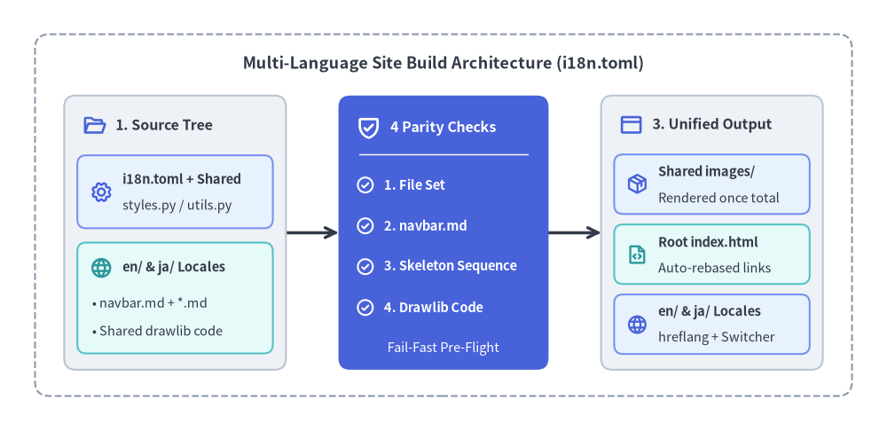
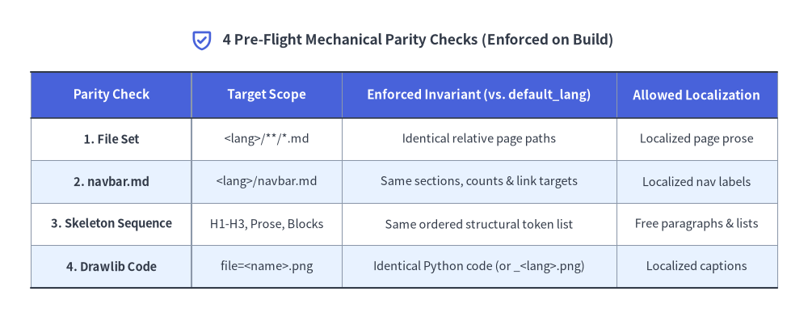

# 多言語ドキュメントサイト・ショーケース

[Drawlib](https://github.com/yuichi110/drawlib) で構築された多言語ドキュメントサイトのショーケースへようこそ。ルート直下の `i18n.toml` 設定に基づき、英語（`en/`）と日本語（`ja/`）の Markdown ツリーから、共有図解アセット・自動リンク補正・言語スイッチャーを備えた統合静的 Web サイトを一括生成します。


<figure class="drawlib-image" style="text-align: center;">
  
  <figcaption class="drawlib-caption">多言語サイトのビルドパイプライン：ロケール別ソースと一貫性検査から統合静的サイト出力まで</figcaption>
</figure>

<details class="drawlib-code-details">
<summary>Source Code</summary>

```python
from drawlib.canvas import setup
from drawlib.icons import phosphor
from drawlib.lines import line
from drawlib.shapes import rectangle
from drawlib.styles import Styles
from drawlib.text import text

setup(width=152, height=74)

# Layer 1: Outer structural boundary (6.0-unit perimeter margin)
rectangle((76.0, 37.0), width=140.0, height=62.0, style=Styles.MutedDashed.patch(shape_r=2.5))
text(
    (76.0, 63.0),
    "Multi-Language Site Build Architecture (i18n.toml)",
    style=Styles.DarkBold.patch(text_size=13.0),
)

# Layer 2: Inter-stage pipeline connectors (snapped to card boundary ports)
line((49.0, 34.0), (58.0, 34.0), arrow_head="->", style=Styles.DarkBold)
line((94.0, 34.0), (103.0, 34.0), arrow_head="->", style=Styles.DarkBold)

# Layer 3A: Stage 1 — Locale Source Tree (Neutral container + tinted-neutral sub-cards)
rectangle((30.0, 34.0), width=38.0, height=47.0, style=Styles.Neutral.patch(shape_r=2.0))
phosphor.folder_open((16.2, 52.5), width=4.2, style=Styles.PrimaryBold)
text((19.8, 52.5), "1. Source Tree", style=Styles.DarkBold.patch(text_size=11.5, halign="left"))

rectangle((30.0, 41.0), width=33.5, height=12.5, style=Styles.PrimaryNeutral.patch(shape_r=1.5))
phosphor.gear((17.4, 41.0), width=4.0, style=Styles.PrimaryBold)
text((21.0, 43.2), "i18n.toml + Shared", style=Styles.DarkBold.patch(text_size=10.5, halign="left"))
text((21.0, 38.6), "styles.py / utils.py", style=Styles.Dark.patch(text_size=10.5, halign="left"))

rectangle((30.0, 22.8), width=33.5, height=19.0, style=Styles.SecondaryNeutral.patch(shape_r=1.5))
phosphor.globe((17.4, 28.0), width=4.0, style=Styles.SecondaryBold)
text((21.0, 28.0), "en/ & ja/ Locales", style=Styles.DarkBold.patch(text_size=10.5, halign="left"))
text((15.8, 22.0), "• navbar.md + *.md", style=Styles.Dark.patch(text_size=10.5, halign="left"))
text((15.8, 17.2), "• Shared drawlib code", style=Styles.Dark.patch(text_size=10.5, halign="left"))

# Layer 3B: Stage 2 — Single PrimaryFlat Focal Card (4 Pre-Flight Parity Checks)
rectangle((76.0, 34.0), width=36.0, height=47.0, style=Styles.PrimaryFlat.patch(shape_r=2.0))
phosphor.shield_check((63.2, 52.0), width=4.4, style=Styles.WhiteBold)
text((66.9, 52.0), "4 Parity Checks", style=Styles.WhiteBold.patch(text_size=11.5, halign="left"))
line((61.5, 47.5), (90.5, 47.5), style=Styles.White.patch(line_width=1.0))

checks = [
    (42.2, "1. File Set"),
    (35.2, "2. navbar.md"),
    (28.2, "3. Skeleton Sequence"),
    (21.2, "4. Drawlib Code"),
]
for cy, label in checks:
    phosphor.check_circle((62.6, cy), width=3.4, style=Styles.WhiteBold)
    text((65.8, cy), label, style=Styles.WhiteBold.patch(text_size=10.5, halign="left"))

text((76.0, 14.2), "Fail-Fast Pre-Flight", style=Styles.White.patch(text_size=10.5))

# Layer 3C: Stage 3 — Compiled Multi-Locale Output (Neutral container + neutral sub-cards)
rectangle((122.0, 34.0), width=38.0, height=47.0, style=Styles.Neutral.patch(shape_r=2.0))
phosphor.browser((108.2, 52.5), width=4.2, style=Styles.PrimaryBold)
text((111.8, 52.5), "3. Unified Output", style=Styles.DarkBold.patch(text_size=11.5, halign="left"))

rectangle((122.0, 42.3), width=33.5, height=10.2, style=Styles.PrimaryNeutral.patch(shape_r=1.5))
phosphor.package((109.2, 42.3), width=3.8, style=Styles.PrimaryBold)
text((112.8, 44.4), "Shared images/", style=Styles.DarkBold.patch(text_size=10.5, halign="left"))
text((112.8, 40.0), "Rendered once total", style=Styles.Dark.patch(text_size=10.5, halign="left"))

rectangle((122.0, 30.3), width=33.5, height=10.2, style=Styles.SecondaryNeutral.patch(shape_r=1.5))
phosphor.file_code((109.2, 30.3), width=3.8, style=Styles.SecondaryBold)
text((112.8, 32.4), "Root index.html", style=Styles.DarkBold.patch(text_size=10.5, halign="left"))
text((112.8, 28.0), "Auto-rebased links", style=Styles.Dark.patch(text_size=10.5, halign="left"))

rectangle((122.0, 18.3), width=33.5, height=10.2, style=Styles.PrimaryNeutral.patch(shape_r=1.5))
phosphor.globe((109.2, 18.3), width=3.8, style=Styles.PrimaryBold)
text((112.8, 20.4), "en/ & ja/ Locales", style=Styles.DarkBold.patch(text_size=10.5, halign="left"))
text((112.8, 16.0), "hreflang + Switcher", style=Styles.Dark.patch(text_size=10.5, halign="left"))
```

</details>


## 1. 機械的パリティ検査と単一レンダリング設計

多言語ドキュメント運用では、一方の言語だけでページ追加・ナビゲーション変更・構成図の更新が行われ、言語間で構造的な乖離（翻訳ドリフト）が発生しがちです。Drawlib は画像描画を開始する前に、すべてのロケールディレクトリを基準言語 `default_lang`（`en/`）と照合する **4つの機械的パリティ検査**を自動実行し、構造の不整合を即座に検出します：

- **1. ファイルセットの一致（File Set Parity）**: 各ロケール（`en/`・`ja/`）の相対 `.md` / `.html` ファイル構成が完全に一致していることを検証します。
- **2. サイドバー構造の一致（`navbar.md` Parity）**: セクション数・見出しの有無・リンク数・正規化リンク先が一致していることを検査しつつ、表示ラベルの自然な翻訳を許容します。
- **3. ページ骨格シーケンスの一致（Skeleton Sequence Parity）**: `Heading(H1..H3)`・`MarkdownText`・`DrawlibBlock`・`CodeBlock` の順序構造を検証します。連続する段落・箇条書き・表・引用は単一の `MarkdownText` トークンに集約されるため、日本語として自然な文章構成で自由に記述できます。
- **4. 図解コードの一致と単一描画（Drawlib Code Parity）**: 同一ファイル名（`file=<name>.png`）の共有図解は Python コードの完全一致が保証され、`images/` へ **1回だけ描画**されます。図中テキストを翻訳したい場合は `file=<stem>_<lang>.png` を指定することで言語別描画に切り替えられます。


<figure class="drawlib-image" style="text-align: center;">
  
  <figcaption class="drawlib-caption">全ロケール間でビルド前に自動実行される4つの機械的パリティ検査マトリクス</figcaption>
</figure>

<details class="drawlib-code-details">
<summary>Source Code</summary>

```python
from drawlib.canvas import setup
from drawlib.icons import phosphor
from drawlib.smartarts import Table
from drawlib.styles import Colors, Styles
from drawlib.text import text

setup(width=156, height=62)

phosphor.shield_check((39.0, 54.2), width=4.4, style=Styles.PrimaryBold)
text(
    (43.0, 54.2),
    "4 Pre-Flight Mechanical Parity Checks (Enforced on Build)",
    style=Styles.DarkBold.patch(text_size=12.5, halign="left"),
)

table = Table(
    cell_style=Styles.White,
    text_style=Styles.Dark.patch(text_size=10.5),
    header_cell_style=Styles.PrimaryFlat,
    header_text_style=Styles.WhiteBold.patch(text_size=11.0),
    border_style=Styles.MutedThin,
)

table.set_style_cell_evenodd(
    even_color=Colors.PrimaryNeutral,
    even_text_style=Styles.Dark.patch(text_size=10.5),
    odd_color=Colors.White,
    odd_text_style=Styles.Dark.patch(text_size=10.5),
)
table.set_style_cell(
    background_color=Colors.White,
    text_style=Styles.DarkBold.patch(text_size=10.5),
    rows=[1, 3],
    columns=[0],
)
table.set_style_cell(
    background_color=Colors.PrimaryNeutral,
    text_style=Styles.DarkBold.patch(text_size=10.5),
    rows=[2, 4],
    columns=[0],
)
table.set_style_cell_header(
    background_color=Colors.Primary,
    text_style=Styles.WhiteBold.patch(text_size=11.0),
)

table.set_style_border(
    top=Styles.Dark.patch(line_width=1.5),
    top2=Styles.Dark.patch(line_width=1.2),
    bottom=Styles.Dark.patch(line_width=1.5),
    left=Styles.MutedThin,
    left2=Styles.Muted,
    right=Styles.MutedThin,
    between_columns=Styles.MutedThin,
    between_rows=Styles.MutedThin,
)

parity_rows = [
    ["Parity Check", "Target Scope", "Enforced Invariant (vs. default_lang)", "Allowed Localization"],
    ["1. File Set", "<lang>/**/*.md", "Identical relative page paths", "Localized page prose"],
    ["2. navbar.md", "<lang>/navbar.md", "Same sections, counts & link targets", "Localized nav labels"],
    ["3. Skeleton Sequence", "H1-H3, Prose, Blocks", "Same ordered structural token list", "Free paragraphs & lists"],
    ["4. Drawlib Code", "file=<name>.png", "Identical Python code (or _<lang>.png)", "Localized captions"],
]

table.draw_flexible(
    xy=(6.0, 48.0),
    column_widths=[31.0, 29.0, 53.0, 31.0],
    row_heights=[8.8, 8.2, 8.2, 8.2, 8.2],
    data=parity_rows,
    align="top_left",
)
```

</details>


## 2. ショーケース各章のガイド

すべてのパリティ検査を通過すると、Drawlib は各ロケール向けページ（`en/**/*.html`・`ja/**/*.html`）に `<html lang="...">` 属性・Google Fonts・`hreflang` タグ・右上言語スイッチャーを付与して出力し、同時に基準言語 `default_lang` から相対リンクを自動補正したルート `index.html` を生成します。各章の実装例は以下からご覧いただけます：

- **[システムアーキテクチャ](architecture/index.md)**: クラウド・マイクロサービス構成図、`styles.py` と `utils.py` による共通テーマ管理、および全ロケール間で共有されるアーキテクチャ図の設計例。
- **[ローカライズ・ワークフロー](workflow/index.md)**: 多言語ドキュメントの執筆・更新フロー、スケルトントークンの集約仕様、および日本語フォントを用いた言語別図解（`file=<stem>_<lang>.png`）の実装手順。
