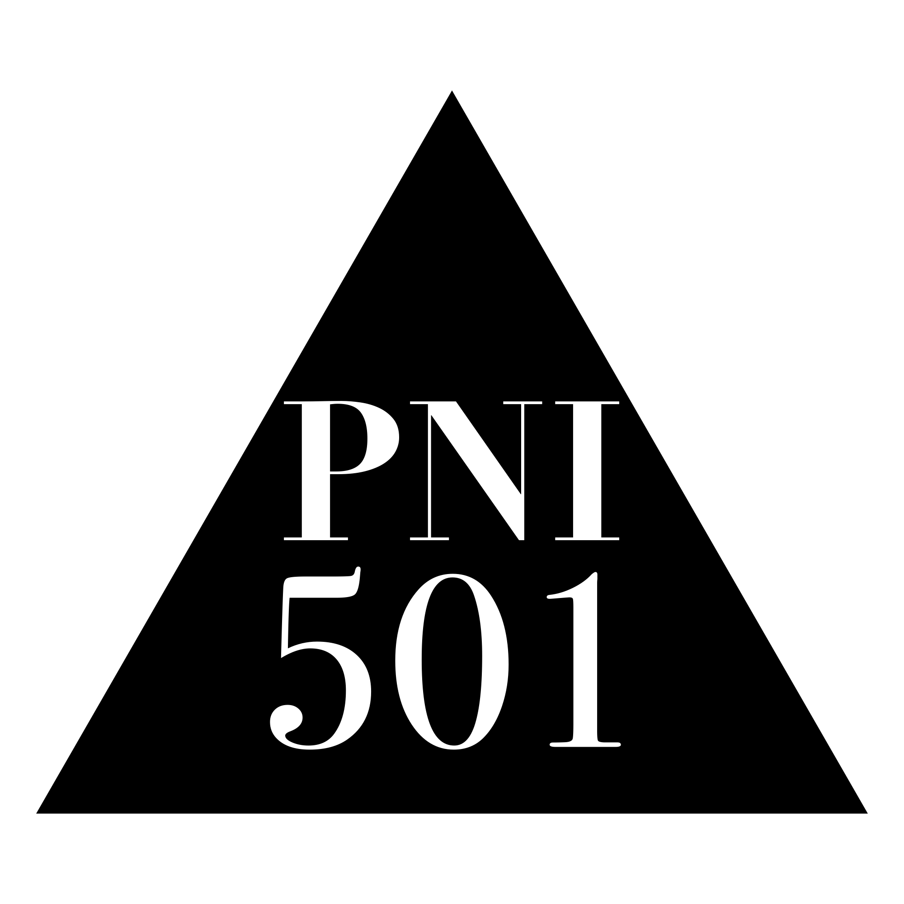

<div class="pni-cover-brand">
  
</div>

# PNI Software Health Diagnostic Report

**Target System: `drawlib` (`v0.3.5`) — Static AST, Architectural Boundary, Hermetic Container Runtime & Supply-Chain Security Audit**

```drawlib align=center code=hide file=ch00_cover_scorecard.png caption="Drawlib v0.3.5 — PNI501 Full Audit Executive Scorecard (Workflow Run wf-8093775c)"
from drawlib.canvas import save, setup
from drawlib.icons import phosphor
from drawlib.shapes import rectangle
from drawlib.smartarts import KpiCards, Panel
from drawlib.styles import Styles
from drawlib.text import text

setup(width=160, height=62, dpi=180)

outer = Panel(
    "PNI501 Software Health Scorecard — drawlib v0.3.5",
    "Run: wf-8093775c (full_audit)",
    style=Styles.Neutral.patch(shape_r=2.5),
    header_style=Styles.PrimaryFlat,
    text_style=Styles.WhiteBold.patch(text_size=11.5),
    description_style=Styles.White.patch(text_size=10.0),
    icon=phosphor.shield_check,
    icon_style=Styles.White,
    dot_styles=(
        Styles.DangerFlat.patch(shape_line_width=0),
        Styles.WarningFlat.patch(shape_line_width=0),
        Styles.SuccessFlat.patch(shape_line_width=0),
    ),
    header_variant="window",
    header_height=8.8,
)
outer.draw((4.0, 3.0), width=152.0, height=56.0, align="bottom_left")
inner_xy, inner_w, inner_h = outer.get_content_box(
    (4.0, 3.0),
    width=152.0,
    height=56.0,
    padding=(3.8, 3.0),
    align="bottom_left",
)

# Left Hero Score Card
badge_w = 48.0
badge_cx = inner_xy[0] + badge_w / 2.0
badge_cy = inner_xy[1] + inner_h / 2.0
rectangle(
    (badge_cx, badge_cy),
    width=badge_w,
    height=inner_h,
    style=Styles.PrimaryFlat.patch(shape_r=2.2),
)
phosphor.medal((badge_cx, badge_cy + 13.5), width=6.0, style=Styles.WhiteBold)
text((badge_cx, badge_cy + 4.8), "94 / 100", style=Styles.WhiteBold.patch(text_size=21.0))
rectangle(
    (badge_cx, badge_cy - 3.6),
    width=28.0,
    height=5.6,
    style=Styles.White.patch(shape_r=2.8),
)
text((badge_cx, badge_cy - 3.6), "GRADE S", style=Styles.PrimaryBold.patch(text_size=11.0))
text(
    (badge_cx, badge_cy - 11.5),
    "Overall Health Score",
    style=Styles.White.patch(text_size=10.0),
)
text(
    (badge_cx, badge_cy - 17.0),
    "Docs 97  |  Typing 96  |  Sec 94",
    style=Styles.WhiteBold.patch(text_size=9.5),
)

# Right 2x2 Headline KPI Grid
kpi_x = inner_xy[0] + badge_w + 4.0
kpi_w = inner_w - badge_w - 4.0
kpis = KpiCards(
    style=Styles.White,
    metric_style=Styles.PrimaryBold.patch(text_size=15.5),
    text_style=Styles.DarkBold.patch(text_size=10.8),
    description_style=Styles.Muted.patch(text_size=9.5),
    accent_style=Styles.PrimaryFlat,
    accent_position="top_bar",
    metric_layout="top_stack",
    spacing=2.8,
)
kpis.add(
    "Python 3.11+",
    "Target Language & Scale",
    "424 modules  |  85,323 LOC  |  150 tests",
)
kpis.add(
    "11 / 16",
    "Engineering Rules Passed",
    "11 PASS  |  5 WARN  |  0 FAIL across 8 audits",
    accent_style=Styles.SecondaryFlat,
    metric_style=Styles.SecondaryBold.patch(text_size=15.5),
)
kpis.add(
    "99.5%",
    "Offline Pass & 86.3% Cov",
    "1,405 / 1,412 offline tests  |  75.5% branch",
)
kpis.add(
    "0 CVEs",
    "Supply-Chain & IaC Status",
    "pillow>=13.0.0 · UID 10001 · 5 waivers",
    accent_style=Styles.SuccessFlat,
    metric_style=Styles.SuccessBold.patch(text_size=15.5),
)
kpis.draw((kpi_x, inner_xy[1]), width=kpi_w, height=inner_h, columns=2, align="bottom_left")

save()
```

### Diagnostic Scope & Audit Metadata

End-to-end engineering assessment of **`drawlib` (`v0.3.5`)** executed via **`pni501` (`full_audit`)**, combining deterministic Python AST verification, layered dependency analysis, hermetic `--network=none` container runtime testing, Trivy supply-chain scanning, and `.pni/pni.toml` policy verification.

| Property | Value |
| :--- | :--- |
| **Target & Archetypes** | `drawlib` (`v0.3.5`, Python `>=3.11`, PEP 621 `uv`, `py.typed`) — `library` (20 facades) + `cli` (9 subcommands) |
| **Workflow & Policy** | `full_audit` (`wf-8093775c`, 17 steps, `.pni/pni.toml` with 5 architectural waivers) — Evaluated `2026-11-05` |
| **Codebase Footprint** | `424` source files (`85,323` LOC, `300` classes, `1,958` functions) & `150` test files (`1,420` collected items) |
| **Overall Health Score** | **94 / 100 (`Grade S`)** — Docs `97`, Typing `96`, Security `94`, Arch `93`, Testing `92`, Deps `91`, Quality `87` |
| **Compliance & Findings** | `11 / 16` rules `PASS` (`5 WARN`, `0 FAIL`) — `0` CVEs, `0` IaC misconfigs (`3` `P0/P1` fixes landed + `7` `P1/P2` follow-ups) |
